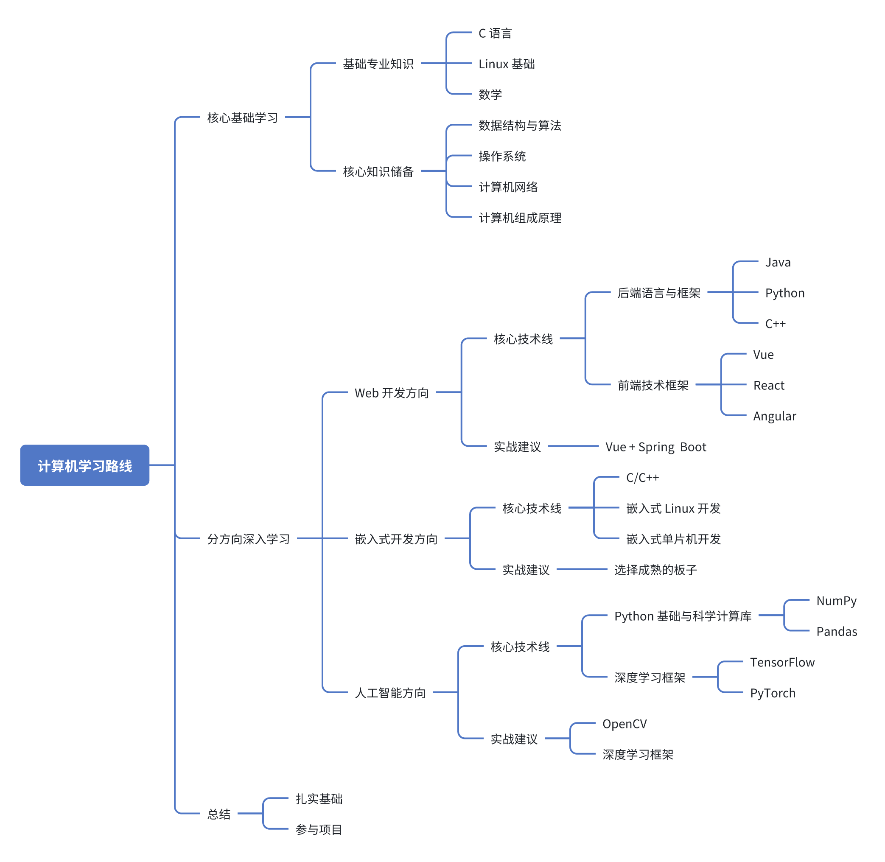

# 让后来者少走弯路

程序员的悲哀是什么？程序员出去创业以后发现，99%的问题都不是技术问题，技术没想象的那么重要；

程序员干的越久越发现，自己不懂的技术越来越多；程序员的世界全都是代码，当你离开这个岗位以后会发现，99%的世界其实跟编程没关系。

程序员的悲哀就是，想吃技术饭，想做架构师，想要走专家路线，但是国内软件开发绝大多数是应用开发，对技术的要求不高，对专家的需求很少。

最后才发现，自己的技术也没达到一定的高度，也没赚到钱，然后突然想明白了，我们都是普通人，我们都是打工人，这就是大多数程序员的现状。

在程序说明中，[] 并不是孤立使用的，它和一套符号体系配合，让语法一目了然:

| 符号       | 含义           | 示例                       |
| ---------- | -------------- | -------------------------- |
| `[ ]`      | 可选           | `ls [-l]` 表示 `-l` 可省略 |
| `< >`      | 必填的占位符   | `cp <source> <dest>`       |
| `{x \| y}` | 多选一（必填） | `{start\|stop}`            |
| `[x \| y]` | 多选一（可选） | `[-a\|-b]`                 |
| `...`      | 可重复         | `[file...]`                |

## 怎么总结: 用“一句话主线 + 四层收束”

总结部分建议写成四段式，每段对应前面链条的归并:

1. 是什么与为什么（归并概念理解、层级关系、为什么需要）: 一句话说清它是什么、在体系中处于哪一层、解决什么根本问题。

2. 怎么运作（归并工作原理、代码解读）: 一句话说清核心机制，代码解读只留“关键设计点”，不重复代码细节。

3. 边界与可控（归并能力边界、自主可控性）: 明确“能做什么/不能做什么”和“哪些环节可自主、哪些有依赖”。

4. 对比与判断（归并对比）: 给出选型或使用建议，一句话点明适用场景与不适用场景。

最后用一句判断句收尾，例如: “因此，X 适合 A 场景，不适合 B 场景；其自主可控的关键在于 C 环节。”
