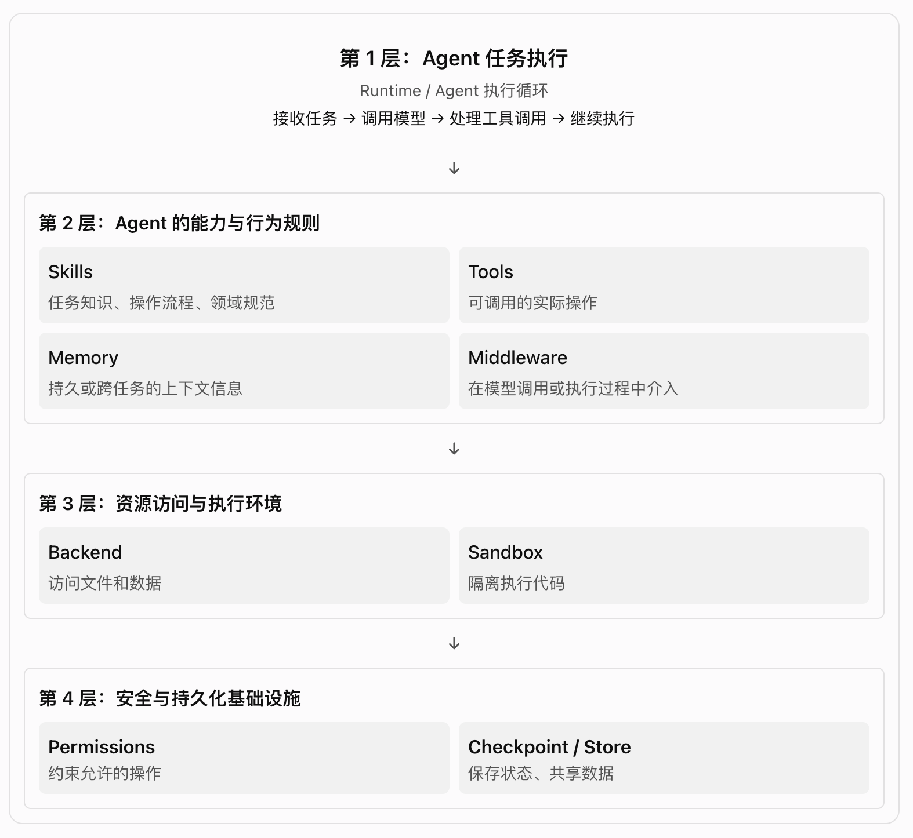

# DeepAgents-5.1-上下文管理-skills



## 一、Skill 与相关组件的区别

| 概念        | 核心职责                                   | 直白理解                         |
| ----------- | ------------------------------------------ | -------------------------------- |
| Skill       | 定义如何完成某类任务                       | 操作手册                         |
| Agent       | 根据目标、上下文和可用能力推进任务         | 执行任务的主体                   |
| Tool        | 提供可调用的具体操作                       | Agent 能使用的工具               |
| Memory      | 提供相对持久的背景信息                     | 项目规范、用户偏好等长期背景     |
| Middleware  | 将技能等机制接入 Agent，并在执行过程中介入 | Agent 执行流程中的扩展机制       |
| Backend     | 提供文件的访问与读写机制                   | 文件访问层                       |
| Runtime     | 驱动 Agent 的任务执行循环                  | 协调模型调用、工具调用和状态推进 |
| Permissions | 决定哪些操作被允许、拒绝或需要审批         | 操作规则                         |
| Sandbox     | 提供隔离的代码执行环境                     | 隔离的执行空间                   |

❗Skill 是可按需加载的任务知识与工作流程，不是一个独立的 Agent，也不是一个 Tool。

Memory 的例子包括项目规范、架构约定、用户偏好等相对持久的信息；这些信息可以通过 AGENTS.md 等文件提供。  
Skill 与 Memory 不同：Memory 主要提供背景，Skill 主要提供某类任务的操作方法。

## 二、Skill 文件结构

### 2.1 最基本的结构

一个 Skill 最少可以只包含一个 SKILL.md。当内容较多时，可以再配套 references/、scripts/、assets/ 等目录。

```bash
my-project/
└── skills/                         # 技能集合目录（常见约定，不是强制名称）
    ├── langgraph-docs/
    │   └── SKILL.md                # 技能入口说明
    │
    └── pdf-processing/
        ├── SKILL.md
        ├── references/
        │   └── schema-reference.md # 辅助参考资料
        ├── scripts/
        │   └── extract.py           # 脚本
        └── assets/
            └── template.json        # 模板、图片、Schema 等静态资源
```

不是每个 Skill 都需要三个子目录。简单的 Skill 只需要 SKILL.md。

### 2.2 SKILL.md 示例

```bash
---
name: langgraph-docs
description: >
  Use this skill for requests related to LangGraph
  in order to fetch relevant documentation and provide
  accurate, up-to-date guidance.
---

# langgraph-docs

辅助文件：
- `references/schema-reference.md`
  Contains the output schema and validation rules.
  Read it before producing structured extraction results.

## Instructions

1. Fetch the documentation index.
2. Select relevant documentation.
3. Fetch and synthesize the sources.
4. Include source links in the answer.
```

- Frontmatter 字段

  | 字段            | 是否必需               | 用途                                               |
  | --------------- | ---------------------- | -------------------------------------------------- |
  | `name`          | 是（按本文采用的约定） | 技能名称；通常要求与父目录名匹配                   |
  | `description`   | 是（按本文采用的约定） | 说明技能用途和适用场景                             |
  | `license`       | 否                     | 许可证信息                                         |
  | `compatibility` | 否                     | 环境要求，例如网络访问或系统依赖                   |
  | `metadata`      | 否                     | 自定义元数据                                       |
  | `allowed-tools` | 否                     | 为实验性的预批准工具列表；具体支持情况应按版本确认 |

### 2.3 文件组织与编写建议

- 技能发现阶段，模型主要先看到技能的 name 和 description。
- 建议将 SKILL.md 正文控制在约 5000 Token 以下，把详细参考资料拆到 references/ 等文件中。
- DeepAgents 的文件发现可能有单独的文件大小限制；本文资料提到超过 10 MB 的技能文件会被跳过，实际阈值应按所用版本核对。
- 辅助文件应在 SKILL.md 中明确引用，告诉 Agent 何时读取、如何使用。
- 避免不同 Skill 的描述大量重叠，否则模型不容易判断该使用哪一个。

### 2.4 skills/、SKILL.md、SkillsMiddleware、Backend 的区别

| 名称               | 所属层次       | 作用                                           |
| ------------------ | -------------- | ---------------------------------------------- |
| `skills/`          | 文件组织       | 常见的技能集合目录名，不是必须使用的特殊目录   |
| `SKILL.md`         | 技能内容       | 描述用途、触发场景、工作流程和注意事项         |
| `SkillsMiddleware` | Agent 集成机制 | 发现技能、加载元数据，并向模型提供技能使用说明 |
| `Backend`          | 资源访问       | 让中间件通过统一接口列出目录、读取文件等       |

❗ Backend 不决定 Skill 应该怎么写；Backend 决定的是中间件如何访问技能文件。

## 三、技能发现与加载

### 3.1 渐进式披露：分阶段提供信息

渐进式披露、SkillsMiddleware、skills、sources、pinned_skills。

- 一个常见的加载思路是：
  1. 发现技能： 扫描技能来源，读取 SKILL.md 的 frontmatter，获取 name 和 description。
  2. 匹配任务： 将可用技能名称与描述提供给模型，由 Agent 判断当前任务是否适用。
  3. 读取正文： 适用时，Agent 通过 read_file 等文件工具读取完整 SKILL.md。
  4. 按需读取资源： 再根据正文中的指引读取 references/、scripts/、assets/ 等文件。

```bash
Agent 开始运行
    ↓
SkillsMiddleware 检查技能元数据状态
    ↓
通过 Backend 扫描 sources
    ↓
读取各技能 SKILL.md 的元数据
    ↓
向模型提供技能名称与描述
    ↓
任务是否适用某个 Skill？
    ├── 不适用 → 按普通任务继续执行
    └── 适用
          ↓
       Agent 读取完整 SKILL.md
          ↓
       模型按技能指引规划操作
          ↓
       调用工具或读取辅助文件
          ↓
       Runtime 推进执行并生成结果
```

- SkillsMiddleware 负责: 技能发现 与 指令加载，后续操作由 Agent 的执行循环继续推进。

### 3.2 skills 与 sources: 常见配置入口有两种

- 方式 A：使用 create_deep_agent() 的便捷入口

  ```python
  from deepagents import create_deep_agent
  from deepagents.backends.filesystem import FilesystemBackend

  backend = FilesystemBackend(
      root_dir="/absolute/path/to/my-project", # 指定文件系统的根目录。
      virtual_mode=True,
  )
  agent = create_deep_agent(
      model="你的模型配置",
      backend=backend,
      skills=["/skills/"], # skills 指向: 包含多个技能目录的上级目录，而不是直接指向某个技能的 SKILL.md
  )
  ```

  概念示例：通过 Agent 配置技能来源，并由相应版本自动接入 SkillsMiddleware。请根据已安装版本确认参数和路径规则。

- 方式 B：直接配置 SkillsMiddleware

  ```python
  from deepagents import create_deep_agent
  from deepagents.backends.filesystem import FilesystemBackend
  from deepagents.middleware import SkillsMiddleware

  backend = FilesystemBackend(
      root_dir="/absolute/path/to/my-project",
      virtual_mode=True,
  )

  skills_middleware = SkillsMiddleware(
      backend=backend,  # backend-2: ② SkillsMiddleware 层, 让 SkillsMiddleware 通过这个后端访问文件
      sources=["/skills/"], # 指定从哪个虚拟路径发现技能。
  )

  agent = create_deep_agent(
      model="你的模型配置",
      backend=backend,  # backend-1: ① Agent 层
      middleware=[skills_middleware],
  )
  ```

这两种方式的核心区别是：由谁负责配置技能加载机制，而不是 Skill 存在哪里。  
不要同时配置 skills= 和自定义 SkillsMiddleware，除非已确认当前版本允许且确实需要这样组合。

### 3.3 root_dir 与 sources 不是同一种路径

- root_dir：实际文件系统的根目录。
- sources：Backend 能识别的技能来源路径。
- /skills/ 是否映射到磁盘上的 my-project/skills/，取决于 Backend 的路径解析方式和配置。

因此，虚拟路径不能不加判断地当成磁盘绝对路径。

### 3.4 pinned_skills：预先加载指定技能

Pin 的思路是：在模型调用前，读取指定 Skill 的完整正文，并把它加入当前对话上下文。

```python
   result = agent.invoke(
       {
           "messages": [
               {
                   "role": "user",
                   "content": "What is LangGraph?",
               }
           ],
           "pinned_skills": ["langgraph-docs"],
       },
       config={
           "configurable": {
               "thread_id": "1",
           }
       },
   )
```

- 使用时注意：
  1. Skill 名称必须匹配已发现的技能。
  2. Pin 加入的是当时读取到的正文快照；修改源文件不代表历史消息会自动更新。
  3. 再次 Pin 可能附加新正文，旧正文仍可能留在历史上下文中。

### 3.5 加载与工具可用性可能受上下文影响

如果某些工具依赖读取 Skill 后才开放，而对话摘要移除了相关的技能读取记录，那么这些工具可能再次不可用。此时可能需要重新读取 Skill，或根据具体实现使用固定加载机制。

## 四、Backend 与文件存储

### 4.1 常见 Backend

| Backend             | 文件数据来源              | 典型用途                       |
| ------------------- | ------------------------- | ------------------------------ |
| `FilesystemBackend` | 指定文件系统中的文件      | 项目技能、仓库文档、开发工作流 |
| `StateBackend`      | 当前线程的 State 文件空间 | 临时生成的文件、会话内文件     |
| `StoreBackend`      | LangGraph Store           | 跨线程共享的文件或数据         |

Skill 是一种文件组织与加载约定，不是一种绑定特定 Backend 的存储类型。

这不意味着使用 StateBackend 就必须把项目里的 skills/ 目录搬走。技能文件的来源和访问方式可以不同，具体取决于 SkillsMiddleware 的实现与配置。

### 4.2 存储位置、Backend 和 Middleware 是三件事

```bash
技能文件存在哪里？
    │
    ├── 存储位置
    │    │   ├── 项目目录
    │    │   ├── 当前线程 State
    │    │   └── LangGraph Store
    │    ▼
    ├── Backend: 提供访问方式
    │    │   ├── FilesystemBackend
    │    │   ├── StateBackend
    │    │   └── StoreBackend
    │    ▼
    ├──  SkillsMiddleware: 发现、加载技能
    │    │
    │    ▼
    └──  Deep Agent: 按任务使用技能
```

### 4.3 远端 Skill 服务的例子

一种简单做法是先把远端内容下载到本地：

```bash
 # ---------------------------------------------
  远端 Skill 服务  # 1. 从远程 下载后放本地
        │ HTTP 下载 SKILL.md
        ▼
  本地 skills/code-review/SKILL.md (存储 Skill 的文本和元数据) # 2. 直接在本地
        ↓
  FilesystemBackend (提供目录列表、文件读取等能力)
        ↓
  SkillsMiddleware (发现 Skill，读取元数据，需要时读取正文)
        ↓
  模型获得 Skill 的说明
        ↓
  Agent 选择工具并推进任务

```

重点不是 Skill 最初来自哪里，而是中间件实际访问的 Backend 能否按要求找到它、读出它。

### 4.4 为什么不同 Backend 不能无条件互换？

同一份 Skill 内容可以存放在磁盘，也可以由应用从远端获取后放进相应的存储空间。但对应 Backend 必须提供技能发现所需的目录列表、文件读取等能力。

例如：

- 情况 A： Store 只保存了某个 Skill 的键值记录，能按已知 key 取回内容，但不能按预期列举所有 Skill 或模拟目录结构。此时 SkillsMiddleware 可能无法直接扫描它。
- 情况 B： 为 Store 增加自定义 Backend 适配器，把 Store 中的数据映射成中间件能够识别的目录与文件，再实现所需的列表和读取能力。

  ```bash
   LangGraph Store (存储 Skill 的文本和元数据)
   ↓
   自定义 Backend 适配器 (把 Store 数据映射成目录和文件)
   ↓
   SkillsMiddleware (按预期发现和读取 Skill)
   ↓
   模型获得 Skill 的说明
  ```

- 类比图书馆：
  1. 存储位置：书放在哪个仓库。
  2. Backend：有没有仓库目录、能不能找到并取出一本书。
  3. SkillsMiddleware：按照书目规则找到 Skill，并读取它的说明。

  仓库里有书，不代表一定有目录；有目录，也不代表目录格式一定符合检索系统的要求。

## 五、工具关联与动态披露

### 5.1 Skill 可以关联工具，但 Skill 本身不等于工具

Skill 负责告诉 Agent 如何完成任务；工具负责执行具体操作。某些实现允许 Skill 关联专用工具，并根据 Skill 是否已加载来控制工具的暴露。

- 当工具仅通过 SkillsMiddleware(tools=...) 提供时，典型行为可能是：
  1. Agent 尚未读取对应 Skill：这些技能工具不可用，调用会失败。
  2. Agent 读取了 Skill：对应工具才会变得可用。
  3. 如果后续对话摘要丢掉了技能读取记录，工具可能再次不可用，需要重新读取或固定该技能。

具体行为应按当前版本确认。

### 5.2 三种工具暴露方式

| 配置方式                                  | 读取 Skill 前      | 读取 Skill 后 |
| ----------------------------------------- | ------------------ | ------------- |
| 只通过 `SkillsMiddleware(tools=...)` 提供 | 隐藏或不可调用     | 可用          |
| 提供给 Agent 的工具列表，并启用延迟加载   | 可通过工具搜索发现 | 可用          |
| 直接提供给 Agent 的普通工具列表           | 始终可见           | 始终可见      |

- 工程上可以这样考虑：
  1. 通用工具：直接提供给 Agent。
  2. 低频、专用工具：可以考虑延迟加载。
  3. 只应在特定流程中开放的工具：可以考虑通过 Skill 门控。

这里的“可见”或“可用”是工具暴露机制的描述，不代表绕过 Permissions；实际操作仍应受权限策略约束。

### 5.3 动态工具解析：resolve_skill_tools

动态解析函数可以根据运行时信息返回相应工具，例如根据用户或组织信息选择可用的 MCP 工具。

- 注意：
  - 解析函数应保持快速，因为它可能在模型调用前以及技能工具调用前反复运行。
  - 如果使用异步解析函数，应使用 Agent 的异步执行方式，例如 ainvoke()。
  - 具体参数、返回格式和调用时机要以所用版本的实现为准。

### 5.4 多个 Skill 来源与覆盖顺序

当配置多个 Skill 来源时，来源之间可能存在同名技能。本文资料记录的规则是“后面的来源覆盖前面的来源”。实际覆盖行为和顺序应通过当前版本文档或源码确认，不要只凭配置列表猜测。

### 5.5 子 Agent 不一定继承主 Agent 的所有技能

主 Agent 配置了某个 Skill，不代表子 Agent 自动拥有同样的技能、工具或上下文。需要检查子 Agent 的创建方式和配置，必要时显式传递对应能力。

## 六、安全与执行

### 6.1 Skill 能被发现，不代表它可以被修改

- 需要区分两件事：
  - Skill availability： Agent 能不能发现和读取某个技能。
  - Skill permissions： Agent 能不能对相关文件执行读取、写入等操作，以及写入前是否需要审批。

例如，某条规则禁止写入 /skills/ 下的文件，保护的是技能文件的修改权限，不等于禁止模型读取这些技能。

### 6.2 权限配置示例

以下示例表达的是配置意图：用 CompositeBackend 将 /skills/ 路径路由到 StoreBackend，默认文件空间使用 StateBackend，并拒绝对技能路径执行写操作。

```python
from deepagents import FilesystemPermission, create_deep_agent
from deepagents.backends import (
    CompositeBackend,
    StateBackend,
    StoreBackend,
)
from langgraph.store.memory import InMemoryStore

store = InMemoryStore()

agent = create_deep_agent(
    model="google_genai:gemini-3.6-flash",
    backend=CompositeBackend(
        default=StateBackend(),
        routes={
            "/skills/": StoreBackend(
                store=store,
                namespace=lambda rt: (
                    "curated-skills",
                    rt.context.org_id,
                ),
            ),
        },
    ),
    skills=["/skills/"],
    permissions=[
        FilesystemPermission(
            operations=["write"],
            paths=["/skills/**"],
            mode="deny",
        ),
    ],
    store=store,
)
```

❗这段代码依赖具体版本的 API、运行时上下文、路径路由规则和权限实现。它用于说明组件如何组合，不应在未核对当前版本的情况下直接视为可运行配置。

### 6.3 Sandbox：读取脚本不等于执行脚本

Skill 可以包含 scripts/，但读取脚本文件与执行脚本是两种不同操作。

- 技能文件的存储位置和代码执行位置可能完全不同：
  1. StoreBackend 负责提供技能文件访问。
  2. LangSmithSandbox 负责在隔离环境中执行代码。
  3. 自定义 Middleware 或其他资源传递机制负责把技能文件或相关资源复制到 Sandbox（如果执行确实需要这些文件）。

因此，`文件存储、操作权限、代码执行环境是不同职责`。能读取脚本不等于脚本会自动运行；能访问文件也不代表执行环境自动拥有该文件。

## 七、状态、更新与持久化

### 7.1 skills_metadata：技能元数据状态

```python
agent.update_state(
 config,
 {"skills_metadata": None},
)

```

skills_metadata 技能元数据缓存：

- None：尚未加载或需要重新发现。
- []：已加载，但没有发现可用技能。

这些语义属于具体实现细节，使用前需要确认当前版本源码；不要假设所有版本都完全相同。

### 7.2 缓存刷新与 Pin 快照是不同事情

- 刷新元数据： 让技能发现机制重新检查可用技能，具体通过什么状态值触发取决于实现。
- Pin Skill： 将当时读取到的完整技能正文加入当前上下文。
- 修改源文件： 不会自动改写已经进入对话历史的正文消息。

所以，源文件更新、元数据缓存刷新、历史上下文中的 Pin 正文更新，是三个不同的问题。

### 7.3 Checkpoint 与 Store

需要区分：

- Checkpoint / Thread State： 与某次线程执行及其状态恢复相关。
- Store： 可用于跨线程共享或持久保存数据，实际持久性取决于所使用的 Store 实现。
- Backend： 为文件操作提供统一接口；它可能把读写映射到底层 State、Store 或文件系统。

不能仅因为使用了 StoreBackend，就推断数据一定已经持久化到磁盘或数据库；例如内存型 Store 与持久化 Store 的行为就不同。

### 7.4 Pin 与上下文摘要

Pin 加入的是读取时的正文快照。源文件更新不会自动修改旧消息；重新 Pin 可能添加新正文，而旧正文仍可能留在消息历史中。若技能工具依赖已读取的 Skill 状态，上下文摘要也可能影响工具的可用性，具体行为需按实现确认。

## 八、生产实践与排障

### 8.1 常见检查项

| 现象 / 风险                | 优先检查什么                                                                                 |
| -------------------------- | -------------------------------------------------------------------------------------------- |
| 找不到 Skill               | `sources` 路径是否正确；Backend 能否列出对应目录；目录下是否有符合约定的 `SKILL.md`          |
| 找到了目录但没有技能       | `SKILL.md` 是否位于预期位置；frontmatter 是否有效；`name`、`description` 是否符合约定        |
| 能发现技能，但读取正文失败 | Backend 的文件读取能力、虚拟路径映射、文件名和权限规则                                       |
| 辅助文件没有被使用         | `SKILL.md` 是否明确引用辅助文件；路径是否正确；Agent 是否实际读取了该文件                    |
| 更新文件后行为没变         | 元数据缓存是否需要刷新；旧正文是否仍留在上下文中；Pin 是否加载了旧快照                       |
| 技能工具不可调用           | 工具是否通过 Skill 门控；对应 Skill 是否已加载；摘要是否移除了相关记录；工具解析函数是否成功 |
| 子 Agent 没有技能          | 检查子 Agent 是否显式配置或继承了所需 Skill 与工具                                           |
| Store 中的 Skill 无法扫描  | Store 是否支持所需的枚举与读取方式；是否需要自定义 Backend 适配器                            |
| 技能文件可读但脚本无法执行 | 检查脚本执行工具、Sandbox、资源复制和执行权限，而不只是文件读取权限                          |
| 配置换版本后失效           | 核对 `create_deep_agent`、`SkillsMiddleware`、Backend、权限接口及路径规则是否发生变化        |

### 8.2 同名覆盖与多来源

如果有多个 Skill 来源，应确认：

- 来源顺序是否影响同名 Skill 的选择。
- 当前版本的覆盖规则是什么。
- 是否存在意外覆盖，例如项目级 Skill 覆盖了团队共享 Skill，或反过来。

本文资料记录了“后面的来源覆盖前面的来源”，但实际行为应以当前版本实现为准。

### 8.3 日志与测试建议

生产环境可以围绕以下环节建立可观测性：

1. 发现： 记录扫描了哪些来源、发现了哪些技能名称。
2. 解析： 记录 frontmatter 解析失败、缺失字段或命名不匹配等问题。
3. 加载： 记录何时读取了完整 SKILL.md 和辅助文件。
4. 工具： 记录工具是否被暴露、动态解析是否成功、调用是否失败。
5. 权限： 记录操作被允许、拒绝或要求审批的结果。
6. 执行： 记录 Sandbox 是否启动、所需资源是否传入、脚本执行是否成功。
7. 更新： 测试源文件变化、元数据刷新、Pin 快照与 Checkpoint 恢复后的行为。

### 8.4 一条完整的概念主线

```bash
Skill 文件与来源
    ↓
Backend 提供目录和文件访问能力
    ↓
SkillsMiddleware 发现技能、加载元数据
    ↓
模型判断任务是否适用
    ↓
Agent 按需读取 SKILL.md 和辅助资源
    ↓
Agent 选择并调用工具
    ↓
Permissions 决定操作是否允许、拒绝或需要审批
    ↓
必要时将代码与资源交给 Sandbox 执行
    ↓
Runtime 协调执行循环并推进任务
```

### 8.5 最后记住这几个区别

- Skill 定义做事方法；Tool 提供具体操作。
- SkillsMiddleware 负责发现和加载；Backend 负责访问文件。
- 存储位置不等于访问接口；能保存数据不等于能按技能目录规则扫描。
- Skill 能被看见不等于文件可被修改；文件可读不等于脚本会执行。
- Permissions 管操作是否允许；Sandbox 管隔离执行。
- 源文件更新、元数据刷新、Pin 快照和 Checkpoint/Store 持久化是不同概念。
- 具体参数、路径、缓存和覆盖规则要以当前安装版本为准。
