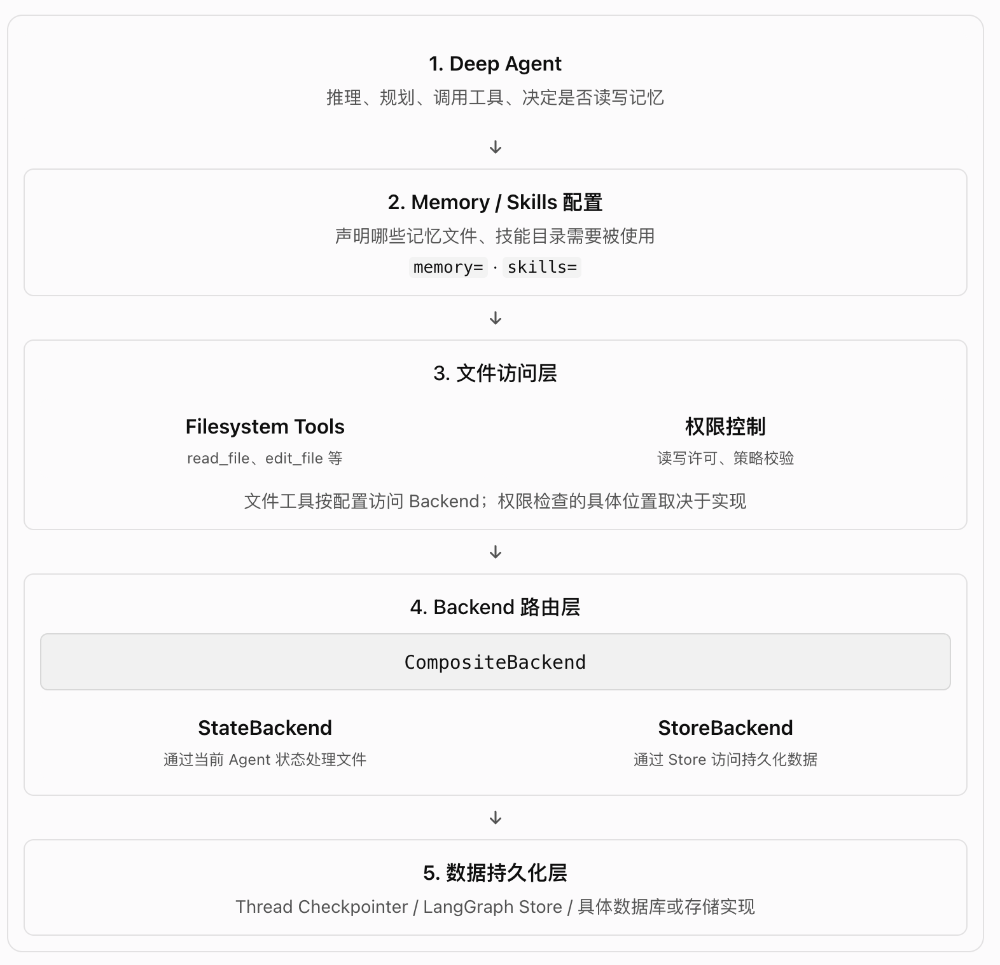
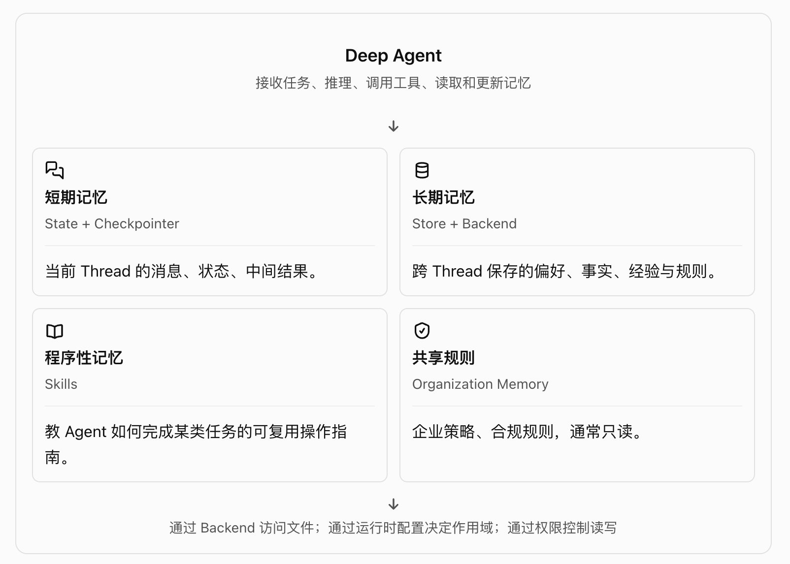

# DeepAgents-5.2-上下文管理-记忆



## 一、先建立整体认知



Memory 是记忆系统的设计概念；
State、Store 和 Backend 是实现记忆存储与访问的不同机制。

注意，这四项不是四个互相独立、完全平行的存储引擎。

- 短期记忆和长期记忆，主要区别是生命周期和持久化范围。
- Skills 是可复用的操作知识，属于程序性记忆的实现方式。
- Organization Memory 是按组织划分作用域的共享记忆。
- Backend 决定文件如何读写、存在哪里；底层可以是 State、Store 或其他存储实现。

## 二、Memory解读

### 2.1. Memory 的工作流程

- 第一步：指定记忆文件
  1. memory=["/memories/AGENTS.md"]
  2. skills=["/skills/"]

- 第二步：读取记忆

  Agent 可以在启动时把记忆加载到系统提示词中，也可以在任务进行时按需读取。

- 第三步：更新记忆（可选）

  当 Agent 学到值得保留的新信息时，可以通过内置的 edit_file 工具更新记忆文件

`指定一个路径不等于自动完成所有记忆管理`。 你还需要正确配置 Backend，并确保文件已经存在或可以被创建、读取和写入。

### 2.2. 短期记忆与长期记忆：State 和 Store 的区别

短期记忆并不等于内存，长期记忆也不等于磁盘。

State 可以通过 Checkpointer 保存到持久化存储中；Store 也可以使用不同的后端实现。短期与长期的区别主要在逻辑作用域，而不是物理介质。

### 2.3 记忆的五个维度

| 维度                         | 它回答的问题       | 可选设计              |
| ---------------------------- | ------------------ | --------------------- |
| Duration（持续时间）         | 记忆保留多久？     | 单次对话 / 跨对话     |
| Information type（信息类型） | 保存什么？         | 经历、事实、操作方法  |
| Scope（作用域）              | 谁能访问？         | 用户、Agent、组织     |
| Update strategy（更新策略）  | 什么时候更新？     | 对话期间 / 后台整理   |
| Retrieval（读取策略）        | 什么时候读取？     | 启动时加载 / 按需读取 |
| Agent permissions（权限）    | Agent 能不能修改？ | 读写 / 只读           |

这几个维度是相互独立的。

### 2.4 三类记忆：Episodic、Semantic、Procedural

1. Episodic Memory(情景记忆): 记录过去发生了什么、经过了哪些步骤、最终结果如何。
2. Semantic Memory(语义记忆): 保存提炼后的事实、背景、偏好和知识。
3. Procedural Memory(程序性记忆): 保存做某件事的方法、步骤和约束。

可以用三个问题记住它们：

- 情景记忆：以前发生过什么？
- 语义记忆：我已经知道什么？
- 程序性记忆：我应该怎么做？

❗注意，三者是概念分类，不是三个必须单独部署的存储系统。同一条历史经验经过总结后，可以从情景记忆转化为语义记忆或程序性记忆。

## 三、记忆的三个作用范围：Agent、User、Organization

```bash

Agent 文件操作
    │
    ▼
CompositeBackend
    │
    ├── /memories/ ──→ StoreBackend
    │                       │
    │                       ├── Namespace A
    │                       │     └── /memories/preferences.md # memory对应的路径
    │                       │          └── "我喜欢简洁回答"
    │                       └── Namespace B
    │                             └── /memories/preferences.md
    │                                  └── "我喜欢详细解释"
    │
    └── /skills/ ─────→ StoreBackend
                            │
                            ├── Namespace A
                            └── Namespace B
# ---------------------------------------------------------------
A 用户发起请求
       │
       ▼
获取 A 的用户身份
       │
       ▼
选择 Namespace: user_A
       │
       ▼
读取 /memories/preferences.md
       │
       ▼
得到 A 的记忆
```

### 3.1 Agent-scoped memory：Agent 级记忆

所有使用同一个 Agent 的用户，共享记忆；所有用户共享的记忆，不应随意接受任何一个用户写入的指令。

```python
from deepagents import create_deep_agent
from deepagents.backends import (
    CompositeBackend,
    StateBackend,
    StoreBackend,
)

agent = create_deep_agent(
    model="google_genai:gemini-3.6-flash",
    memory=["/memories/AGENTS.md"], # 告诉 Agent 使用 /memories/AGENTS.md 这份长期记忆文件。
    skills=["/skills/"],
    backend=CompositeBackend( # 组合多个 Backend，根据路径选择对应的实现。
        default=StateBackend(), # 没有匹配其他路由的路径，默认交给 StateBackend。
        routes={ # 为指定路径配置专门的 Backend
            "/memories/": StoreBackend( # 当 Agent 操作 /memories/ 下的文件时，交由 StoreBackend 处理，并通过当前运行时中的 assistant_id 确定 Store 命名空间。
                namespace=lambda rt: (
                    rt.server_info.assistant_id,  #
                ),
            ),
            "/skills/": StoreBackend(
                namespace=lambda rt: (
                    rt.server_info.assistant_id, #
                ),
            ),
        },
    ),
)
```

❗注意，memory= 不是 Store，也不是存储引擎。它声明的是记忆资源的路径

### 3.2 User-scoped memory：用户级记忆

```python
agent = create_deep_agent(
    model="google_genai:gemini-3.6-flash",
    memory=["/memories/preferences.md"],
    skills=["/skills/"],
    backend=CompositeBackend(
        default=StateBackend(),
        routes={
            "/memories/": StoreBackend(
                namespace=lambda rt: (
                    rt.server_info.user.identity, # 不同用户访问不同命名空间下的“/memories/preferences.md”
                ),
            ),
            "/skills/": StoreBackend(
                namespace=lambda rt: (
                    rt.server_info.user.identity,
                ),
            ),
        },
    ),
)
```

### 3.3 多 Agent、多用户：Namespace 怎么组合

文档还说明：

- 只使用 assistant_id：按 Agent 隔离，不再细分用户。
- 只使用 user_id：按用户隔离，同一用户可能在多个 Agent 之间共享该作用域。
- 同时使用两者：按 Agent 和用户的组合隔离。

注意，以上讨论的是 Store 的逻辑隔离方式，具体数据组织行为还取决于 Store 实现和文件访问约定。

### 3.4 Organization-scoped memory：组织级记忆

```python
agent = create_deep_agent(
    model="google_genai:gemini-3.6-flash",
    memory=[
        "/memories/preferences.md",
        "/policies/compliance.md",
    ],
    backend=CompositeBackend(
        default=StateBackend(),
        routes={
            "/memories/": StoreBackend(
                namespace=lambda rt: (
                    rt.server_info.user.identity, # 个人
                ),
            ),
            "/policies/": StoreBackend(
                namespace=lambda rt: (
                    rt.context.org_id,  # 组织
                ),
            ),
        },
    ),
)
# 不同类型的文件，可以使用同一种 Backend，但采用不同的 Namespace。
```

组织级记忆用于保存所有相关 Agent 或用户都应该遵守的共享信息；

组织级记忆通常应该是只读的：由应用或管理员负责维护，普通用户和 Agent 不应该随意修改。

## 四、Episodic Memory：长期记忆 的 读取和写入

### 4.1 Checkpointer 负责保存，搜索工具负责检索

```bash
  用户提出当前问题
      ↓
  Agent 判断需要历史经验
      ↓
  调用 search_past_conversations
      ↓
  从 Runtime 获取用户身份
      ↓
  SDK 搜索用户的历史 Thread
      ↓
  按关键词、元数据或向量检索筛选
      ↓
  选出最相关的 3～5 段历史
      ↓
  压缩为“问题—排查—结果”
      ↓
  交给 Agent, 供 Agent 分析和回答
```

### 4.2 读取方式：启动时加载 vs 按需读取

1. 启动时加载: Agent 启动时把记忆内容放进 System Prompt。(缺点：记忆越来越多)
2. 按需读取: Agent 先知道记忆文件的路径，任务需要时再调用文件工具读取。(需要判断什么时候读取)

Skills vs Memory: Skills 偏向告诉 Agent 如何执行任务，Memory 偏向保存需要跨任务复用的信息。

### 4.3 写入方式：对话中更新 vs 后台整理

| 维度             | 对话中更新               | 后台整理                           |
| ---------------- | ------------------------ | ---------------------------------- |
| 何时发生         | 当前对话过程中           | 对话结束后或定时执行               |
| 记忆何时可用     | 更新成功后即可供后续读取 | 通常要等后台任务完成               |
| 对当前请求的延迟 | 可能增加                 | 不必增加主对话的等待时间           |
| 归纳质量         | 可能只考虑当前对话       | 可以综合多个对话、合并重复信息     |
| 实现成本         | 相对简单                 | 需要额外 Agent、任务调度和维护机制 |

- Hot path 的工作方式

```bash
  用户对话
     ↓
  主 Agent 完成任务
     ↓
  发现值得保存的信息
     ↓
  edit_file 更新记忆
     ↓
  Backend 持久化
     ↓
  下一次对话可以读取
```

- Background 的工作方式

  ```bash
    Thread A ──┐
    Thread B ──┼──→ 历史对话
    Thread C ──┘        │
                        ↓
                  定时触发 Cron
                        ↓
                 Consolidation Agent (提取事实、合并、去重)
                        ↓
                  更新 Memory Store
  ```

* 实战建议：先实现 Hot path，再在确实需要时增加后台整理。

## 五、安全问题：共享记忆可能成为 Prompt Injection 的入口

### 5.1 只读记忆 与 可写记忆

### 5.2 Concurrent writes：多个 Thread 同时写记忆
