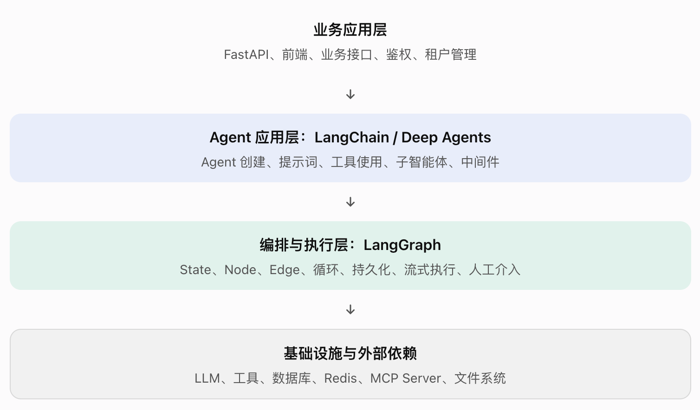

# langGraph

LangGraph 是一个用于编排 AI Agent 执行过程的底层框架。它让你能够控制 Agent 的状态、执行顺序、循环、持久化、人工介入，以及整个工作流的运行方式。

1. 先记住这几个定位:
   - LangChain: 提供模型、工具、Agent 等开发组件和较高层的抽象。
   - LangGraph: 负责把节点、状态和执行路径组织成一个可运行的工作流。
   - Deep Agents: 建立在这些基础能力之上，提供规划、子智能体、文件系统等更完整的 Agent 架构。
   - FastAPI: 负责对外提供 HTTP API，通常承担业务接口、认证授权等职责。
   - LangSmith: 用于追踪、调试、评估和监控 Agent；属于配套能力，不是运行 LangGraph 的必需条件。

2. 如果把一个 AI Agent 看成一个完整的软件系统:
   - LLM 是负责理解、推理和生成的模型。
   - Tools 是 Agent 能调用的外部能力。
   - LangGraph 是控制这些能力如何协作、何时执行、如何流转和恢复的编排引擎。
   - 业务代码定义真正的业务规则。
   - 部署与可观测性设施负责让系统稳定地运行在生产环境。

从工程角度看，LangGraph 的核心职责是编排和执行控制



## 二、LangGraph 到底是什么？

可以拆成三个概念

1. Low-level: 低层级框架;
   - LangGraph 给你的是控制权，而不是一个已经替你做完所有决策的黑盒 Agent。

2. Orchestration: 编排:
   - 决定任务如何流经各个步骤;

3. Runtime: 运行时;
   - 框架定义了如何构建图；运行时则负责按照图的规则执行它。

因此，LangGraph 不只是一个把函数串起来的工具，它还提供面向有状态、可持续执行工作流的运行机制。

## 三、建立 LangGraph 的概念层级

理解 LangGraph 时，建议分成四个层次，而不是把所有 API 名称都当成同等重要的知识点。

- 第 1 层: 图结构与控制流
  Graph · Node · Edge · Conditional Edge · START · END
  决定工作流有哪些步骤、执行顺序如何安排、何时分支，以及何时结束。

- 第 2 层: 状态与执行语义
  State · Reducer · Runtime · Checkpointer · Interrupt
  决定节点之间如何共享数据、状态如何合并、执行进度如何保存，以及如何暂停和恢复。

- 第 3 层: Agent 能力与协作
  LLM · Tools · Agent Loop · Memory · Subgraphs
  把模型推理、工具调用、循环、长期记忆和多 Agent 协作组织成具体业务能力。

- 第 4 层: 生产工程与部署
  Streaming · Observability · Evaluation · Deployment
  解决可观测性、质量评估、故障恢复、服务部署、扩展和运维问题。

这四层之间的关系可以概括为:❗先用图结构定义流程，再用状态承载数据，用运行时执行流程，最后把模型、工具和生产基础设施接入其中。

## 四、核心抽象: Graph、Node、Edge、State

| 抽象                         | 含义                                        | 在代码中的典型形式                | 工程类比             |
| ---------------------------- | ------------------------------------------- | --------------------------------- | -------------------- |
| Graph （图）                 | 整个工作流                                  | StateGraph(...)                   | 一套流程定义         |
| Node （节点）                | 一个执行步骤 ( 一个具体任务)                | classify_intent(state)            | 函数、任务处理器     |
| Edge （边）                  | 节点之间的连接                              | add_edge(...)                     | 控制流转移           |
| State （状态）               | 节点共享的工作状态 (节点之间共享的数据)     | EmailAgentState                   | 工作流上下文         |
| Reducer                      | 合并状态更新的规则                          |                                   | 字段更新策略         |
| Routing（路由）              | 决定下一步执行什么                          | Command、条件边(Conditional Edge) |                      |
| Checkpointer（检查点保存器） | 保存执行检查点 (保存执行进度，以便后续恢复) | MemorySaver() 等                  | 工作流进度持久化机制 |
| Runtime                      | 执行图的运行环境                            |                                   | 工作流执行引擎       |

Node 负责做事，State 负责传递数据，Edge 或 Command 负责控制流程。

### 4.1 确定性流程 与 Agent 流程如何融合？

```bash
输入与权限检查: 确定性逻辑
  ↓
LLM 理解任务: 模型驱动逻辑
  ↓
权限与参数再次校验: 确定性逻辑
  ↓
调用工具或请求审批: 受控执行
```

## 五、逐行理解官方 Hello World

```python
from langgraph.graph import StateGraph, MessagesState, START, END

# -- 5.1 定义状态结构 ----------------------
# MessagesState
# -- 5.2 定义节点 ----------------------
def mock_llm(state: MessagesState):
    return {
        "messages": [
            {"role": "ai", "content": "hello world"}
        ]
    }
# -- 5.3 创建图并注册节点 ----------------------
graph = StateGraph(MessagesState)
graph.add_node(mock_llm)
# -- 5.4 定义控制流 ----------------------
graph.add_edge(START, "mock_llm")
graph.add_edge("mock_llm", END)
# -- 5.5 编译与执行 ----------------------
graph = graph.compile()

graph.invoke({
    "messages": [
        {"role": "user", "content": "hi!"}
    ]
})
```

## 六、LangGraph 的核心能力分别解决什么问题？

### 6.1 Mix deterministic and agentic steps: 确定性与智能决策混合

传统程序通常由明确的代码路径控制。Agent 则可能需要根据模型输出动态决定下一步。

LangGraph 允许二者共存。例如，模型决定应该查询哪个工具，但实际调用前由程序检查工具权限和参数。

适用场景: 业务规则明确，但任务处理又需要模型灵活推理的系统。

### 6.2 Persistence: 持久化与恢复

持久化的核心价值是: 工作流执行状态可以保存，后续能够恢复，而不是每次都从头开始。

- 需要区分两个概念:
  - State: 当前工作流的数据。
  - Checkpoint: 在执行过程中保存的状态快照及相关执行信息

在 LangGraph 中，通常通过 Checkpointer 实现检查点持久化。实际的跨进程、跨机器恢复能力，取决于持久化后端、线程标识、运行方式和业务代码的设计。

### 6.3 Human-in-the-loop: 人在执行环中

人工审批节点并不自动保证安全。 你仍然需要设计权限校验、审批人身份验证、操作范围限制和幂等机制。

### 6.4 Comprehensive memory: 短期状态与长期记忆

1. 短期记忆 / 工作状态

   保存当前任务所需的信息，例如用户本轮输入、工具返回结果、执行进度和中间推理数据。  
   常见实现基础: State + Checkpointer + Thread ID

2. 长期记忆

   保存跨会话仍然有价值的信息，例如用户偏好、已确认的业务事实或长期任务知识。  
   常见实现基础: Store、数据库、向量检索或其他存储系统

- 需要注意:
  - Checkpointer 主要解决工作流状态和执行进度的持久化。
    1. Checkpointer: 任务执行到一半，如何保存现场，下次接着执行？

  - 长期记忆通常需要单独设计存储、检索、更新与删除策略。
    1. 长期记忆: 这次任务结束以后，如何保留有价值的信息，供未来的其他任务使用？

  - 两者可以配合，但不能相互替代。
  - 是否把某段对话写入长期记忆，应当由明确的业务策略控制，而不是默认全部保存。

### 6.5 Streaming: 流式输出

流式输出让调用方可以逐步接收执行过程中产生的信息，而不是只能等整个工作流完成后拿到结果。

### 6.6 Debugging with LangSmith: 调试与可观测性

当一个 Agent 包含多个节点、工具调用和循环时，最终回答出错，原因可能来自任何一个步骤。

❗LangGraph 的编排能力，不等于 LangSmith 的可观测性能力。 追踪和评估是重要的工程配套，不是使用 LangGraph 本身的硬性前提。

### 6.7 Production-ready deployment: 生产部署

生产部署还涉及服务化、并发控制、资源管理、持久化后端、认证、网络、监控和扩缩容等问题。

LangGraph 的图执行能力为构建这类系统提供基础，但一个图能在本地执行，不代表整个服务已经满足生产要求。

同样，部署平台是可选的架构组件，不是 LangGraph 图定义的一部分。

## 七、总结

1. LangGraph 管执行过程
   不只是调用模型，而是定义整个任务的控制流。

2. State 是贯穿执行的核心
   节点通过状态共享业务数据，Reducer 决定特定字段的更新如何合并。

3. 确定性逻辑和模型决策可以混合
   把权限、安全、校验和关键业务规则交给程序，把需要灵活理解与推理的部分交给模型。

4. 持久化让 Agent 能处理长任务
   结合检查点、线程标识、暂停恢复与人工介入，可以构建不局限于单次请求的工作流。

5. 生态产品是可组合的
   LangChain、LangSmith Observability 和 LangSmith Deployment 各自承担不同职责，不需要把整套生态当成不可拆分的整体。

## mini_create_agent.py

```python
from langchain_openai import ChatOpenAI
from langchain.tools import tool
from langgraph.graph import StateGraph, MessagesState, START, END
from langgraph.prebuilt import ToolNode, tools_condition


# 1. 定义工具
@tool
def multiply(a: int, b: int) -> int:
    """计算两个整数的乘积。"""
    print(f"[执行工具] multiply({a}, {b})")
    return a * b


@tool
def add(a: int, b: int) -> int:
    """计算两个整数的和。"""
    print(f"[执行工具] add({a}, {b})")
    return a + b


# 2. 模拟 create_agent 的核心实现
def mini_create_agent(model, tools):

    # -- 让模型知道可用工具及其参数 -----------------------------
    model_with_tools = model.bind_tools(tools)

    # -- 模型节点：调用大模型 --------------------------------
    def call_model(state: MessagesState):
        response = model_with_tools.invoke(state["messages"])
        return {"messages": [response]}

    # -- 工具节点：执行模型请求的工具 ----------------------------
    tool_node = ToolNode(tools)

    # -- tools_condition ------------------------------------
    def my_tools_condition(state):
      # 1. 取出最后一条消息
      last_message = state["messages"][-1]

      # 2. 判断模型是否请求调用工具
      if last_message.tool_calls:
          return "tools"

      # 3. 没有工具调用，结束流程
      return "__end__"

    # -- 构建图 -----------------------------------------
    builder = StateGraph(MessagesState)

    builder.add_node("model", call_model)
    builder.add_node("tools", tool_node)

    builder.add_edge(START, "model")

    # 根据模型响应，决定执行工具还是结束
    builder.add_conditional_edges(
        "model",
        my_tools_condition,
        {
            "tools": "tools",
            "__end__": END,
        },
    )

    # 工具执行完毕，再次调用模型
    builder.add_edge("tools", "model")

    # 编译并返回可执行 Agent
    return builder.compile()


# 3. 使用迷你版 Agent
if __name__ == "__main__":
    model = ChatOpenAI(
        model="gpt-4.1-mini",
        temperature=0,
    )

    agent = mini_create_agent(
        model=model,
        tools=[multiply, add],
    )

    result = agent.invoke({
        "messages": [
            {
                "role": "user",
                "content": "先计算 25 乘以 36，再加上 100。",
            }
        ]
    })

    print("\n最终答案：")
    print(result["messages"][-1].content)
# ---------- AIMessage ------------------
    AIMessage(
    content="",
    tool_calls=[
        {
            "name": "multiply",
            "args": {"a": 25, "b": 36},
            "id": "call_001"
        }
    ]
)
# bind_tools 赋予模型工具调用能力，ToolNode 执行调用，tools_condition 决定流程走向。
```
