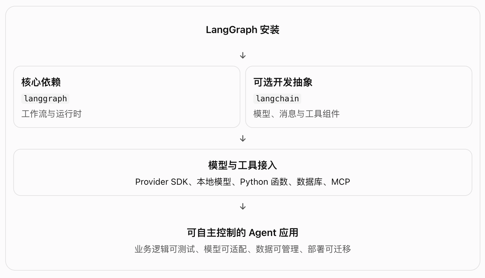

# langGraph-2.1-安装



## 一、概念理解

### 1. langgraph：流程编排与运行时

- 它是构建状态化 Agent 工作流的核心依赖。你可以用它定义：
  - State：工作流共享的状态。
  - Node：执行某项任务的节点。
  - Edge：节点之间的执行关系。
  - Conditional Edge：根据状态或模型输出决定下一步。
  - Checkpoint：保存执行状态，为恢复、持续运行等能力提供基础。

LangGraph 管理的是这套流程如何执行，而不是亲自提供大语言模型。

### 2. langchain：模型与工具的开发抽象

LangChain 提供了模型调用、消息结构、工具定义等较方便的抽象

- 要区分：
  - LangGraph：关注工作流如何运行。
  - LangChain：提供构建 LLM 应用时常用的组件与抽象。
  - 模型供应商集成包：负责接入具体的模型服务或 SDK。

### 3. 模型供应商包：真正连接模型的依赖

它们通常承担：

- 认证和请求发送。
- 消息格式转换。
- 流式输出。
- 模型参数配置。
- 工具调用协议适配。

安装 LangGraph 并不等于已经接入 LLM，也不等于已经获得了可用的 Agent。

## 二、安装 与 运行

1. 使用 uv 安装

   ```python
   # 1. 安装 uv 后创建项目
   uv init langgraph-demo
   cd langgraph-demo

   # 2. 添加依赖
   uv add langgraph

   # 3. 需要 LangChain 时再添加
   uv add langchain

   # 4. 运行
   uv run python main.py
   ```

   这种方式会将依赖声明保存在 pyproject.toml，并通常通过 uv.lock 锁定具体依赖版本，方便在不同机器上复现环境。

2. 检测 是否成功

   ```python
   uv run python -c "import langgraph; print('langgraph import OK')"
   uv tree
   ```

## 三、实战路线：从安装到真正理解 LangGraph

1. 安装与环境管理

   掌握虚拟环境、依赖声明、锁文件、包版本与导入检查。
   成果：其他机器也能复现的 Python 项目。

2. 核心图模型

   学习 StateGraph、State、Node、Edge、START、END 和 compile()。
   成果：一个不依赖 LLM 的确定性工作流。

3. 模型与工具

   理解模型调用、bind_tools()、ToolNode、tools_condition 与条件边。
   成果：可以调用工具并根据执行结果继续推理的 Agent。

4. 状态持久化与恢复

   学习 Checkpointer、Thread、Interrupt、Resume 和长期记忆的区别。
   成果：可以跨调用保存状态、暂停并恢复执行的工作流。

5. 生产化与解耦

   学习错误重试、幂等性、人工审核、日志、测试、模型适配层和部署。
   成果：可测试、可观测、可迁移的 Agent 后端。
