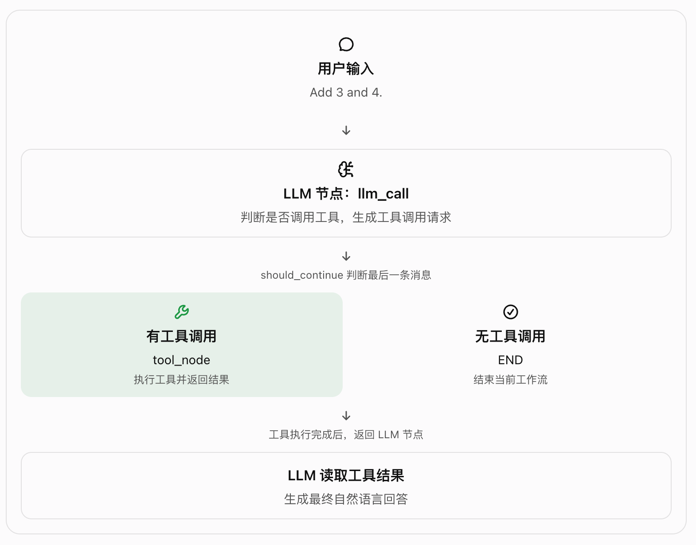
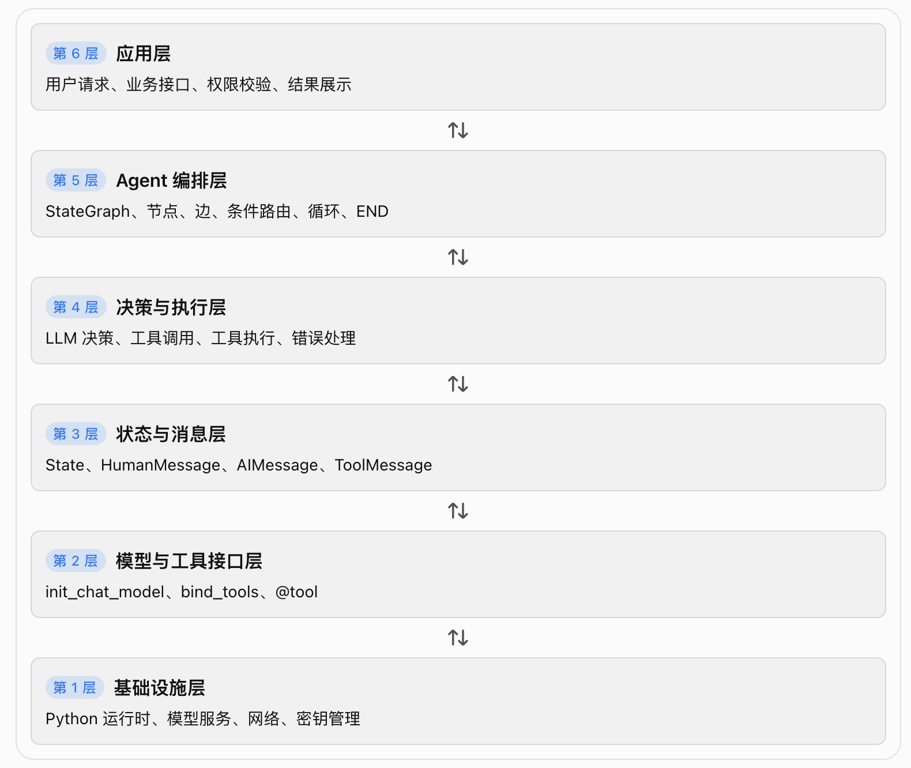

# langGraph-2.2-快速入门

先给出整体结论:

- LLM 负责决策: 判断是否需要调用工具，以及调用哪个工具。
- Tool 负责执行: 真正完成加法、乘法、除法等确定性计算。
- State 负责传递数据: 保存对话消息和 LLM 调用次数。
- Graph 负责控制流程: 决定先执行什么、接下来执行什么、什么时候结束。
- Compile 负责构建可执行工作流: 把节点、边和状态规则组装成 Agent。

这五个部分构成了一个最基础的工具调用型 Agent。

## 一、概念理解: 这个 Agent 究竟是什么？

Agent 不是单次调用 LLM，而是一个能够根据执行结果反复决策的循环。

### LangGraph 提供两种组织执行逻辑的方式

1. Graph API 与 Functional API 的区别

   | 对比维度 | Graph API                    | Functional API                   |
   | -------- | ---------------------------- | -------------------------------- |
   | 组织方式 | 显式定义节点和边             | 在函数中组织执行逻辑             |
   | 控制流   | 条件边、普通边、循环         | 函数调用、任务及控制逻辑         |
   | 执行过程 | 图结构清晰可见               | 更接近普通 Python 程序           |
   | 适合场景 | 多步骤 Agent、复杂分支、循环 | 已有函数流程、希望渐进式引入编排 |
   | 可观察性 | 容易直接检查图结构           | 重点在函数和任务执行过程         |

2. 容易混淆的概念
   - bind_tools(): 告诉模型有哪些工具可供调用，并使模型能够生成结构化工具调用请求。它本身不执行工具。
   - tool_node(): 真正执行工具调用，并将执行结果包装为 ToolMessage。
   - StateGraph: 定义整个工作流的状态类型与节点关系。
   - compile(): 构建可执行的图对象，不等于把程序部署到服务器。
   - invoke(): 启动一次工作流执行，直到正常结束或遇到异常等情况。

## 二、层级关系: 从底层组件到完整 Agent

❗需要注意，这是一种便于理解的逻辑分层，并不是 LangGraph 官方规定的内部架构。

- 各层的控制权属于谁？

  | 环节             | 控制者                  | 作用                             |
  | ---------------- | ----------------------- | -------------------------------- |
  | 是否调用工具     | LLM 提供决策结果        | 决定下一步建议采取的动作         |
  | 是否允许执行工具 | 你的程序                | 校验工具名、参数、权限与业务规则 |
  | 工具实际做什么   | 工具实现代码            | 执行数据库查询、API 调用或计算   |
  | 下一步执行什么   | LangGraph 图结构        | 根据边与路由函数调度节点         |
  | 状态如何更新     | State Schema 与更新规则 | 决定哪些数据保留、追加或覆盖     |
  | 最终什么时候结束 | 图的控制逻辑            | 到达 END 或满足其他终止条件      |

🔥 LLM 可以提出动作，但不应该天然拥有执行动作的全部权限。

## 三、自主可控性

1. LangGraph 核心编排: 可自主部署
2. 模型供应商: 需要评估绑定
3. LangSmith 追踪与监控: 可选平台，需评估绑定
4. 部署、存储与任务运行时: 按需选择

## 总结

可以记住三个层次:

- 组件层: bind_tools、@tool、State、消息。
- 编排层: 节点、条件边、循环、START、END。
- 工程层: 持久化、异常处理、权限、安全、观测与部署。

LangGraph 提供的是 Agent 的编排与状态执行机制，而不是替你完成所有业务安全、持久化和部署工作的完整解决方案。
