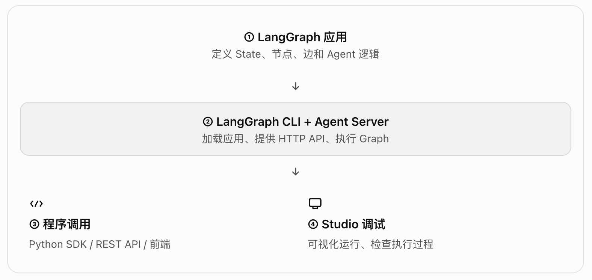

# langGraph-2.3-本地服务器



LangGraph 是编排框架，Agent Server 是运行和访问应用的服务层，Studio 是调试界面。 三者不是同一个东西。

## 一、 概念

langgraph dev 就是文档提供的本地开发入口。它帮你省去了手工编写一套 Agent HTTP 服务的工作。

关键概念的层级关系

| 概念                        | 职责                                             | 是否是 Agent 本身 |
| --------------------------- | ------------------------------------------------ | ----------------- |
| LangGraph / LangChain Agent | 定义业务逻辑、工具调用和流程                     | 是核心业务逻辑    |
| langgraph-cli               | 命令行工具，创建项目、启动服务                   | 否                |
| Agent Server                | 对外提供 API、管理运行请求                       | 否，是运行服务层  |
| LangGraph SDK               | 从 Python 程序调用服务端 API                     | 否，是客户端      |
| LangGraph Studio            | 可视化调试应用                                   | 否，是调试工具    |
| LangSmith                   | 提供相关平台能力，如 Studio 访问、追踪和部署服务 | 否，是平台服务    |

❗注意：这些组件并不是必须全部使用。可以直接调用 Agent，也可以用 FastAPI 自己封装 Agent；使用 LangGraph CLI 是一种更省事的开发方案。

## 二、从安装到运行

### 第 1 步：安装 LangGraph CLI

`pip install -U "langgraph-cli[inmem]"` 或 `uv add --dev "langgraph-cli[inmem]"`

- pip install：安装到当前激活的 Python 环境。
- uv add --dev：把 CLI 声明为当前项目的开发依赖，适合需要把依赖记录到 pyproject.toml 的项目。
- -U：升级到可用的较新版本。
- [inmem]：安装 CLI 的 inmem 可选依赖，用于支持这里的轻量级内存开发服务。

能力边界： 安装 CLI 不代表你的 Agent 已经创建，也不代表模型已经可以调用。

### 第 2 步：创建 LangGraph 应用

`langgraph new langgraph-local-demo \  --template new-langgraph-project-python`
这一步不是创建一个空文件夹，而是从官方模板生成应用的基础代码和配置。

- 重点关注这几类文件：

  | 文件                  | 作用                      |
  | --------------------- | ------------------------- |
  | pyproject.toml        | Python 项目元数据和依赖   |
  | langgraph.json        | 告诉 CLI 去哪里加载 Graph |
  | .env.example          | 环境变量配置示例          |
  | src/ 下的 Python 文件 | Agent / Graph 的具体实现  |

- langgraph.json

  ```json
  {
    "dependencies": ["."], // 告诉服务端加载哪些项目依赖； "." 表示当前项目。
    "graphs": {
      "agent": "./src/agent.py:agent" // 注册一个名为 agent 的 Graph，指向 src/agent.py 文件中的 agent 对象。
    },
    "env": ".env" // 指定环境变量文件。
  }
  ```

  这里的 agent 是服务端识别的应用名称，不是 Python 语言的保留字，也不要求变量一定叫 agent。如果配置中使用其他名称，后续 SDK 请求也必须使用对应名称。

### 第 3 步：安装项目依赖

`pip install -e .` 或 `uv sync`
普通安装通常会把包安装到环境的 site-packages 目录中；
而 pip install -e . 会让 Python 将本地项目以可编辑方式关联到当前环境。你修改源代码后，通常不需要重新安装整个项目。
