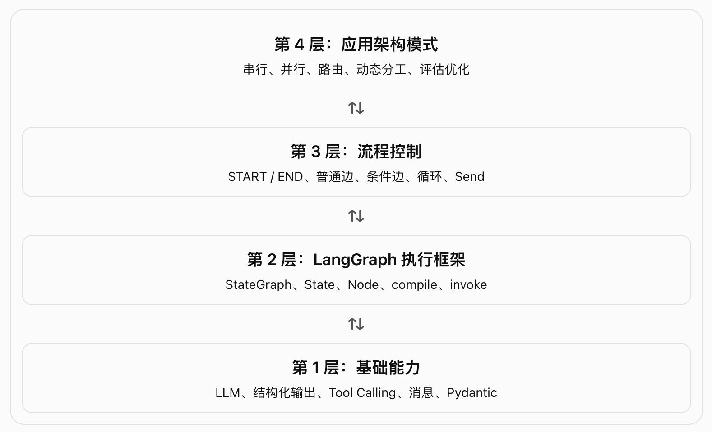
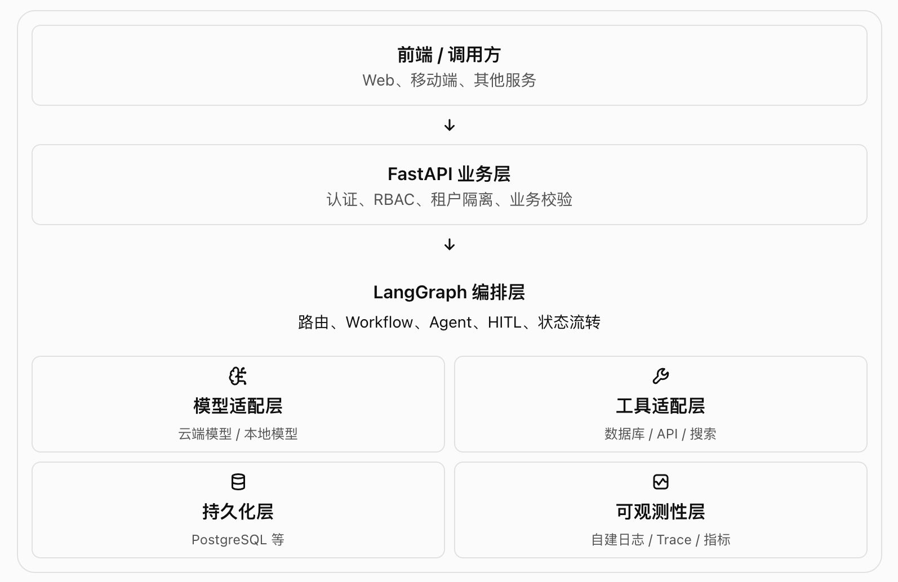

# langGraph-2.5-工作流与智能体

工作流（Workflows）与智能体（Agents）的设计模式

## 一、概念理解

- Workflow（工作流）: 执行路径 预先由代码定义，系统按照设计好的顺序执行。
- Agent（智能体）: 执行过程更具动态性，模型可以根据当前情况决定下一步做什么、使用什么工具。

Workflow 和 Agent 不是两种互斥的技术。 你完全可以在一个 Workflow 中嵌入 Agent，把固定流程与动态决策组合起来。

## 二、层级关系: 从基础组件到完整 Agent



### 2.1 基础能力层: 模型能做什么？

| 能力       | 对应代码                           | 作用                       |
| ---------- | ---------------------------------- | -------------------------- |
| 结构化输出 | llm.with_structured_output(Schema) | 让模型按定义的结构返回数据 |
| 工具调用   | llm.bind_tools(tools)              | 让模型能够提出工具调用请求 |
| 短期记忆   | 消息历史、Graph State 等           | 为后续步骤提供之前的上下文 |

❗bind_tools() 不是直接执行工具，而是让模型能够按照工具定义生成调用请求。

```python
llm_with_tools = llm.bind_tools([multiply])
msg = llm_with_tools.invoke("What is 2 times 3?")
print(msg.tool_calls)

# [
#     {
#         "name": "multiply",
#         "args": {"a": 2, "b": 3},
#         "id": "call_123",
#     }
# ]
```

此时，工具函数不一定已经执行。你还需要工具执行器去真正调用 multiply(2, 3)，再把结果交回模型或后续节点。

这正是后面 Agent 循环的基础。

### 2.2 LangGraph 执行框架层: 程序如何组织起来？

```python
builder = StateGraph(State)

builder.add_node("generate", generate)
builder.add_node("check", check)

builder.add_edge(START, "generate")
builder.add_edge("generate", "check")
builder.add_edge("check", END)

graph = builder.compile()

result = graph.invoke({"topic": "cats"})
```

compile() 不会把你的 Python 代码翻译成某种新的机器代码;
它会 完成图的构建与检查，得到可运行的图对象。

### 2.3 流程控制层

Routing（路由）是一种应用设计模式，而条件边（Conditional Edges）是 LangGraph 实现路由的机制之一。

| 概念                    | 所属层级                   | 含义                                           |
| ----------------------- | -------------------------- | ---------------------------------------------- |
| Routing                 | 应用设计模式               | 根据请求或状态选择处理路径                     |
| add_conditional_edges() | Graph API                  | 根据函数返回值选择后继节点                     |
| route_decision()        | 用户编写的函数             | 具体实现路由判断                               |
| Command(goto=...)       | Graph API 的另一种控制方式 | 在节点返回结果中指定下一步                     |
| Send                    | 动态任务分发机制           | 向目标节点发送指定输入，可创建多个 worker 任务 |

### 2.4 应用架构层: 文档的六种主要模式

1. Prompt Chaining（提示链）
   A → B → C
   将复杂任务拆成多个串行步骤。例如生成内容 → 检查 → 润色。

2. Parallelization（并行化）
   A、B、C 同时执行 → 汇总
   适合互相独立的子任务，或对同一内容进行多角度评估。

3. Routing（路由）
   输入 → 分类 → 选择一个分支
   适合价格、退款、退货等不同类型请求的分流。

4. Orchestrator-Worker（编排器与工作节点）
   编排器规划 → 动态分发 → 汇总
   适合子任务数量不确定的场景，例如生成多章节报告或处理多个文件。

5. Evaluator-Optimizer（评估与优化）
   生成 → 评估 → 反馈 → 再生成
   适合具有明确验收标准、需要反复改进的任务。

6. Agent（智能体）
   模型决策 → 工具执行 → 观察结果 → 再决策
   适合下一步操作无法完全预先确定的任务。

前五种主要描述如何组织任务流程；第六种强调模型如何参与决策。实际项目可以把它们组合使用。

## 三、代码解读: 逐一理解关键实现

### 3.1 Prompt Chaining（提示链）: 固定步骤 + 条件分支

### 3.2 Parallelization（并行化）: 为什么汇总节点会等待？

```python
   parallel_builder.add_edge(START, "call_llm_1")
   parallel_builder.add_edge(START, "call_llm_2")
   parallel_builder.add_edge(START, "call_llm_3")

   parallel_builder.add_edge("call_llm_1", "aggregator")
   parallel_builder.add_edge("call_llm_2", "aggregator")
   parallel_builder.add_edge("call_llm_3", "aggregator")
```

它表示三个任务可以在同一轮图执行中并行调度，然后进入汇总节点。

### 3.3 Routing（路由）: 让模型选择业务处理路径

LLM 负责理解和分类，Python 负责将分类结果映射到执行路径。

模型只给出了决策结果，图运行时才会据此调度后续节点。

### 3.4 Orchestrator-Worker("编排器-工作者"模式): Send 是什么？

```python
def assign_workers(state: State):
    """Assign a worker to each section in the plan"""
    return [Send("llm_call", {"section": s}) for s in state["sections"]]

# Send("llm_call", {...}) 表示"向 llm_call 节点派发一个任务，携带指定输入"
# 当一个节点（llm_call）被 Send 并行派发出多个实例时，LangGraph 会把这些实例视为同一个“超步”（super-step）中的并行任务。引擎的调度规则是：必须等当前超步内所有被触发的节点实例都执行完毕，才会推进到下一个节点。

completed_sections: Annotated[list, operator.add]
# 让多个 worker 的结果能够累加到同一个状态字段中。
```

| 概念                 | 作用                                   |
| -------------------- | -------------------------------------- |
| Send                 | 动态分发任务，并为目标节点提供特定输入 |
| operator.add reducer | 定义多个更新写入同一状态字段时如何合并 |

Send 解决“发多少个任务、每个任务带什么输入”的问题；reducer 解决“多个任务的输出如何合并”的问题。它们不是同一机制。

### 3.5 Evaluator-Optimizer（评估与优化）: 反馈循环

设置最大迭代次数

### 3.6 Agent：把模型决策、工具执行和循环连接起来

- ToolNode 支持并行工具执行、错误处理和状态注入。
- 文档中的计算器示例使用 eval(expression)。不要直接把用户输入交给 eval 执行。实际应用应该使用安全的表达式解析器、受限的计算函数或经过校验的参数。

## 四、能力边界：LangGraph 帮你做什么，不替你做什么？

| 能力       | LangGraph 提供的机制           | 仍需要你负责的部分               |
| ---------- | ------------------------------ | -------------------------------- |
| 流程控制   | 节点、普通边、条件边、动态分发 | 业务规则与流程设计               |
| 状态管理   | Graph State、状态更新机制      | 字段设计、数据校验、并发更新策略 |
| 工具执行   | ToolNode、工具运行时集成       | 工具业务逻辑、权限、输入校验     |
| 并行任务   | 并行节点、Send                 | 并发预算、限流、资源隔离         |
| 循环优化   | 条件边和循环流程               | 最大迭代次数、质量标准、退出策略 |
| 持久化     | 可集成检查点机制               | 存储部署、保留周期、备份与恢复   |
| 流式输出   | 流式执行能力                   | 前端协议、断连处理、取消任务     |
| 调试与追踪 | 可集成的追踪工具               | 日志、指标、告警、审计体系       |

### 4.1 三种常见误区

- 误区一：使用 Agent 就能自动完成所有工作。

  实际上，模型只能基于它收到的上下文和可用工具做决策。工具缺失、数据不准确或模型判断错误，都可能影响结果。

- 误区二：有条件边就能保证流程安全。

  条件边只负责控制执行路径。它不自动提供用户权限验证、数据权限过滤或外部副作用保护。

- 误区三：使用 LangGraph 就自然具备生产级可观测性。

  LangGraph 提供了相应的集成能力，但追踪系统、告警规则、数据保留和运维策略仍然需要单独设计。

### 4.2 还要补齐哪些工程能力？

结合企业级 AI 应用的实际需求，建议在这份文档之外，继续学习：

- 持久化与恢复：检查点、线程隔离、失败后恢复、幂等性。
- 权限控制：用户身份、租户隔离、工具授权、RAG 文档 ACL。
- 可靠性：重试、超时、限流、熔断、取消与补偿。
- 可观测性：运行日志、指标、Trace、调用成本、失败分析。
- 人工审核：高风险操作确认、暂停与恢复。
- 评估测试：固定测试集、工具调用正确率、答案质量、回归测试。

这些能力和 Workflow / Agent 的组织模式是互补关系，而不是替代关系。

## 五、自主可控性：哪些是框架能力，哪些会形成供应商绑定？

### 5.1 推荐的自主可控架构



这里的关键设计原则是：

- 业务流程由自己的代码定义。
- 模型调用通过统一适配层进行。
- 工具不直接绕过业务层访问无权限的数据。
- 状态存储与追踪系统分别设计，避免不必要的耦合。
- 将模型调用记录、工具输入输出、状态变化和错误关联起来，支持审计与回放。

### 5.2 最终实战项目：企业内部知识助手

一个具备权限控制的知识助手：

1. Routing：识别用户意图，区分知识问答、数据库查询和业务操作。
2. RAG 检索：根据用户身份和部门权限过滤文档。
3. Agent：需要时调用搜索、计算或业务工具。
4. Evaluator-Optimizer：对回答进行质量检查，并在预算允许的情况下修正。
5. HITL：对退款、写入数据等高风险操作要求人工审批。
6. Persistence：保存运行状态，支持失败恢复。
7. Observability：记录 Trace、模型调用、工具结果、错误和成本。

## 六、总结

- 概念：Workflow 是预定义执行路径，Agent 允许模型参与动态决策。
- 机制：State 保存共享数据，Node 执行步骤，Edge 控制流转，条件边实现条件路由，Send 支持动态任务分发。
- 关键代码：with_structured_output()、bind_tools()、add_conditional_edges()、ToolNode 和 operator.add 各自解决不同问题。
- 工程边界：流程编排不等于权限控制、持久化、审计和生产级可靠性。
- 自主可控：优先掌握 Graph API 和自定义工具；将模型、存储与追踪系统设计为可替换组件，并明确 LangSmith 等外部平台的绑定成本。
