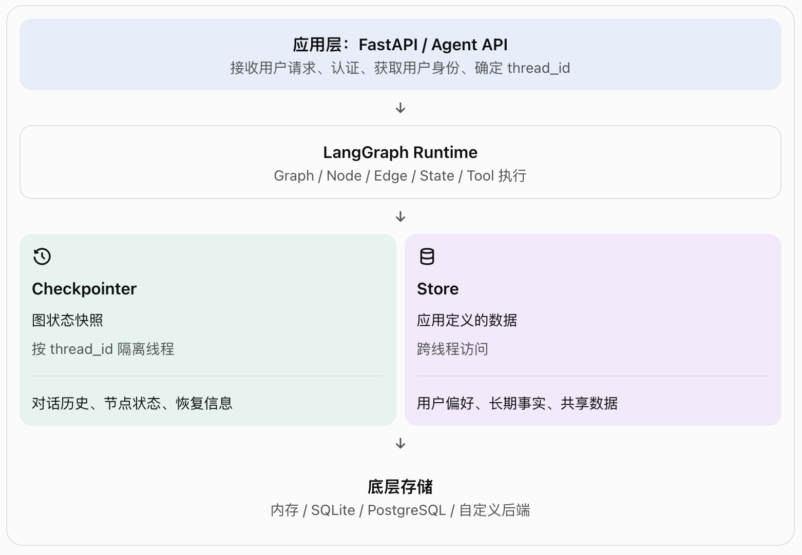

# langGraph-3.1-持久性 Persistence

把 Persistence 理解为整个 Agent 系统的“数据记忆与恢复机制”。

Checkpointer 保存一次对话线程的图状态，Store 保存跨线程长期使用的数据。两者解决不同的问题，生产系统通常可以同时使用。

## 一、概念理解：LangGraph 的 Persistence 主要解决四类问题

1. 对话连续性: 通过 thread_id 找回同一对话线程之前的状态。

2. 中断后继续执行: 例如，Agent 等待人工审批，审批完成后再继续。

3. 故障恢复: 在符合检查点和执行语义的前提下，从已保存的执行状态恢复，而不必每次都从头运行。

4. 长期记忆: 保存用户偏好、项目事实和共享知识，让不同对话线程可以访问这些信息。

❗注意：持久化并不等于模型自己获得了永久记忆。真正保存和读取数据的是你的应用(LangGraph 的持久化组件以及底层存储系统)。

## 二、层级关系：LangGraph Persistence 的整体架构



这张图需要注意两点：

- Checkpointer 和 Store 是两套互补的持久化机制，不是父子关系。
- 上图中的内存、SQLite 和 PostgreSQL 是不同的实现选择，不是每个实现都同时支持两套机制。

### 2.1 Checkpointer 与 Store 的区别

| 对比维度 | Checkpointer                         | Store                          |
| -------- | ------------------------------------ | ------------------------------ |
| 核心用途 | 保存图执行状态                       | 保存应用定义的数据             |
| 典型范围 | 单个线程                             | 多个线程之间                   |
| 数据形式 | State 的检查点及执行元数据           | 命名空间下的 key-value 数据项  |
| 常见内容 | Messages、当前工作状态、恢复所需信息 | 用户偏好、项目事实、长期记忆   |
| 访问方式 | thread_id + graph config             | namespace + key                |
| 典型场景 | 对话续接、人工介入、故障恢复         | 跨对话记忆、用户资料、共享知识 |

用一个容易记忆的类比：

- Checkpointer = 某个工作任务的存档。
- Store = 多个工作任务都可以查询的资料库。

❗Store 不会自动把所有对话内容转化成长期记忆。应用需要明确决定哪些信息值得保存、如何检索，以及何时更新或删除。

## 三、代码解读：从 Quickstart 看懂执行流程

```python
from langgraph.checkpoint.memory import InMemorySaver
from langgraph.store.memory import InMemoryStore

checkpointer = InMemorySaver() # 第一步：创建两个持久化组件
store = InMemoryStore() # 第一步：创建两个持久化组件

# -----------------------------------------------
graph = builder.compile( # 第二步：把持久化能力接入 Graph
    checkpointer=checkpointer,
    store=store,
)
result = graph.invoke(
    {
        "messages": [
            {"role": "user", "content": "Hi, my name is Bob."}
        ]
    },
    {"configurable": {"thread_id": "thread-1"}}, # 第三步：这里的第二个参数是运行配置 config，不是 Graph 的业务 State。
)


```

这里有三个常见误区：

1. thread_id 不是用户 ID。一个用户可以拥有多个对话线程。
2. thread_id 也不是 Store 的 key。它用于标识图执行线程。
3. 仅仅设置 thread_id 并不会让数据跨进程永久保存，仍然取决于 Checkpointer 的实现。

### 3.1 第四步：Store 怎样保存长期记忆？

```python
# 选择一个用户的命名空间
namespace = ("users", "user-123")
# 保存用户偏好
store.put(
    namespace,
    "preferences",
    {"preferred_database": "PostgreSQL"},
)
# 读取用户偏好
item = store.get(namespace, "preferences")

if item is not None:
    print(item.value)  # {"preferred_database": "PostgreSQL"}
```

| 参数          | 含义                 |
| ------------- | -------------------- |
| namespace     | 数据属于哪个逻辑空间 |
| "preferences" | 当前空间中的数据 key |
| value         | 要保存的业务数据     |

❗ 实际项目中必须根据经过认证的用户身份确定 namespace，不能直接相信客户端随意传来的用户 ID。 否则可能发生跨用户读取或修改数据的问题。

## 四、能力边界：Persistence 能做什么，不能做什么？

### 4.1 Checkpointer 的能力边界

可以做到

- 保存线程的图状态检查点。
- 为对话续接、人工介入和状态检查提供基础。
- 在符合恢复条件时，从保存的执行状态继续。
- 为时间旅行式调试、历史状态检查等功能提供基础。

不能单独保证

- 外部 API 调用只执行一次。
- 所有副作用都能自动回滚。
- 数据无限期保留且不会增加成本。
- 不同线程之间自动共享全部状态。

因此，生产系统还需要：

- 幂等键（Idempotency Key）。
- 明确的副作用执行边界。
- 对外部操作记录结果。
- 必要时采用事务、补偿操作或人工确认。
  保存了检查点，不代表所有外部操作都具有 exactly-once 语义。

### 4.2 Store 的能力边界

Store 可以持久化应用定义的数据，但它不是完整的记忆管理系统。

它不会自动完成：

- 从长对话中提取有价值的事实。
- 判断事实是否过期或相互矛盾。
- 对所有历史数据进行自动语义检索。
- 自动执行用户权限检查。
- 自动删除数据库和备份中的所有相关数据。

如果需要语义检索，还要根据使用的 Store 实现配置相应的索引、embedding 和检索逻辑。

### 4.3 常见问题

1. 为什么检查点会不断增长？
   假设用户一直在同一个线程里聊天： 每次请求都可能产生多个检查点，而不是只产生一个。
   此外，如果 State 中的 messages 不断累积，默认情况下，每个 super-step 的检查点还可能包含完整的累积状态。因此，检查点数量在增长，单个检查点的大小也可能在增长。
   - 有一个容易忽略的区别：
     - 检查点数量增长：执行过程中保存了越来越多的状态快照。
     - 检查点体积增长：对话历史、工具结果等 State 内容越来越大。

   解决方案包括：
   - 根据业务需求制定保留周期。
   - 评估官方后端提供的清理能力。
   - 设计经过验证的归档、清理和备份策略。
   - 先确认历史检查点的依赖关系，再执行删除。
     不要未经验证就直接删除数据库中的检查点行，因为检查点、父子关系和恢复所需元数据可能相互关联。

2. 为什么父图可能无法立即看到子图的状态更新？

   父图和子图可能拥有不同的检查点命名空间。子图内部状态的保存，不代表父图 State 中的同名字段会自动同步。

3. 什么时候真正写入数据库？还可以配置

   LangGraph 提供了 durability 执行模式：

   | 模式    | 写入时机                 | 特点                                             |
   | ------- | ------------------------ | ------------------------------------------------ |
   | "sync"  | 保存完成后再进入下一步   | 持久性更强，可能增加延迟                         |
   | "async" | 异步保存，同时执行下一步 | 性能与持久性折中                                 |
   | "exit"  | 图执行退出时保存变更     | 性能较好，但中途崩溃时可能丢失尚未保存的中间状态 |

## 五、自主可控性

自建时建议重点掌握的四项能力

1. 状态持久化：检查点保存、恢复、保留周期和备份。
2. 长期记忆：用户级、租户级命名空间，以及记忆的创建、更新和删除。
3. 可观测性：记录节点执行、模型调用、工具输入输出、错误和耗时。
4. 审计与回放：保存执行事件、状态版本及必要的输入输出，以便排查问题和重建执行过程。

❗特别注意：审计日志不应直接保存所有敏感提示词、密钥或未经脱敏的业务数据。回放也不一定等于原样重跑；模型输出、时间、外部接口响应等可能发生变化。

## 六、实战路线：从内存实验到生产部署

- 生产环境还需要额外解决什么？
  原文提到 PostgresSaver 的 thread_id 长度限制、检查点清理和子图命名空间问题。这些都是具体工程问题，而不是 Persistence 的全部。

  在生产环境中，还要明确：
  - 数据库连接池、并发写入和事务策略。
  - 多实例部署时，各实例能否访问同一套持久化后端。
  - 检查点和 Store 的备份、恢复与迁移。
  - 用户注销、租户删除和数据保留政策。
  - 外部工具执行记录与图状态之间的一致性。
  - LangGraph、检查点扩展包和数据库版本之间的兼容性。

  另外，文档中的 uuid7 示例用于生成线程标识；如果采用随机 UUID，不必为了确定性而做额外处理。如果业务确实要求同一业务对象生成稳定的线程 ID，应选择有明确命名空间和碰撞控制的设计，而不是随意截断哈希或 UUID。

## 七、总结

- Persistence: 让应用数据和执行状态能够超越单次运行
- Checkpointer: 保存、读取和恢复线程级 Graph 状态
- thread_id: 标识一个对话或执行线程
- Store: 保存应用定义的跨线程数据
- Namespace + Key: 定位 Store 中的数据
- InMemorySaver: 内存型检查点实现，重启后数据丢失
- InMemoryStore: 内存型 Store，不能作为默认的跨重启持久化方案
- PostgreSQL 后端: 可用于构建自托管的持久化方案
- LangSmith :可用于观测等工作，不应与 LangGraph 的核心持久化概念混为一谈

建议记住三句话：

1. thread_id 解决的是“这是哪个线程”，不是“这是哪个用户”。
2. Checkpointer 解决“上次执行到哪里、状态是什么”；Store 解决“其他线程也需要使用哪些长期数据”。
3. 持久化只是可靠 Agent 的基础，还需要权限、幂等、审计、备份、保留策略和故障恢复设计。
