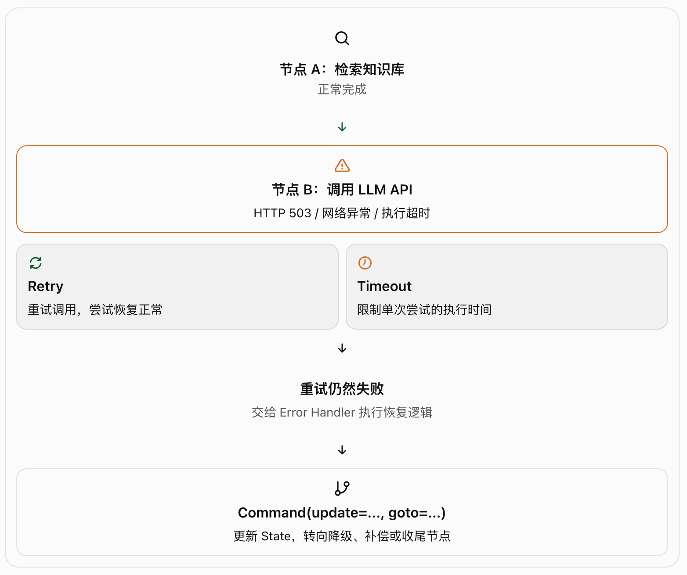
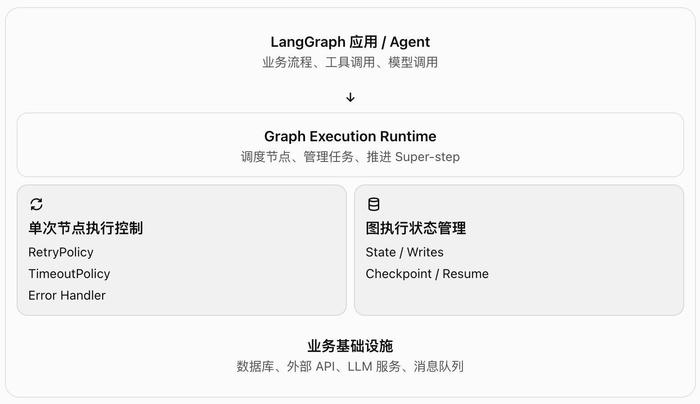
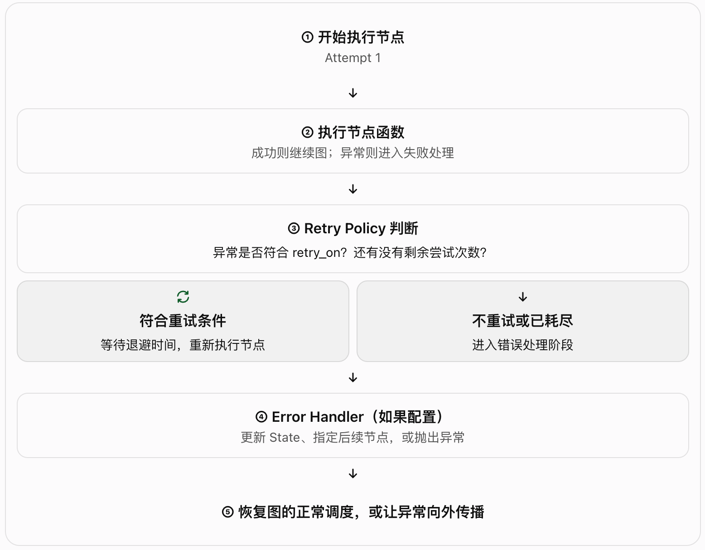

# langGraph-3.11-容错机制

## 一、概念理解：Fault tolerance 到底是什么？

Fault tolerance（容错）不是保证程序永远不出错，而是：当程序出错时，系统有明确的策略决定：是否重试、何时停止、如何恢复，以及如何保留必要的执行进度。



- 执行失败的处理：Retry、Timeout、Error Handler。
- 执行进度的持久化与恢复：Checkpoint、Checkpointer、Resume。

## 二、层级关系：这些机制位于 LangGraph 的哪里？



- RetryPolicy: 判断失败后是否重新执行
- TimeoutPolicy: 限制单次节点尝试的运行时间或无进展时间
- error_handler :重试耗尽后处理失败
- State: 表示当前图的业务状态
- Checkpoint: 持久化图执行状态与相关执行信息
- RunControl: 请求图在 Super-step 边界停止【容器停机，退出】

## 三、为什么需要这套机制？

| 故障场景                 | 合适的处理方式         | 原因                                 |
| ------------------------ | ---------------------- | ------------------------------------ |
| HTTP 503，服务临时不可用 | Retry                  | 过一会儿可能恢复                     |
| 某次模型调用卡住         | Timeout + Retry        | 限制等待，再决定是否重试             |
| 参数错误、业务校验失败   | 直接报错或业务错误处理 | 重试通常无法修复输入问题             |
| 扣款失败，但库存已经预留 | Error Handler + 补偿   | 需要处理已经产生的业务副作用         |
| 容器收到 SIGTERM         | Graceful Shutdown      | 在合适的执行边界停止，保留恢复点     |
| 进程崩溃后继续执行       | Checkpoint + Resume    | 依赖持久化状态恢复，而不是仅靠 Retry |

🔥核心原则是：技术故障优先考虑重试，业务失败优先考虑业务规则，进程退出优先考虑安全停止和恢复。

## 四、工作原理：一次节点失败后，LangGraph 按什么顺序处理？



这里有三个关键细节。

1. Retry 在 Error Handler 之前。 如果节点重试成功，就不会因为这次失败而调用 Error Handler。
2. Error Handler 不是必需的。 没有配置处理器，异常在重试耗尽后会继续向外传播。
3. Timeout 也会进入 Retry 流程。 超时会产生 NodeTimeoutError，随后由重试策略判断是否再次执行。

### 4.1 Retry：重试的是整个节点尝试

```python
from langgraph.types import RetryPolicy

builder.add_node(
    "call_api",
    call_api,
    retry_policy=RetryPolicy(max_attempts=3),
)
```

| 参数             | 默认值           | 含义                     |
| ---------------- | ---------------- | ------------------------ |
| max_attempts     | 3                | 最大总尝试次数           |
| initial_interval | 0.5 秒           | 首次重试前的基础等待时间 |
| backoff_factor   | 2.0              | 每次等待时间的增长倍数   |
| max_interval     | 128 秒           | 单次重试间隔的上限       |
| jitter           | True             | 在等待时间中加入随机抖动 |
| retry_on         | default_retry_on | 决定哪些异常可以重试     |

- default_retry_on排除不适合自动重试的异常，例如：
  - ValueError：值不符合预期。
  - TypeError：类型使用错误。
  - RuntimeError：默认策略排除该异常及其子类。
  - OSError：默认策略也排除该异常及其子类。

- 自定义异常进行特殊处理

```python
from langgraph.types import RetryPolicy, default_retry_on

def custom_retry_on(exc: BaseException) -> bool:
    if isinstance(exc, MyCustomError):
        return False

    return default_retry_on(exc)

policy = RetryPolicy(
    max_attempts=3,
    retry_on=custom_retry_on,
)
```

这段代码表示：MyCustomError 不重试，其他异常继续使用 LangGraph 的默认判断规则。

### 4.2 Timeout：区分执行超时与空闲超时

❗ 文档要求 langgraph>=1.2，而且节点级超时只适用于 异步节点。

```python
builder.add_node(
    "call_model",
    call_model,
    timeout=60, # 这表示单次尝试的最长运行时间为 60 秒。
)

# -------------------------------------------------------
from langgraph.types import TimeoutPolicy

builder.add_node(
    "call_model",
    call_model,
    timeout=TimeoutPolicy(
        run_timeout=120,
        idle_timeout=30,
    ),
)
```

- run_timeout：运行时间上限

  无论节点有没有持续输出进展，单次尝试总运行时间达到上限，就触发超时。活动不会重置这只时钟。

- idle_timeout：无进展时间上限

  节点持续没有可观察到的进展达到指定时间，就触发超时。产生有效进展信号后，空闲计时器可以重置。

默认的 refresh_on="auto" 会根据可观察到的进展刷新空闲计时器，包括状态写入、流式输出、子任务调度、Runtime stream writer 调用，以及 LangChain 回调事件等。

这意味着，"收到 LLM token 并不等于整个节点完成了任务"，但它可能足以刷新 idle_timeout。因此，即使一个节点持续输出 token，也仍然可能因为达到 run_timeout 而超时。

```python
# --- 如果只希望显式心跳才算进展： --------------------------------------------------
timeout=TimeoutPolicy(
    idle_timeout=30,
    refresh_on="heartbeat",
)
# 长时间运行的异步节点可以主动发送心跳：
async def long_running_node(state, runtime):
    for batch in fetch_batches():
        process(batch)
        runtime.heartbeat()

    return {"status": "done"}
# ❗ 注意，这个示例里的 fetch_batches() 和 process() 是示意业务函数；如果它们是同步阻塞操作，仍需要考虑阻塞事件循环的问题。
```

### 超时与重试如何组合？

```python
builder.add_node(
    "call_model",
    call_model,
    timeout=TimeoutPolicy(idle_timeout=30),
    retry_policy=RetryPolicy(max_attempts=3),
)
```

单次尝试超时后，LangGraph 抛出 NodeTimeoutError，清除这次失败尝试产生的图状态写入，再由 Retry Policy 决定是否重试。新尝试有自己的超时计时。

但要注意： `清除 LangGraph 状态写入，不代表撤销已经发生的外部副作用`。 如果调用方已经完成扣款或提交数据库事务，单纯重试可能再次扣款或重复提交。

另外，❗同步节点不能直接使用这里的节点超时配置。如果需要为阻塞 I/O 设置超时边界，应使用异步节点，并合理地通过 asyncio.to_thread() 等方式封装阻塞操作；具体能否真正取消底层操作，还取决于被调用的库和执行方式。

### 4.3 Error Handler：重试失败后如何恢复？

```python
from langgraph.errors import NodeError
from langgraph.types import Command, RetryPolicy

def charge_payment(state):
    raise RuntimeError("payment gateway timeout")

def payment_error_handler(state, error: NodeError):
    return Command(
        update={
            "status": f"failed: {error.error}"
        },
        goto="finalize",
    )

builder.add_node(
    "charge_payment",
    charge_payment,
    retry_policy=RetryPolicy(max_attempts=3),
    error_handler=payment_error_handler,
)
```

这里的 NodeError 包含两个字段：

- error.node：失败节点的名称。
- error.error：实际抛出的异常对象。

处理器可以返回普通的 State 更新，也可以返回 Command，同时指定更新内容与后续路由。 ⚠️ 副作用需要补偿

另外，❗ Error Handler 本身如果抛出异常，该异常会继续向外传播。虽然可以为处理器配置 Retry 和 Timeout，但不要认为处理器自身的失败一定能被同一个处理器捕获并恢复。

## 五、代码解读：把三种容错机制串起来

```python

import asyncio
from typing_extensions import TypedDict

from langgraph.errors import NodeError
from langgraph.graph import StateGraph, START, END
from langgraph.types import Command, RetryPolicy, TimeoutPolicy


class State(TypedDict):
    result: str
    status: str


# 实际项目中替换成真实的异步 API 请求
async def call_api(state: State) -> dict:
    await asyncio.sleep(0.1)
    return {
        "result": "data from API",
        "status": "success",
    }


async def call_api_node(state: State) -> dict:
    return await call_api(state)


def handle_api_error(
    state: State,
    error: NodeError,
) -> Command:
    # 此处仅演示状态降级。
    # 生产环境应记录日志、错误码及必要的审计信息。
    return Command(
        update={
            "result": "",
            "status": f"degraded: {error.node}",
        },
        goto="finalize",
    )


def finalize(state: State) -> dict:
    return {"status": state["status"]}


builder = StateGraph(State)

builder.add_node(
    "call_api",
    call_api_node,
    retry_policy=RetryPolicy(
        max_attempts=3,
    ),
    timeout=TimeoutPolicy(
        run_timeout=10,
    ),
    error_handler=handle_api_error,
)

builder.add_node("finalize", finalize)
builder.add_edge(START, "call_api")
builder.add_edge("call_api", "finalize")
builder.add_edge("finalize", END)

graph = builder.compile()


async def main():
    result = await graph.ainvoke({
        "result": "",
        "status": "pending",
    })
    print(result)


if __name__ == "__main__":
    asyncio.run(main())

```

理解执行结果时，可以分成两条路径：

- 正常路径：API 调用成功 → 更新 State → 执行 finalize → 返回结果。
- 失败路径：API 调用持续失败或超时 → 最多尝试三次 → 执行 handle_api_error → Command 更新 State 并跳转到 finalize。

### 5.1 execution_info：节点怎么知道当前是第几次尝试？

```python
from langgraph.runtime import Runtime

async def call_api_node(state: State, runtime: Runtime) -> dict:
    if runtime.execution_info.node_attempt > 1:
        # 第二次及后续尝试：改走备用服务
        return await call_fallback_api()

    return await call_primary_api()
```

这能实现一种很实用的降级策略：

- 第一次：调用主服务。
- 第二次：调用备用服务。
- 后续：继续执行备用逻辑，或根据业务策略处理。
  不过，重试本身并不要求你读取 node_attempt。只有在需要根据尝试次数改变执行策略时才需要它。

execution_info 还提供:

1. node_first_attempt_time、
2. thread_id、
3. run_id、
4. checkpoint_id
5. task_id 等信息，

适合用于日志关联和故障排查。没有配置 Checkpointer 时，thread_id 可以是 None。

### 5.2 set_node_defaults：统一设置节点默认策略

如果每个节点都要设置相同的 Retry、Timeout 和 Error Handler，代码会出现大量重复。

```python
# --- 可以使用 图级默认值： --------------------
builder = StateGraph(State)

# 这三个节点会使用统一的默认配置。
builder.set_node_defaults(
    retry_policy=RetryPolicy(max_attempts=3),
    timeout=TimeoutPolicy(run_timeout=30),
    error_handler=default_error_handler,
)

builder.add_node("fetch_data", fetch_data)
builder.add_node("process_data", process_data)
builder.add_node("save_data", save_data)

# --- 某个节点也可以覆盖默认值： --------------------
builder.add_node(
    "save_data",
    save_data,
    timeout=TimeoutPolicy(run_timeout=60),
    error_handler=save_error_handler,
)
# 此时 save_data 使用 60 秒的超时和专属错误处理器；其他未覆盖的配置仍使用图级默认值。
```

几个容易忽略的规则：

- 默认值在 compile() 时解析，因此 set_node_defaults() 可以在添加节点前或后调用。
- 父图的默认值不会自动继承给子图。
- 错误处理器自身可以配置 Retry 和 Timeout。
- 默认的 error_handler 不应用于错误处理器节点自身，避免处理器捕获自身的失败。
- cache_policy 的默认值也不应用于错误处理器节点，因为缓存补偿逻辑可能产生不安全的结果。

## 六、Graceful Shutdown：为什么它不属于普通的重试逻辑？

Graceful Shutdown（优雅停机）解决的是：系统准备停止，但不希望把正在执行的图直接中断在任意位置。

LangGraph 通过 RunControl 提供协作式停止机制：

```python
from langgraph.runtime import RunControl
from langgraph.errors import GraphDrained

control = RunControl()

try:
    result = graph.invoke(
        inputs,
        config,
        control=control,
    )
except GraphDrained as exc:
    print(f"Stopped: {exc.reason}")

# -- 外部的信号处理逻辑或进程管理器可以调用： --------------
control.request_drain("sigterm")
# 这个调用请求图在合适的边界停止，而不是立即取消正在执行的所有任务。
```

❗ 总结：Graceful Shutdown 是应用层面的“尽力而为”，而容器系统的 SIGKILL 是物理层面的“绝对命令”。只有当应用的停机耗时严格小于容器的宽限期时，优雅停机才能真正生效

### 6.1 为什么是 Super-step 边界？

LangGraph 的图执行以 Super-step 为调度单位。一个 Super-step 可能包含多个并行执行的节点。

request_drain() 发出停止请求后：

- 正在执行的节点不会因此立即被强行终止。
- 正在进行的重试循环会继续，直到成功或重试耗尽。
- 到达下一个 Super-step 边界时，如果还有后续工作，图会保存可恢复的 Checkpoint，并通过 GraphDrained 表明本次运行已暂停。
- 如果图恰好在同一时刻自然完成，调用可能正常返回，而不是抛出 GraphDrained。

❗这与节点级 Timeout 有本质区别。

- 恢复方式：`result = graph.invoke(None, config)`: 前提是使用相同的 thread_id、可用的 Checkpointer，以及此前保存的可恢复状态。

❗还要注意：优雅停机不等于强制取消。它不会自动终止正在运行的线程，也不会保证阻塞 I/O 立刻停止。因此，生产环境通常需要同时设计合理的节点超时、底层 I/O 超时和进程退出期限。

## 七、能力边界：这些机制究竟能保证什么？

- 7.1 Retry 不等于业务操作只执行一次
  1. 副作用，例：支付

- 7.2 Checkpoint 不等于自动回滚
  1. 副作用，例：已经写入数据库的数据

- 7.3 Error Handler 不等于异常一定被吞掉
  1. 自身异常

- 7.4 interrupt() 不走普通的失败处理链
- 7.5 子图失败如何处理？

  如果父图的某个节点包装了子图，子图出现未处理异常时，该异常会向父节点传播。如果父节点配置了 Error Handler，处理器可以接收到子图抛出的异常。

  👉 父图的 set_node_defaults() 不会自动继承到子图。子图有自己的节点默认配置。

## 八、对比：Retry、Timeout、Error Handler、Checkpoint 与 Graceful Shutdown

| 机制              | 主要解决什么问题                   | 是否直接负责持久化恢复 |
| ----------------- | ---------------------------------- | ---------------------- |
| Retry             | 暂时失败后再次尝试                 | 否                     |
| Timeout           | 限制单次尝试的执行时间             | 否                     |
| Error Handler     | 失败耗尽后执行恢复或补偿逻辑       | 否                     |
| Checkpoint        | 保存图执行状态，支持恢复           | 是                     |
| Graceful Shutdown | 在 Super-step 边界停止并保留恢复点 | 依赖 Checkpointer      |

- State：当前工作流的状态数据。
- Writes：节点执行过程中产生的状态更新。
- Super-step：图的调度与执行边界。
- Checkpoint：在相应检查点边界持久化图状态。
- Retry：在节点级重新尝试执行。
- Error Handler：在失败处理阶段决定后续状态和路由。
- Resume：从保存的执行状态继续运行。

## 九、自主可控性

对生产环境，我建议你把以下能力掌握在自己的业务代码和基础设施中：

1. 可配置的重试策略：针对不同外部服务设置不同的异常类型、次数和退避参数。
2. 统一的业务错误模型：区分可重试异常、永久异常、业务拒绝和人工审批。
3. 幂等与补偿机制：确保扣款、订单创建、消息发送等外部副作用能够安全恢复。
4. 可恢复的持久化：根据任务重要性选择持久化 Checkpointer，并验证重启恢复流程。
5. 自有审计与追踪：关联 thread_id、run_id、task_id、业务任务 ID 和错误记录。
6. 优雅停机与任务管理：协调进程退出、超时、Checkpointer 和后台任务调度。

## 总结：建立完整的故障处理思维模型

```text
节点执行失败: 异常、网络故障或超时
   ↓
Retry Policy: 判断是否允许再次尝试
   ↓
Error Handler（如果配置）: 恢复、降级、补偿或转向其他节点
   ↓
续图执行或向外传播异常: 需要跨进程恢复时，配合 Checkpoint
```

最后再把三个最重要的区别记牢：

- Retry 是重新尝试执行，不是恢复整个图。
- Error Handler 是处理失败，不是自动撤销外部副作用。
- Checkpoint 是保存可恢复的执行状态，不是保证业务事务恰好执行一次。
