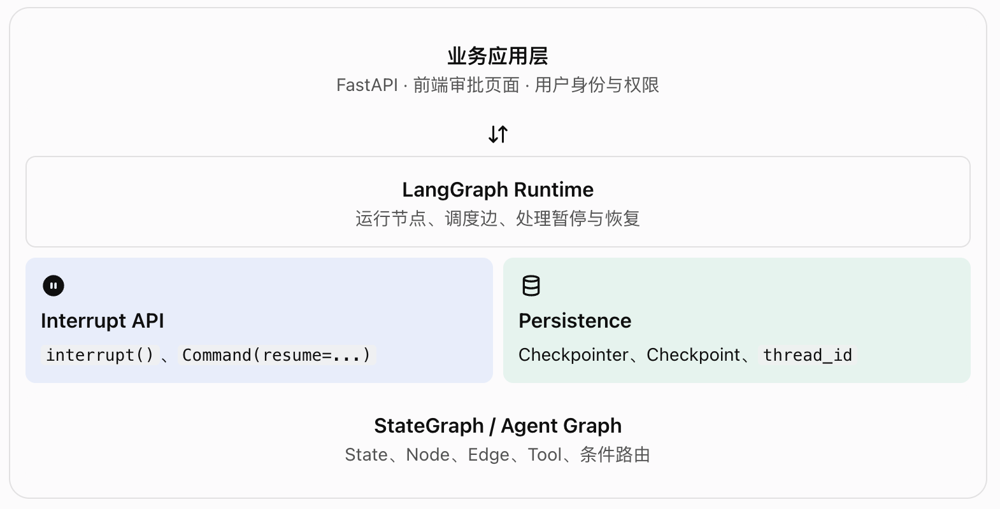
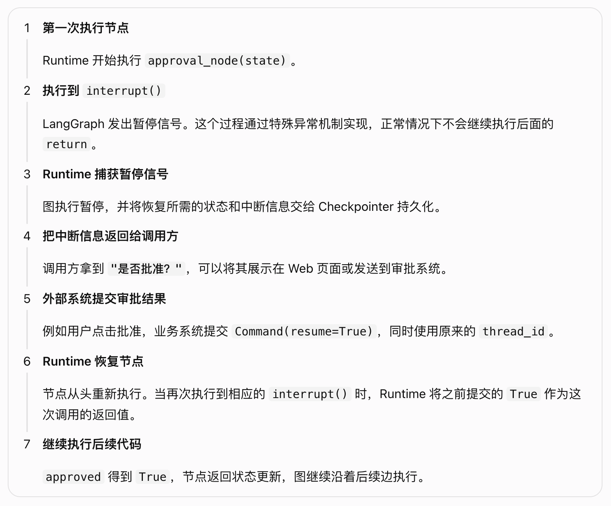

# langGraph-3.4-暂停(Interrupts)

- interrupt(): 负责暂停并向外部提出请求;
- Checkpointer: 负责保存图的执行状态;
- thread_id : 负责定位这次执行;
- Command(resume=...) : 负责把外部输入送回暂停的位置;

四者组合起来，构成 LangGraph 的人工介入机制（Human-in-the-loop，HITL）。

## 一、概念理解：Interrupt 到底是什么？

对于查询操作，通常可以自动执行；但对于删除数据、修改权限、发送邮件、执行付款等高风险操作，通常应该先让人确认。
LangGraph 负责工作流暂停和恢复；具体的审批页面、身份认证、通知、权限校验，需要应用层配合实现。

## 层级关系：Interrupt 在 LangGraph 中处于什么位置？



| 概念                | 负责什么                       | 不负责什么                       |
| ------------------- | ------------------------------ | -------------------------------- |
| interrupt()         | 在节点中提出暂停请求           | 不负责展示审批页面               |
| Checkpointer        | 持久化图执行状态及恢复所需信息 | 不负责让人批准                   |
| thread_id           | 定位需要恢复的图执行线程       | 不等于用户身份或审批单号         |
| Command(resume=...) | 将外部响应传回中断点           | 不自动验证业务用户是否有审批权限 |
| stream.interrupts   | 向调用方暴露待处理的中断信息   | 不负责把通知送到审批人手机上     |
| response_schema     | 描述、校验恢复输入的结构       | 不替代业务授权与完整的业务规则   |

## 三、为什么需要 Interrupt？它解决了什么问题？

1. 普通工作流无法自然等待人工决策
2. 真实业务需要“执行权”的控制点
3. Interrupt 不是每个节点都需要使用

## 四、工作原理：一次 Interrupt 究竟发生了什么？



```python
def approval_node(state):
    print("执行前置逻辑")

    approved = interrupt("是否批准？")

    print("审批结果：", approved)
    return {"approved": approved}
```

❗恢复时不是从 interrupt() 下一行直接跳转，而是重新执行【包含 interrupt()】的那个节点（node）函数体，不是整个图从头重新执行

第一次执行会打印：执行前置逻辑；
恢复执行时，print("执行前置逻辑") 还会再次运行，然后 Runtime 才会将恢复值交给 interrupt()。任何写在中断点之前的代码，都要考虑重复执行的可能。

### 4.1 Checkpoint VS Writes 保存什么？

State：图当前的业务状态，例如 approved、action_details。
Checkpoint：保存图的某个执行边界上的"状态快照(即State)"，以及 Runtime 恢复执行所需的持久化信息。
Writes：记录”已经完成的节点任务“所产生的状态更新，使 Runtime 能够在后续提交状态时复用这些结果。
Interrupt 信息：待处理的中断请求和关联的恢复信息。

LangGraph 保存的是能够支持工作流恢复的持久化数据，而不是把整个 Python 进程冻结到某一行代码。

### 4.2 thread_id 为什么如此重要？

thread_id：线程ID

## 五、代码解读

```python
from typing import TypedDict

from langgraph.checkpoint.memory import InMemorySaver
from langgraph.graph import START, END, StateGraph
from langgraph.types import Command, interrupt


class State(TypedDict):
    action: str
    approved: bool | None


def approval_node(state: State):
    approved = interrupt({   # 暂停节点，并把审批信息交给调用方
        "question": "是否批准执行？",
        "action": state["action"],
    })
    return {"approved": approved}


def execute_node(state: State):
    # 这里只展示流程，不实际执行外部操作
    return {"action": f"已批准执行：{state['action']}"}


def cancel_node(state: State):
    return {"action": f"已拒绝执行：{state['action']}"}


def route(state: State):
    return "execute" if state["approved"] else "cancel"


builder = StateGraph(State)
builder.add_node("approval", approval_node)
builder.add_node("execute", execute_node)
builder.add_node("cancel", cancel_node)

builder.add_edge(START, "approval")
builder.add_conditional_edges(
    "approval",
    route, # 根据更新后的状态决定下一条边
    {
        "execute": "execute",
        "cancel": "cancel",
    },
)
builder.add_edge("execute", END) # 结束当前图执行
builder.add_edge("cancel", END)

graph = builder.compile(checkpointer=InMemorySaver()) # 为图配置持久化机制

config = {
    "configurable": {
        "thread_id": "order-10086"  # 指定要保存和恢复的线程
    }
}

# 第一次执行：到达审批节点后暂停
result = graph.invoke(
    {
        "action": "删除订单 10086",
        "approved": None,
    },
    config=config,
)

print(result["__interrupt__"]) # 从默认 invoke() 结果中读取中断信息

# 恢复执行：模拟人工批准
result = graph.invoke(
    Command(resume=True), # 把批准结果传回对应的中断点
    config=config,
)

print(result)
```

interrupt() 返回给调用方的是中断请求;
Command(resume=True) 中的 True 是恢复时交给节点的响应。

### 5.1 Command 有两种常见用途

1. 作为图的输入：恢复中断

   `graph.invoke(Command(resume=True), config=config,)` 含义：把外部输入交给之前暂停的 interrupt()。

2. 作为节点的返回值：更新状态或跳转

   `return Command(update={"approved": True}, goto="execute",)` 含义：节点返回状态更新，并指示 Runtime 跳转到指定节点。

- Command(resume=...) 是用来恢复中断的；
- Command(update=..., goto=...) 则是节点控制图执行的另一种方式。

### 5.2 用事件流处理 Interrupt

```python
stream = graph.stream_events(
    {"action": "删除订单 10086", "approved": None},
    config=config,
    version="v3",
)

# 必须消费到暂停或结束，才能驱动本次运行完成
_ = stream.output

if stream.interrupted: # 判断本次运行是否因中断而暂停。
    for item in stream.interrupts: # 查看暂停时提交的中断信息。
        print(item.value)

    resumed = graph.stream_events(
        Command(resume=True),
        config=config,
        version="v3",
    )
    final_state = resumed.output # 取得最终图状态；在等待输入的场景中，读取它也会驱动流完成到暂停点。
```

## 六、进阶能力：Interrupt 不只是一个批准按钮

### 6.1 类型化响应：response_schema

```python
from pydantic import BaseModel
from langgraph.types import interrupt


class Decision(BaseModel):
    approved: bool
    note: str | None = None


def approval_node(state):
    decision = interrupt(
        {
            "question": "是否批准修改数据库？",
            "target": state["target"],
        },
        response_schema=Decision,
    )

    return {"decision": decision}
# -- 恢复时： -------------------------------------
result = graph.invoke(
    Command(
        resume={
            "approved": True,
            "note": "已核对业务单据",
        }
    ),
    config=config,
)
```

### 6.2 多个 Interrupt：一个节点可以问多个问题

### 6.3 并行 Interrupt：多个分支同时等待审批

```python
resume_map = {
    item.id: response_for(item) for item in stream.interrupts
}

resumed = graph.stream_events(
    Command(resume=resume_map),
    config=config,
    version="v3",
)
```

并行分支的核心问题是响应与中断的对应关系，而不是响应的数量。

### 6.4 中断可以放进 Tool 内部

## 七、能力边界：哪些地方最容易出问题？

1. 不要用 try/except Exception 包住 interrupt()
2. 中断前的副作用可能重复执行
3. 不要在单个节点中用 while True 反复中断
4. 中断状态不等于整个业务系统的持久化
5. Checkpointer 的持久性决定恢复能力
