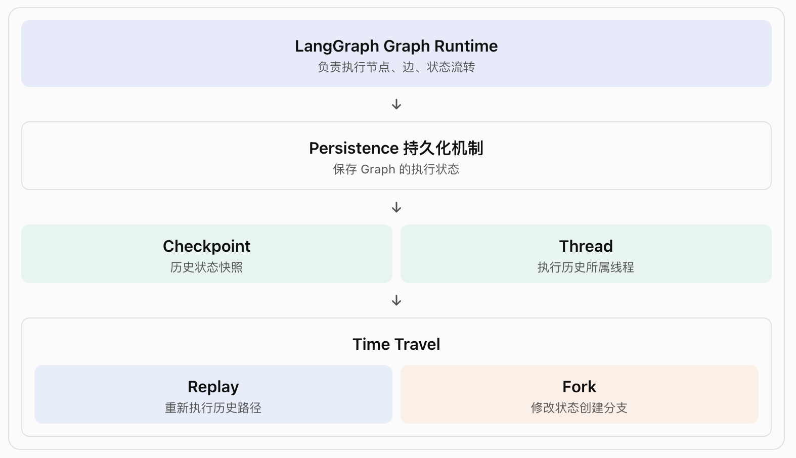

# langGraph-3.5-时间旅行(Time Travel) -- 基于检查点

Time Travel 的核心价值: 让 Agent 能够回到过去某个检查点，重新执行后续流程，或者修改过去的状态，探索另一条执行路径。

## 一、概念理解: 什么是 Time Travel？

- Time Travel（时间旅行）就是: 利用历史 Checkpoint，回到某个历史执行节点，从那里重新继续运行 Graph。

- LangGraph 提供两种时间旅行方式:

  | 方式   | 含义                   | 是否修改 State |
  | ------ | ---------------------- | -------------- |
  | Replay | 从历史检查点重新执行   | 默认不修改     |
  | Fork   | 从历史检查点创建新分支 | 可以修改       |

## 二、层级关系: Time Travel 在 LangGraph 中处于什么位置？



几个概念的关系:

- Checkpoint: 保存某个时刻的 Graph 状态。
- Thread: 一组关联的执行历史。
- Replay: 读取历史 Checkpoint，重新执行后续节点。
- Fork: 基于历史 Checkpoint 创建一个新的执行分支。
- get_state_history(): 查看 Thread 中的历史检查点。
- update_state(): 创建修改状态后的新检查点。

❗Time Travel 不是单独的执行引擎，而是利用 Checkpoint 和 Graph Runtime 实现的执行能力。

## 三、工作原理: Replay 和 Fork 到底怎么运行？

Checkpoint 不只是保存 State，还包含 Graph 的执行进度信息。

- Replay: 使用历史 State，重新执行。
- Fork: 修改历史 State，然后从修改后的 State 继续运行。

### 3.1 Replay: 重新执行历史检查点之后的节点

Replay 是重新计算，不是缓存读取。

### 3.2 Fork: 修改历史状态，创建新的执行分支

Fork 不会删除或回滚原来的执行历史，而是创建一个新的 Checkpoint 分支。原来的历史还在，新分支也会保留。

### 3.3 Replay 🆚 Fork

| 比较项     | Replay                 | Fork               |
| ---------- | ---------------------- | ------------------ |
| 起点       | 历史 Checkpoint        | 历史 Checkpoint    |
| 修改 State | 默认不修改             | 可以修改           |
| 创建分支   | 不主动修改状态创建分支 | 是                 |
| 后续节点   | 重新执行               | 重新执行           |
| 原始历史   | 保留                   | 保留               |
| 适用场景   | 重试、调试             | 方案探索、修改输入 |

注意: Replay 即使没有显式调用 update_state()，重新执行也可能产生与原来不同的结果。

## 四、代码解读

```python
from langgraph.graph import StateGraph, START
from langgraph.checkpoint.memory import InMemorySaver
from typing_extensions import TypedDict, NotRequired
from langchain_core.utils.uuid import uuid7

class State(TypedDict):
    topic: NotRequired[str] # 笑话主题。
    joke: NotRequired[str] # 生成的笑话。
    # NotRequired 表示字段不是必填的。
# -------------------------------------------
def generate_topic(state: State):
    return {"topic": "socks in the dryer"}

def write_joke(state: State):
    return {
        "joke": f"Why do {state['topic']} disappear? They elope!"
    }
# --------------------------------------
checkpointer = InMemorySaver()

graph = (
    StateGraph(State)
    .add_node("generate_topic", generate_topic)
    .add_node("write_joke", write_joke)
    .add_edge(START, "generate_topic")
    .add_edge("generate_topic", "write_joke")
    .compile(checkpointer=checkpointer)
)
# -- 第一次运行 Graph ----------------------------
config = {
    "configurable": {
        "thread_id": str(uuid7())
    }
}

result = graph.invoke({}, config)
# == 查看历史 Checkpoint ======================
history = list(
    graph.get_state_history(config) # 返回当前 Thread 的历史状态快照【History 按照时间倒序排列】。
)
# -- 遍历 -----------------------------------
for state in history:
    print(
        f"next={state.next}, "
        f"checkpoint_id="
        f"{state.config['configurable']['checkpoint_id']}"
    )
# 这里主要关注两个字段:
#   1. state.next: 下一个待执行的节点
#   2. checkpoint_id: 当前检查点的唯一标识

# == 4.1 Replay 代码 =======================
before_joke = next( # 从历史检查点中找到下一个需要执行 write_joke 的那个检查点。
    s for s in history if s.next == ("write_joke",)
    )

replay_result = graph.invoke(  # 不是重新运行整个 Graph，而是从指定历史检查点继续执行。
    None,
    before_joke.config
    )

# * None: 表示不额外提供新的输入 State，直接使用该 Checkpoint 保存的状态继续执行。
# * before_joke.config 它包含:
#   1. thread_id
#   2. checkpoint_id : 指定从哪个历史检查点恢复。
#   3. 以及相关执行配置

# == 4.2 Fork 代码 =======================
fork_config = graph.update_state(
    before_joke.config,
    values={
        "topic": "chickens"
    },
)
# before_joke.config: 指定从哪个历史 Checkpoint 分支
# values: 要修改的 State 字段

# 执行后会发生什么？
#   原始 Checkpoint: { "topic": "socks in the dryer" }
#   新 Checkpoint: {"topic": "chickens"}
#❗注意: 这不是直接修改原来的 Checkpoint，而是创建新的 Checkpoint。

# -- 从分支继续运行 ------------------------
fork_result = graph.invoke(
    None,
    fork_config
)
print(fork_result["joke"]) # 得到的是关于 chickens 的笑话。
```

## 五、From a specific node：指定从哪个节点之后继续执行

❗这一部分容易和普通的 Fork 混淆。

- update_state() 的两个能力：
  1. 修改 State。
  2. 指定这次 State 更新应该被视为哪个节点产生的。

1. 默认情况

   ```python
   fork_config = graph.update_state(
       before_joke.config,
       values={
           "topic": "chickens"
       },
   )
   ```

   LangGraph 会根据历史执行记录推断这次更新应该归属哪个节点。

2. 显式指定 as_node

   ```python
   fork_config = graph.update_state(
       before_joke.config,
       values={
           "topic": "chickens"
       },
       as_node="generate_topic", # 这相当于告诉 LangGraph：把这次 State 更新视为 generate_topic 节点的输出,从它的后继节点继续执行。
   )
   ```

   为什么需要它？主要有三种情况：

   | 场景      | 为什么需要                               |
   | --------- | ---------------------------------------- |
   | 并行分支  | 多个节点同时更新 State，无法确定更新归属 |
   | 新 Thread | 没有历史执行记录可以推断                 |
   | 跳过节点  | 希望把某个后续节点视为已经执行           |

   values 的合并方式也不是简单覆盖所有字段，而是通过对应 State 字段的 reducer 处理【数组追加】。

## 六、Interrupt 与 Time Travel

1. 普通 Interrupt：ask_human -> interrupt() -> 暂停
2. Replay 回到 Interrupt 之前: Interrupt 不是直接读取上一次人工输入，而是重新等待一次人工输入。

   ```bash
      回到 ask_human 之前
        ↓
      重新执行 ask_human
        ↓
      再次遇到 interrupt()
        ↓
      暂停，等待新的 Command(resume=...)
   ```

3. Fork 回到 Interrupt 之前

   ```bash
      修改历史 State
        ↓
      创建新分支
        ↓
      重新执行 ask_human
        ↓
      再次触发 interrupt
        ↓
      等待新输入
   ```

## 七、Multiple Interrupts：多个中断点的时间旅行

这对以下场景特别有价值：

- 多步骤表单。
- 人工审批。
- Agent 多轮信息收集。
- 业务流程修改。
- 工作流异常恢复。

❗注意：是从两个 Interrupt 之间的历史检查点继续。

## 八、Subgraphs：子图的时间旅行

1. 默认方式：Inherited Checkpointer: 子图默认继承父图的 Checkpointer。

   父图会把"整个子图的执行"作为一个 Super-step 处理(把整个子图作为一个节点-node，不能穿透到子图内部)。

2. 子图独立 Checkpointer：
   如果给子图配置自己的 Checkpointer，就可以保存更细粒度的执行历史。

- 这里要区分：
  - 父图 Checkpointer：保存父图级别的执行状态。
  - 子图 Checkpointer：保存子图内部的执行状态。

  因此，时间旅行的粒度取决于 Checkpointer 的配置方式。

## 九、能力边界：Time Travel 不是什么？

| 能力                                 | 是否支持 | 说明                   |
| ------------------------------------ | -------- | ---------------------- |
| 回到历史 State                       | 支持     | 通过历史 Checkpoint    |
| 重新执行后续节点                     | 支持     | Replay                 |
| 修改历史 State                       | 支持     | Fork                   |
| 保留原始执行历史                     | 支持     | 创建新分支             |
| 重新触发 Interrupt                   | 支持     | 需要新 resume          |
| 自动撤销外部 API 操作                | 不支持   | 不会自动回滚外部副作用 |
| 自动恢复原来的 LLM 输出              | 不支持   | 后续节点重新调用       |
| 默认继承模式下进入子图内部任意检查点 | 不支持   | 父图粒度有限           |
| 自动保证业务数据一致性               | 不支持   | 需要业务层设计         |

## 十、对比：Time Travel、Retry、Resume、Update State

| 功能         | 主要用途                   | 核心操作                  |
| ------------ | -------------------------- | ------------------------- |
| Retry        | 节点执行失败后重试         | RetryPolicy               |
| Resume       | 从 Interrupt 暂停处继续    | Command(resume=...)       |
| Update State | 修改当前 Graph 状态        | update_state()            |
| Replay       | 从历史检查点重新执行       | invoke(None, config)      |
| Fork         | 从历史检查点修改状态并分支 | update_state() + invoke() |

## 十一、最终总结

- 最后记住这五句话：
  1. Checkpoint 是时间旅行的基础：保存历史状态和执行进度。
  2. Replay 是回到过去重新执行：不修改原始状态，但后续节点会重新运行。
  3. Fork 是回到过去修改状态：创建一个新的执行分支。
  4. Interrupt 在时间旅行中会重新触发：需要重新提供 Resume 输入。
  5. Time Travel 只能控制 Graph 的执行历史：不能自动撤销外部 API 已经产生的副作用。

- 与前面持久化章节的衔接

  | 知识点      | 解决的问题                     |
  | ----------- | ------------------------------ |
  | Checkpoint  | 保存执行状态                   |
  | Thread      | 管理一组执行历史               |
  | Super-step  | 确定执行与检查点的边界         |
  | Writes      | 保存节点执行产生的中间更新     |
  | Store       | 跨 Thread 保存长期数据         |
  | Time Travel | 回到历史状态重新执行或创建分支 |
  | Interrupt   | 暂停执行，等待外部输入         |
