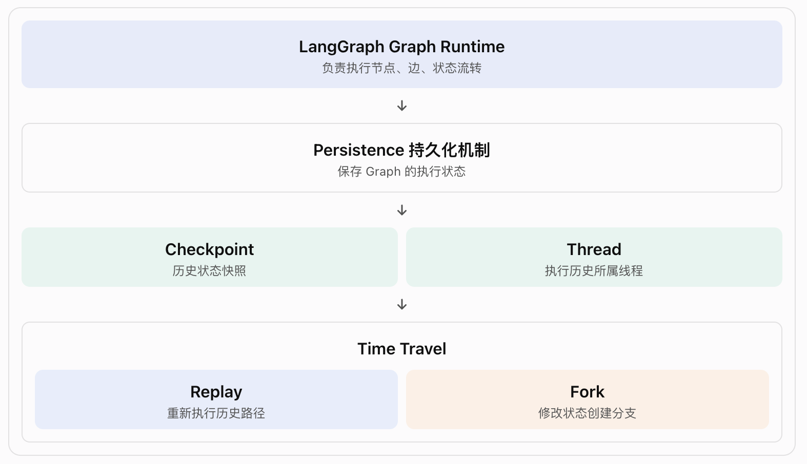

# langGraph-3.5-时间旅行(Time Travel)

Time Travel 的核心价值: 让 Agent 能够回到过去某个检查点，重新执行后续流程，或者修改过去的状态，探索另一条执行路径。

## 一、概念理解: 什么是 Time Travel？

- Time Travel（时间旅行）就是: 利用历史 Checkpoint，回到某个历史执行节点，从那里重新继续运行 Graph。

- LangGraph 提供两种时间旅行方式:

  | 方式   | 含义                   | 是否修改 State |
  | ------ | ---------------------- | -------------- |
  | Replay | 从历史检查点重新执行   | 默认不修改     |
  | Fork   | 从历史检查点创建新分支 | 可以修改       |

## 二、层级关系: Time Travel 在 LangGraph 中处于什么位置？



几个概念的关系:

- Checkpoint: 保存某个时刻的 Graph 状态。
- Thread: 一组关联的执行历史。
- Replay: 读取历史 Checkpoint，重新执行后续节点。
- Fork: 基于历史 Checkpoint 创建一个新的执行分支。
- get_state_history(): 查看 Thread 中的历史检查点。
- update_state(): 创建修改状态后的新检查点。

❗Time Travel 不是单独的执行引擎，而是利用 Checkpoint 和 Graph Runtime 实现的执行能力。

## 三、工作原理: Replay 和 Fork 到底怎么运行？

Checkpoint 不只是保存 State，还包含 Graph 的执行进度信息。

- Replay: 使用历史 State，重新执行。
- Fork: 修改历史 State，然后从修改后的 State 继续运行。

### 3.1 Replay: 重新执行历史检查点之后的节点

Replay 是重新计算，不是缓存读取。

### 3.2 Fork: 修改历史状态，创建新的执行分支

Fork 不会删除或回滚原来的执行历史，而是创建一个新的 Checkpoint 分支。原来的历史还在，新分支也会保留。

### 3.3 Replay 🆚 Fork

| 比较项     | Replay                 | Fork               |
| ---------- | ---------------------- | ------------------ |
| 起点       | 历史 Checkpoint        | 历史 Checkpoint    |
| 修改 State | 默认不修改             | 可以修改           |
| 创建分支   | 不主动修改状态创建分支 | 是                 |
| 后续节点   | 重新执行               | 重新执行           |
| 原始历史   | 保留                   | 保留               |
| 适用场景   | 重试、调试             | 方案探索、修改输入 |

注意: Replay 即使没有显式调用 update_state()，重新执行也可能产生与原来不同的结果。

## 四、代码解读

```python
from langgraph.graph import StateGraph, START
from langgraph.checkpoint.memory import InMemorySaver
from typing_extensions import TypedDict, NotRequired
from langchain_core.utils.uuid import uuid7

class State(TypedDict):
    topic: NotRequired[str] # 笑话主题。
    joke: NotRequired[str] # 生成的笑话。
    # NotRequired 表示字段不是必填的。
# -------------------------------------------
def generate_topic(state: State):
    return {"topic": "socks in the dryer"}

def write_joke(state: State):
    return {
        "joke": f"Why do {state['topic']} disappear? They elope!"
    }
# --------------------------------------
checkpointer = InMemorySaver()

graph = (
    StateGraph(State)
    .add_node("generate_topic", generate_topic)
    .add_node("write_joke", write_joke)
    .add_edge(START, "generate_topic")
    .add_edge("generate_topic", "write_joke")
    .compile(checkpointer=checkpointer)
)
# -- 第一次运行 Graph ----------------------------
config = {
    "configurable": {
        "thread_id": str(uuid7())
    }
}

result = graph.invoke({}, config)
# == 查看历史 Checkpoint ======================
history = list(
    graph.get_state_history(config) # 返回当前 Thread 的历史状态快照【History 按照时间倒序排列】。
)
# -- 遍历 -----------------------------------
for state in history:
    print(
        f"next={state.next}, "
        f"checkpoint_id="
        f"{state.config['configurable']['checkpoint_id']}"
    )
# 这里主要关注两个字段:
#   1. state.next: 下一个待执行的节点
#   2. checkpoint_id: 当前检查点的唯一标识

# == 4.1 Replay 代码 =======================
before_joke = next( # 从历史检查点中找到下一个需要执行 write_joke 的那个检查点。
    s for s in history if s.next == ("write_joke",)
    )

replay_result = graph.invoke(  # 不是重新运行整个 Graph，而是从指定历史检查点继续执行。
    None,
    before_joke.config
    )

# * None: 表示不额外提供新的输入 State，直接使用该 Checkpoint 保存的状态继续执行。
# * before_joke.config 它包含:
#   1. thread_id
#   2. checkpoint_id : 指定从哪个历史检查点恢复。
#   3. 以及相关执行配置

# == 4.2 Fork 代码 =======================
fork_config = graph.update_state(
    before_joke.config,
    values={
        "topic": "chickens"
    },
)
# before_joke.config: 指定从哪个历史 Checkpoint 分支
# values: 要修改的 State 字段

# 执行后会发生什么？
#   原始 Checkpoint: { "topic": "socks in the dryer" }
#   新 Checkpoint: {"topic": "chickens"}
#❗注意: 这不是直接修改原来的 Checkpoint，而是创建新的 Checkpoint。

# -- 从分支继续运行 ------------------------
fork_result = graph.invoke(
    None,
    fork_config
)
print(fork_result["joke"]) # 得到的是关于 chickens 的笑话。
```
