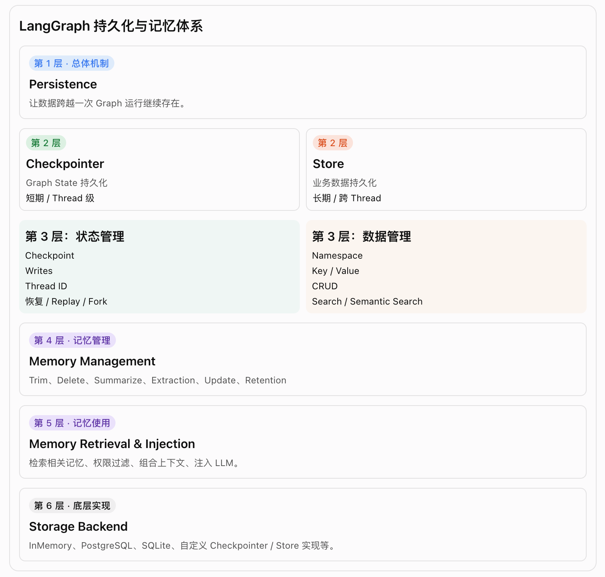

# LangGraph 持久化与记忆体系 (总结)

Trim:裁剪消息;
Delete:删除消息;
Summarize:总结消息;
Extraction: 提取消息;
Update: 更新;
Retention: 保留;

这里有一个重要区分:

- 第 1～3 层主要对应 LangGraph 提供的持久化机制和 API。
- 第 4～5 层更多是应用开发者需要设计的记忆业务逻辑。
- 第 6 层是具体的数据存储实现。

也就是说，LangGraph 提供了持久化能力，但不会自动替你决定哪些用户信息应该成为长期记忆。
