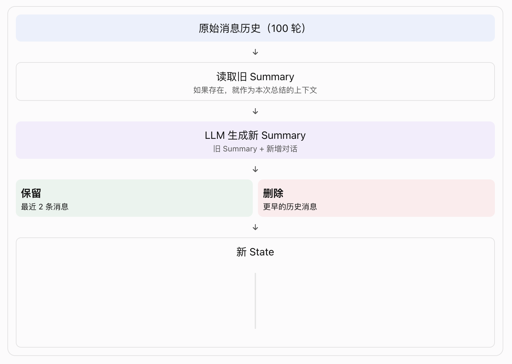

# langGraph-3.6-记忆机制(Memory)

Memory 是一套信息保存、检索、管理和使用的机制。Memory 不等于数据库，也不等于对话历史

## 一、概念理解：LangGraph 有两种 Memory


两者最大的区别：

| 对比     | Short-term      | Long-term               |
| -------- | --------------- | ----------------------- |
| 作用范围 | 单个 Thread     | 跨 Thread               |
| 保存内容 | Graph State     | 自定义记忆数据          |
| 核心组件 | Checkpointer    | Store                   |
| 数据结构 | State 快照      | Namespace + Key + Value |
| 典型用途 | 对话上下文      | 用户偏好、用户画像      |
| 生命周期 | Thread 生命周期 | 应用定义的生命周期      |

❗这里的 Short-term / Long-term，主要是按照"记忆的作用范围"区分，而不是按照保存时间区分。

## 二、层级关系：Memory 在 Agent 架构中的位置


- 这里有三个特别重要的概念：
  1. State：Agent 当前执行过程中使用的数据。
  2. Checkpointer：负责将 State 持久化，以便后续恢复。
  3. Store：负责保存跨 Thread 的自定义数据。

- 容易混淆的地方：

  Checkpointer 和 Store 都可以使用 PostgreSQL，但它们不是同一个组件，也不是同一套数据管理逻辑。

## 三、为什么需要 Memory？

假设用户已经进行了 100 轮对话。

1. 如果每次都把 100 轮历史全部传给 LLM：
   - Token 消耗越来越大。
   - 上下文窗口可能不够。
   - 无关历史干扰当前回答。
   - 请求延迟增加。

2. 因此，还需要管理记忆：
   - Trim：裁剪。
   - Delete：删除。
   - Summarize：总结。
   - Search：检索。

## 四、工作原理: Short-term Memory

Short-term Memory = State + Checkpointer + thread_id

- 其中：
  - State：保存当前对话状态。
  - Checkpointer：保存 State 的检查点。
  - thread_id：区分不同会话。

LangGraph 负责恢复 State，不负责自动决定把多少历史消息发送给 LLM。

## 五、工作原理: Long-term Memory

Long-term Memory = Store + Namespace + Key + Value

与 Checkpointer 不同，Store 不保存整个 Graph State，而是保存开发者定义的数据。

| 字段      | 作用         | 示例                   |
| --------- | ------------ | ---------------------- |
| namespace | 数据分组     | user_123/memories      |
| key       | 数据唯一标识 | 1                      |
| value     | 实际记忆内容 | User prefers dark mode |

```bash
   Store
   │
   ├── user_001
   │   └── memories
   │       ├── 1: 喜欢 Python
   │       └── 2: 喜欢深色模式
   │
   ├── user_002
   │   └── memories
   │       ├── 1: 使用 Java
   │       └── 2: 喜欢简洁回答
   │
   └── user_003
       └── memories
           └── 1: 使用 Go
```

这样就可以实现不同用户之间的记忆隔离。

❗注意：Namespace 只是数据组织机制，不等于完整的权限控制。生产环境仍需要后端校验用户身份和访问权限，不能直接信任客户端传入的 user_id。

- 如何在 Node节点 中访问 Store？

  | 对象            | 来源           | 作用                 |
  | --------------- | -------------- | -------------------- |
  | runtime.context | invoke 时传入  | 当前用户、业务上下文 |
  | runtime.store   | compile 时注入 | 长期记忆存储         |
  | state           | Graph 运行过程 | 当前状态             |

- 检索记忆

  ```python
    memories = await runtime.store.asearch(
        namespace, # 只搜索当前用户的记忆。
        query=state["messages"][-1].content, # 根据当前用户问题搜索。
        limit=3 # 最多返回 3 条。
    )
  ```

  ❗Store 检索到数据，不代表 LLM 自动就能看到数据。开发者需要将检索结果注入模型输入。

- 保存记忆

  ```python
  await runtime.store.aput( # 4、保存到 Store。
      namespace, # 1、指定用户 Namespace。
      str(uuid7()), # 2、生成一个唯一 Key。
      {
          "data": "User prefers dark mode" # 3、将记忆内容写入 Value。
      }
  )
  ```

- 如果希望自动提取，需要额外设计：

  ```bash
  用户对话
   ↓
  LLM 提取用户偏好
     ↓
  开发者校验 / 业务规则
     ↓
  Store 保存
  ```

- 完整数据流


## 六、Semantic Search（语义搜索）

语义搜索不等于 LLM 理解记忆。

它主要负责找到语义上相关的数据，最终如何理解和使用这些数据，仍然由应用和 LLM 决定。

❗存储和检索用的嵌入模型，必须“建库”和“查询”是同一个模型；而聊天和应用用的生成模型，可以“这次用 A、下次用 B”。

## 七、Manage Short-term Memory：短期记忆管理

Checkpointer 会保存完整的 Graph State。但是：保存完整 State ≠ 每次把完整 State 发给 LLM。这两个操作必须分开理解。

Checkpointer 可以保存全部 100 轮。节点Node 可以只取最近的几轮传给模型。

- LangGraph 文档提供了四种主要管理方式。

  | 方法       | 作用                        | 是否修改 State |
  | ---------- | --------------------------- | -------------- |
  | Trim       | 裁剪输入消息                | 否             |
  | Delete     | 删除历史消息                | 是             |
  | Summarize  | 总结历史消息                | 是             |
  | Checkpoint | 管理 查看、恢复、删除检查点 | 操作持久化数据 |

### 7.1 Trim Messages：裁剪消息

只控制本次发送给 LLM 的消息，不删除 State 中的历史消息。

```python
from langchain_core.messages.utils import (trim_messages,count_tokens_approximately)

def call_model(state: MessagesState):
    messages = trim_messages( # 创建一个裁剪后的消息列表
        state["messages"], # 原始消息，并没有被删除（❗Checkpointer 中仍然可以保存完整历史。LLM 本次只接收到裁剪后的历史。）
        strategy="last", # 优先保留最新消息
        token_counter=count_tokens_approximately, # Token 计算方式
        max_tokens=128, # 最大Token预算
        start_on="human", # 尽量从 Human 消息开始
        end_on=("human", "tool"), # 控制保留消息的结束类型
    )
    response = model.invoke(messages)
    return {"messages": [response]}
```

### 7.2 Delete Messages：删除消息

❗注意：删除当前 State 中的消息，不等于清除了所有历史 Checkpoint。之前已经保存的历史检查点仍可能包含旧消息。

```python
from langchain.messages import RemoveMessage

def delete_messages(state):
    messages = state["messages"]
    # MessagesState 使用了 add_messages reducer。

    # -- 删除最早的两条：----------------------------------
    # 并不是简单地把列表覆盖掉。它会通过消息 ID 找到对应消息并执行删除。
    if len(messages) > 2:
        return {
            "messages": [RemoveMessage(id=m.id) for m in messages[:2]]
        }
    # -- 删除全部消息：------------------------------------
        return {
            "messages": [RemoveMessage(id=REMOVE_ALL_MESSAGES)]
        }
```

### 7.3 Summarize Messages：总结消息

把早期对话压缩成 Summary，保留最近几轮原始对话。

```python
from langgraph.graph import MessagesState

# State 包含 {"messages": [...], "summary": "..." }
class State(MessagesState):
    summary: str

def summarize_conversation(state: State):
    summary = state.get("summary", "")
    if summary:
        summary_message = (
            f"This is a summary of the conversation to date: {summary}\n\n"
            "Extend the summary by taking into account the new messages above:"
        )
    else:
        summary_message = (
            "Create a summary of the conversation above:"
        )

    # 临时构造给 LLM 的输入。并没有把 summary_message 真正写入 State。
    messages = state["messages"] + [HumanMessage(content=summary_message)]
    response = model.invoke(messages)
    delete_messages = [ RemoveMessage(id=m.id) for m in state["messages"][:-2] ]
    # 最终真正更新 State 的是：
    return {
        "summary": response.content,
        "messages": delete_messages
    }
```



### 7.4 Trim、Delete、Summarize 应该怎么选？

| 场景                 | 推荐方式   |
| -------------------- | ---------- |
| 临时控制 Token       | Trim       |
| 不再需要某些消息     | Delete     |
| 希望保留历史核心信息 | Summarize  |
| 希望恢复以前某个状态 | Checkpoint |

注意，Summary 本身也可能越来越长，因此还需要设置摘要长度上限和定期压缩策略。

## 八、Manage Checkpoints：检查点管理

### 8.1 查看当前 Thread 状态

```python
config = {
    "configurable": {
        "thread_id": "1"
    }
}
graph.get_state(config)
# StateSnapshot(
#     values={...}, # 当前 State 数据
#     next=(),  # 接下来要执行的节点
#     config={...}, # 当前检查点配置
#     metadata={...}, # 检查点元数据
#     created_at=..., # 创建时间
#     parent_config=..., # 父检查点
#     tasks=..., # 任务信息
#     interrupts=... # 中断信息
# )
```

### 8.2 查看 Thread 历史

`list( graph.get_state_history(config))` 返回当前 Thread 的多个 StateSnapshot。

```bash
  Checkpoint 1
      ↓
  Checkpoint 2
      ↓
  Checkpoint 3
      ↓
  Checkpoint 4
```

### 8.3 删除 Thread 的检查点

```python
thread_id = "1"
checkpointer.delete_thread(thread_id) # 这表示删除指定 Thread 的检查点数据。
```

注意：❗delete_thread 删除的是该 Thread 的短期持久化数据，不是 Store 中该用户的长期记忆。

如果用户要求注销账号或清除全部个人数据，必须分别处理：

- Checkpointer 中的 Thread 数据。
- Store 中的用户记忆。
- 其他业务数据库。
- 向量索引及相关缓存。

## 九、对比：Short-term、Long-term、Checkpoint、Store、Summary

| 概念              | 本质             | 保存什么              | 谁负责               |
| ----------------- | ---------------- | --------------------- | -------------------- |
| State             | 运行状态         | 当前 Graph 数据       | LangGraph            |
| Checkpoint        | State 快照       | 某个时刻的 State      | Checkpointer         |
| Short-term Memory | 短期记忆机制     | Thread 内的状态和历史 | State + Checkpointer |
| Store             | 长期数据存储     | 自定义 Key-Value      | BaseStore 实现       |
| Long-term Memory  | 长期记忆机制     | 跨 Thread 的信息      | Store + 业务逻辑     |
| Summary           | 压缩后的历史信息 | 对话摘要              | 通常由 LLM 生成      |

同一个用户可以拥有多个 Thread，但这些 Thread 可以通过相同的用户 Namespace 访问同一份长期记忆。

## 十、自主可控性：生产环境应该如何设计？

### 推荐的生产架构

```bash
src/
└── app/
    ├── api/
    │   └── chat.py
    │
    ├── agent/
    │   ├── graph.py
    │   ├── state.py
    │   ├── context.py
    │   └── nodes/
    │       ├── call_model.py
    │       ├── retrieve_memory.py
    │       ├── extract_memory.py
    │       └── summarize.py
    │
    ├── memory/
    │   ├── short_term.py
    │   ├── long_term.py
    │   ├── memory_service.py
    │   └── embedding.py
    │
    ├── database/
    │   ├── postgres.py
    │   └── models/
    │
    └── main.py
```

### 一个非常重要的生产问题：谁决定保存记忆？

LangGraph 只提供存储、检索和运行时集成能力。并不会自动替你设计一套完整的用户记忆管理系统。

- 建议增加记忆提取策略：

  | 类型     | 示例             | 是否建议保存 |
  | -------- | ---------------- | ------------ |
  | 用户偏好 | 喜欢中文回答     | 是           |
  | 技术栈   | 主要使用 Python  | 是           |
  | 长期目标 | 学习 AI 应用开发 | 是           |
  | 临时问题 | 今天代码报错     | 通常否       |
  | 敏感信息 | 密码、密钥       | 不应保存     |
  | 过时信息 | 已经更换的技术栈 | 更新或删除   |

- 此外还要考虑：
  1. 记忆去重。
  2. 记忆更新。
  3. 记忆过期。
  4. 用户主动删除。
  5. 用户数据隔离。
  6. 记忆来源追踪。
  7. 错误记忆纠正。
  8. 写入权限与审核。

## 十一、总结：建立完整的 Memory 知识体系

- LangGraph Memory 知识体系
  1. Short-term Memory 解决：当前会话如何记住历史？
     - State
     - Checkpointer
     - thread_id
     - PostgresSaver

  2. Long-term Memory 解决：不同会话如何共享用户信息？
     - Store
     - Namespace
     - Key / Value
     - Runtime Context
     - PostgresStore

  3. Semantic Search 解决：如何找到语义相关的记忆？
     - Embedding
     - Vector Index
     - Similarity Search

  4. Memory Management 解决：如何控制记忆规模和质量？
     - Trim
     - Delete
     - Summarize
     - Search

  5. Checkpoint Management 解决：如何查看、恢复、删除历史状态？
     - get_state
     - get_state_history
     - delete_thread
     - Time Travel

- 最后建立五个核心认知
  1. Short-term Memory = State + Checkpointer，通过 Thread ID 恢复当前会话状态。
  2. Long-term Memory = Store + 业务逻辑，通过 Namespace 管理跨会话的用户记忆。
  3. Store 不会自动总结对话，记忆提取、总结、更新需要开发者设计。
  4. 保存历史不等于全部发送给 LLM，Trim、Delete、Summarize 是不同的上下文管理策略。
  5. LangGraph 不强制绑定 LangSmith，可以使用自托管 PostgreSQL、pgvector 和本地 Embedding，构建自己的 Memory 系统。

- LangGraph 提供 Memory 的基础设施，但真正的记忆策略、记忆质量、记忆权限和生命周期，最终由应用开发者控制。
