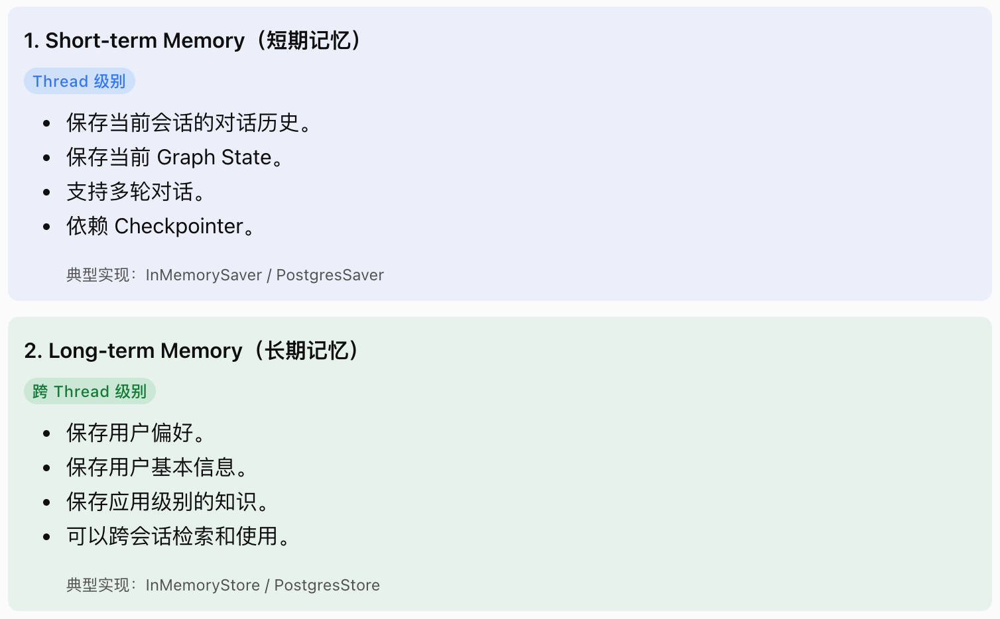
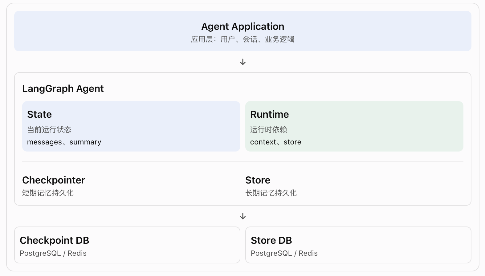
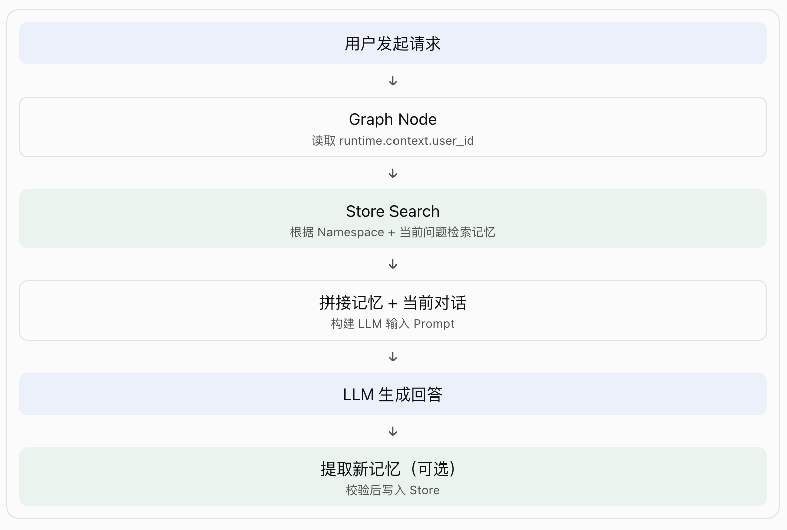

# langGraph-3.6-记忆机制(Memory)

Memory 是一套信息保存、检索、管理和使用的机制。Memory 不等于数据库，也不等于对话历史

## 一、概念理解：LangGraph 有两种 Memory



两者最大的区别：

| 对比     | Short-term      | Long-term               |
| -------- | --------------- | ----------------------- |
| 作用范围 | 单个 Thread     | 跨 Thread               |
| 保存内容 | Graph State     | 自定义记忆数据          |
| 核心组件 | Checkpointer    | Store                   |
| 数据结构 | State 快照      | Namespace + Key + Value |
| 典型用途 | 对话上下文      | 用户偏好、用户画像      |
| 生命周期 | Thread 生命周期 | 应用定义的生命周期      |

❗这里的 Short-term / Long-term，主要是按照"记忆的作用范围"区分，而不是按照保存时间区分。

## 二、层级关系：Memory 在 Agent 架构中的位置



- 这里有三个特别重要的概念：
  1. State：Agent 当前执行过程中使用的数据。
  2. Checkpointer：负责将 State 持久化，以便后续恢复。
  3. Store：负责保存跨 Thread 的自定义数据。

- 容易混淆的地方：

  Checkpointer 和 Store 都可以使用 PostgreSQL，但它们不是同一个组件，也不是同一套数据管理逻辑。

## 三、为什么需要 Memory？

假设用户已经进行了 100 轮对话。

1. 如果每次都把 100 轮历史全部传给 LLM：
   - Token 消耗越来越大。
   - 上下文窗口可能不够。
   - 无关历史干扰当前回答。
   - 请求延迟增加。

2. 因此，还需要管理记忆：
   - Trim：裁剪。
   - Delete：删除。
   - Summarize：总结。
   - Search：检索。

## 四、工作原理: Short-term Memory

Short-term Memory = State + Checkpointer + thread_id

- 其中：
  - State：保存当前对话状态。
  - Checkpointer：保存 State 的检查点。
  - thread_id：区分不同会话。

LangGraph 负责恢复 State，不负责自动决定把多少历史消息发送给 LLM。

## 五、工作原理: Long-term Memory

Long-term Memory = Store + Namespace + Key + Value

与 Checkpointer 不同，Store 不保存整个 Graph State，而是保存开发者定义的数据。

| 字段      | 作用         | 示例                   |
| --------- | ------------ | ---------------------- |
| namespace | 数据分组     | user_123/memories      |
| key       | 数据唯一标识 | 1                      |
| value     | 实际记忆内容 | User prefers dark mode |

```bash
   Store
   │
   ├── user_001
   │   └── memories
   │       ├── 1: 喜欢 Python
   │       └── 2: 喜欢深色模式
   │
   ├── user_002
   │   └── memories
   │       ├── 1: 使用 Java
   │       └── 2: 喜欢简洁回答
   │
   └── user_003
       └── memories
           └── 1: 使用 Go
```

这样就可以实现不同用户之间的记忆隔离。

❗注意：Namespace 只是数据组织机制，不等于完整的权限控制。生产环境仍需要后端校验用户身份和访问权限，不能直接信任客户端传入的 user_id。

- 如何在 Node节点 中访问 Store？

  | 对象            | 来源           | 作用                 |
  | --------------- | -------------- | -------------------- |
  | runtime.context | invoke 时传入  | 当前用户、业务上下文 |
  | runtime.store   | compile 时注入 | 长期记忆存储         |
  | state           | Graph 运行过程 | 当前状态             |

- 检索记忆

  ```python
    memories = await runtime.store.asearch(
        namespace, # 只搜索当前用户的记忆。
        query=state["messages"][-1].content, # 根据当前用户问题搜索。
        limit=3 # 最多返回 3 条。
    )
  ```

  ❗Store 检索到数据，不代表 LLM 自动就能看到数据。开发者需要将检索结果注入模型输入。

- 保存记忆

  ```python
  await runtime.store.aput( # 4、保存到 Store。
      namespace, # 1、指定用户 Namespace。
      str(uuid7()), # 2、生成一个唯一 Key。
      {
          "data": "User prefers dark mode" # 3、将记忆内容写入 Value。
      }
  )
  ```

- 如果希望自动提取，需要额外设计：

  ```bash
  用户对话
   ↓
  LLM 提取用户偏好
     ↓
  开发者校验 / 业务规则
     ↓
  Store 保存
  ```

- 完整数据流



## 六、Semantic Search（语义搜索）

语义搜索不等于 LLM 理解记忆。

它主要负责找到语义上相关的数据，最终如何理解和使用这些数据，仍然由应用和 LLM 决定。

❗存储和检索用的嵌入模型，必须“建库”和“查询”是同一个模型；而聊天和应用用的生成模型，可以“这次用 A、下次用 B”。

## 七、Manage Short-term Memory：短期记忆管理

## 八、Manage Checkpoints：检查点管理

## 九、对比：Short-term、Long-term、Checkpoint、Store、Summary
