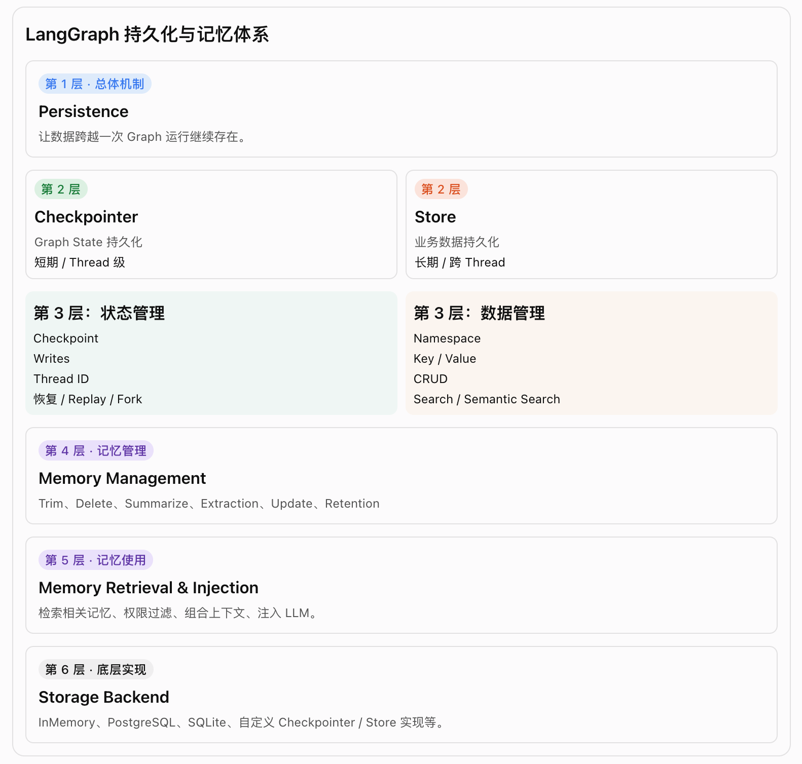

# LangGraph 持久化与记忆体系(总结)



Trim: 裁剪消息; Delete: 删除消息; Summarize: 总结消息; Checkpoint Management: 检查点管理;
Memory Extraction: 提取长期记忆; Memory Update: 更新长期记忆; Retention: 保留;

这里有一个重要区分:

- 第 1～3 层主要对应: LangGraph 提供的持久化机制和 API。
- 第 4～5 层更多是: 应用开发者需要设计的记忆业务逻辑。
- 第 6 层是具体的数据存储实现。

也就是说，LangGraph 提供了持久化能力，但不会自动替你决定哪些用户信息应该成为长期记忆。

## 二、分类详解

1. 按记忆生命周期分类

   | 分类     | Short-term Memory          | Long-term Memory             |
   | -------- | -------------------------- | ---------------------------- |
   | 中文     | 短期记忆                   | 长期记忆                     |
   | 范围     | 单个 Thread                | 跨 Thread                    |
   | 主要内容 | 对话历史、Graph State      | 用户偏好、用户事实、应用知识 |
   | 核心机制 | Checkpointer               | Store                        |
   | 主要目的 | 延续当前对话               | 不同对话共享信息             |
   | 生命周期 | 由 Thread 的持久化策略决定 | 由业务记忆管理策略决定       |

2. 按持久化机制分类
   这是 LangGraph Memory 最核心的两种机制。

   | 分类      | Checkpointer             | Store                   |
   | --------- | ------------------------ | ----------------------- |
   | 数据组织  | Checkpoint / Writes      | Namespace / Key / Value |
   | 标识      | thread_id                | namespace + key         |
   | 读取      | get_state()              | get() / search()        |
   | 写入      | Graph 执行过程中自动保存 | put() / aput()          |
   | 删除      | delete_thread()          | delete() / adelete()    |
   | 跨 Thread | 不直接共享               | 支持                    |
   | 语义搜索  | 不属于其主要能力         | 支持                    |

   两者可以同时使用，不是二选一。

3. 按记忆管理策略分类

   | 策略                  | 功能             | 解决的问题               |
   | --------------------- | ---------------- | ------------------------ |
   | Trim                  | 裁剪消息         | 控制上下文长度           |
   | Delete                | 删除消息         | 清理无用历史             |
   | Summarize             | 总结消息         | 保留重要信息，减少 Token |
   | Checkpoint Management | 查看、删除检查点 | 管理历史状态             |
   | Extraction            | 提取长期记忆     | 从对话中提取重要信息     |
   | Update                | 更新长期记忆     | 去重、修正、覆盖旧记忆   |

   其中前四项主要针对短期记忆；后两项是 Store 长期记忆应用中需要自行设计的业务逻辑。

## 三、核心对象之间的层级关系

这一部分建议重点记忆。

| 对象              | 所属层次       | 核心职责                |
| ----------------- | -------------- | ----------------------- |
| Memory            | 概念层         | 整体记忆体系            |
| Short-term Memory | 记忆分类       | Thread 级记忆           |
| Long-term Memory  | 记忆分类       | 跨 Thread 记忆          |
| Checkpointer      | 持久化机制     | 保存 Graph State        |
| Store             | 持久化机制     | 保存任意 Key-Value      |
| Runtime           | 运行时机制     | 访问 Context、Store 等  |
| Namespace         | Store 数据组织 | 划分记忆空间            |
| Key               | Store 数据组织 | 唯一标识一条记忆        |
| Value             | Store 数据组织 | 实际记忆内容            |
| Embedding         | 检索技术       | 将文本转换为向量        |
| BaseStore         | 接口抽象       | 自定义 Store 的基础契约 |

这里特别区分:

- Runtime 不是 Memory。
- Namespace 不是 Store。
- Embedding 不是 Store。
- Checkpointer 和 Store 才是两种核心持久化机制。

## 四、一次完整的 Memory 工作流程


这里特别强调:

⑤ 和 ⑥ 不是同一件事。

- Checkpointer 保存 Graph 执行状态，是 LangGraph 的持久化机制。
- Store 保存长期业务记忆，是应用主动设计的业务操作。

  ```bash
    用户消息
       ↓
    Memory Extraction Node
       ↓
    判断是否值得记忆
       ↓
    提取、整理、结构化
       ↓
    Memory Update Node
       ↓
    Store.put(namespace, key, value)
  ```

## 五、一个完全自主部署的典型架构

```bash
                 FastAPI
                    │
                    ▼
               LangGraph
                    │
          ┌─────────┴─────────┐
          │                   │
          ▼                   ▼
     Checkpointer           Store
          │                   │
          ▼                   ▼
      PostgreSQL          PostgreSQL
          │                   │
          ▼                   ▼
     Thread State        Long-term Memory

# -----------------------------------------------
        自己开发 Memory Manager
                  │
       ┌──────────┼──────────┐
       ▼          ▼          ▼
    Extraction  Summarize  Retrieval
       │          │          │
       └──────────┴──────────┘
                  │
                  ▼
               LLM
```

## 六、最后记住这六句话

1. Persistence 是持久化总体系:解决数据如何跨运行保留。
2. Checkpointer 保存 Graph State:解决 Thread 内的状态延续。
3. Store 保存业务数据:解决跨 Thread 的长期数据共享。
4. Memory 是 Agent 的记忆能力:不是第三种数据库或持久化后端。
5. Memory Manager 决定记什么:提取、总结、更新、删除都需要设计。
6. Memory Retrieval 决定用什么:检索相关记忆，经过权限和相关性筛选后交给 LLM。
