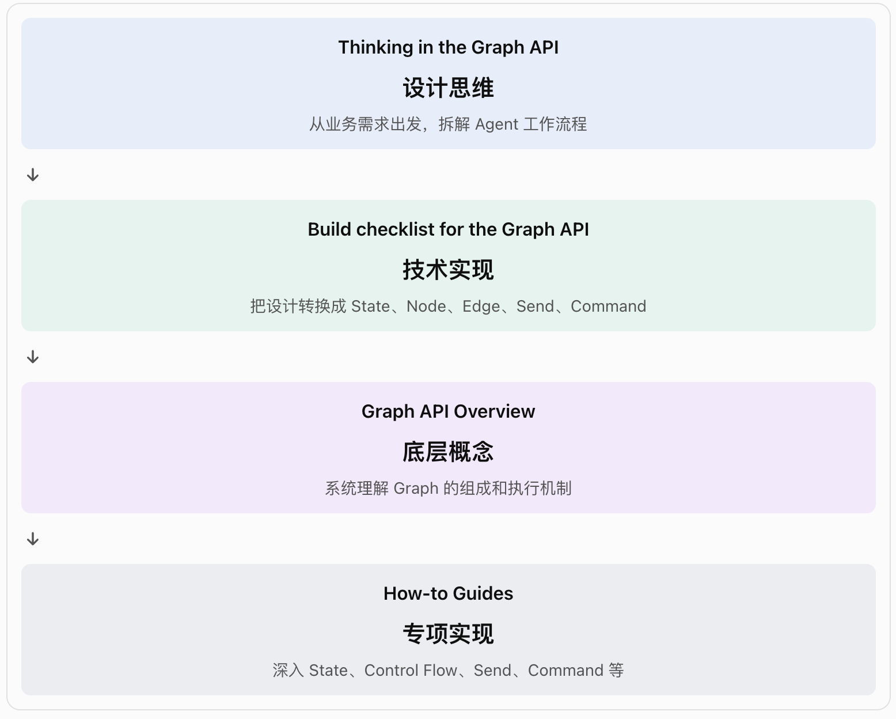

# langGraph-5-GraphAPI开始

注意：这个图是学习关系，

假设开发一个企业内部知识库 Agent。

- Thinking in the Graph API： 思考用户问题应该经过哪些处理步骤，哪些节点需要拆分，什么时候需要人工介入。
- Build checklist： 决定用什么 State、Reducer、Edge、Send、Command，以及如何配置重试和超时。
- Graph API Overview： 理解这些 API 背后的整体模型和机制。

建议是：Thinking 负责培养架构设计能力，Build checklist 负责形成技术实现能力。

| 文档                              | 核心问题                         | 学习目标     |
| --------------------------------- | -------------------------------- | ------------ |
| Thinking in the Graph API         | 应该如何思考和设计图？           | 建立设计思维 |
| Build checklist for the Graph API | 实际构建图时应该做哪些决策？     | 掌握构建步骤 |
| Graph API overview（本文）        | Graph API 有哪些组件、如何执行？ | 理解底层机制 |
