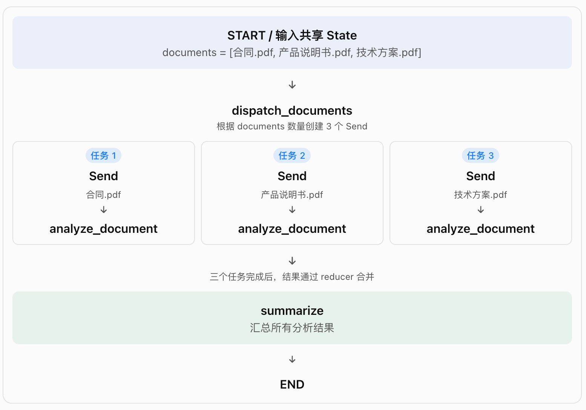

# langGraph-5.1- Graph API 的【设计思维】

LangGraph 最核心的一项能力：如何把一个实际业务流程，拆解成 State、Node、Edge 和 Command，并最终构建成一个可以执行、暂停、恢复、容错的 Agent。

## 一、概念理解

1. 什么是 Thinking in the Graph API？

用图的思维设计 AI Agent，把一个复杂业务流程拆成多个独立步骤，通过共享状态传递数据，通过边和路由控制执行顺序。

- Graph API 的核心组成：
  1. State（共享状态）：在节点之间保存和传递业务数据；
  2. Node（节点）：执行具体业务任务；
  3. Edge（边）：连接节点，控制执行关系；
  4. Command：更新状态 + 动态路由；
  5. Runtime：执行、检查点、暂停与恢复；

1. Graph API 的核心思想

先设计业务流程，再设计状态结构，然后实现节点，最后连接并编译图。

---

## 二、为什么需要 Graph API？

1. 普通 Python 函数 vs Graph API

   | 对比     | 普通 Python 函数 | LangGraph            |
   | -------- | ---------------- | -------------------- |
   | 流程控制 | if/else、循环    | Edge、Command        |
   | 数据传递 | 参数、返回值     | Shared State         |
   | 执行边界 | 自己划分         | Node                 |
   | 检查点   | 自己实现         | Checkpointer         |
   | 暂停恢复 | 自己实现         | interrupt、resume    |
   | 节点重试 | 自己实现         | RetryPolicy          |
   | 适用场景 | 简单业务逻辑     | 复杂、有状态的工作流 |

   普通 Python 并不是不能实现这些能力，而是需要自行开发和维护。

2. 为什么要拆分成各个 Node？

每个 Node 有自己的执行边界。原文特别强调：LangGraph 在节点边界进行 checkpoint。因此，节点粒度 会影响 故障恢复时 需要重新执行的工作量。

---

## 三、层级关系


1. Node 的四种职责分类
   - LLM steps： 理解、分析、生成、推理；
   - Data steps： 获取外部信息 ；
   - Action steps： 执行外部操作 ；
   - User input steps： 获取人工输入 ；

这四类是业务职责分类，不是 LangGraph 的四种特殊 Node 类型。

---

## 四、工作原理

### 4.1、 整体工作流

### 4.2、 State：共享状态

State 存储原始数据，不存储格式化后的 Prompt。

### 4.3、 Node：节点如何执行？

Node 本质上是一个 Python 函数。

```text
当前 State
   ↓
Node 读取数据
   ↓
执行具体业务逻辑
   ↓
返回 State 更新
   ↓
LangGraph 合并更新
   ↓
进入下一节点
```

❗注意：Node 返回的是 State 更新，不一定是完整 State。

### 4.4、 如何控制执行路径？

- LangGraph Graph API 中 三种方式：
  1. 固定边 add_edge()：提前确定下一个节点。
  2. 条件边 add_conditional_edges()：通过独立的路由函数决定下一个节点。
  3. 节点内部动态路由 Command(goto=...)：可以同时更新 State。

#### 4.4.1、 固定边: add_edge()

```python
  graph.add_edge(START, "next 节点名A")
  graph.add_edge("节点名A", "next 节点名B")
  graph.add_edge("节点名B", END)
```

#### 4.4.2、 条件边: add_conditional_edges()

将业务处理和路由判断分开。

```python
graph.add_conditional_edges("节点名字", 函数名字【返回next节点名】,)
```

#### 4.4.3、节点内部动态路由: Command

更新状态 + 动态路由 = Command。

```python
   return Command(
       update={
           "classification": classification
       },
       goto="next_node" # 下一个节点名字
   )
```

1. update ：更新共享 State
2. goto： 决定下一个执行节点

如果只是路由，优先使用条件边； 如果需要同时更新 State 和路由，使用 Command。

#### 4.4.4 ❗一个非常重要的注意事项

不要在同一个 Node 上同时使用静态边和动态路由。

```python
graph.add_edge("node_a", "node_b")

# node_a 内部又返回
return Command(goto="node_c")
```

这并不是 Command 覆盖了 add_edge()。 实际可能导致 node_b 和 node_c 都被执行。

### 4.5、Send

Send 是 LangGraph 提供的一种动态任务分发机制。 它允许一个节点根据运行时的数据，动态地把多个任务发送给指定节点执行，并且可以为每个任务传入不同的输入。

可以先把它理解成：一个节点根据数据拆分出 N 个子任务，然后把这些子任务分发给同一个处理节点，并行执行。它主要用于 `Map-Reduce（映射-归约）` 场景。

- add_conditional_edges()、Command 不一样：主要解决流程往哪里走，
- Send 还解决了如何动态创建多个任务，以及每个任务携带什么输入。

```python
from langgraph.types import Send

Send(
    node="目标节点",
    arg={"传给目标节点的数据": "具体内容"}
)
# --------------------------------------------
import operator
from typing import Annotated
from typing_extensions import TypedDict

from langgraph.graph import StateGraph, START, END
from langgraph.types import Send


# 1. 整个图的共享 State
class OverallState(TypedDict):
    documents: list[str]
    results: Annotated[list[str], operator.add]


# 2. Worker 节点接收的任务 State
class WorkerState(TypedDict):
    document: str


# 3. 动态分发任务
def dispatch_documents(state: OverallState):
    return [
        Send("analyze_document",{"document": document}) for document in state["documents"] # 返回多个 Send
    ]


# 4. Worker 节点：每次处理一份文档
def analyze_document(state: WorkerState):
    document = state["document"]

    result = f"{document} 分析完成"

    return {
        "results": [result]
    }


# 5. 汇总节点
def summarize(state: OverallState):
    print("所有分析结果：", state["results"])

    return {}


# 6. 组装 Graph
builder = StateGraph(OverallState)

builder.add_node("analyze_document", analyze_document)
builder.add_node("summarize", summarize)

builder.add_conditional_edges(START,dispatch_documents)

builder.add_edge("analyze_document", "summarize")
builder.add_edge("summarize", END)

graph = builder.compile()


# 7. 执行
result = graph.invoke({
    "documents": [
        "合同.pdf",
        "产品说明书.pdf",
        "技术方案.pdf",
    ],
    "results": []
})

print(result)
```

最重要的理解：🔥Send 不是简单地决定“下一步走哪个节点”，而是动态地决定“下一步创建多少个节点任务，以及每个任务拿到什么输入”。



---

## 五、代码解读：从 Node 到完整 Graph

### 5.1. 人工审核节点：interrupt()

```python
def human_review(state: EmailAgentState,) -> Command[Literal["send_reply", END]]:

    classification = state.get("classification") or {}
    # -- 第一：interrupt() ---------------------------
    # 作用：
    # - 暂停当前图的执行。
    # - 将需要人工处理的信息暴露给外部。
    # - 等待后续恢复时提供人工决策。
    # 这里的 interrupt() 不是普通的 Python input()，也不是一个单独注册的 Graph Node。
    human_decision = interrupt(
        {
            "email_id": state.get("email_id", ""),
            "original_email": state.get("email_content", ""),
            "draft_response": state.get("draft_response", ""),
            "urgency": classification.get("urgency"),
            "intent": classification.get("intent"),
            "action": "Please review and approve/edit this response",
        }
    )
    # -- 第二：人工批准 -------------------------------
    # 允许人工修改回复内容，然后进入发送节点。
    if human_decision.get("approved"):
        return Command(
            update={
                "draft_response": human_decision.get(
                    "edited_response",
                    state.get("draft_response", "")
                )
            },
            goto="send_reply",
        )
    # -- 第三：人工拒绝 ------------------------------
    # 拒绝后结束当前图的执行，邮件由人工在图外处理。
    return Command(
        update={},
        goto=END
    )
```

### 5.2 为什么需要 Checkpointer？

interrupt() 负责发起中断，但要实现暂停后恢复，需要 Checkpointer 保存 “图执行状态”。

| 组件                | 作用                   |
| ------------------- | ---------------------- |
| interrupt()         | 请求暂停执行           |
| Checkpointer        | 保存 执行检查点        |
| thread_id           | 标识同一条运行会话     |
| Command(resume=...) | 提供恢复所需的人工输入 |

### 5.3. 编译 Graph

| API               | 作用                 |
| ----------------- | -------------------- |
| StateGraph(State) | 创建图，指定状态结构 |
| add_node()        | 注册节点             |
| add_edge()        | 添加固定边           |
| compile()         | 编译成可执行 Graph   |
| checkpointer=     | 配置检查点持久化机制 |

### 5.4. Invoke：执行图

```python
config = {
    "configurable": {
        "thread_id": "customer_123"
    }
}

result = app.invoke(
    {
        "email_content": "I was charged twice for my subscription! This is urgent!",
        "sender_email": "customer@example.com",
        "email_id": "email_123",
    },
    config,
)
```

### 5.5. Resume：恢复执行

```python
app.invoke(
    Command(
        resume={
            "approved": True,
            "edited_response": (
                "We sincerely apologize for the double charge. "
                "I've initiated an immediate refund..."
            ),
        }
    ),
    config,
)
```

❗恢复时， 节点函数 从开头重新执行。不是从 interrupt() 下一行直接恢复。  
在 interrupt() 之前执行的操作，应该具有幂等性。

因此需要：

- 将有副作用的操作放在中断之后。
- 或者在执行前检查是否已经执行过。
- 或者通过业务唯一键实现幂等。

## 六、能力边界

### 6.1. Node 拆得越细越好吗？

不一定。

1. 原文给出的核心权衡：
   - 节点越小，检查点越频繁。
   - 节点越小，故障恢复时需要重新执行的工作越少。
   - 节点越小，测试和调试更容易。
   - 节点越多，也会增加图的复杂度。

2. 但是合并之后：
   - 两者之间失去独立检查点。
   - 后续失败时，可能需要重复执行两者。
   - 无法单独检查邮件读取和分类的中间结果。

因此，节点拆分应该根据业务职责、失败边界、重试需求和调试需求决定。

### 6.2. 缓存是不是 LangGraph 自带的？

搜索结果缓存属于应用层实现，LangGraph 不规定具体缓存 API。  
这也意味着 LangGraph 不会因为你拆分了更多 Node，就自动帮你缓存外部 API 的结果。

## 七、总结

1. 整篇文档的知识结构

   | 核心概念     | 一句话理解         | 关键 API            |
   | ------------ | ------------------ | ------------------- |
   | Workflow     | 先设计业务流程     | 流程规划            |
   | State        | 节点之间共享的数据 | TypedDict           |
   | Node         | 执行具体业务任务   | add_node()          |
   | Edge         | 固定的节点连接     | add_edge()          |
   | Command      | 更新状态并动态路由 | Command()           |
   | Interrupt    | 暂停等待人工输入   | interrupt()         |
   | Checkpointer | 保存执行检查点     | InMemorySaver       |
   | Resume       | 恢复暂停的执行     | Command(resume=...) |
   | Compile      | 构建可执行图       | compile()           |
   | Invoke       | 执行图             | invoke()            |

2. 必须建立的几个认知
   1. Graph API 首先是一种工作流设计思想，而不只是 API 集合。
   2. State 是共享数据，不是节点执行流程。
   3. Node 是普通业务函数，负责读取 State 并返回更新。
   4. Edge 负责固定连接，Command 负责动态路由。
   5. Node 边界是重要的检查点和故障恢复边界。
   6. interrupt 负责暂停，Checkpointer 支持保存和恢复。
   7. Resume 时节点从头重新执行，因此需要考虑幂等性。
   8. LangGraph 提供编排能力，但不替代业务系统、数据库、RAG 和外部服务。

3. 一句话总结：

LangGraph Graph API 的本质，就是使用 State 管理数据、使用 Node 执行业务、使用 Edge 和 Command 控制流程，再通过 Runtime 提供检查点、暂停、恢复和容错等工作流执行能力。
