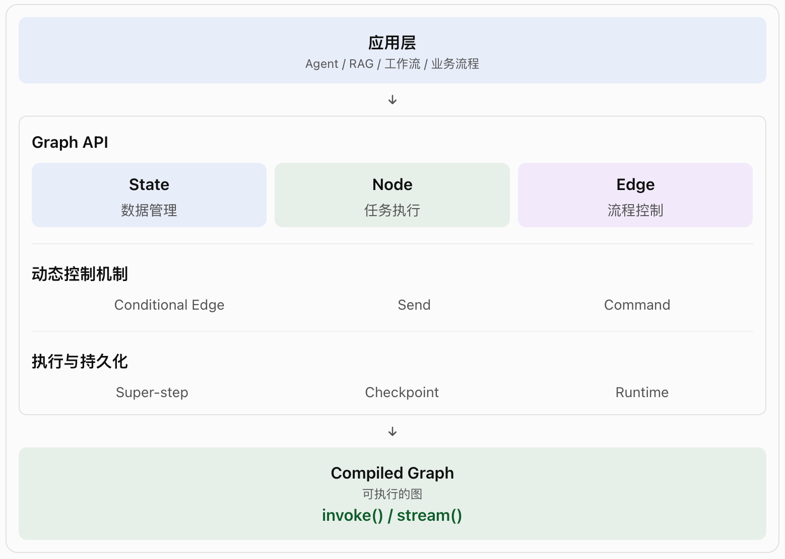
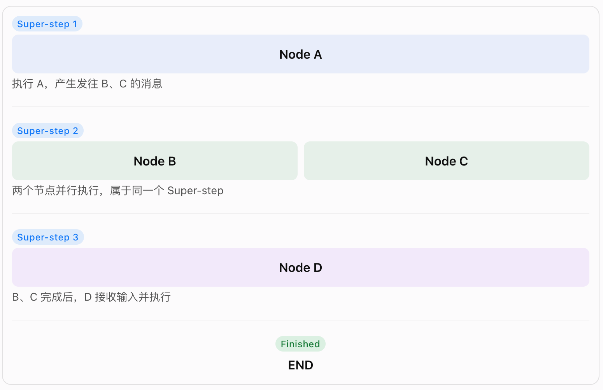

# langGraph-5.3-GraphAPI解读【底层机制】

如何用 State、Node、Edge 三个基本元素，把一个 Agent 工作流 组织成可执行、可恢复、可控制的图？

## 一、概念理解

1. Graph API： Graph API 是 LangGraph 用来定义和执行工作流的底层编程接口。

   Graph = State + Nodes + Edges
   - State（状态）：数据在哪里。
   - Node（节点）：具体做什么。
   - Edge（边）：接下来去哪里。

2. Graph API 不等于 Agent

## 二、为什么需要 Graph API？

单纯依赖函数调用、if/else 和异常处理，维护成本就会增加。

❗ 注意：Graph API 并不是取代 Python，而是在 Python 之上增加了一套工作流编排和执行机制。

## 三、层级关系

### 3.1. 整体架构



1. 第一层：图的结构
   - State：定义数据。
   - Node：定义任务。
   - Edge：定义连接关系。

2. 第二层：流程控制
   - Conditional Edge：条件路由。
   - Send：动态分发任务。
   - Command：更新状态并动态路由。

3. 第三层：执行基础设施
   - Super-step：执行调度单位。
   - Checkpoint：保存执行状态。
   - Runtime：传递运行时依赖和工具。

### 3.2. State 内部还有什么？

State 不只是一个普通字典。

- 文档将 State 分成两个部分：
  1. Schema: 声明有哪些状态字段;
  2. Reducer: 定义多个更新如何合并;

     Reducer 本质上是 State 的更新合并规则。

  ```python
  from typing import Annotated
  from typing_extensions import TypedDict
  import operator

  class State(TypedDict):
      name: str
      results: Annotated[list[str], operator.add]
  ```

### 3.3 Node 的输入不只有 State

1. state :当前图状态
2. config :RunnableConfig，例如 thread_id、tags
3. runtime :运行时对象，包含 context、store、stream_writer 等

- State 和 Runtime Context 不是一回事。❗
  - State：这次工作流正在处理的数据。
  - Context：工作流执行时需要使用的外部依赖和配置。

## 四、工作原理

### 1. Graph 的生命周期

一个 Graph 从定义到执行，基本经过以下步骤：

1. 定义 State： 声明状态结构、字段类型以及 Reducer。

2. 定义 Node： 编写业务函数，执行具体任务。

3. 定义 Edge： 连接节点，定义固定流程和条件路由。

4. Compile： 编译图，检查图结构，并配置 Checkpointer、Breakpoint 等运行选项。

5. Invoke / Stream： 传入初始状态，执行工作流或获取流式事件。

6. Checkpoint： 在执行过程中按 Super-step 边界保存状态（配置持久化时）。

StateGraph 是构建器，compile() 之后得到的 graph 才是可以执行的图。

### 2. Super-step：LangGraph 的执行调度机制



核心规则：

1. 同一个 Super-step 中可以有多个节点并行执行。
2. 串行执行的节点属于不同 Super-step。
3. 节点收到输入消息后变为活跃。
4. 没有待处理消息、所有节点都不再活跃时，图执行结束。

🔥重要：Super-step 是执行调度单位，也是 Checkpoint 的关键边界。

### 3. Node 为什么需要考虑幂等性？

- 因此，Node 需要考虑：
  - 幂等键（Idempotency Key）。【键 + 结果 存起来，下次用键直接取结果】
  - 数据库 Upsert。
  - 写入前检查。
  - 将具有独立恢复需求的操作封装为 Task。

- 容易混淆的区别：

  | 执行单元   | Checkpoint 特性         | 恢复行为                   |
  | ---------- | ----------------------- | -------------------------- |
  | 普通函数   | 不独立产生 Checkpoint   | 随所在 Node 重执行         |
  | Task       | 保存已完成任务结果      | 已完成 Task 可以复用结果   |
  | Subgraph   | 可拥有自己的 Checkpoint | 可在子图内部恢复           |
  | Graph Node | 在 Super-step 后保存    | 从该节点对应的恢复边界继续 |

  所以，Node 不只是业务函数，它还是一个重要的 恢复边界和重试边界。

### 4. Send：动态分发任务

这是 Map-Reduce / Orchestrator-Worker 模式的核心。

```python
from langgraph.types import Send

def dispatch(state):
    return [
        Send(
            "worker", # 1. 目标 Node 名称
            {"document": document} # 2. 这次 Node 调用专属的输入
        )
        for document in state["documents"]
    ]


graph.add_conditional_edges(
    "dispatcher",
    dispatch
)
```

Send 不会创建新的 Node，而是对已有 Node 创建多次动态调用，每次传入不同的输入。

### 5. Command：状态更新 + 路由

```python
    return Command(
        update={"status": "普通咨询"},
        goto="normal"
    )
```

- Command 允许一个 Node 同时完成：
  1. 更新 State。
  2. 决定下一步路由。

- Command 还有另外两个重要用途：
  1. Command(resume=...)：恢复 Interrupt。
  2. Command.PARENT：从子图跳转到父图中的节点。

- 文档明确建议：
  - 只需要路由：优先 Conditional Edge。
  - 需要同时更新状态和路由：使用 Command。
  - 需要 Interrupt 恢复或工具内部路由：也可以使用 Command。

### 6. Conditional Edge、Send、Command 的关系

| 机制             | 核心职责              | 是否更新 State                |
| ---------------- | --------------------- | ----------------------------- |
| Normal Edge      | 固定连接              | 否                            |
| Conditional Edge | 根据条件选择节点      | 路由函数本身不负责 State 更新 |
| Send             | 动态创建目标节点调用  | 传递自定义调用输入            |
| Command          | 更新 State + 动态路由 | 是                            |

❗ 同一个源节点不要混合使用静态 Edge 和动态路由，否则可能导致两条路径都执行。

## 五、代码解读

### 1. 消息状态：MessagesState

```python
from langgraph.graph import MessagesState

class State(MessagesState):
    documents: list[str]
```

MessagesState 自带一个 messages 字段，并使用 add_messages 作为 Reducer。

- 为什么不直接用：`operator.add`

  因为消息可能需要根据 message ID 更新已有消息，例如 Human-in-the-loop 修改消息。

  add_messages 不只是简单追加，还支持消息更新和常见消息格式反序列化

### 2. Runtime Context 示例

```python
from dataclasses import dataclass
from langgraph.graph import StateGraph, START, END
from langgraph.runtime import Runtime
from typing_extensions import TypedDict

class State(TypedDict):
    input: str
    output: str

@dataclass
class ContextSchema:
    llm_provider: str = "openai" # 默认值

def node_a(
    state: State,
    runtime: Runtime[ContextSchema] # ----
):
    provider = runtime.context.llm_provider # --获取--
    return {
        "output": f"使用 {provider} 处理：{state['input']}"
    }

graph = (
    StateGraph(
        State,
        context_schema=ContextSchema # 声明
    )
    .add_node("node_a", node_a)
    .add_edge(START, "node_a")
    .add_edge("node_a", END)
    .compile()
)


result = graph.invoke(
    {"input": "你好"},
    context={"llm_provider": "anthropic"} # 传参
)
```

Graph State 和 Context 是两条独立的数据通道。

一个面向工作流状态，一个面向运行时依赖。

## 六、对比

### 1. Graph API vs 普通 Python 工作流

| 对比     | 普通 Python         | LangGraph                |
| -------- | ------------------- | ------------------------ |
| 流程组织 | 函数调用            | Node + Edge              |
| 状态管理 | 自己维护变量        | State + Reducer          |
| 条件分支 | if/else Conditional | Edge / Command           |
| 并行任务 | asyncio / threading | Send / 并行节点          |
| 中断恢复 | 自己实现            | Interrupt + Checkpoint   |
| 执行回放 | 自己实现            | Checkpoint + Time Travel |
| 可视化   | 自己绘制            | Graph 可视化             |

LangGraph 的优势不是 Python 做不到这些，而是提供统一的工作流抽象和执行机制。

### 2. State vs Runtime Context

| 维度     | State                        | Runtime Context                     |
| -------- | ---------------------------- | ----------------------------------- |
| 用途     | 工作流业务状态               | 运行时依赖                          |
| 生命周期 | 随图执行和 Checkpoint 保存   | 由调用时提供                        |
| 示例     | messages、documents、results | user_id、model_provider、数据库句柄 |
| 节点访问 | state["key"]                 | runtime.context.xxx                 |

## 七、自主可控性

建议

| 层级       | 技术选择                                |
| ---------- | --------------------------------------- |
| API 层     | FastAPI                                 |
| Agent 编排 | LangGraph                               |
| 模型层     | LangChain Model / OpenAI-compatible API |
| 持久化     | PostgreSQL Checkpointer                 |
| 缓存       | Redis                                   |
| 业务数据库 | PostgreSQL + SQLAlchemy                 |
| 权限       | FastAPI RBAC / 租户隔离                 |
| 观测       | OpenTelemetry + 自建 Grafana 等         |
| 审计       | 自建审计表                              |

这样 LangGraph 只是工作流引擎，而不是整个系统的中心依赖。

## 八、总结

### 1. 这篇文档真正需要掌握什么？

1. 第一优先级：Graph 的基础抽象
   - State：共享状态
   - Node：任务执行
   - Edge：流程控制
   - Reducer：状态合并
   - Compile：构建可执行图

2. 第二优先级：流程控制机制
   - Conditional Edge：条件路由
   - Send：动态任务分发
   - Command：状态更新 + 路由
   - Super-step：并行调度单位

3. 第三优先级：生产执行机制
   - Checkpoint：状态持久化
   - Interrupt：暂停与恢复
   - Task：独立任务结果保存
   - Idempotency：幂等性
   - Runtime Context：运行时依赖注入

### 2. 一张图记住整篇文档

```text
                Graph API
                    |
          +---------+---------+
          |         |         |
        State      Node      Edge
          |         |         |
       数据管理   执行任务   流程控制
          |         |         |
       Reducer   Runtime   Conditional
                            Edge
                              |
                       +------+------+
                       |             |
                     Send         Command
                       |             |
                    动态分发    更新状态+路由
                       |
                  Super-step
                       |
                  Checkpoint
                       |
                Interrupt / Resume
```

### 3. 最后建立一个正确的认知

🔥 LangGraph 的核心不是让大模型变得更智能，而是让 Agent 的执行过程变得可编排、可控制、可恢复。

- 从系统设计角度：
  - State 解决数据共享问题。
  - Node 解决任务执行问题。
  - Edge 解决流程组织问题。
  - Send 解决动态任务分发问题。
  - Command 解决状态更新与流程控制耦合问题。
  - Super-step 解决图的执行调度问题。
  - Checkpoint 解决执行状态持久化问题。

### 最终记忆口诀：

State 管数据，Node 干活，Edge 控流程；Conditional 做判断，Send 做分发，Command 管更新和跳转；Super-step 管调度，Checkpoint 管恢复。
