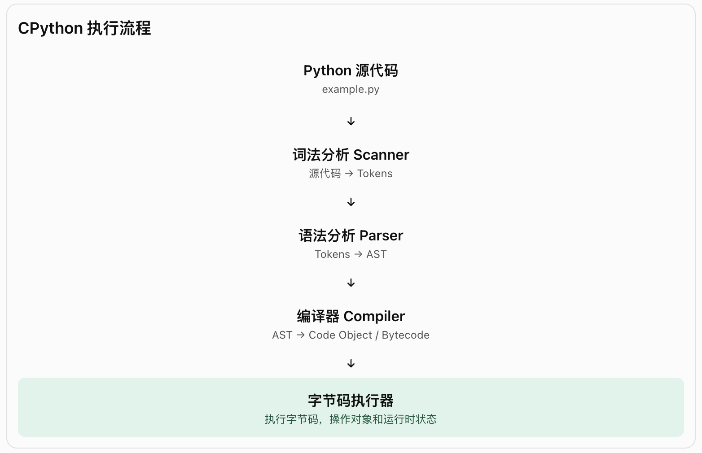
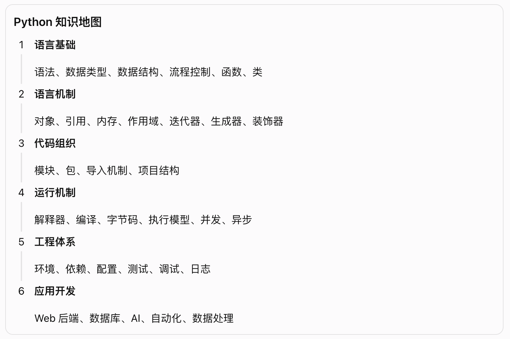

# python 大纲

## 一、第一层: Python 系统内部架构

CPython 拆成三个组成部分:

1. 核心解释器
   这是 Python 的“发动机”。
   你写的 .py 文件并不会直接被执行，而是经历一条流水线:
   1. Scanner（词法分析） 把代码切成一个个 token；
   2. Parser（语法分析） 建立抽象语法树（AST）；
   3. Compiler（编译器） 生成 Python 字节码；
   4. 最后由 Code Evaluator（虚拟机） 逐条执行字节码。

   这解释了为什么 Python 有时会生成 .pyc 文件——那是缓存的字节码，下次运行可以跳过前面的步骤。

   

2. 运行时环境

   解释器执行字节码时，需要一套支撑系统。
   - 对象模型与类型系统: 管理着 Python 里的一切（整数、列表、字典、你自定义的类）；
   - 内存分配器: 负责对象创建时的内存申请（本质是 C 的 malloc 的一层封装）；
   - 垃圾回收机制:
   - 引用计数:
   - 异常处理机制:
   - 线程与解释器状态:
   - 内建函数和内建类型:
   - 运行时状态: 则维护解释器在正常与异常状态之间的切换。

3. 模块与库
   - 包括 Python 自带的标准库（Lib/ 目录下，用 Python 编写）、
   - 内建模块（Modules/ 目录下，用 C 编写以追求速度），
   - 以及你安装的第三方库。

   它们都是搭建在核心解释器和运行时环境之上的“上层建筑”。

- 🔥 注意:
  1. Python 不等于 CPython

     Python 是编程语言，CPython 是它的一种实现。除此之外，还有 PyPy、Jython 等实现。

  2. .pyc 不代表每次运行都一定生成

     .pyc 是字节码缓存，通常保存在 `__pycache__` 目录下。
     它主要用于加速模块导入，不意味着所有 Python 脚本运行都会生成 .pyc，也不意味着运行时一定可以完全跳过解析和编译。

## 二、第二层: Python 程序的构成

1. 一个 .py 文件就是一个模块。
   - 模块是 Python 代码组织的基本单位之一;
   - 包用于组织模块;
   - 多个包和模块共同构成一个应用程序。

2. Python 的函数具有词法作用域，但类定义有一个特殊之处:
   - 原因是: 类的命名空间不会自动成为”类中方法“的外层词法作用域。
     ”类中方法“中的 name 会按照正常的作用域规则查找，而不是自动读取类属性。

   ```python
      name = "全局"
      class User:
          name = "类属性"
          def introduce(self):
              print(name)
      # 调用: User().introduce() --> 全局,而不是: 类属性
      # 如果要访问类属性，可以使用: self.name 或 User.name
   ```

3. 函数执行结束后，它的局部命名空间不再由该次调用的执行帧持有。
   - 局部变量所引用的对象，如果仍然有其他引用，就不会消失。

   ```python
      def create_user():
          user = {"name": "张三"}
          return user

      result = create_user()
      print(result)
      # 函数已经执行结束，但是字典对象依然存在，因为 result 仍然引用它。
   ```

### 2.1 Python 语言基础: 解决「怎么写程序」

| 知识模块 | 主要内容                       | 解决的问题           |
| -------- | ------------------------------ | -------------------- |
| 基础语法 | 变量、注释、缩进、表达式       | 如何表达指令         |
| 数据类型 | int、float、str、bool、None    | 如何表示数据         |
| 数据结构 | list、tuple、dict、set         | 如何组织数据         |
| 运算与流 | 程控制 运算符、if、for、while  | 如何控制程序逻辑     |
| 函数     | 参数、返回值、作用域、闭包     | 如何组织和复用代码   |
| 面向对象 | class、对象、继承、多态        | 如何组织复杂业务     |
| 异常处理 | try、except、finally、raise    | 如何处理错误         |
| 高级语法 | 推导式、装饰器、迭代器、生成器 | 如何编写更灵活的代码 |

变量、数据类型、函数、类并不是彼此独立的知识，它们共同组成了 Python 表达和组织程序的方式。

### 2.2 Python 核心机制: 解决「代码为什么这样运行」

| 核心机制     | 需要理解什么                      |
| ------------ | --------------------------------- |
| 对象模型     | Python 中的数据为什么都是对象     |
| 引用与内存   | 变量、对象、引用之间是什么关系    |
| 可变与不可变 | list、dict 与 int、str 有什么区别 |
| 作用域       | LEGB、局部变量、全局变量          |
| 参数传递     | 位置参数、关键字参数、可变参数    |
| 迭代机制     | iterable、iterator、next          |
| 生成器       | yield、惰性计算                   |
| 装饰器       | 函数包装、增强原有功能            |
| 上下文管理器 | with、资源管理                    |
| 异常机制     | 异常传播、异常捕获                |

### 2.3 模块与包: 解决「如何组织代码」

| 知识          | 作用                                    |
| ------------- | --------------------------------------- |
| Module        | 一个 Python 模块，通常对应一个 .py 文件 |
| Package       | 组织多个模块的包                        |
| import        | 导入其他模块                            |
| 标准库        | Python 自带的功能库                     |
| 第三方库      | 通过包管理工具安装的库                  |
| `__init__.py` | 包初始化及包级接口组织                  |
| `__name__`    | 判断模块运行方式                        |
| sys.path      | 模块搜索路径                            |

### 2.4 Python 程序运行机制: 解决「代码如何执行」

- Python: 一门编程语言。
- CPython: Python 最主流的参考实现，也是你通常安装和使用的 Python 解释器实现。
- 语言提供规则，解释器负责实现这些规则，运行时环境负责支撑程序执行。

```bash
  编写 Python 源代码 .py 【example.py】
    │
    ▼
┌───────────────── 编译阶段 ──────────────────────────┐
│ 词法分析 【源代码 → Tokens】                         │
│   │                                               │
│   ▼                                               │
│ 语法分析 【Tokens → AST】                           │
│   │                                               │
│   ▼                                               │
│ 编译器 Compiler 【AST → Code Object / Bytecode】    │
└───────────────────────────────────────────────────┘
    │
    ▼
┌───────────────── 执行阶段 ──────────────────────────┐
│ CPython 虚拟机执行 【 执行字节码、操作对象和运行时环境 】 │
│   │                                               │
│   ▼                                               │
│ 运行时环境                                          │
│   │                                               │
│   ▼                                               │
│ 操作对象、内存、函数、异常                            │
└───────────────────────────────────────────────────┘
    │
    ▼
输出结果 / 文件 / 网络 / 数据库
```

🔥 example.py 文件交给 CPython 编译器，编译器内部先做词法分析（变成 Tokens），再做语法分析（变成 AST），最后编译生成字节码。然后，CPython 虚拟机接手，在运行时环境中操作内存、对象，最终产生输出结果。

- 后面还需要学习:
  - Python 解释器与虚拟机
  - .py 和 .pyc
  - GIL（全局解释器锁）
  - 进程与线程
  - 同步与异步
  - CPU 密集型与 I/O 密集型任务
  - Python 的内存管理与垃圾回收

### 5. Python 开发生态: 解决「如何开发和维护程序」

Python 本身提供了语言和标准库，但真正开发项目还需要工具链。

| 工具 / 技术                       | 主要作用              |
| --------------------------------- | --------------------- |
| Python Interpreter(Python 解释器) | 运行 Python 程序      |
| pip                               | 安装第三方依赖        |
| uv                                | Python 项目与依赖管理 |
| venv                              | 创建虚拟环境          |
| pyproject.toml                    | 项目配置和依赖声明    |
| pytest                            | 自动化测试            |
| ruff                              | 代码检查与格式化      |
| mypy / pyright                    | 静态类型检查          |
| logging                           | 日志记录              |
| debugger                          | 断点调试              |
| Git                               | 版本管理              |

Python 语言 ≠ Python 解释器 ≠ Python 开发工具 ≠ Python 第三方框架。

### 6. Python 应用开发: 解决「用 Python 做什么」

Python 应用方向

1. Web 后端: FastAPI、Django、Flask
2. AI 应用: LangChain、LangGraph、RAG
3. 数据处理: Pandas、NumPy、ETL
4. 自动化: 脚本、爬虫、任务调度

## 三、再从另一个角度理解：一个 Python 程序是如何组成的？

一个 Python 项目通常包含以下部分：

| 组成部分 | 典型内容               |
| -------- | ---------------------- |
| 数据     | 变量、对象、数据结构   |
| 逻辑     | 表达式、条件、循环     |
| 功能     | 函数、方法             |
| 结构     | 类、模块、包           |
| 控制     | 流程控制、异常处理     |
| 运行     | 解释器、运行时环境     |
| 依赖     | 标准库、第三方库       |
| 工程     | 配置、测试、日志、部署 |

## 四、应该按照什么顺序学习？

### 第一阶段：建立语言基础 (优先掌握)

1. Python 基本语法与代码结构
2. 数据类型与数据结构
3. 运算符与流程控制
4. 函数、参数、返回值
5. 类、对象、面向对象
6. 模块、包、import
7. 异常处理

### 第二阶段：理解核心机制 (重点深入)

1. 对象、引用、内存模型
2. 可变对象与不可变对象
3. 作用域与闭包
4. 迭代器与生成器
5. 装饰器
6. 上下文管理器
7. 类型注解与泛型
8. 并发、线程、进程
9. async / await 异步编程

### 第三阶段：工程化与应用 (实际开发)

1. Python 解释器与运行机制
2. uv、pip、venv、pyproject.toml
3. 项目结构与模块设计
4. logging、pytest、调试
5. 文件、网络、数据库操作
6. FastAPI
7. SQLAlchemy
8. LangChain / LangGraph

## 六、最终建立一个完整的知识地图



## Python 完整知识体系总图

```bash
python技术体系
├─ 一、Python 语言本身
│  ├─ 基本语法
│  ├─ 数据类型与数据结构
│  ├─ 表达式与流程控制
│  ├─ 函数与参数
│  ├─ 类与面向对象
│  ├─ 异常处理
│  ├─ 迭代器、生成器、装饰器
│  └─ 类型系统与异步语法
│
├─ 二、Python 内部运行机制
│  ├─ CPython 解释器
│  ├─ 词法分析与语法分析
│  ├─ AST 与字节码编译
│  ├─ 虚拟机执行
│  ├─ 对象与类型系统
│  ├─ 引用、内存与垃圾回收
│  ├─ 线程、进程与 GIL
│  └─ 异步运行机制
│
├─ 三、Python 程序组织结构
│  ├─ 表达式与语句
│  ├─ 函数与类
│  ├─ 模块 Module
│  ├─ 包 Package
│  ├─ 标准库与第三方库
│  └─ 项目结构与程序入口
│
├─ 四、Python 工程开发体系
│  ├─ 解释器与虚拟环境
│  ├─ pip / uv / pyproject.toml
│  ├─ 依赖管理
│  ├─ 测试与调试
│  ├─ 日志与配置
│  └─ 部署与运维
│
└─ 五、Python 应用开发
   ├─ Web 后端：FastAPI
   ├─ 数据库：SQLAlchemy
   ├─ AI 应用：LangChain / LangGraph
   ├─ RAG / Agent / MCP
   └─ 自动化与数据处理

```

## 啊

## 从岗位数量看（国内近几年）

大致可以理解为:

```bash
    Python后端       ★★★★★
    AI应用开发       ★★★★★
    测试开发         ★★★★☆
    数据工程         ★★★★☆
    运维开发(DevOps) ★★★★☆
    机器学习         ★★★★☆
    数据分析         ★★★☆☆
    爬虫开发         ★★☆☆☆
    桌面开发         ★☆☆☆☆
```

- 从长期职业发展看，现在比较有潜力的是: Python后端 + AI应用开发; 也就是: FastAPI + LLM + RAG + Agent (后端 + AI”复合型工程师)

- AI应用工程师

  学习内容:
  1. Python
  2. FastAPI
  3. 数据库
  4. Redis
  5. Docker
  6. LLM
  7. RAG
  8. Agent

### 1. Python Web 后端开发（FastAPI/Django/Flask）

Python → Web开发 → 数据库 → 网络 → Linux → 缓存 → 消息队列 → 微服务 → 云原生

- Python后端全景图

  ```bash
    业务代码
    │
    ├─ Python
    │
    ├─ FastAPI
    │
    ├─ SQLAlchemy
    │
    ├─ Redis
    │
    ├─ RabbitMQ/Kafka
    │
    ├─ MySQL
    │
    ├─ HTTP/TCP/IP
    │
    ├─ Linux
    │
    ├─ Docker
    │
    ├─ CI/CD
    │
    └─ Kubernetes
  ```

- 按就业和实际开发优先级排序

  ```bash
    第一优先级（必须）
    Python
    ↓
    MySQL
    ↓
    Linux
    ↓
    HTTP/TCP/IP
    ↓
    FastAPI
    ↓
    Redis

    第二优先级（进阶）
    asyncio
    ↓
    pytest
    ↓
    Docker

    第三优先级（高级）
    RabbitMQ/Kafka
    ↓
    Nginx
    ↓
    CI/CD
    ↓
    Kubernetes
  ```

### 2. 自动化运维（DevOps）

- paramiko
- fabric
- ansible

### 3. 测试开发（Test Development）

- pytest
- selenium
- playwright

### 4. 数据分析

- pandas
- numpy
- matplotlib

读取: Excel、CSV、数据库，然后输出统计结果。

### 5. 数据工程（Data Engineering）

数据分析 -> 分析数据

数据工程 -> 建设数据管道

- Airflow
- PySpark

例如: MySQL -> ETL -> Hive -> 数据仓库

### 6. AI / 机器学习

- numpy
- pytorch
- tensorflow

例如: 图像识别、语音识别、推荐系统、大模型

### 7. AI应用开发（Agent / LLM）

### 8. 爬虫与数据采集

### 9. 桌面软件（较少）

### 10. 科学计算

- NumPy
- SciPy

例如: 天气模拟、量化交易、基因分析

### 11. 网络安全

- scapy
- socket
- requests

### 12. 游戏工具开发

不是开发大型游戏本身。

而是: 资源处理工具、配置生成工具、自动化脚本、运营后台
