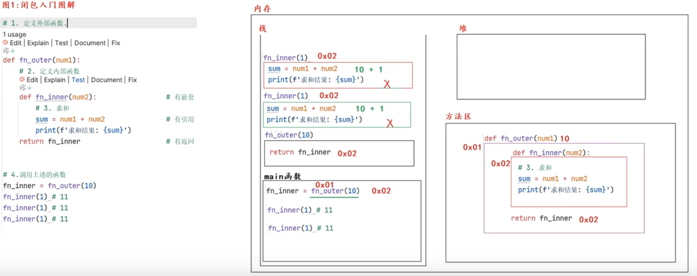
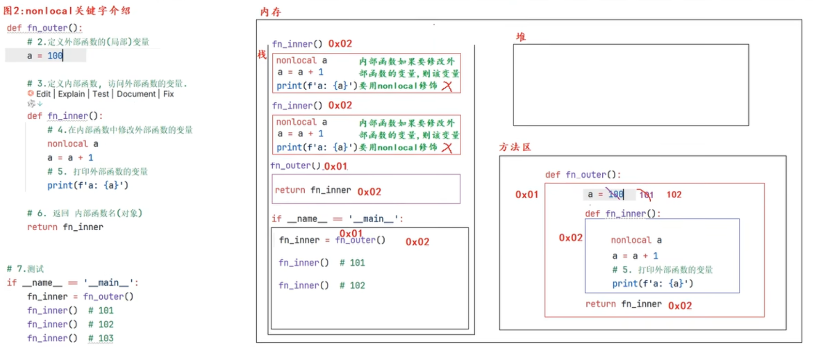

# Python 语法与运行机制知识体系（整合版）

> 目标：把零散笔记整理成一份可持续维护的 Python 学习与查阅文档。按“运行机制 → 语言基础 → 程序组织 → 面向对象与对象协议 → 迭代与函数增强 → 文件与异常 → 标准库 → 网络与并发 → I/O 模型”组织。

---

## 目录

- 1、[Python 全局认知与运行流程](#1-python-全局认知与运行流程)
- 2、[变量、对象与内存模型](#2-变量对象与内存模型)
- 3、[数据类型与数据结构](#3-数据类型与数据结构)
- 4、[运算符、表达式与流程控制](#4-运算符表达式与流程控制)
- 5、[函数](#5-函数)
- 6、[命名空间、作用域与闭包](#6-命名空间作用域与闭包)
- 7、[模块、包与项目组织](#7-模块包与项目组织)

---

# 1. Python 全局认知与运行流程

## 1.1 Python 是什么

Python 是一种高级、动态类型、强类型、通常通过 解释器运行 的编程语言。

- 编译型🆚解释型

- 强类型🆚弱类型
  1. 强类型: 数据类型不可以被忽略的语言，即变量的数据类型一旦被定义，那就不会再改变，除非进行强转。
  2. 弱类型: 数据类型可以被忽略的语言，数据类型可以被忽略，数据类型由数据内容决定。（例: linux中的shell语言）

- 静态型🆚动态型
  1. 静态型: 在定义阶段指定数据类型，在运行时传其他类型报错；需要事先给变量进行数据类型定义
  2. 动态型: 在定义阶段只定义变量名，不定义类型；在运行时（即在变量赋值时），变量名绑定到具体对象；

- 解释器实现：常见实现是 CPython，但 Python 语言不等于CPython。还有 PyPy、Jython 等实现。

- 编译与执行并存：CPython 会先把源代码编译成字节码，再由 Python虚拟机执行；所以简单称为"纯解释执行"并不准确。

## 1.2 从启动解释器到执行 `.py` 文件

以 CPython 执行 `python main.py` 为例：

```text
操作系统启动 Python 解释器进程
        ↓
初始化解释器运行环境、内建对象和模块系统
        ↓
读取 main.py 源文件字节
        ↓
识别源文件编码并解码为文本
        ↓
词法分析：识别关键字、标识符、字面量、运算符等
        ↓
语法分析：构建 AST（抽象语法树）
        ↓
编译：生成代码对象 / 字节码
        ↓
Python 虚拟机执行字节码
        ↓
运行期间调用对象、函数、模块及底层 C 实现
```

补充：

1. `.py` 文件是源代码文件；`.pyc` 是字节码缓存文件，不是必须手动生成或分发的程序文件。
2. Python 3 默认源码编码是 UTF-8。只有需要使用其他编码时，才通常需要在文件开头声明编码。
3. 词法分析、语法分析、编译等是解释器内部阶段；日常开发一般不需要手动执行。
4. 运行过程中，解释器还会处理异常、对象生命周期、模块导入、垃圾回收等工作。

## 1.3 变量、对象与垃圾回收的基本模型

Python 更准确的理解方式是：

> **对象存储数据；名字通过命名空间绑定到对象。**

```python
# -- 给"整数对象10"绑定3个变量名 ----
x = 10  # 实际是 x=int(10)  涉及申请内存空间
y = x
z = x
# -- 解除变量名x、y与值10的绑定关系 ----
del x
del y
print(z)  # 10

z = 123 # 此时 z=123, 值10没有绑定关系了, 会被回收
```

`x = 10` 并不是在变量 `x` 里面开辟一个固定类型的“盒子”，而是让当前作用域中的名字 `x` 绑定到`整数对象 10`。

- “变量值” 的三大特性:
  1. `id(obj)`：返回对象身份标识(唯一)。在 CPython 中通常与内存地址相关，但语言层面不应把它直接等同于内存地址。
  2. `type(obj)`：查看对象类型。
  3. `obj`：对象本身。
  ```python
  x='Info Tony:18' # 'Info Tony:18'是字符串对象
  print(id(x), type(x), x) # ==> 4376607152, <class 'str'>,  'Info Tony:18'
  ```
- is 与 ==
  - `is`：比较两个引用是否指向同一个对象。
  - `==`：比较两个对象的值是否相等。

  ```python
  a = [1, 2]
  b = a
  c = [1, 2]

  print(a is b)  # True
  print(a == c)  # True
  print(a is c)  # False
  #------------------

  ```


CPython 主要使用 **引用计数** 管理对象，并配合 **循环垃圾回收器** 处理部分循环引用。对象只要仍被其他对象、容器、栈帧等引用，就可能继续存活。


## 1.4 常量(约定)

Python 没有强制常量的专用语法。通常用全大写变量名表达约定：

```python
MAX_RETRIES = 3
DATABASE_URL = "sqlite:///app.db"
```

这是开发约定，不会阻止代码重新赋值。

---

# 2. 变量、对象与内存模型

## 2.1 可变对象与不可变对象

| 类型       | 常见类型                                                     | 特征                           |
| ---------- | ------------------------------------------------------------ | ------------------------------ |
| 不可变对象 | `int`、`float`、`bool`、`str`、`bytes`、通常意义上的 `tuple` | 对象创建后，其内容不能原地修改 |
| 可变对象   | `list`、`dict`、`set`、多数自定义实例                        | 可以在原对象上修改内容         |

- 可变对象: 值变了，id不变，证明改的是原值，证明原值是可以被改变的；
- 不可变对象: 值变了，id也变了，证明是产生新的值，原值没有改变，证明原值是不可被修改的；

```python
x = 10
old_id = id(x)
x = 20
print(id(x) == old_id)  # 通常为 False：名字重新绑定到另一个整数对象

items = [1, 2]
old_id = id(items)
items.append(3)
print(id(items) == old_id)  # True：列表对象原地修改
```

- 注意：

  - 不可变对象:不是“变量不能重新赋值”，而是**对象内容不能原地改变**。
  - 元组的外层结构不可变，但如果元组中包含列表等可变对象，内部对象仍可以修改。

  ```python
  t = (1, [2, 3])
  t[1].append(4)  # 合法
  # t[0] = 9      # 不合法
  ```
  
- 一个对象可哈希，意味着它满足两个条件

  1. 在它的生命周期内，hash() 值不变（即 `__hash__` 返回一个稳定的整数）。
  2. 可以和其他对象比较相等（即实现了 `__eq__`），并且相等的对象哈希值必须相同。

  通俗说：可哈希 = 不可变 + 能算出一个稳定的“指纹”。

dict 和 set 底层是哈希表。存一个键时，Python 先算 hash(key) 定位到桶，再用 == 比较确认是不是同一个键。

* 内置的不可变类型(可哈希): int、float、bool、str、bytes、tuple（前提是元素都可哈希）、frozenset、函数、类、None
* 内置的可变类型(不可哈希): list、dict、set
* 自定义类默认可哈希（用 id），除非你重写了 __eq__ 而没写 __hash__。

## 2.2 真值判断

以下对象在布尔上下文中通常为假：

- `False`
- `None`
- 数值零：`0`、`0.0` 等
- 空序列：`""`、`[]`、`()`
- 空集合：`set()`
- 空字典：`{}`

其他大多数对象为真。

```python
if not items:
    print("列表为空")
```

## 2.3 对象身份、缓存与复用（CPython 实现细节）

理解对象身份时，必须区分三个概念：

| 概念     | 含义                         | 常用判断 |
| -------- | ---------------------------- | -------- |
| 值相等   | 两个对象内容是否相等         | `a == b` |
| 对象身份 | 是否为同一个对象             | `a is b` |
| 对象标识 | 对象存活期间用于标识身份的值 | `id(a)`  |

**不要用 `is` 判断普通数值或字符串是否相等。** `is` 主要用于判断身份，最典型的是 `x is None`。

```python
a = [1, 2]
b = [1, 2]
c = a

a == b  # True：值相等
a is b  # False：不是同一个列表对象
a is c  # True：两个名字引用同一个对象
```

### 为什么有时两个独立赋值的对象 `is` 为 True？

CPython 为了性能和内存效率，可能复用某些对象，或在编译阶段合并常量。这些行为大多属于**实现优化**，不能作为业务逻辑的依据。

| 现象                                | 说明                                                  | 是否可依赖                           |
| ----------------------------------- | ----------------------------------------------------- | ------------------------------------ |
| 小整数缓存                          | CPython 通常缓存 `-5` 到 `256` 的整数对象             | 否，属于实现细节                     |
| 字符串驻留                          | 某些字符串会被 intern；也可用 `sys.intern()` 显式驻留 | 自动驻留策略不可依赖                 |
| 字面量常量合并                      | 编译器可能合并相同常量或相邻字符串字面量              | 不应依赖身份                         |
| 常量折叠                            | 编译器可能预先计算常量表达式                          | 结果语义可依赖，具体优化方式不可依赖 |
| 空元组复用                          | CPython 常复用空元组                                  | 不应依赖身份                         |
| 空 `frozenset`                      | 实现可能复用，也可能不复用                            | 不可依赖                             |
| `None`、`True`、`False`、`Ellipsis` | 语言内建的单例对象                                    | 可以用 `is` 判断                     |

```python
# 推荐：判断值用 ==
x == 100

# 推荐：判断单例用 is
if result is None:
    ...

# 显式驻留字符串
import sys
a = sys.intern("some_identifier")
b = sys.intern("some_identifier")
assert a is b
```

注意：

- `id(obj)` 不是通用的内存地址API。语言保证对象存活期间身份标识稳定；CPython 中通常与内存地址相关。
- `is` 的结果可能受解释器实现、版本、编译上下文影响。不要根据某次运行的 `is True` 推导语言规则。
- `a = 1 + 2` 的结果是 `3`。编译器可能提前折叠常量表达式，但不改变表达式语义。
- Python 语言规范不承诺小整数缓存的具体范围；`-5` 到 `256` 是 CPython 常见实现行为，而不是跨实现保证。

### 其他容易混淆的“共享”

对象复用与程序主动共享状态不是一回事：

1. **默认参数共享**：默认值在函数定义时求值一次，见「5.5 默认参数的陷阱」。
2. **类属性共享**：类属性由类对象持有，实例通常通过类查找访问；可变类属性被原地修改时，实例会观察到变化。
3. **闭包共享变量**：闭包捕获外层作用域中的变量绑定，不是简单复制当时的值；见「6.4 闭包」。
4. **赋值共享引用**：`b = a` 不复制对象，只增加一个名字绑定；见「11.1 赋值不是拷贝」。

## 2.4 解包赋值

```python
a, b, c = [10, 20, 30]

first, *middle, last = [1, 2, 3, 4, 5]
# first = 1
# middle = [2, 3, 4]
# last = 5
```

字典直接解包时，默认解包的是 **key**：

```python
data = {"name": "Tom", "age": 18}
name, age = data
```

`_` 常被用作“我不关心这个值”的占位名字，但它仍然是普通变量名，并非语言保留字。

---

# 3. 数据类型与数据结构


## 3.1 内置类型总览

| 类别   | 类型                      | 主要用途               | 可变性                        |
| ------ | ------------------------- | ---------------------- | ----------------------------- |
| 数值   | `int`、`float`、`complex` | 整数、浮点数、复数     | 不可变                        |
| 布尔   | `bool`                    | 真/假判断              | 不可变                        |
| 空值   | `NoneType`                | 表示缺失、无值或无结果 | 不可变                        |
| 文本   | `str`                     | Unicode 文本           | 不可变                        |
| 二进制 | `bytes`、`bytearray`      | 字节数据               | bytes 不可变；bytearray 可变  |
| 序列   | `list`、`tuple`、`range`  | 有序数据               | list 可变；tuple/range 不可变 |
| 集合   | `set`、`frozenset`        | 去重、集合运算         | set 可变；frozenset 不可变    |
| 映射   | `dict`                    | 键值映射               | 可变                          |

## 3.2 `None`

`None` 是 `NoneType` 类型唯一的常用实例，用于表示“没有值”、“尚无结果”等。

```python
result = None

def save():
    print("saved")
    # 没有显式 return，函数返回 None
```

不要把 `None` 与空字符串、数字零、空列表混为一谈。

## 3.3 列表 `list`

有序、可变、允许重复、支持索引和切片。

```python
items = [10, 3, "aa", "cc", ["a", 4]]

items[0]       # 10
items[-1]      # ["a", 4]
items[1:3]     # [3, "aa"]
items.append(5) # [10, 3, 'aa', 'cc', ['a', 4], 5]
items.extend([6, 7]) # [10, 3, 'aa', 'cc', ['a', 4], 5, 6, 7]
items.insert(0, 99) # [99, 10, 3, 'aa', 'cc', ['a', 4], 5, 6, 7]
items.remove(3) # [99, 10, 'aa', 'cc', ['a', 4], 5, 6, 7]
value = items.pop()
```

- 正向索引从 `0` 开始。
- 反向索引从 `-1` 开始。
- `append(x)` 添加一个元素；`extend(iterable)` 将可迭代对象中的元素逐个添加。
- 列表越界访问会抛出 `IndexError`。

## 3.4 元组 `tuple`

有序、不可变、允许重复，常用于固定结构的数据。

```python
point = (10, 20)
single = ("hello",)  # 单元素元组必须带逗号
nested = ((1, 2), (3, 4))
```

元组不可变: 指的是元素引用不能被替换，不代表其中引用的可变对象也被冻结：

```python
data = (1, ["a", "b"])
data[1].append("c")  # 合法
```

## 3.5 字符串 `str`

字符串是不可变的 Unicode 文本序列，支持索引、切片和大量字符串方法。

```python
text = "hello world"
new_text = text.replace("l", "L") # 在原来的'字符串'的基础上，复制一份修改，返回新的；

print(text)      # hello world：原字符串不变
print(new_text)  # heLLo worLd
# text[0] = "H"  # ❌ TypeError
```

### 字符串格式化

优先掌握 f-string：

```python
name = "张三"
height = 175.22
salary = 1000.123456

print(f"{name}，身高 {height:.2f} cm，工资 {salary:10.2f}")
#--> 张三,身高175.22cm,工资   1000.12
```

常见格式：

- `{value:.2f}`：保留两位小数。
- `{value:10}`：最小字段宽度为 10。
- `{value:>10}`：右对齐。
- `{value:<10}`：左对齐。
- `{value:^10}`：居中。

其他格式化方式：

```python
"姓名：{}，年龄：{}".format("张三", 18)
"姓名：%s，年龄：%d" % ("张三", 18)
```

1. `%` 格式化是旧式写法；
2. `m.n` 的含义取决于格式转换类型，不能笼统理解成“m 总宽度、n 小数位”。
3. 新代码优先使用 f-string。

## 3.6 集合 `set` -- 存 "键"

无序、不支持索引、元素唯一，适合去重和集合运算。

```python
values = {1, 2, 3, 3}
print(values)  # {1, 2, 3}

empty_set = set()  # 空集合
empty_dict = {}    # 空字典
```

集合元素必须是可哈希对象，通常是不可变对象；不能直接放入列表、字典或普通集合。
实现了 哈希规则的 自定义类型 也可放入集合

```python
a = {1, 2, 3}
b = {3, 4, 5}

a & b  # 交集
a | b  # 并集
a - b  # 差集
a ^ b  # 对称差集
```

## 3.7 字典 `dict` -- 存 “键值对”

保存 key-value 映射。字典保持插入顺序（Python 3.7+ 语言规范保证），key 必须可哈希且唯一。

```python
user = {
    "name": "张三",
    "age": 18,
}

user["name"]
user.get("email")            # 不存在时返回 None
user.get("email", "未填写")   # 指定默认值
user["age"] = 19
user["city"] = "北京"

for key, value in user.items():
    print(key, value)
```

- key 通常使用字符串、整数、元组（其成员也必须可哈希）等。
- value 可以是任意对象。
- `dict` 的 key 唯一；重复赋值会覆盖原值。

## 3.8 通用操作与类型转换

```python
len(container)
min(container)
max(container)
sorted(container, reverse=True) # 排序；返回新列表，不会原地修改原容器。

list(iterable)
tuple(iterable)
set(iterable) # 去重，但不保证顺序。
str(value)
```

注意：

- `list(dict_obj)` 得到字典的 key 列表。
- `str(obj)` 是转成字符串表示，不等于把任意容器序列化成可逆格式。

## 3.9 比较规则

- Python 3 的 `str` 是 Unicode 文本；UTF-8 是常见编码方式，不是字符串比较规则。
- Python 3 的 字符串: 按 Unicode 码点顺序进行字典序比较。
- 不同类型之间通常不能直接进行大小比较，例如 `1 < "2"` 会报 `TypeError`。

---

# 4. 运算符、表达式与流程控制

## 4.1 常用运算符

| 类型   | 运算符            |
| ------ | ----------------- |
| 算术   | `+ - * / // % **` |
| 比较   | `== != > < >= <=` |
| 逻辑   | `not and or`      |
| 成员   | `in`、`not in`    |
| 身份   | `is`、`is not`    |
| 位运算 | `& \| ^ ~ << >>`  |

- 逻辑运算优先级：`not` > `and` > `or`。
- `//`: 向下取整(朝负无穷方向); `%`: 取余(符号跟随除数)
  ```python
  -7 // 3   # -3  （不是 -2）
  -7 % 3    # 2   （不是 -1）
  ```

## 4.2 短路求值

`and` 和 `or` 不一定返回布尔值，而是返回参与判断的某个操作数：

```python
name = input_name or "anonymous"
result = user and user["name"]
```

- `A and B`：A 为假时返回 A；A 为真时继续判断并返回 B。
- `A or B`：A 为真时返回 A；A 为假时继续判断并返回 B。

## 4.3 条件与循环

```python
if score >= 90:
    level = "A"
elif score >= 60:
    level = "B"
else:
    level = "C"
```

```python
for item in items:
    print(item)

for i in range(1, 10, 2):
    print(i)

while condition:
    # ...
    break       # 结束当前循环
    # continue  # 跳过本轮剩余语句
```

`range(start, stop, step)` 的 `stop` 不包含在结果中【左闭右开】。

---

# 5. 函数

## 5.1 定义与调用

```python
def add(a, b):
    return a + b

result = add(1, 2)
```

- `def` 定义普通函数。
- `lambda` 定义简短匿名函数，适合简单表达式，不适合承载复杂业务逻辑。
- 函数是对象，可以赋值给变量、作为参数传递、作为返回值。

* 定义函数时: 解释器创建函数对象并执行必要的定义阶段工作；
  1. 申请内存空间保存函数体代码
  2. 将上述内存地址绑定到函数名
  3. 定义函数不会执行函数体代码，但会检测函数体语法

* 调用函数时: 才执行函数体。
  1. 通过函数名找到函数内存地址
  2. 然后加括号就是在 触发函数体代码的执行，❗产生(局部)名称空间（命名空间-局部）

* 形参与实参:
  1. 在调用阶段，实参会绑定给形参
  2. 这种绑定关系只能在函数体内使用
  3. 实参与形参的绑定关系在函数调用时生效，函数调用结束后解除绑定关系；
  4. 默认参数的值是在定义阶段被赋值的，❗赋予的是内存地址；

- 编译阶段: Python 在函数定义时（编译阶段）扫描函数体: 发现`x = 2`，于是 Python 认为: 👉 x 是局部变量。
- 执行阶段: 但执行时: 执行到: `print(x)`局部变量 x 还没有赋值。所以报错: UnboundLocalError

  ⚠️ 注意: 不是找不到变量; 是找到局部变量，但还没赋值。  
   👉 全局变量在函数执行前已经赋值了，而局部变量是在函数执行过程中才赋值。

## 5.2 参数类型

```python
def create_user(name, age=18, *args, city, **kwargs):
    ...
```

| 参数类型              | 说明                      | 示例                    |
| --------------------- | ------------------------- | ----------------------- |
| 位置参数              | 按位置传值                | `f("Tom", 18)`          |
| 关键字参数【js 没有】 | 按参数名传值，可调整顺序  | `f(age=18, name="Tom")` |
| 默认参数              | 调用时可省略              | `age=18`                |
| 可变位置参数          | 收集多余位置参数为 tuple  | `*args`                 |
| 可变关键字参数        | 收集多余关键字参数为 dict | `**kwargs`              |
| 仅限关键字参数        | 必须通过参数名传入        | `*, city` 后面的参数    |

参数顺序需要遵守 Python 语法规则。典型形式：

```python
def func(positional, default=1, *args, keyword_only, **kwargs):
    print(positional, default, args, keyword_only, kwargs)
```

调用：

```python
func(10, 20, "a", "b", keyword_only="北京", extra=True)
```

## 5.3 `*` 与 `**` 的解包

```python
def show(a, b, c):
    print(a, b, c)

values = [1, 2, 3]
show(*values)  # 等价于 show(1, 2, 3)

data = {"a": 1, "b": 2, "c": 3}
show(**data)   # 等价于 show(a=1, b=2, c=3)
```

- 在**函数定义**中，`*args` / `**kwargs` 用于收集参数。
- 在**函数调用**中，`*iterable` / `**mapping` 用于解包参数。
- `*dict` 解包的是字典的 key，不是 value。

## 5.4 返回值与多返回值

```python
def get_info():
    return "张三", 18

name, age = get_info()
result = get_info()  # 实际返回一个 tuple
```

Python 函数只能通过 `return` 返回一个对象；写多个逗号分隔的值时，通常是返回一个元组。

没有显式 `return` 或只写 `return`，返回值都是 `None`。

## 5.5 默认参数的陷阱

默认参数表达式: 在函数定义时求值一次，不是每次调用时重新创建。

❗默认参数的值在 def 时创建一次并被所有调用共享；
如果它是可变对象，就会被反复修改。用 None 占位、在函数体里再创建，就能保证每次调用拿到全新的对象。

```python
# 不推荐
def add_item(item, items=[]):
    items.append(item)
    return items

# 推荐
def add_item(item, items=None):
    if items is None:
        items = []
    items.append(item)
    return items
```

### 原因 (四层)

1. 第一层：def 是一条语句，执行时就把默认值算出来;

   Python 里 def 不是"声明"，而是一条会执行的语句。执行到这一行时，它做三件事：
   1. 创建一个函数对象
   2. `当场把默认值表达式求值`（[] 就在此时被创建成一个真实列表对象）
   3. 把这个列表对象存进函数对象的 **defaults** 元组
   - 之后每次调用，若没传 items，就`从 __defaults__ 里取出那个已存在的对象`绑定给 items。不是"重新执行 []"。

   - 为什么设计成定义时求值？

     因为默认参数属于函数定义的一部分，是"函数自带的东西"。语言设计上把它当成函数对象的一个属性固定下来，而不是每次调用再算——这样简单、快速、可内省（能通过 `__defaults__`看到）。几乎所有动态语言（含 Python）都这样。

2. 第二层：items.append(...) 没有重新绑定名字
   append 是`原地修改对象`，不是给 items 重新赋值。

   ```python
   def add_item(item, items=[]):
     # items.append(item)   # 修改的是 items 指向的那个列表本身
     # items = [...]      # 这才是重新绑定，但代码里没这么写
     # -----------------------------------------------------------------
     items = items + [item]   #  新建了列表并重新绑定 items，原默认列表没被改
     return items
   ```

3. 第三层：名字是标签，对象是盒子

   Python 里变量不是"装值的盒子"，而是`贴在对象上的标签`。

   `def add_item(item, items=[]):`
   - [] 创建了一个对象（记作 A）
   - 这个对象 A 被存进 add_item.**defaults**
   - 每次调用不传参时，items 这个标签就贴到对象 A 上
   - items.append(x) → 修改对象 A

   所以"每次调用拿到的是同一个 A"，不是"A 的副本"。默认值共享的是对象本身，不是值。

4. 第四层：对比不可变对象为什么没坑

   ```python
   def f(x, n=0):
     n = n + 1      # 这不是改 0，而是新建 int 对象并重新绑定 n
     return n
   ```

   0 也是定义时创建一次、被共享。但 int 不可变，n + 1 会`新建`一个对象再让 n 指向它，原来那个 0 纹丝不动。所以共享不共享无所谓——反正改不了它。

## 5.6 参数传递的准确理解

Python 使用对象引用传递（也常称 call by sharing）：函数参数名绑定到传入对象。

- 对可变对象进行原地修改，调用方可能观察到变化。
- 在函数内部把参数名重新绑定到新对象，不会改变调用方变量的绑定。

```python
def change(items):
    items.append(3)  # 修改同一个列表对象

def rebind(items):
    items = [100]    # 只改变局部名字的绑定
```

---

# 6. 命名空间、作用域与闭包

## 6.1 命名空间 Namespace

命名空间是**名字到对象的映射**。可以把它理解为一张查找表【本质就是: 👉 一个 dict（字典）】；  
模块全局命名空间通常可通过 `globals()` 观察，局部命名空间可通过 `locals()` 观察。

Python 里名字（name）只是标签，命名空间就是"哪个标签指向哪个对象"的查找表。查找变量 x 时，解释器在某个命名空间里按名字查表，拿到对象。

常见命名空间：

| 命名空间        | 创建时机       | 主要内容                         |
| --------------- | -------------- | -------------------------------- |
| Local           | 函数调用时     | 当前函数参数和局部变量           |
| Enclosing       | 外层函数调用时 | 外层函数局部变量，供内层函数访问 |
| Global          | 模块执行时     | 模块级变量、函数、类             |
| Built-in (内置) | 解释器初始化   | `print`、`int`、内建异常等       |
| Class namespace | 执行类定义体时 | 类属性、方法等                   |

Global 命名空间在“模块顶层代码首次被执行时”创建（被 import 时触发执行，或作为主程序运行时执行）；同一模块重复导入不会重建。

类命名空间主要参与类属性和属性查找，不应简单地把它插入函数的 LEGB 查找链中。

## 6.2 作用域与 LEGB

函数中查找普通名字时，常见顺序是：

```text
L - Local       当前函数局部作用域 (局部)
E - Enclosing   外层函数作用域 (闭包)
G - Global      当前模块全局作用域 (全局)
B - Builtins    内建命名空间 (内建)
```

Python 使用词法（静态）作用域：变量的作用域关系由代码结构决定，而不是由调用者是谁决定。

Python 没有普通的 `if`、`for`、`while` 块级作用域；但函数、类、模块等会形成自己的命名空间/作用域边界。

## 命名空间 🆚 作用域 🆚 LEGB

命名空间：名字→对象的`表`（数据结构，运行时真实存在）。

作用域：代码里“某段” 能访问 “哪些名字”的`规则/区域`（静态，看代码结构）。

LEGB：查找一个名字时，按 L → E → G → B 的顺序去各个作用域对应的命名空间里查表——它是`查找顺序规则`，作用在"作用域"这个层面上。

## 6.3 `global` 与 `nonlocal`

```python
count = 0

def increment():
    global count
    count += 1
```

`global` 声明函数中对某名字的赋值 指向模块全局命名空间。

```python
def outer():
    count = 0

    def inner():
        nonlocal count
        count += 1

    inner()
    return count
```

`nonlocal` 指向最近一层、且已经存在该名字的外层函数作用域。

注意：对列表执行 `append()` 等原地修改，通常不需要 `global` / `nonlocal`；只有需要在当前作用域内**重新绑定名字**时，才需要相应声明。

## 6.4 闭包

闭包: 是函数对象 与 其捕获的“外部作用域变量”之间的组合。内层函数即使在外层函数执行结束后，仍可以访问被捕获的变量。

`fn_outer(100)(200)`: 其中 `fn_outer(100)`是外部函数执行后返回的内部函数`fn_inner`，等价于 `fn_inner(200)`；

```python
def make_counter():
    count = 0

    def counter():
        nonlocal count
        count += 1
        return count

    return counter

counter = make_counter()
print(counter())  # 1
print(counter())  # 2
```

常见用途：保存状态、延迟执行、装饰器、函数工厂。




---

# 7. 模块、包与项目组织

## 7.1 模块 Module

一个 Python 模块通常对应一个 `.py` 文件。模块可以包含变量、函数、类和可执行语句。

常见导入方式：`[from 模块名] import [模块 | 类 | 变量 | 函数 | * ] [as 别名]`

```python
import module
import module as alias
from module import function
from module import function as alias
from module import *

import 顶级包.子包.子模块 # ❗凡是在导入时带点的，点的左边都必须是一个包，否则非法【包、模块 通用】
```

不建议在业务代码中大量使用 `from module import *`，因为它会让名字来源不清晰，也容易造成命名冲突。

## 7.2 `__name__`: 内置变量

```python
if __name__ == "__main__":
    main()
```

- 文件作为程序入口直接执行时，`__name__ == "__main__"`。
- 文件作为模块导入时，`__name__` 通常是模块的导入名。

用途：把可复用定义与脚本入口逻辑分开。

## 7.3 `__all__`: 内置变量

`__all__` 主要控制执行 `from module import *` 时导出的名称：

```python
__all__ = ["add", "subtract"]
```

它不是模块的访问权限系统，也不会阻止别人显式导入其他名字。

包中的 `__all__` 可用于控制 `from package import *` 时导出的名称，但不会自动替代模块导入和包初始化机制。

## 7.4 包 Package

包用于组织多个模块。传统常规包通常包含 `__init__.py`：

```text
my_project/
├── pyproject.toml
└── src/
    └── my_app/
        ├── __init__.py
        ├── main.py
        ├── api/
        │   ├── __init__.py
        │   └── users.py
        └── services/
            ├── __init__.py
            └── user_service.py
```

Python 3 还支持 namespace package（命名空间包），因此并非所有包都必须包含 `__init__.py`。但常规项目通常保留它，以明确包边界并便于初始化。

## 7.5 导入与模块缓存

### 7.5.1 绝对导入

确保“执行文件” 与 “包” 在同一文件夹下 或者 sys.path.append('/Usrs/xxx/foo')；

原因: 👉 环境变量是以执行文件为准的，“所有被导入的模块中” 或 “后续的其他文件中” 引用的sys.path都是参照执行文件的sys.path

| 写法                     | 当前命名空间新增的名字 | 访问方式       |
| ------------------------ | ---------------------- | -------------- |
| import pkg.mod           | pkg                    | pkg.mod.func() |
| import pkg.mod as m      | m                      | m.func()       |
| from pkg import mod      | mod                    | mod.func()     |
| from pkg.mod import func | func                   | func()         |
| from pkg import `*`      | `__all__` 列出的名字   | 直接名字       |

### 7.5.2 相对导入（仅限于包内引用，不能跨出包）

| 写法 | 含义              |
| ---- | ----------------- |
| .    | 当前包（pkg.sub） |
| ..   | 父包（pkg）       |
| ...  | 祖父包，以此类推  |

- ❗注：相对导入依赖 `__package__`。
  - 直接运行 python pkg/sub/mod.py 时，该模块是 `__main__`，没有包上下文，相对导入会报 ImportError 错误。
  - 正确做法是 `python -m pkg.sub.mod` 或从包外导入。

### 7.5.3 收尾

| 主题                | 要点                                                           |
| ------------------- | -------------------------------------------------------------- |
| `from pkg import *` | 受 `__all__` 控制；无,则导非下划线名                           |
| `__all__`           | 可选；只约束 `import *`；可含模块/函数/变量/类；模块和包都适用 |
| 相对导入 `. ..`     | 仅包内、被导入时可用；直接运行会失败                           |
| 子模块 + `import *` | 需 `__all__ `列出并已加载，或 `__init__` 显式 import           |
| 最佳实践            | 少用 `import *`，优先显式导入                                  |

### 7.5.4 包、模块 的查找顺序

- 首次import 的顺序大致是：
  1. 查找模块（sys.path / sys.modules）;
  2. 创建模块对象，同时给它建好一个空的 `__dict__`（此时命名空间是空的）;
  3. 把模块对象`放进 sys.modules 缓存`（⚠️先放，防止循环导入重复执行）;
  4. 执行模块顶层代码，每条赋值/def/class 都写进这个 `__dict__` (命名空间在这一步被填充);
  5. 绑定名字到导入方。

- 之后的导入，都是直接引用 “首次导入” 产生的命名空间（不会重复执行）；

```text
import pkg.mod
 │
 ├─ 0. sys.modules 里已有 'pkg.mod'？ → 直接返回（不重复执行）
 │
 ├─ 1. 导入父包 pkg（递归走同样流程）
 │      └─ 执行 pkg/__init__.py，填充 pkg.__dict__(命名空间)
 │
 ├─ 2. 为 'pkg.mod' 找 spec：
 │      └─ 遍历 sys.meta_path 的 finder
 │           ├─ BuiltinImporter（内置模块）
 │           ├─ FrozenImporter（冻结模块）
 │           └─ PathFinder 遍历 sys.path 各项
 │                ├─ 脚本所在目录/当前目录 → PYTHONPATH → 标准库 → 第三方site-packages
 │                └─ 找到 pkg/mod.py 或 pkg/mod/__init__.py
 │
 ├─ 3. 用 spec 创建模块对象，建空 __dict__(命名空间)
 │
 ├─ 4. 放入 sys.modules['pkg.mod']缓存（先放，防循环导入重复执行）
 │
 ├─ 5. 执行模块顶层代码，填充 __dict__（命名空间 在这一步被填充）
 │
 └─ 6. 绑定：pkg.mod = <module>，并把 pkg 绑定到当前命名空间
```

spec 是模块的"加载说明书"：finder 搜索后产出它，里面写着模块名、来源路径、用哪个 loader、是不是包、子模块去哪找；  
import 系统 据此 创建模块对象并执行代码。它是"查找"与"加载"之间的桥梁。

- Python: 模块是一个对象，被 import 系统动态加载。
- Node CommonJS: 模块是一个函数执行环境，通过 require 运行。
- Node ESM: 模块是一个静态依赖图，在执行前完成链接。

#### Node.js 模块加载机制--1--CommonJS（传统）

1. 第一步: 检查缓存: `require.cache`
2. 第二步: 路径解析:
   Node 按顺序查找:

   ```js
   ./foo
   ./foo.js
   ./foo.json
   ./foo.node
   // ========================
   当前目录/node_modules
   父目录/node_modules
   根目录/node_modules
   ```

3. 第三步: 创建 Module 对象,并加入缓存`require.cache`;

   ```js
   Module {
     id
     filename
     exports
     loaded
   }
   ```

4. 第四步: 代码包装；Node 不会直接执行 JS 文件，会先包一层函数:

   ```js foo.js
   (function (exports, require, module, __filename, __dirname) {
     // foo.js 内容
   });
   ```

5. 第五步: 执行模块:
   执行 wrapper function，最终返回: `module.exports`

#### Node.js 模块加载机制--2--ES Module（现代）

- Node 的 ESM 实现遵循: ECMAScript Module Spec
- 加载流程: 解析 → 链接 → 执行
- ESM 关键特点: 静态分析: 在 编译阶段就解析:所以: import 不能写在 if 里
- live binding: `export let count = 0` 其他模块引用: 实时更新(不是拷贝)。

#### Python vs Node 模块机制核心区别

| 对比     | Python               | Node CommonJS    | Node ESM     |
| -------- | -------------------- | ---------------- | ------------ |
| 加载方式 | import               | require()        | import       |
| 解析阶段 | 运行时               | 运行时           | 编译阶段     |
| 缓存     | sys.modules          | require.cache    | Module Map   |
| 模块本质 | Module object        | module.exports   | live binding |
| 执行次数 | 一次                 | 一次             | 一次         |
| 循环依赖 | 可运行但可能未初始化 | 容易 undefined   | 更安全       |
| 作用域   | module.**dict**      | wrapper function | module scope |
| 是否静态 | 否                   | 否               | 是           |

## 7.6 第三方依赖与项目安装

```bash
python -m pip install requests
```

使用 uv 时：

```bash
uv add requests
uv sync
```

- `pip` / `uv` 负责安装依赖。
- `pyproject.toml` 用于声明项目元数据、依赖和工具配置。
- `src` 布局把可导入包放在 `src/` 下，减少从项目根目录意外导入源码的情况。
- `pip install -e .` 是可编辑安装：把当前项目安装到环境中，开发时修改源码通常不需要重新安装。
- 项目目录名与 Python 包名不要求相同，例如项目名 `my-agent` 可以对应导入包 `my_agent`。

---
