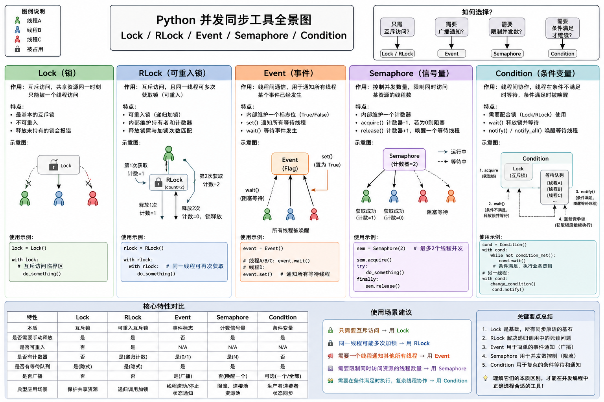

# Python 语法与运行机制知识体系（整合版）

> 目标：把零散笔记整理成一份可持续维护的 Python 学习与查阅文档。按“运行机制 → 语言基础 → 程序组织 → 面向对象与对象协议 → 迭代与函数增强 → 文件与异常 → 标准库 → 网络与并发 → I/O 模型”组织。

---

## 目录

- 16、[并发编程：进程、线程、协程](#16-并发编程进程线程协程)
- 17、[asyncio 异步编程](#17-asyncio-异步编程)
- 18、[I/O 模型与高性能网络基础](#18-io-模型与高性能网络基础)
- 19、[核心概念对照表](#19-核心概念对照表)
- 20、[原笔记关键错误与修正清单](#20-原笔记关键错误与修正清单)
- 21、[建议学习顺序](#21-建议学习顺序)

---

# 并发通信：Queue、Pipe 与任务协作

## 先建立通信工具全景

| 工具                            | 所属模块          | 通信范围                 | 典型用途                       |
| ------------------------------- | ----------------- | ------------------------ | ------------------------------ |
| `queue.Queue`                   | `queue`           | 同一进程内的线程之间     | 线程生产者/消费者              |
| `queue.LifoQueue`               | `queue`           | 同一进程内的线程之间     | 后进先出任务栈                 |
| `queue.PriorityQueue`           | `queue`           | 同一进程内的线程之间     | 按优先级取任务                 |
| `multiprocessing.Queue`         | `multiprocessing` | 多个进程之间             | 多生产者、多消费者             |
| `multiprocessing.JoinableQueue` | `multiprocessing` | 多个进程之间             | 需要确认任务完成               |
| `multiprocessing.Pipe`          | `multiprocessing` | 进程之间的连接端点       | 两个进程直接收发消息           |
| `asyncio.Queue`                 | `asyncio`         | 同一事件循环中的协程任务 | 异步生产者/消费者              |
| `subprocess.PIPE`               | `subprocess`      | 父进程与子进程标准流     | 捕获命令的 stdin/stdout/stderr |

选择时先问：**谁和谁通信？线程、进程、协程，还是外部子进程？**

## `queue.Queue`：线程间队列

`queue.Queue` 是线程安全的 FIFO 队列。多个线程可以同时 `put()` 和`get()`，队列内部负责必要的同步。

```python
from queue import Queue, Empty
from threading import Thread

tasks = Queue(maxsize=100)

def producer():
    for item in range(5):
        tasks.put(item)       # 队列满时默认等待
    tasks.put(None)           # 发送结束标记

def consumer():
    while True:
        item = tasks.get()    # 队列空时默认等待
        try:
            if item is None:
                return
            print("处理：", item)
        finally:
            tasks.task_done()

t1 = Thread(target=producer)
t2 = Thread(target=consumer)
t1.start()
t2.start()

tasks.join()                  # 等待所有 put 的任务都 task_done
t1.join()
t2.join()
```

常用 API：

| API                                   | 作用                               |
| ------------------------------------- | ---------------------------------- |
| `put(item, block=True, timeout=None)` | 放入元素；满队列时可阻塞           |
| `put_nowait(item)`                    | 非阻塞放入；失败抛出 `queue.Full`  |
| `get(block=True, timeout=None)`       | 取出元素；空队列时可阻塞           |
| `get_nowait()`                        | 非阻塞取出；失败抛出 `queue.Empty` |
| `task_done()`                         | 通知队列某个已取出的任务处理完毕   |
| `join()`                              | 等待未完成任务计数归零             |

❗注意：`Queue.join()`等待的是任务完成计数归零，不是等待线程退出。每次成功 `get()`后，消费者 应对 对应任务调用一次 `task_done()`，否则 `join()`可能一直等待。

### `LifoQueue` 与 `PriorityQueue`

```python
from queue import LifoQueue, PriorityQueue

stack = LifoQueue()
stack.put("first")
stack.put("second")
print(stack.get())             # second

priority = PriorityQueue()
priority.put((10, "普通任务"))
priority.put((1, "高优先级任务"))
print(priority.get())          # (1, '高优先级任务')
```

`PriorityQueue` 默认按元素比较顺序取出最小项，因此数值越小越先出队。若优先级相同且任务对象不可比较，可加入递增序号作为第二排序字段：

```python
from itertools import count
from queue import PriorityQueue

sequence = count()
tasks = PriorityQueue()
tasks.put((1, next(sequence), {"job": "A"}))
tasks.put((1, next(sequence), {"job": "B"}))
```

## `multiprocessing.Queue`：进程间队列

不同进程拥有相互隔离的地址空间，普通 Python列表或变量不会因为传给子进程就自动成为共享状态。  
`multiprocessing.Queue` 提供跨进程消息传递。

```python
from multiprocessing import Process, Queue

def producer(q):
    for value in range(3):
        q.put(value)
    q.put(None)                # 结束标记

def consumer(q):
    while True:
        value = q.get()
        if value is None:
            break
        print("收到：", value)

if __name__ == "__main__":
    q = Queue()
    p1 = Process(target=producer, args=(q,))
    p2 = Process(target=consumer, args=(q,))
    p1.start()
    p2.start()
    p1.join()
    p2.join()
    q.close()
    q.join_thread()
```

要点：

1. 基本定位与主要接口
   - 主要接口: `put()` / `get()`;
   - 阻塞语义：有界队列满时 put() 会阻塞，空队列 get() 会阻塞；两者都支持 timeout 参数，超时分别抛 queue.Full / queue.Empty。
   1. 有界队列（bounded queue）就是容量有上限的队列：创建时指定了最大长度，队列里的元素数量不能超过这个上限`Queue(5)`；
   2. 无界队列：不限制数量，直到内存耗尽；put() 基本不会因"满"而阻塞`Queue() 或 Queue(0)`；

2. 对象传递与序列化:
   - 进程队列 传递 Python 对象时需要 "序列化"（通常使用 pickle），接收端再反序列化。

3. 实现细节:
   - 进程队列 内部涉及管道、缓冲、锁/信号量以及 feeder thread 等实现细节；
   - ⚠️ **不要把实现简单概括成固定的"Pipe + 一把锁"**，具体内部实现属于 CPython 版本实现细节。

4. 状态查询的可靠性:
   - `empty()`、`full()`、`qsize()` 在多进程并发场景下 "不能作为可靠同步依据"；
   - 应通过阻塞操作、超时、哨兵值或明确的协议协调。

5. 非阻塞操作:
   - `get_nowait()` / `put_nowait()` 是非阻塞操作，可能抛出 `queue.Empty` / `queue.Full`。

6. 生命周期管理:
   - 使用完毕可调用 `close()`，并按需要调用 `join_thread()` 等待队列后台 feeder thread 结束。

## `JoinableQueue`：(进程) 确认任务处理完成

`JoinableQueue` 在进程队列基础上增加未完成任务计数：

```text
put(task)       → 未完成任务数 +1
get()           → 取出任务，但计数不减少
task_done()     → 未完成任务数 -1
join()          → 等待未完成任务数归零
```

完整示例（包含结束哨兵和任务确认）：

```python
from multiprocessing import Process, JoinableQueue

def worker(q):
    while True:
        task = q.get()
        try:
            if task is None:
                return
            print("处理任务：", task)
        finally:
            # 普通任务和结束哨兵都要与一次 put 对应一次 task_done
            q.task_done()

if __name__ == "__main__":
    q = JoinableQueue()
    workers = [Process(target=worker, args=(q,)) for _ in range(2)]

    for p in workers:
        p.start()

    for task in range(5):
        q.put(task)

    # 等待业务任务处理完成
    q.join()

    # 每个 worker 发送一个结束哨兵
    for _ in workers:
        q.put(None)

    # 哨兵本身也计入未完成任务，因此再次 join
    q.join()

    for p in workers:
        p.join()

    q.close()
    q.join_thread()
```

`task_done()` 必须与已放入队列的任务一一对应；多调用会抛出
`ValueError`，漏调用则可能让 `join()` 永远等不到计数归零。

## multiprocessing.Pipe：进程间连接通道

`Pipe()` 创建一对连接对象。默认 `duplex=True`，两个端点都可以收发；设置`duplex=False` 时创建单向通信端点。

```python
from multiprocessing import Process, Pipe

def worker(conn):
    message = conn.recv()
    conn.send({"reply": f"收到：{message}"})
    conn.close()

if __name__ == "__main__":
    parent_conn, child_conn = Pipe(duplex=True)

    p = Process(target=worker, args=(child_conn,))
    p.start()

    child_conn.close()         # 父进程不使用子进程端，及时关闭自己的副本
    parent_conn.send("hello")
    print(parent_conn.recv())

    parent_conn.close()
    p.join()
```

常用接口：

- `send(obj)` / `recv()`：发送和接收可 pickle 的对象。
- `send_bytes(data)` / `recv_bytes()`：发送和接收字节数据。
- `poll(timeout)`：检查是否有数据可读。
- `close()`：关闭连接端点。

Pipe 适合明确的一对一通信，代码直接、抽象较低。**不能简单说Pipe"不安全"**：两个端点按协议由各自进程使用时完全可以正常工作；如果多个进程同时写同一个连接端点，消息可能发生交错，应自行同步，或改用Queue。

## Queue 🆚 Pipe

| 维度         | `multiprocessing.Queue`  | `multiprocessing.Pipe`         |
| ------------ | ------------------------ | ------------------------------ |
| 抽象         | 队列                     | 连接通道                       |
| 消息组织     | FIFO 队列                | 端点之间直接收发               |
| 常见通信模式 | 多生产者/多消费者        | 通常一对进程                   |
| 并发写入     | 封装了队列所需的同步机制 | 多进程共用同一端点时需自行同步 |
| 任务完成确认 | `JoinableQueue` 支持     | 需要自行设计协议               |
| 使用难度     | 较低                     | 需要自行管理端点和通信协议     |
| 典型场景     | 任务分发、工作队列       | 父子进程命令/响应              |

性能没有脱离场景的绝对结论。消息大小、生产者/消费者数量、序列化成本、进程调度和缓冲策略都会影响结果，不要仅凭"Pipe一定更快"来选择。

## `asyncio.Queue`：协程间队列

`asyncio.Queue`用于同一事件循环中的协程任务，不是线程安全队列，也不能直接替代`multiprocessing.Queue`。

```python
import asyncio

async def producer(q: asyncio.Queue):
    for item in range(3):
        await q.put(item)
    await q.put(None)

async def consumer(q: asyncio.Queue):
    while True:
        item = await q.get()
        try:
            if item is None:
                return
            print("处理：", item)
        finally:
            q.task_done()

async def main():
    q = asyncio.Queue(maxsize=10)
    async with asyncio.TaskGroup() as tg:
        tg.create_task(producer(q))
        tg.create_task(consumer(q))
    await q.join()

asyncio.run(main())
```

常见接口与线程队列相似，但阻塞操作需要`await`：`await put()`、`await get()`、`await join()`。

`asyncio.Queue`的 `put_nowait()` / `get_nowait()` 是同步的非阻塞接口。

## `subprocess.PIPE` 不等于 `multiprocessing.Pipe`

```python
import subprocess

result = subprocess.run(
    ["python", "-c", "print('hello')"],
    capture_output=True,
    text=True,
    check=True,
)
print(result.stdout)
```

- `subprocess.PIPE` 是把外部子进程的标准输入/输出/错误流连接到父进程。
- `multiprocessing.Pipe` 是 Python 多进程 API 提供的进程间连接对象。
- 两者都借助操作系统的进程通信能力，但 API、数据模型和使用场景不同。

## 共享内存：与消息队列不同的思路（进阶）

`multiprocessing.shared_memory`可让多个进程访问同一块内存，减少大块数据在进程间反复序列化和复制的成本。但共享内存只解决"共享数据区域"，不自动解决并发读写一致性；仍需锁、事件或其他协议协调。

**选择建议：**

- 普通任务传递：优先 `multiprocessing.Queue`。
- 明确的一对一通信：考虑 `Pipe`。
- 需要任务完成确认：`JoinableQueue`。
- 大块数值数据共享：评估 `shared_memory`。
- 线程之间传任务：`queue.Queue`。
- 协程之间传任务：`asyncio.Queue`。

---

# 16. 并发编程：进程、线程、协程

## 16.1 并发与并行

- **并发（Concurrency）**：多个任务在一段时间内交替推进，宏观上同时处理多个任务。
- **并行（Parallelism）**：多个任务在同一时刻真正同时执行，通常需要多核或多执行资源。
- 并发不等于并行。

## 16.2 进程 Process

进程: 是操作系统进行资源分配和隔离的重要单位。每个进程通常拥有独立的虚拟地址空间。

```python
from multiprocessing import Process, current_process

def work(name):
    print("working:", name)

if __name__ == "__main__":
    p = Process(target=work, args=("task",))
    p.start()
    p.join()
```

常用操作：

- `start()`：启动子进程。
- `join()`：等待子进程结束。
- `terminate()`：请求/强制终止进程，不适合用于正常清理流程。
- `is_alive()`：检查进程是否仍在运行。
- `daemon`：守护进程设置，需在启动前配置。因为进程启动后属性不可修改；  
  🔥 daemon 不是“守护别人”，而是“被主进程绑定生死”

计算机会给每一个运行的进程分配一个PID号;  
进程之间默认不共享普通 Python 对象；通信需要 IPC，例如 Queue、Pipe、共享内存等。

**跨平台注意：**

- macOS、Windows 常见启动方式为 `spawn`；
- Linux 还可能使用 `fork`。
- ❗多进程代码应使用 `if __name__ == "__main__":` 保护入口，避免子进程导入主模块时重复启动任务。

## 16.3 线程 Thread

线程: 是进程内的执行单元。同一进程中的线程共享进程地址空间，因此共享数据方便，但也需要处理竞态条件(抢)❗。

```python
import threading

lock = threading.Lock()
counter = 0

def work():
    print(f"线程{i}开始工作")
    global counter
    with lock:  # 离开会自动解锁（异常也会解锁）
        counter += 1
        print(f"线程{i}计数器增加到: {counter}")
    print(f"线程{i}结束工作")

threads = [threading.Thread(target=work) for _ in range(10)]

for thread in threads:
    thread.start()

for thread in threads:
    thread.join()
```

线程适合 I/O 密集型任务，例如等待网络、磁盘、数据库响应。

🔥 daemon 不是“守护别人”，而是“被进程绑定生死”

## 16.4 锁与同步原语

| 原语                    | 作用                                 |
| ----------------------- | ------------------------------------ |
| `Lock`                  | 互斥锁，同一时刻只允许一个线程持有   |
| `RLock`                 | 可重入锁，同一线程可重复获取         |
| `Semaphore`             | 信号量，限制同时访问某资源的任务数量 |
| `Deadlock`              | 死锁，锁用错了，大家一起卡死         |
| `Event`                 | 事件标志，用于通知等待方             |
| `Condition`             | 条件变量，等待某个共享状态满足       |
| `queue.Queue`           | 线程安全队列                         |
| `multiprocessing.Queue` | 进程间队列                           |

- 锁应使用上下文管理器：

  ```python
  with lock:
      # 临界区
      ...
  ```

- 死锁常见原因：多个锁获取顺序不一致、持锁等待另一个任务、异常路径没有正确释放锁等。

  降低风险的方法：统一锁顺序、缩小临界区、避免持锁执行慢 I/O、设置合理超时。

- Event 🆚 Condition 🆚 Semaphore:  
  Event 管“开关”，Condition 管“条件 + 队列”，Semaphore 管“名额（配额）”
  1. Event 👉 大门开/关（开了大家都能进）
  2. Condition 👉 “有空位才叫你进”（带排队 + 唤醒机制）
  3. Semaphore 👉 车位数量（最多 N 辆车能进）



## 僵尸进程、孤儿进程（了解）

僵尸进程: 孩子死了，父进程没“收尸”（必须处理）；  
孤儿进程: 父进程死了，孩子还活着（被“init进程”接管）

## 16.5 GIL（全局解释器锁）

GIL（全局解释器锁）不是 Python 语言规范的一部分，而是 CPython 解释器的实现机制；

在传统 GIL 构建的 CPython 中，同一进程内 通常同一时刻 只有一个线程执行 Python 字节码。因此：

- 多线程适合 I/O 密集型任务。
- CPU 密集型纯 Python 计算通常难以通过多线程实现多核并行，可考虑多进程或原生扩展。
- GIL 不等于业务锁，不能代替 `Lock` 保护共享业务状态。
- 其他 Python 实现或 CPython 的特殊构建可能有不同情况；现代 CPython 也出现了可选 free-threaded 构建，不能把“Python 永远只有 GIL”当作语言定律。

## 16.6 线程池与进程池

```python
from concurrent.futures import ThreadPoolExecutor, ProcessPoolExecutor，as_completed

def work(value):
    return value * 2

with ThreadPoolExecutor(max_workers=5) as pool:
    # -- map：批量、同函数、有序、简单 --------------
    results = list(pool.map(work, range(10)))
    # -- submit：单个提交、可拿 Future、可做超时/回调/异常处理 ----------
    futs = [pool.submit(work, i) for i in range(10)]
    for f in futs:
        print(f.result())   # 阻塞取结果；异常会在 result() 处抛出
    # -- as_completed：谁先完成先处理 -------------------------------
    futs = [pool.submit(work, i) for i in range(10)]
    for f in as_completed(futs):
        print(f.result())   # 完成顺序，非提交顺序

```

- `ThreadPoolExecutor`：线程池，适合大量 I/O 等待任务（共享内存、切换开销小，注意竞争）；
- `ProcessPoolExecutor`：进程池，适合 CPU 密集型任务（绕 GIL、真并行，需 pickle 与入口保护）。
- `submit()` 返回 `Future`（未来），可通过 `result()` 获取结果；
- map() 批量映射，结果有序，阻塞到全部完成，不支持 timeout。
- as_completed()：按完成顺序处理。
- with 退出时 shutdown(wait=True)，等待任务完成。

submit、map、as_completed 这三个 API 对线程池和进程池完全通用，因为它们定义在共同的基类 Executor 上，ThreadPoolExecutor 和 ProcessPoolExecutor 都继承它

## 16.7 协程 Coroutine

协程：是一种可以暂停并在之后恢复执行的任务。
`async def` 定义的函数调用后会产生协程对象；协程需要由事件循环等机制调度运行。

```python
import asyncio

async def work():
    await asyncio.sleep(1)
    return "done"

# 任务执行
#   ↓
# 遇到 await（IO/等待）
#   ↓
# 主动让出控制权
#   ↓
# 事件循环去执行别的任务
```

协程通常在单线程事件循环中协作式切换；它不等于线程，也不会自动让 CPU 密集计算并行。

---

# 17. asyncio 异步编程

asyncio = 事件循环 + IO多路复用 + 协程调度

🔥 核心执行流程（必须掌握）

```bash
   1. 事件循环: 调度 "协程" 开始执行
   2. 协程 执行到 await reader.read()，❗数据未就绪
      - 如果数据已经在缓冲区里，read() 可能直接返回, 不会走到第 3 步

   3. asyncio: 把 socket 的 "读事件" 注册到 selector（epoll）

   4. 协程挂起，让出 CPU，返回 pending Future

   5. 事件循环(event loop): 继续跑 其他协程/回调/定时器 【没有任务则休眠】

   6. 某一刻(收到数据): 内核 把“数据”放进 socket的缓冲区域，并检查 socket 是否被某个 epoll 实例关注
      * 是：把 socket 放进 epoll实例 的就绪队列

   7. epoll_wait() 返回就绪的fd(休眠的话，事件循环被唤醒)，拿到就绪 fd

   8. 事件循环: 调用该 fd 的回调 → 读出数据 → future.set_result(data)

   9. Future 完成触发回调，协程被重新排入就绪队列

   10. 事件循环: 调度该协程恢复，await 返回数据，继续执行
```

一句话总结: await = “先挂起，等 IO 好了再回来继续”

## 事件循环 与 线程休眠

- 同一线程在不同时刻有两种状态：状态 A（睡眠）、状态 B（忙）；
  1. 状态 A（睡眠）：就绪列表为空、也没有到期的定时器、就绪队列里没有待跑的协程时，事件循环调用 epoll_wait()，线程睡在内核里，不占 CPU。
  2. 状态 B（忙）：epoll_wait() 返回后（有 fd 就绪，或超时到了），线程醒来，依次执行就绪 fd 的回调、就绪队列里的协程、到期的定时器。这时候它在跑你说的“其他回调、协程”。

```text
t0: 协程 A 执行到 await read()，数据没到 → 注册 socket 到 epoll → A 挂起
t1: 就绪队列里还有协程 B、C → 事件循环执行 B、C（状态 B，忙）
t2: B、C 也挂起了，就绪队列空了，没有到期定时器
    → 事件循环调用 epoll_wait()，线程睡眠（状态 A）
t3: socket 有数据，内核唤醒线程，epoll_wait() 返回
t4: 事件循环恢复协程 A（状态 B，忙）
```

事件循环是个 while True，但循环体里大部分时间卡在 epoll_wait() 这个阻塞调用上。while True 不等于 CPU 忙，卡在阻塞系统调用里时 线程是睡眠的。你可以用 top 看一个纯 asyncio 空闲服务的 CPU 占用，接近 0%，就是因为它睡在 epoll_wait() 里。

## 17.1 生态关系

```text
asyncio（Python 标准库异步基础设施）
        ↑
AnyIO（兼容 asyncio / Trio 等异步后端的抽象层）
        ↑
Starlette / FastAPI 等框架可通过 AnyIO 等机制管理异步任务
```

AnyIO 的价值是提供统一的异步并发抽象。

## 17.2 最小可用模板

```python
import asyncio

async def main():
    print("开始")
    await asyncio.sleep(1)
    print("结束")

asyncio.run(main())
```

- `async def` 定义协程函数。
- 调用协程函数会得到 coroutine 对象。
- `await` 用于等待可等待对象，并在等待期间让出控制权。
- `asyncio.run()` 通常用于程序入口，创建并运行事件循环。

## 17.3 顺序等待与并发等待

顺序执行：

```python
a = await fetch_a()
b = await fetch_b()
```

并发执行：

```python
results = await asyncio.gather(
    fetch_a(),
    fetch_b(),
)
```

`gather()` 的结果顺序与传入 awaitable 的顺序一致，而不是谁先完成就排在谁前面。

## 17.4 Task 与 TaskGroup

```python
task = asyncio.create_task(fetch_data())
result = await task
```

创建 Task 后，事件循环可以调度该任务。应保存需要管理的 Task 引用，并妥善处理异常与取消。

Python 3.11+ 推荐了解结构化并发 `TaskGroup`：

```python
async def main():
    async with asyncio.TaskGroup() as group:
        group.create_task(fetch_a())
        group.create_task(fetch_b())
    # 离开上下文时，组内任务已完成或按规则取消
```

TaskGroup 中任务失败时，会触发组级别的取消与异常传播，具体异常可能以 `ExceptionGroup` 形式呈现。

## 17.5 异步代码中的阻塞陷阱

错误：

```python
async def bad():
    time.sleep(1)          # 阻塞事件循环线程
    requests.get(url)      # 同步 HTTP 请求也会阻塞
```

推荐：

```python
async def good():
    await asyncio.sleep(1)
    response = await async_client.get(url)
```

如果暂时只能使用同步阻塞 I/O 函数：

```python
result = await asyncio.to_thread(blocking_function, arg)
```

`asyncio.to_thread()` 主要用于把阻塞 I/O 函数放到线程中执行，不是让纯 Python CPU 密集计算自动获得多核并行。

## 17.6 asyncio 的适用边界

适合：

- 大量网络请求。
- 高并发 I/O 等待。
- 异步数据库、异步 HTTP 客户端。
- WebSocket、长连接等。

不适合直接解决：

- 纯 Python CPU 密集计算。
- 本身没有异步接口且无法隔离的阻塞调用。
- 需要多核并行计算的任务。

异步不是“执行速度一定更快”，而是提高等待期间的资源利用率和并发承载能力。

---

# 18. I/O 模型与高性能网络基础

## 18.1 一次 I/O 的两个阶段

以网络接收为例：

1. **等待数据准备好**：数据从网络到达，并进入内核 socket 接收缓冲区。
2. **数据拷贝**：数据从 内核缓冲区 复制到 用户空间缓冲区，供应用程序使用。

很多网络 I/O 的主要等待发生在第一阶段。

## 18.2 五种经典 I/O 模型

| 模型         | 核心行为                                       | 应用程序是否还要 `recv/read` |
| ------------ | ---------------------------------------------- | ---------------------------- |
| 阻塞 I/O     | 调用等待数据就绪，之后等待拷贝完成             | 是                           |
| 非阻塞 I/O   | 数据未就绪时立即返回，应用`反复尝试(疯狂轮询)` | 是                           |
| I/O 多路复用 | 内核监视多个 fd，通知哪些 fd 就绪              | 是                           |
| 信号驱动 I/O | 数据就绪时通过信号通知应用                     | 通常是【不常用-了解】        |
| 异步 I/O     | 应用提交请求，内核完成 I/O 后通知              | 否                           |

这里的“异步 I/O”是经典 I/O 模型语境下的概念，不要与 Python `async def` 直接画等号。

## 18.3 多路复用IO 下的: select 、poll、epoll

❗演进链路: 阻塞 → select → poll → epoll → 事件循环 → asyncio

- `select`：使用"集合"描述要监视的 fd，存在平台相关的 “数量限制”；每次调用通常需要重新传入并扫描集合；
- `poll`：使用 pollfd 数组，缓解了传统 `select` 的 fd 数量限制，但仍需要遍历检查就绪项；
- `epoll`：Linux 提供的 I/O 事件通知机制，适合大量连接场景；通过内核维护关注 集合和就绪事件，减少无效扫描；

`epoll` 通知的是**就绪（ready）**：某个 fd 现在可以尝试读/写；应用仍需调用 `recv()` / `send()` 完成相应操作。它通常归入同步 I/O 多路复用，而不是内核替应用完成全部数据拷贝的异步 I/O。

1. select【每次全量扫描，数量限制】
2. poll【每次全量扫描，无数量限制】
3. epoll【内核维护，事件通知】

## 18.4 同步/异步 、 阻塞/非阻塞 是两个维度

- **阻塞/非阻塞**：描述调用是否会让当前线程等待。
- **同步/异步**：描述 I/O 操作由谁推进、何时以何种方式通知完成。

典型理解：

- epoll：等待事件时，线程可能阻塞在 `epoll_wait()`；收到 ready 后，应用主动 `recv()`，属于 I/O 多路复用、同步 I/O。
- 典型异步 I/O：应用提交请求，内核完成操作后通知 completion。

因此“非阻塞 I/O 就是异步 I/O”是错误的。

## 18.5 Reactor 与 Proactor

- **Reactor**：关注事件就绪；事件发生后，由应用执行读写处理。常与 `select`、`poll`、`epoll` 组合。
- **Proactor**：应用先提交异步 I/O 请求，由系统完成操作，再通知应用结果。

## 18.6 asyncio 与事件循环

可以用下面的概念链理解常见 asyncio 网络 I/O：

```text
协程任务
   ↓
await 等待网络 I/O
   ↓
事件循环把 socket 注册到 I/O 多路复用机制
   ↓
内核监视 socket 是否就绪
   ↓
就绪事件通知事件循环
   ↓
事件循环恢复对应协程
   ↓
协程继续执行后续读写逻辑
```

不同操作系统底层可能使用 epoll、kqueue、IOCP 等不同机制。不要把 asyncio 永远等同于 Linux epoll。

## 18.7 用户态、内核态、DMA与零拷贝

- 用户态：程序通过系统调用请求内核执行文件、网络等操作。
- 用户态/内核态切换有成本，但不是每次切换都等价于一次完整的线程上下文切换。

- DMA(Direct Memory Access - 直接内存访问): 允许设备 在 DMA控制器 协助下 与内存传输数据，减少 CPU 逐字节搬运。

- 零拷贝: 是一类减少数据复制和用户态参与的技术，不代表所有路径完全没有数据复制。

1. 传统 IO: 多次数据拷贝 + 多次用户态/内核态切换

   ```text
      磁盘
       │ DMA
       ▼
   内核缓冲区（Page Cache）
       │ copy_to_user   ← CPU 拷贝
       ▼
   用户空间缓冲区
       │ copy_from_user  ← CPU 拷贝
       ▼
   内核 socket 缓冲区
       │ DMA
       ▼
      网卡
   ```

2. 零拷贝（经典 sendfile）: 绕过 user buffer，省掉两次 CPU 拷贝和两次态切换

   ```text
      磁盘
       │ DMA
       ▼
   内核缓冲区（Page Cache）
       │ 内核内拷贝（经典 sendfile 仍有）
       ▼
   内核 socket 缓冲区
       │ DMA
       ▼
      网卡
   ```

使用 `sendfile()` 等机制时，可以在适用条件下减少数据经过用户空间的往返拷贝。实际内核、驱动、协议和硬件路径会更复杂，不能把示意图当成所有机器的固定执行细节。

## 18.8 高并发的核心思路

高并发不只是“开更多线程”，还包括：

1. 不让线程长时间空等 I/O。
2. 减少不必要的线程/任务切换。
3. 控制数据复制与内存分配。
4. 减少不必要的系统调用。
5. 做好连接、队列、线程池和任务数量的背压管理。

常见技术关联：

| 技术     | 相关思想                                   |
| -------- | ------------------------------------------ |
| Redis    | 事件驱动网络处理；具体版本与线程模型有演进 |
| Nginx    | 事件驱动、多路复用、`sendfile` 等          |
| asyncio  | 事件循环、协程、平台 I/O 事件机制          |
| Netty    | Reactor 等网络事件驱动模型                 |
| Kafka    | 页缓存、批量 I/O、零拷贝相关优化           |
| io_uring | Linux 新一代异步 I/O 接口                  |
| IOCP     | Windows 完成端口机制                       |

---

# 19. 核心概念对照表

## 19.1 名字、对象、作用域

| 概念        | 回答的问题                         |
| ----------- | ---------------------------------- |
| 对象        | 数据和行为是什么                   |
| 变量名/名称 | 用什么名字引用对象                 |
| 命名空间    | 名字存放在哪里、映射到什么对象     |
| 作用域      | 当前代码按什么规则查找名字         |
| 闭包        | 内层函数如何保留外层作用域中的变量 |

## 19.2 可迭代对象、迭代器、生成器

| 概念         | 关键点                           |
| ------------ | -------------------------------- |
| 可迭代对象   | 能通过 `iter()` 获取迭代器       |
| 迭代器       | 能通过 `next()` 逐个产出值       |
| 生成器       | 用生成器函数或表达式创建的迭代器 |
| 列表推导式   | 立即创建列表                     |
| 生成器表达式 | 按需生成元素                     |

## 19.3 进程、线程、协程

| 维度     | 进程             | 线程             | 协程                   |
| -------- | ---------------- | ---------------- | ---------------------- |
| 所属层级 | 操作系统         | 操作系统         | 语言/运行时任务        |
| 内存     | 通常独立地址空间 | 同进程内共享     | 通常运行在某个线程上   |
| 切换     | 相对较重         | 相对较轻         | 通常较轻               |
| 通信     | IPC              | 共享内存/队列/锁 | 通过 await、队列等协作 |
| 适用方向 | CPU 并行、隔离   | I/O 并发、线程库 | 大量异步 I/O           |
| 典型工具 | multiprocessing  | threading        | asyncio                |

## 19.4 并发方案选择

| 场景                               | 优先考虑                          |
| ---------------------------------- | --------------------------------- |
| 大量同步 I/O 调用，改造成本低      | 线程池                            |
| 大量异步网络 I/O                   | asyncio / 异步客户端              |
| 纯 Python CPU 密集计算             | 多进程                            |
| NumPy 等释放 GIL 的原生计算        | 结合库特性评估线程/进程           |
| 简单后台任务                       | 线程/任务队列，视生命周期要求选择 |
| 需要可靠任务投递、重试、跨机器执行 | 专门的任务队列/工作进程架构       |

## 19.5 内置函数与对象协议速查

| 目标       | 常用入口                          | 相关协议/注意点                       |
| ---------- | --------------------------------- | ------------------------------------- |
| 看类型     | `type()`、`isinstance()`          | 类型判断不等于身份判断                |
| 看身份     | `id()`、`is`                      | 不用于比较普通值                      |
| 看属性     | `dir()`、`getattr()`、`hasattr()` | 动态属性访问属于反射                  |
| 看长度     | `len()`                           | `__len__()`                           |
| 遍历对象   | `iter()`、`next()`、`enumerate()` | 迭代协议                              |
| 组合数据   | `zip()`                           | 默认按最短输入停止                    |
| 映射/过滤  | `map()`、`filter()`               | 返回迭代器                            |
| 排序       | `sorted()`                        | 返回新列表；依赖 key 或元素间可比较性 |
| 反向遍历   | `reversed()`                      | 返回反向迭代器，不是原地修改          |
| 真值判断   | `bool()`、`all()`、`any()`        | `__bool__()` / `__len__()`            |
| 字符串表示 | `str()`、`repr()`、`format()`     | 面向用户/开发者/格式规范              |
| 动态执行   | `eval()`、`exec()`                | 不可信输入存在代码执行风险            |

## 19.6 相等、身份与共享状态速查

| 情况                      | 是否共享同一对象             | 应如何理解                             |
| ------------------------- | ---------------------------- | -------------------------------------- |
| `b = a`                   | 是                           | 赋值建立新名字绑定，不复制对象         |
| `b = a.copy()`            | 否（外层容器不同）           | 浅拷贝，内部成员可能仍共享             |
| 小整数/字符串字面量       | 有时可能                     | 解释器优化，不依赖 `is`                |
| `None` / `True` / `False` | 是对应单例                   | 可用 `is` 判断                         |
| 可变默认参数              | 多次调用共享默认对象         | 默认值在定义函数时求值                 |
| 可变类属性                | 多实例可能访问同一对象       | 类属性由类对象持有                     |
| 闭包变量                  | 闭包函数共享被捕获的变量绑定 | 需要固定循环值时可用默认参数或工厂函数 |

---

# 21. 建议学习顺序

建议按依赖关系学习，而不是按“基础、进阶、高级”文件名机械推进。

## 第一阶段：语言基础

1. 变量名与对象、`id/type/value`、可变与不可变。
2. 数值、字符串、列表、元组、字典、集合。
3. 索引、切片、运算符、条件与循环。
4. 函数、参数、返回值、解包。
5. 异常处理与文件读写。

**阶段目标：** 能独立编写小型脚本，读写数据并组织函数。

## 第二阶段：程序组织与面向对象

1. 模块、包、导入机制、`__name__`。
2. 命名空间、作用域、LEGB、`global`、`nonlocal`。
3. 类、实例、属性、方法、继承、组合、多态。
4. `property`、魔法方法、反射。
5. 赋值、浅拷贝、深拷贝。

**阶段目标：** 能把脚本整理成结构清晰、可维护的多模块项目。

## 第三阶段：Python 语言进阶能力

1. 迭代协议、可迭代对象、迭代器。
2. 生成器、推导式。
3. 闭包与装饰器。
4. 常用标准库：`pathlib`、`json`、`logging`、`datetime`、`subprocess` 等。
5. 项目依赖、虚拟环境、`pyproject.toml`、`uv`。

**阶段目标：** 能读懂常见 Python 库的接口设计，掌握常见工程化工具。

## 第四阶段：并发与网络

1. TCP/UDP、socket、HTTP 基础。
2. 进程、线程、锁、队列。
3. 线程池、进程池、Future。
4. 协程、事件循环、`async` / `await`。
5. `asyncio`、`Task`、`TaskGroup`、取消与异常处理。
6. I/O 多路复用、Reactor、Proactor、零拷贝概念。

**阶段目标：** 能根据任务类型选择同步、线程池、进程池或异步 I/O。

## 第五阶段：面向 Python 后端与 AI 应用开发

在语言基础稳定后，再进入：

1. FastAPI：路由、请求/响应、依赖注入、Pydantic。
2. 数据库：SQL、PostgreSQL、SQLAlchemy 2.x、Alembic。
3. 认证授权：JWT、RBAC、权限边界。
4. 异步后端：async endpoint、异步数据库驱动、HTTPX。
5. 工程化：日志、配置、测试、类型检查、Lint、CI/CD。
6. AI 应用：模型 API、工具调用、RAG、Agent、任务编排与可观测性。

---

## 最终知识地图

```text
Python
│
├── 运行机制
│   ├── 解释器 / CPython
│   ├── 源码 → AST → 字节码 → 虚拟机执行
│   ├── 对象模型 / 引用 / 垃圾回收
│   └── 模块加载机制
│
├── 语言基础
│   ├── 数据类型与容器
│   ├── 运算符 / 流程控制
│   ├── 函数 / 参数 / 返回值
│   ├── 命名空间 / 作用域 / 闭包
│   └── 异常 / 文件 / 编码
│
├── 语言进阶
│   ├── 模块 / 包 / 项目组织
│   ├── 面向对象 / 继承 / 组合 / 多态
│   ├── 迭代器 / 生成器 / 推导式
│   ├── 装饰器 / property
│   └── 拷贝 / 反射
│
├── 标准库与工程能力
│   ├── pathlib / json / logging / subprocess
│   ├── datetime / re / collections / hashlib
│   ├── pip / uv / pyproject.toml
│   └── 测试 / 类型标注 / 代码质量
│
└── 网络与并发
    ├── Socket / TCP / UDP / HTTP
    ├── 进程 / 线程 / 锁 / 队列
    ├── 线程池 / 进程池
    ├── asyncio / Task / TaskGroup
    └── I/O 多路复用 / Reactor / Proactor / 零拷贝
```

> 学习主线：先理解 Python 如何表示对象、查找名字和执行函数，再理解如何组织程序；最后学习网络 I/O 与并发。这样后续学习 FastAPI、SQLAlchemy、HTTPX、LangChain/LangGraph 等框架时，会更容易看懂其底层机制。

# 补充概念与内容取舍

## 递归

递归函数会调用自身，必须有明确的终止条件：

```python
  import sys;
  sys.getrecursionlimit() # ==> 1000 获取递归深度
  sys.setrecursionlimit(2000) # 设置递归深度
  # ---------------------------------------------
   def factorial(n: int) -> int:
       if n < 0:
           raise ValueError("n 必须非负")
       if n <= 1:
           return 1
       return n * factorial(n - 1)
```

Python不保证尾递归优化，递归层数过深会触发递归深度限制。处理深层数据或大规模任务时，优先考虑显式栈/循环，避免简单地调高递归限制。

- 递归的2个阶段: 递推、回归

回溯: 指的是一种通过“试错”来寻找解的方法；

## 字符编码

- 一、 字符编码基础
  1. 数学基础: `2**7=128；2**8=256；2**9=512`
  2. ASCII 码表:
     - 涵盖范围 0-127，是世界上首个字符编码表。
     - 实际只需要 7 位（Bit）二进制即可表示完整，但计算机中通常分配 1 个字节（8位）来存储，多出的 1 位（最高位）主要用于后续扩展或奇偶校验。
     - “向下兼容性”: 后续所有主流的字符编码表（如 GBK、UTF-8 等）都完全兼容 ASCII 码（即全面支持英文和基础符号）。

- 二、输入字符到显示的完整流程（标准版）
  1. 键盘输入阶段: 你按键盘 其实是: “s h a n g” 这些字符属于 ASCII，所以键盘发送的是: ASCII 码（字母）；
  2. 输入法阶段（字符生成）: 输入法（如 Microsoft Pinyin）负责: “ASCII 拼音 → 中文字符”（例: shang → 上）；
     - 这里发生的是: 字符层面的转换；
     - ❗此时还没有存储，只是生成了一个字符。

  3. 字符在计算机中的统一表示（Unicode）: 计算机内部必须统一表示所有字符，于是使用: 👉 Unicode 字符集；
     - Unicode 的作用: “字符 → 编号（码点）”（例: 上 → U+4E0A）；
     - Unicode 只是一个 “抽象编号体系”，并不决定如何存储。

  4. 编码阶段（真正进入内存）: 为了把 Unicode 存入内存，必须使用编码方式，例: UTF-8、UTF-16、UTF-32
     - 上（U+4E0A）→ UTF-8 → E4 B8 8A（二进制）
     - 字符 → Unicode → UTF-8 → 写入内存
     - ❗内存本身没有编码；编码是程序解释这些 0 和 1 的方式。
     - ❗编码属于程序，不属于内存

  5. 程序处理阶段: 软件（如文本编辑器）在内存中处理数据: 复制、粘贴、搜索、计算；这些操作通常基于 Unicode 逻辑。
  6. 显示到屏幕: 内存 UTF-8 → 解码 → Unicode → 字形 → 显示；
     - 解码: 软件根据编码（如 UTF-8）把二进制转换为 Unicode。
     - 字体查找: 字体（如 Microsoft YaHei）负责: “Unicode → 字形（Glyph）”
     - 渲染: 操作系统将字形绘制到屏幕

  7. 保存到文件（硬盘）: 当你按“Ctrl + S”，软件会“Unicode → 指定编码 → 写入文件”（例: UTF-8、UTF-8、UTF-16）
     - ❗如果保存编码不同，可能产生乱码（存储时，必须使用指定的编码，否则，数据会乱码）。

  8. 文件读取: 当再次打开文件“文件 → 按指定编码读取 → Unicode → 内存”
     - ❗如果编码选择错误: 乱码

  ❗乱码的本质: 乱码只有一个原因: 👉 编码和解码不一致
  ❗字符集不支持: 例: 保存日文、韩文选择GBK格式，会出现 直接报错、占位符替换 等数据丢失情况；

- 👉 输入到显示的核心链路: 键盘 → ASCII → 输入法（字符） → Unicode → 编码（UTF-8） → 内存 → 解码 → Unicode → 字体 → 屏幕
- 文件流程:
  1. 保存: 内存中的 Unicode 字符 → 编码（UTF-8 / GBK 等） → 生成二进制字节 → 写入硬盘文件
  2. 读取: 从硬盘读取字节流 → 加载到内存 → 解码（UTF-8 / GBK 等） → 得到 Unicode 字符

- Python 解释器读取文件:
  1. 启动 Python 解释器【类似: 文本编辑器】；
     - 加载 Python 程序 → 内存 → 开始执行；
  2. Python 打开 .py 文件（字节模式）【类似: 加载文件】；
     - Python 首先做的事情是: 以“二进制模式”读取文件，👉 此时 Python 不知道文件是什么编码。它只拿到: 一串字节（bytes）例: E4 B8 8A；
  3. 检测编码声明（关键）:
     - Python 会检查文件前两行，寻找: ` # coding: xxx # -*- coding: xxx -*-`
     - 👉 这一步是在“字节层”完成的。
     - 👉 Python 还没有真正解析代码。
     - 原因: Python 必须先知道编码，才能正确解码。
     - 为什么只扫描前两行？因为历史原因（兼容 Python2）: 编码声明通常在第一或第二行。

  4. 确定编码:
  5. 解码源码为 Unicode: 字节 → 解码 → Unicode
  6. 词法分析（Lexical Analysis）: 例: print('上')会被分解为print、(、'上'、)
  7. 语法分析（Parsing）:生成 AST（抽象语法树）
  8. 编译为字节码: 例: 字节码为`LOAD_CONST CALL_FUNCTION`
  9. 执行: Python 虚拟机执行字节码

  👉 Python 解释器先以字节读取源码，检测编码声明后再解码为 Unicode，然后进行词法和语法分析，最终编译为字节码执行。

```python
# coding=utf-8  #既是注释，又是指令；是告诉解释器，这个文件使用utf-8编码 (不用默认编码)
print('上')
```
