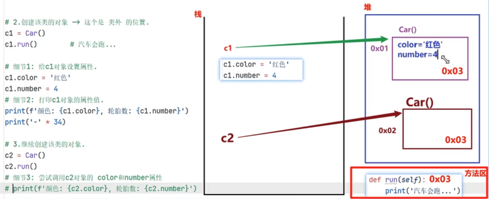
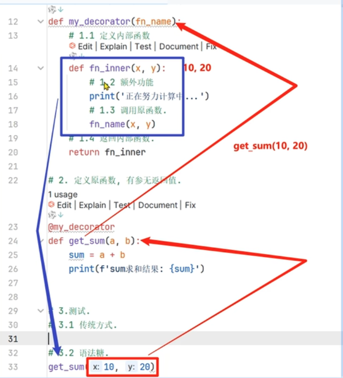
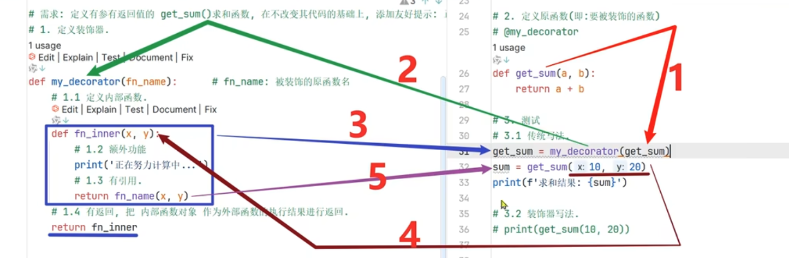

# Python 语法与运行机制知识体系（整合版）

> 目标：把零散笔记整理成一份可持续维护的 Python 学习与查阅文档。按“运行机制 → 语言基础 → 程序组织 → 面向对象与对象协议 → 迭代与函数增强 → 文件与异常 → 标准库 → 网络与并发 → I/O 模型”组织。

---

## 目录

- 8、 [面向对象编程](#8-面向对象编程)
- 9、 [迭代器、生成器与推导式](#9-迭代器生成器与推导式)
- 10、[装饰器与属性管理](#10-装饰器与属性管理)
- 11、[赋值、浅拷贝与深拷贝](#11-赋值浅拷贝与深拷贝)
- 12、[文件与资源管理](#12-文件与资源管理)
- 13、[异常处理](#13-异常处理)
- 14、[常用标准库与第三方库](#14-常用标准库与第三方库)
- 15、[网络编程基础](#15-网络编程基础)

---

# 8. 面向对象编程

📌 本质: 面向对象 = 用对象组织程序，而不是用函数堆代码；

🔥 一句话讲清三者关系: `类是模具 → 造出对象 → 对象用函数来干活`

1️⃣ 封装（Encapsulation）: 把数据和操作数据的方法绑定在一起，并隐藏内部细节;
2️⃣ 继承（Inheritance）: 子类继承父类的属性和方法，并扩展新的属性和方法;
3️⃣ 多态（Polymorphism）: 同一个方法，不同对象表现不同;

## 8.1 面向过程与面向对象

- **面向过程**：围绕步骤和流程组织代码。
- **面向对象**：围绕对象组织状态和行为。
- 两者不是互斥关系。面向对象程序内部仍然由函数和步骤完成工作。



## 8.2 类与对象

- 类（class）：描述一类对象的属性和行为，是创建实例的模板【类是“生成对象的规则”】。
- 对象/实例（instance）：根据类创建的具体对象【封装"数据+行为"的实体，是程序运行的基本单位】。
- 属性：对象或类所关联的数据。
- 方法：定义在类中的函数，通常描述对象行为【封装“可复用的功能(行为)”】。

```python
class User:
    def __init__(self, name, age):
        self.name = name
        self.age = age

    def introduce(self):
        return f"{self.name}, {self.age}"

    print("===== 定义时运行 ====") # 只执行一次

user = User("张三", 18)
print(user.introduce())
```

0. 编译阶段: 类私有属性改名字，
1. 类定义阶段: 就是"执行到 class 语句的那一刻"，它发生在运行时，不是编译/解析期。

   class User: 这条语句被执行时，立即执行类体代码，建出类的命名空间，然后创建类对象。

2. 类调用阶段: 即生成对象实例时

## 8.3 `self` 与实例化过程

`self` 不是 Python 关键字，只是实例方法中约定俗成的第一个参数名，代表当前实例。

```python
user.introduce() # Python 自动做了一件事，把 user 作为第一个参数塞进去
# 近似等价于
User.introduce(user) # 类本身不会自动补 self，所以你必须手动把实例作为第一个参数传。self 就是形参名，实参是 user。
```

调用 `User(...)` 创建实例时，核心过程涉及 `__new__()` 创建对象，再由 `__init__()` 初始化对象。`__init__()` 不负责创建对象，也不应返回其他对象。

## 8.4 常见魔法方法

| 方法                     | 用途                                                |
| ------------------------ | --------------------------------------------------- |
| `__new__`                | 创建实例                                            |
| `__init__`               | 初始化实例                                          |
| `__str__`                | 面向用户的字符串表示，常被 `str()` / `print()` 使用 |
| `__repr__`               | 面向开发者的表示，常用于调试                        |
| `__del__`                | 对象终结时可能调用；不适合承担关键资源释放          |
| `__len__`                | 支持 `len(obj)`                                     |
| `__iter__`               | 返回迭代器                                          |
| `__next__`               | 获取下一个元素                                      |
| `__enter__` / `__exit__` | 支持上下文管理器 `with`                             |

不要依赖 `__del__()` 的执行时机来关闭文件、网络连接等资源；使用 `with` 或显式关闭更可靠。

## 8.5 实例属性、类属性，实例方法、类方法、静态方法

```python
class Student:
    school = "一中"  # 类属性

    def __init__(self, name):
        self.name = name  # 实例属性

    def show(self):       # 实例方法
        print(self.name)

    @classmethod
    def show_school(cls): # 类方法
        print(cls.school)

    @staticmethod
    def is_adult(age):    # 静态方法
        return age >= 18
```

| 类型     | 第一个隐式参数 | 适用场景                           |
| -------- | -------------- | ---------------------------------- |
| 实例方法 | `self`         | 访问/修改实例状态                  |
| 类方法   | `cls`          | 访问/修改类状态，或提供替代构造器  |
| 静态方法 | 无             | 与类逻辑相关，但不依赖实例或类状态 |

- 类属性可被实例访问，但对“可变类属性”进行“原地修改”会影响“共享该对象的实例”。

  ✅ 查找规则（必须记住）: 对象 → 类 → 父类 →...→ object → 报错;

- 实例对同名属性赋值，通常会在实例自身创建同名属性，从而遮蔽类属性。

## 8.6 封装与“私有”属性

Python 没有 Java 那种严格的 `private` 访问控制。“双下划线开头的属性”会触发名称改写（name mangling）：

```python
class Person:
    def __init__(self, name):
        self.name = name
        self.__mobile = "123456"

    def get_mobile(self):
        return self.__mobile
```

`__mobile` 通常会被改写为 `_Person__mobile`，主要用于避免子类属性意外冲突，不是安全边界，也不是绝对不可访问。【编译阶段】

命名习惯：

- `name`：公开属性。
- `_name`：约定为内部使用。
- `__name`：触发名称改写。
- `__name__`：通常是 Python 特殊方法或特殊属性命名形式，不要自行随意占用。

## 8.7 继承、重写与 `super()`

```python
class Animal:
    def speak(self):
        print("动物发声")

class Dog(Animal):
    def speak(self):
        print("汪汪")
        super().speak()
```

- 子类继承父类的属性和方法。
- 子类定义同名方法会覆盖继承来的方法，即方法重写。
- `super()` 按 MRO（方法解析顺序）继续查找，不应简单理解成“直接调用父类”。
- 多继承的查找顺序可通过 `ClassName.mro()` 查看【一般 优先左边顺序】。
- 多继承时应遵守协作式继承设计，父类方法通常通过 `super()` 串联调用。

## 8.8 组合优先原则

组合是让一个对象持有另一个对象作为属性，以复用其能力。相比继承，组合通常耦合更低、替换更灵活。

- “is-a（是一个）”关系且行为确实可替代：考虑继承。
- “has-a（有一个）”关系：优先考虑组合。

```python
class Fly:
    def fly(self):
        print("飞")

class Swim:
    def swim(self):
        print("游")

class Duck:
    def __init__(self):
        self.fly_ability = Fly()
        self.swim_ability = Swim()
```

## 8.9 多态

多态强调不同对象可以通过共同接口被统一使用：

```python
class Cat:
    def speak(self):
        print("喵")

class Dog:
    def speak(self):
        print("汪")

def make_sound(animal):
    animal.speak()
```

Python 常使用鸭子类型（duck typing）：关注对象是否提供所需行为，而不是必须继承某个指定父类。

## 8.10 `property`

`property` 把 “方法” 包装成 属性接口，常用于校验或控制读写：  
改变调用方式 `实例.函数名()==》实例.函数名`

```python
class Person:
    def __init__(self, age):
        self._age = age

    @property
    def age(self):
        return self._age

    @age.setter
    def age(self, value):
        if value < 0:
            raise ValueError("age 不能小于 0")
        self._age = value
```

也可以通过 `property(getter, setter)` 形式创建，但装饰器写法更常见。

## 8.11 反射与元类

- **反射**：运行时检查或操作对象属性，例如 `getattr()`、`setattr()`、`hasattr()`、`delattr()`。
- **元类**：用于控制类对象如何创建；`type` 是常见默认元类。一般业务开发很少需要自定义元类，先理解即可。

## 8.12 内置函数、反射与对象协议

Python 内置函数（Built-in Functions）是语言运行环境提供的常用工具。它们不是彼此孤立的“命令”，很多操作会通过对象协议调用特殊方法（常被称为魔法方法）。

### 常用内置函数分类

| 分类          | 常用函数                                                                                             | 用途                           |
| ------------- | ---------------------------------------------------------------------------------------------------- | ------------------------------ |
| 对象与类型    | `type()`、`isinstance()`、`issubclass()`、`id()`、`dir()`、`help()`                                  | 查看对象类型、身份、属性和帮助 |
| 数值计算      | `abs()`、`round()`、`pow()`、`divmod()`、`sum()`、`min()`、`max()`                                   | 数值处理与聚合                 |
| 真值判断      | `bool()`、`all()`、`any()`                                                                           | 真值转换、整体判断             |
| 迭代处理      | `iter()`、`next()`、`enumerate()`、`zip()`、`map()`、`filter()`、`sorted()`、`reversed()`、`range()` | 迭代、组合、映射、过滤、排序   |
| 类型构造/转换 | `int()`、`float()`、`str()`、`bool()`、`list()`、`tuple()`、`set()`、`dict()`                        | 构造或转换对象                 |
| 反射与属性    | `getattr()`、`setattr()`、`hasattr()`、`delattr()`、`vars()`                                         | 运行时检查和操作属性           |
| 作用域        | `globals()`、`locals()`                                                                              | 查看全局/局部命名空间          |
| 格式化与表示  | `format()`、`repr()`、`str()`                                                                        | 格式化及字符串表示             |
| 输入输出      | `print()`、`input()`、`open()`                                                                       | 控制台与文件 I/O               |
| 动态执行      | `eval()`、`exec()`、`compile()`                                                                      | 执行动态表达式或代码           |

补充理解：

- `dir(obj)` 用于查看属性名称线索，不等于完整、可靠的 API 文档。
- `help(obj)` 查看帮助文档。
- `vars(obj)` 通常返回对象的 `__dict__`；并非所有对象都有 `__dict__`，例如某些使用 `__slots__` 的对象。
- `locals()`、`globals()` 返回命名空间映射；不要把修改 `locals()` 的结果当作可靠的局部变量赋值机制。
- `eval()` 计算表达式并返回结果；`exec()` 执行代码块，返回值为 `None`。不要对不可信输入使用二者。
- `__import__()` 是底层导入钩子；业务代码通常使用 `importlib.import_module()` 做动态导入。
- `__name__`、`__file__`、`__package__`、`__doc__`、`__annotations__` 是模块/对象常见特殊属性，不是内置函数。

### 内置函数与特殊方法（对象协议）对照

| 内置函数 / 语法        | 常见协议入口                                                   | 说明         |
| ---------------------- | -------------------------------------------------------------- | ------------ |
| `len(obj)`             | `obj.__len__()`                                                | 返回长度     |
| `str(obj)`             | `obj.__str__()`                                                | 用户可读表示 |
| `repr(obj)`            | `obj.__repr__()`                                               | 开发者表示   |
| `abs(obj)`             | `obj.__abs__()`                                                | 绝对值       |
| `bool(obj)` / `if obj` | `obj.__bool__()`；否则尝试 `obj.__len__()`                     | 真值判断     |
| `iter(obj)`            | `obj.__iter__()`；特定旧式序列协议也可能回退到 `__getitem__()` | 获取迭代器   |
| `next(it)`             | `it.__next__()`                                                | 获取下一个值 |
| `obj[key]`             | `obj.__getitem__(key)`                                         | 下标/键访问  |
| `obj[key] = value`     | `obj.__setitem__(key, value)`                                  | 设置元素     |
| `del obj[key]`         | `obj.__delitem__(key)`                                         | 删除元素     |
| `x in obj`             | 通常 `obj.__contains__(x)`；否则可能迭代查找                   | 成员测试     |
| `reversed(obj)`        | 优先 `obj.__reversed__()`；否则要求序列协议                    | 反向迭代     |
| `obj()`                | `obj.__call__()`                                               | 可调用对象   |

### 运算符与特殊方法

| 表达式   | 常见特殊方法                                       |
| -------- | -------------------------------------------------- |
| `a + b`  | `a.__add__(b)`，必要时尝试反向运算 `b.__radd__(a)` |
| `a - b`  | `__sub__()` / `__rsub__()`                         |
| `a * b`  | `__mul__()` / `__rmul__()`                         |
| `a / b`  | `__truediv__()` / `__rtruediv__()`                 |
| `a // b` | `__floordiv__()` / `__rfloordiv__()`               |
| `a % b`  | `__mod__()` / `__rmod__()`                         |
| `a ** b` | `__pow__()` / `__rpow__()`                         |
| `a == b` | `__eq__()`                                         |
| `a != b` | `__ne__()`                                         |
| `a < b`  | `__lt__()`                                         |
| `a <= b` | `__le__()`                                         |
| `a > b`  | `__gt__()`                                         |
| `a >= b` | `__ge__()`                                         |

说明：运算符分派比表格中的单一方法调用更复杂，可能涉及反向方法、子类优先规则以及 `NotImplemented`。表格用于建立入口对应关系，不是完整的解释器调用流程。

### 属性访问协议

| 操作                 | 相关特殊方法                                               |
| -------------------- | ---------------------------------------------------------- |
| 读取 `obj.x`         | `__getattribute__()`；属性不存在时可能调用 `__getattr__()` |
| 写入 `obj.x = value` | `__setattr__()`                                            |
| 删除 `del obj.x`     | `__delattr__()`                                            |

`__getattribute__()` 参与每次常规属性读取；`__getattr__()` 是属性查找失败后的后备机制。重写 `__getattribute__()` 时应使用 `object.__getattribute__(self, name)` 等方式避免递归。

### 对象创建与上下文管理

```python
obj = MyClass()
```

通常涉及：

1. 元类的调用逻辑（默认元类通常是 `type`）。
2. `__new__()` 创建实例。
3. 若 `__new__()` 返回当前类的实例，再调用 `__init__()` 初始化。

`__del__()` 是终结器，不等于可靠的析构/资源释放机制。资源应使用 `with` 或显式 `close()` 管理。

```python
with resource as value:
    ...
```

对应上下文管理协议：

- `__enter__()`：进入上下文并返回绑定给 `as` 的对象。
- `__exit__(exc_type, exc_value, traceback)`：退出上下文；返回真值可抑制异常。

### 类型检查钩子

`isinstance(obj, A)` 和 `issubclass(B, A)` 的判断可能受抽象基类注册及元类钩子影响，涉及 `A` 的元类 `__instancecheck__()` / `__subclasscheck__()`。它们不是普通实例类上随意定义同名方法就会触发的通用机制。

**核心认知：** Python 的许多内置操作和语法，会通过对象协议分派到特殊方法；但不能把所有语法都简单归结为“语法糖就是直接调用一个魔法方法”。

---

# 9. 迭代器、生成器与推导式

## 9.1 可迭代对象 Iterable

可迭代对象可以被 `for` 遍历。常见有：

- `list`、`tuple`、`str`、`dict`、`set`
- `range`
- 文件对象
- 生成器
- 实现了迭代协议的自定义对象

可迭代对象不一定就是迭代器。

## 9.2 迭代器 Iterator

迭代器需要支持：

- `__iter__()`：返回迭代器自身（或返回一个迭代器）。
- `__next__()`：返回下一个值；没有更多元素时抛出 `StopIteration`。

```python
class Count:
    def __init__(self, start, end):
        self.current = start
        self.end = end

    def __iter__(self):  # 重写iterator方法，返回当前对象（即：迭代器对象）
        return self

    def __next__(self):    # 重写next方法，返回当前值，并更新当前值
        if self.current >= self.end:
            raise StopIteration
        value = self.current
        self.current += 1
        return value

for number in Count(1, 4):
    print(number)
```

`iter(obj)` 获取迭代器；`next(iterator)` 获取下一个值。

## 9.3 生成器 Generator

生成器是一种便于创建迭代器的方式，按需生成值，不必一次性把所有结果放进内存。

创建生成器的方式: 1、yield 关键字; 2、生成器推导式;

1. yield 关键字

   ```python
   def count_up_to(n):
       for i in range(n):
           yield i

   gen = count_up_to(3)
   next(gen)  # 0
   next(gen)  # 1
   ```

   调用生成器函数时，不会立即执行函数体到结束，而是返回生成器对象；每次迭代推进执行，遇到 `yield` 暂停并产出值。
   1. 创建生成器对象：当调用 count_up_to(3) 时，Python 发现函数体里有 yield，就会直接返回一个生成器对象（此时函数体内的代码一行都还没执行）。
   2. 暂停并保存状态：当执行到 yield i 时，yield 会暂停函数的执行，并把当前的局部变量状态（比如 i 的值、代码执行到哪一行了）保存在生成器对象内部。
   3. 产出值（向外返回）：将 yield 后面的值（这里是 i）抛给调用者（也就是交给 next() 函数）。

   ❗ 简记版： yield 的核心动作是 “暂停执行” 和 “产出值”，而不是创建对象。

2. 生成器表达式 (生成器推导式)：

   ```python
   gen = (x * x for x in range(1000000))
   ```

- 生成器 推导式 🆚 列表 推导式：

  ```python
  # 列表推导式（立即计算并生成整个列表，占内存）
  squares_list = [x for x in range(3)]  # [0, 1, 2]

  # 生成器推导式（返回生成器对象，惰性求值）
  squares_gen = (x for x in range(3))  # <generator object <genexpr> at 0x...>
  next(squares_gen)  # 0
  ```

## 9.4 推导式

```python
列表: [x * 2 for x in values]
字典: {x: x * x for x in values}
集合: {x for x in values if x > 0}
生成器 表达式: (x * 2 for x in values)
```

---

# 10. 装饰器与属性管理

## 10.1 装饰器是什么

装饰器: 本质上是一个接收 (函数/类)并返回(函数/类) 的可调用对象【一个高阶函数】;

常用于: 在不直接修改原函数业务代码的情况下, 增加横切逻辑。

```python
from functools import wraps

def log_call(func):
    @wraps(func)
    def wrapper(*args, **kwargs):
        print("调用前")
        result = func(*args, **kwargs)
        print("调用后")
        return result
    return wrapper

@log_call
def add(a, b):
    return a + b

print(add(1, 2))
```

`@log_call` 近似等价于：`add = log_call(add)`

`functools.wraps` 用于保留被装饰函数的名称、文档字符串等元信息。

## 10.2 装饰器必须正确处理参数与返回值

通用装饰器 通常使用：

```python
def decorator(func):
    @wraps(func)
    def wrapper(*args, **kwargs):
        result = func(*args, **kwargs)
        return result
    return wrapper
```

不能只处理“无参数、无返回值”的函数，否则会破坏原函数接口。




## 10.3 多层装饰器

```python
@decorator_a
@decorator_b
def task():
    pass
```

等价于：`task = decorator_a(decorator_b(task))`

离函数最近的装饰器先应用，外层装饰器再包装内层结果。

-传统执行流程.png>)

## 10.4 带参数的装饰器

带参数装饰器通常多一层函数：

```python
def retry(times):
    def decorator(func):
        @wraps(func)
        def wrapper(*args, **kwargs):
            for attempt in range(times):
                try:
                    return func(*args, **kwargs)
                except Exception:
                    if attempt == times - 1:
                        raise
        return wrapper
    return decorator

@retry(3)
def request_data():
    ...
```

---

# 11. 赋值、浅拷贝与深拷贝

## 11.1 赋值不是拷贝

```python
a = [1, 2]
b = a
b.append(3)
print(a)  # [1, 2, 3]
```

`a` 与 `b` 绑定到同一个列表对象。

## 11.2 浅拷贝

浅拷贝：创建一个新的最外层容器，但内部元素仍然引用原对象。

```python
import copy

source = [[1, 2], [3, 4]]
shallow = copy.copy(source)

shallow is source        # False
shallow[0] is source[0]  # True
```

列表切片、`list.copy()`、`dict.copy()` 等常见操作都是浅拷贝。

适用情况：只需要复制外层容器，或内部对象本来就打算共享。

## 11.3 深拷贝

深拷贝：会递归复制嵌套对象（并通过 memo 机制处理循环引用）：

```python
deep = copy.deepcopy(source)
```

适用情况：需要让嵌套可变对象也相互独立。

注意：深拷贝不一定适用于所有对象；文件句柄、锁、网络连接等资源对象通常不应简单深拷贝。

## 11.4 浅拷贝 vs 深拷贝

浅拷贝：换了皮囊（外层新对象），共用灵魂（内层引用）。

深拷贝：皮囊灵魂全换新（彻底隔离），只有不可变元素（如数字、字符串）因为优化直接复用引用。

---

# 12. 文件与资源管理

## 12.1 文件对象与操作系统资源

- 文件: 是"操作系统 通过 文件系统 提供的"抽象;
- Python 里的文件对象 只是“代理人”，真正管磁盘的是 操作系统(OS);
- 双重资源占用:
  1. open() 不仅消耗 Python 内存（创建 file 对象），
  2. 还会消耗操作系统的文件描述符（Linux 的 fd / Windows 的 handle）。

```text
Python 程序 (你的代码)
    │ open()
    ▼
Python 文件对象 (内存中的对象，带有 read/write 方法)
    │ 封装系统调用 (open/read/write)
    ▼
操作系统文件描述符 (fd) / 句柄 (handle) —— 进程内有限的整数编号
    │
    ▼
文件系统 (管理目录和 inode)
    │
    ▼
存储设备 (硬盘/SSD)
```

## 12.2 `open()` 参数

`open(file, mode="r", encoding=None)`

常用模式：

| 模式 | 含义                           |
| ---- | ------------------------------ |
| `r`  | 只读，文件必须存在             |
| `w`  | 只写；存在则清空，不存在则创建 |
| `a`  | 追加写；不存在则创建           |
| `x`  | 独占创建；文件已存在则报错     |
| `+`  | 在基础模式上增加读写能力       |
| `t`  | 文本模式，默认                 |
| `b`  | 二进制模式                     |

组合示例：`rt`、`wt`、`rb`、`wb`、`r+`、`w+`、`a+`。

- 文本模式: 读写 `str`，需要编码/解码；通常显式指定 `encoding="utf-8"`。
- 二进制模式: 读写 `bytes`，不能指定 `encoding`。
- `w` 会清空原文件；需要保留原内容时不要误用。

## 12.3 读文件

```python
with open("data.txt", "r", encoding="utf-8") as f:
    content = f.read()
```

常见读取方法：

| 方法            | 行为                                                   |
| --------------- | ------------------------------------------------------ |
| `read(n)`       | 读取最多 n 个字符（文本模式）或 n 个字节（二进制模式） |
| `readline()`    | 读取一行                                               |
| `readlines()`   | 读取所有行并返回列表                                   |
| `for line in f` | 逐行迭代，适合大文件                                   |

大文件通常优先逐行读取，避免一次性把整个文件载入内存。

## 12.4 写文件与缓冲区

用 with 语句打开文件，会自动关闭文件：

```python
with open("data.txt", "w", encoding="utf-8") as f:
    f.write("hello\n")
    f.writelines(["第一行\n", "第二行\n"])
    f.flush()
```

- 写入通常经过缓冲区，不保证每次 `write()` 都立即落盘。
  1. `write()` 写入字符串。
  2. `writelines()` 写入字符串可迭代对象，不会自动添加换行符。

- `flush()` 刷新 Python 文件缓冲区；把 数据 推到 操作系统的页缓存（Page Cache）;
- `close()` 会刷新缓冲区并关闭文件。

- 完整的写入链路是：

  ```text
  Python 代码 (f.write)
      │
      ▼
  Python 缓冲区 (BufferedWriter)
      │ flush() 触发
      ▼
  操作系统页缓存 (Page Cache)
      │ fsync() 触发
      ▼
  存储设备 (物理磁盘)
  ```

- 只有调用 os.fsync(f.fileno())，才是真正告诉操作系统：“把页缓存里的数据立刻刷到物理磁盘上”（这是防断电/崩溃的最后一道保险）。
- 原因：CPU执行快，硬盘是低速设备，为了避免低速设备拉慢程序执行，将数据写入（内存的）缓存区，等缓存区满了，或者缓存区数据写入完毕，才会将数据写入硬盘；

## 12.5 二进制文件与编码

```python
with open("image.jpg", "rb") as f:
    data = f.read()

text = "你好"
raw = text.encode("utf-8")
decoded = raw.decode("utf-8")
```

- `str.encode()`：文本编码为 `bytes`。
- `bytes.decode()`：字节按指定编码解码为文本。
- 图片、音频、压缩包等一般按二进制方式读写。

## 12.6 `seek()` 与 `tell()`

```python
with open("data.bin", "rb") as f:
    f.seek(10, 0)  # 从文件开头偏移 10 字节
    position = f.tell()
```

`seek(offset, whence)`：

- `whence=0`：从文件开头。
- `whence=1`：从当前位置。
- `whence=2`：从文件末尾。

二进制模式下偏移按字节计算。文本模式对 `seek()` 的偏移限制更严格，不应把文本模式下的偏移简单理解为任意字节偏移。

## 12.7 `with` 上下文管理器

```python
with open("data.txt", encoding="utf-8") as f:
    content = f.read()
```

`with` 通过上下文管理协议确保退出代码块时执行清理逻辑，即使发生异常也会进入退出流程。它适用于文件、锁、数据库连接、网络连接等资源管理。

---

# 13. 异常处理

## 13.1 基本结构

```python
try:
    result = 10 / 2
except ZeroDivisionError as exc:
    print("除数不能为零：", exc)
else:
    print("try 中没有发生异常")
finally:
    print("无论是否发生异常，都会执行清理流程")
```

- `try`：放置可能抛出异常的代码。
- `except`：捕获并处理匹配的异常。
- `else`：只有 `try` 块没有异常时执行。
- `finally`：通常用于清理资源，无论是否异常都会执行（进程被强制终止等特殊情况除外）。

## 13.2 主动抛出异常与自定义异常

```python
if age < 0:
    raise ValueError("age 不能小于 0")

class BusinessError(Exception):
    pass
```

建议：

- 捕获具体异常，而不是无差别捕获 `Exception`。
- 不要静默吞掉异常。
- 需要保留原始异常上下文时使用 `raise` 或 `raise NewError(...) from exc`。
- 不要把正常业务分支全部写成异常流程。

---

# 14. 常用标准库与第三方库

## 14.1 标准库模块分类

| 领域       | 模块                                                            | 用途                                |
| ---------- | --------------------------------------------------------------- | ----------------------------------- |
| 时间日期   | `time`、`datetime`                                              | 时间戳、日期时间、时间差            |
| 随机与数学 | `random`、`math`、`statistics`                                  | 随机数、数学函数、统计              |
| 操作系统   | `os`、`sys`                                                     | 环境、路径、进程参数、解释器信息    |
| 路径       | `pathlib`、`os.path`                                            | 路径拼接、判断、遍历                |
| 文件操作   | `shutil`、`zipfile`、`tempfile`                                 | 复制、移动、压缩、临时文件          |
| 序列化     | `json`、`pickle`                                                | JSON 数据交换、Python 对象序列化    |
| 配置       | `configparser`、`tomllib`                                       | INI、TOML 配置读取                  |
| 哈希       | `hashlib`                                                       | SHA-256 等摘要计算                  |
| 正则       | `re`                                                            | 文本模式匹配                        |
| 标识符     | `uuid`                                                          | 生成 UUID                           |
| 二进制结构 | `struct`                                                        | Python 数据与二进制结构转换         |
| 数据结构   | `collections`、`heapq`、`bisect`                                | deque、Counter、堆、二分            |
| 并发       | `threading`、`multiprocessing`、`concurrent.futures`、`asyncio` | 多线程、多进程、线程池/进程池、协程 |
| 网络       | `socket`、`urllib`、`http.server`                               | 底层网络与简单 HTTP 服务            |
| 子进程     | `subprocess`                                                    | 启动外部程序、执行系统命令          |
| 日志       | `logging`                                                       | 分级日志、日志输出与配置            |

## 14.2 `pathlib` 与 `os.path`

新代码通常优先考虑 `pathlib`：

```python
from pathlib import Path

path = Path("data") / "users.json"
if path.exists():
    text = path.read_text(encoding="utf-8")
```

`os` 仍然适合环境变量、进程、权限等操作；`pathlib` 更适合面向对象地处理路径。

## 14.3 JSON 与 pickle

```python
import json

data = {"name": "Tom", "age": 18}
text = json.dumps(data, ensure_ascii=False)
obj = json.loads(text)
```

文件读写：

```python
with open("data.json", "w", encoding="utf-8") as f:
    json.dump(data, f, ensure_ascii=False, indent=2)

with open("data.json", encoding="utf-8") as f:
    data = json.load(f)
```

- JSON 是跨语言数据交换格式，适合 API 和配置。
- `pickle` 是 Python 专用序列化机制。
- **不要反序列化不可信来源的 pickle 数据**，因为它可能执行任意代码。

## 14.4 `logging`

生产项目应优先使用 `logging`，而不是到处 `print()`：

```python
import logging

logger = logging.getLogger(__name__)
logger.info("任务开始")
logger.exception("任务执行失败")
```

`logger.exception()` 通常在异常处理上下文中使用，会附带异常堆栈。

## 14.5 `subprocess`

```python
import subprocess

result = subprocess.run(
    ["python", "--version"],
    capture_output=True,
    text=True,
    check=True,
)
print(result.stdout)
```

优先使用参数列表而不是拼接 shell 命令字符串；处理外部输入时尤其要避免命令注入风险。

## 14.6 常见第三方库

| 领域        | 常见库                           | 用途                   |
| ----------- | -------------------------------- | ---------------------- |
| HTTP 客户端 | `requests`、`httpx`              | 同步/异步 HTTP 请求    |
| Web 后端    | `FastAPI`、`Starlette`、`Django` | API 与 Web 应用        |
| 数据验证    | `pydantic`                       | 数据解析、校验与序列化 |
| 数据库      | `SQLAlchemy`、数据库驱动         | ORM、SQL 与数据库连接  |
| 数值计算    | `numpy`                          | 数组与数值运算         |
| 数据分析    | `pandas`                         | 表格数据处理           |
| 可视化      | `matplotlib`、`pyecharts`        | 图表                   |
| AI/机器学习 | 按项目选择相应框架               | 模型训练、推理与应用   |

---

# 15. 网络编程基础

## 15.1 网络分层与 socket

Socket 是应用程序进行网络通信时常用的编程接口。它不是 TCP 本身，而是操作系统提供的网络通信抽象。

```text
应用层协议（HTTP 等）
        ↓
传输层（TCP / UDP）
        ↓
网络层（IP）
        ↓
链路层与物理网络
```

## 15.2 TCP 与 UDP

| 对比     | TCP                         | UDP                           |
| -------- | --------------------------- | ----------------------------- |
| 连接     | 面向连接                    | 无连接                        |
| 可靠性   | 提供有序、可靠字节流        | 不保证送达、顺序和去重        |
| 数据边界 | 字节流，没有消息边界        | 数据报，有消息边界            |
| 控制机制 | 流量控制、拥塞控制、重传    | 协议本身不提供上述完整机制    |
| 常见用途 | HTTP/HTTPS、数据库连接、SSH | DNS、实时音视频、部分游戏通信 |

TCP 是字节流协议：一次 `send()` 不对应对端一次 `recv()`。应用层需要自行设计消息边界，例如固定长度、长度前缀或分隔符协议。

## 15.3 TCP 服务端基本流程

```text
socket()
  ↓
bind()       绑定 IP 与端口
  ↓
listen()     开始监听
  ↓
accept()     接受连接，得到连接 socket
  ↓
recv()/send() 收发数据
  ↓
close()      关闭连接
```

客户端常见流程：

```text
socket()
  ↓
connect()
  ↓
send()/recv()
  ↓
close()
```

服务端监听 socket 与 `accept()` 返回的连接 socket 是不同角色。

## 15.4 UDP 基本流程

UDP 服务端一般使用：

```text
socket()
  ↓
bind()
  ↓
recvfrom()
  ↓
sendto()
```

UDP 客户端创建 socket 后可以直接 `sendto()`，也可以按需要使用 `connect()` 设置默认对端。

## 15.5 并发服务器

最简单的单线程 TCP 服务端通常一次处理一个连接；一个连接处理较慢时，其他连接可能等待。

可选方案包括：

- 多线程：每个连接/任务分配线程。
- 多进程：用多个进程处理连接或任务。
- I/O 多路复用：`select`、`poll`、`epoll` 等。
- 异步框架：如 `asyncio`、`aiohttp`、`httpx`、FastAPI/Starlette 所依赖的异步生态。

`socketserver` 提供基础服务器类，可用于理解同步、多线程和多进程服务器模型；生产项目通常使用更成熟的 Web/网络框架。

---
