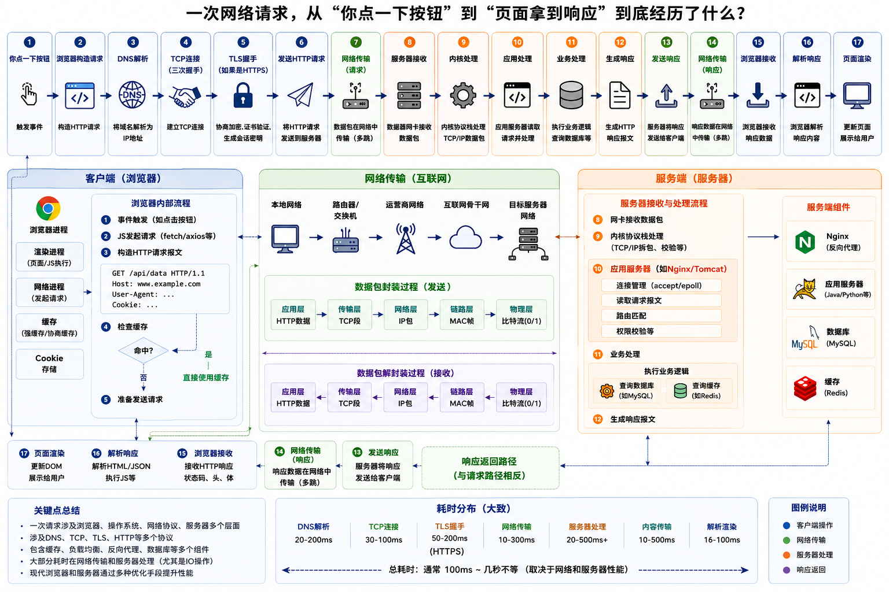

# python -- 网络


## 目录

1.  [socket 是一切网络编程基础](#一socket-是一切网络编程基础)
2.  [Python 网络编程生态](#二python-网络编程生态)
3.  [一次网络请求，从“你点一下按钮”到“页面拿到响应”到底经历了什么？](#三一次网络请求从你点一下按钮到页面拿到响应到底经历了什么)

---

## 一、socket 是一切网络编程基础

所有：

```bash
  HTTP
  WebSocket
  Redis
  MySQL
  RPC
```

本质都基于：socket

## 二、Python 网络编程生态

### 2.1 先建立层级关系

Python 网络编程不是一堆平级库，而是不同抽象层的工具。

```bash
业务框架层:  FastAPI / Flask / Django
     ↓
应用服务器接口层:  ASGI / WSGI
     ↓
服务端运行层:  Uvicorn / Gunicorn（常见组合）
     ↓
HTTP 协议实现层:  h11 / httptools 等（依具体实现）
     ↓
异步运行时、I/O 调度:  asyncio
     ↓
Socket API:  socket
     ↓
操作系统网络协议栈:  TCP / UDP / IP
     ↓
网卡与网络
```

客户端工具是另一条分支：

```bash
业务代码
  ↓
requests / httpx / aiohttp
  ↓
HTTP 协议处理
  ↓
Socket / TLS / asyncio（按实现与使用方式）
  ↓
操作系统网络栈
```

### 2.2 常见模块与库

| 名称           | 类型         | 主要作用                      | 常见用途                         |
| -------------- | ------------ | ----------------------------- | -------------------------------- |
| `socket`       | 标准库       | 底层 Socket API               | TCP/UDP 通信、理解网络基础       |
| `socketserver` | 标准库       | 简化同步网络服务器编写        | 教学、小型服务                   |
| `http.server`  | 标准库       | 简单 HTTP 服务端              | 本地测试，不建议直接作为生产服务 |
| `urllib`       | 标准库       | URL 处理、HTTP 客户端相关能力 | 简单请求、标准库方案             |
| `requests`     | 第三方库     | 同步 HTTP 客户端              | 普通同步接口调用                 |
| `httpx`        | 第三方库     | 同步/异步 HTTP 客户端         | 现代 Python 服务间调用           |
| `aiohttp`      | 第三方库     | 异步 HTTP 客户端与服务端      | 异步网络应用                     |
| `websockets`   | 第三方库     | WebSocket 通信                | WebSocket 服务与客户端           |
| `asyncio`      | 标准库       | 异步事件循环与协程调度        | 高并发 I/O 程序                  |
| `FastAPI`      | 第三方框架   | ASGI Web API 框架             | API 业务开发                     |
| `Uvicorn`      | 第三方服务器 | ASGI 服务器                   | 运行 FastAPI 等 ASGI 应用        |

注意：库之间不是简单的“上一层调用下一层”的固定树状关系。不同实现可能采用不同协议解析库、TLS 实现、事件循环和底层 I/O 机制。

### 2.3 socket：底层网络接口

socket、socketserver、urllib、http.server: 这些更多是：教学、底层框架开发、特殊协议

适合学习 TCP/UDP、实现简单协议、理解连接和数据收发。

不适合直接承担复杂 HTTP 业务，除非明确需要自己实现协议细节。

### 2.4 asyncio：异步编程基础设施

`asyncio` 提供：

- 协程与 `async` / `await`。
- 事件循环。
- Task 与 Future。
- 异步 Socket I/O。
- 同步原语。
- 异步网络服务的调度能力。

异步不等于多线程，也不等于 CPU 并行。

异步 I/O 的关键是：任务等待 I/O 时可以让出执行权，事件循环调度其他就绪任务。

### 2.5 requests、httpx、aiohttp

#### 2.5.1 requests

- 同步 HTTP 客户端。
- 使用简单，适合同步程序。
- 在 `async def` 中直接调用可能阻塞事件循环。

#### 2.5.2 httpx

- 同时提供 同步和异步 客户端。
- 支持连接池、超时、HTTP/1.1 和 HTTP/2（需按依赖与配置确认）。
- 适合 FastAPI 服务调用外部 API。

示例：

```python
import httpx

async def get_user():
    async with httpx.AsyncClient(timeout=10.0) as client:
        response = await client.get("https://example.com/api/user")
        response.raise_for_status()
        return response.json()
```

#### 2.5.3 aiohttp

- 提供异步 HTTP 客户端。
- 也可以用于构建异步 HTTP 服务端。
- 在已有 asyncio 技术栈中使用较多。

### 2.6 ASGI、Uvicorn 与 FastAPI

它们不是同一层：

- FastAPI：Web 应用框架，定义路由、依赖、校验和业务接口。
- ASGI：异步 Python Web 服务器与应用之间的接口规范。
- Uvicorn：ASGI 服务器，负责接收网络请求并调用 ASGI 应用。
- asyncio：常用异步运行时。
- Socket：操作系统网络通信接口。

关系：

```text
浏览器
  ↓ HTTP
操作系统 Socket
  ↓
Uvicorn
  ↓ ASGI scope / receive / send
FastAPI
  ↓
路由、依赖、业务逻辑
  ↓
响应通过 ASGI 返回
  ↓
Uvicorn 编码 HTTP 响应并发送
```

FastAPI 并不直接负责 TCP 三次握手；连接管理和底层网络 I/O 主要由 操作系统与 ASGI 服务器承担。

### 2.7 Python 后端开发的推荐掌握顺序

1. URL、DNS、IP、端口、子网、网关。
2. TCP/IP 分层、TCP 与 UDP。
3. TCP 三次握手、四次挥手、连接复用。
4. HTTP 请求/响应、状态码、缓存、HTTPS。
5. Socket 基础：`bind`、`listen`、`accept`、`connect`、`send`、`recv`。
6. HTTP 客户端：先掌握 `httpx`，再理解 `requests`、`aiohttp` 的适用场景。
7. asyncio：协程、Task、事件循环、取消、超时、并发控制。
8. ASGI 与 Uvicorn：理解请求如何进入 FastAPI。
9. 代理、TLS、超时、连接池、限流、日志与抓包。
10. 生产部署：Nginx、进程管理、容器网络、健康检查和可观测性。

---

## 三、一次网络请求，从“你点一下按钮”到“页面拿到响应”到底经历了什么？

背后横跨：

- 浏览器
- 操作系统
- TCP/IP
- 网卡
- 路由器
- DNS
- Linux 内核
- epoll
- nginx
- 应用服务器
- 数据库
- 再一路返回

这是一条非常长的链路。

```bash
用户点击
  ↓
浏览器发起 HTTP 请求
  ↓
DNS 解析域名
  ↓
TCP 建立连接（三次握手）
  ↓
TLS/HTTPS 握手（如果 HTTPS）
  ↓
浏览器发送 HTTP 数据
  ↓
数据进入操作系统内核
  ↓
网卡发送数据包
  ↓
路由器/交换机/公网传输
  ↓
服务端网卡收到数据
  ↓
Linux 内核 TCP/IP 协议栈处理
  ↓
Socket 放入 accept 队列
  ↓
epoll/select 监听到事件
  ↓
应用服务器读取数据
  ↓
业务代码处理
  ↓
查询 Redis/MySQL
  ↓
生成 HTTP 响应
  ↓
响应数据写回 socket
  ↓
客户端收到响应
  ↓
浏览器解析数据
  ↓
页面更新
```



### 第一阶段：用户操作（应用层）

1. 点击按钮
2. js发起请求（fetch/ajax等）
3. 浏览器构造HTTP请求报文【应用层协议】

```bash
   GET /api/user HTTP/1.1
   Host: xxx.com
   Cookie: ...
   User-Agent: ...
```

### 第二阶段：DNS 域名解析

浏览器发现：你访问的是 xxx.com,

但网络只能识别：IP地址,

所以先查：xxx.com → 112.80.xx.xx,

流程：

```bash
   浏览器缓存
     ↓
   系统缓存
     ↓
   hosts 文件
     ↓
   本地 DNS
     ↓
   根 DNS
     ↓
   顶级域 DNS
     ↓
   权威 DNS
```

最终得到：服务器 IP

### 第三阶段：TCP 建立连接（三次握手）

HTTP 本身不会传输数据。

真正传输的是：TCP, 所以客户端先建立 TCP 连接。

- 三次握手:
  1. 客户端：SYN
  2. 服务端：SYN + ACK
  3. 客户端：ACK

建立成功。

此时 OS 开始参与, 这里已经进入：内核态;

因为 TCP/IP 协议栈在："操作系统内核(Linux Kernel)"里实现。

### 第四阶段：HTTPS（TLS 握手）

如果是：`https://` 还需要：TLS 握手, 目的：协商加密密钥,否则网络传输是明文。

TLS 会：

1. 验证证书
2. 协商加密算法
3. 生成会话密钥

之后：HTTP 数据会被加密, 即：HTTP + TLS = HTTPS

### 第五阶段：客户端发送数据

现在浏览器真正发送：`GET /api/user HTTP/1.1`, 但这里不是直接发字符串。

- 会经历：
  1. HTTP 数据: `GET /api/user ...`
  2. TCP 分段，TCP 会：
     - 切分数据
     - 编号
     - 保证可靠性

  3. IP 包，加入：源IP、目标IP
  4. MAC 帧，加入：源MAC、目标MAC
  5. 网卡发送电信号,最终：`010101010101`发出去。

#### OSI / TCP-IP 分层（核心）

这里你会看到经典分层。

- TCP/IP 五层模型
  1. 应用层
  2. 传输层
  3. 网络层
  4. 数据链路层
  5. 物理层

- 数据封装过程
  1. 浏览器数据：HTTP 数据
  2. 传输层加 TCP Header：TCP + HTTP
  3. 网络层加 IP Header：IP + TCP + HTTP
  4. 链路层加 MAC Header：MAC + IP + TCP + HTTP
  5. 物理层：0101010101

### 第六阶段：网络传输过程

数据经过：

```bash
   交换机
   路由器
   运营商
   公网
   CDN
   负载均衡
```

不断转发。

- 路由器主要看：目标 IP, 决定下一跳。

### 第八阶段：服务端收到数据

服务器网卡收到："二进制数据", 然后："网卡 → DMA → 内存"🔥。

- DMA = Direct Memory Access

- 作用：
  1. 网卡直接写内存
  2. 不经过 CPU 搬运

否则 CPU 会累死。

### 第九阶段：Linux 内核处理数据

现在数据进入：Linux TCP/IP 协议栈

内核开始：

```bash
  拆 MAC
  拆 IP
  拆 TCP
  校验
  排序
  重传
```

最终还原：HTTP 请求

### 第九.1：Socket 登场（超级核心）

应用程序不会直接操作 TCP。

而是：Socket,

- socket 是：内核提供的网络编程接口
- 应用层：sock.recv(), 实际上是：从内核 socket 缓冲区读取数据

### 第九.2：accept 队列

服务端：server.listen() 之后：

内核维护：

- 半连接队列
- 全连接队列

TCP 完成三次握手后：连接进入 accept 队列

应用：conn, addr = server.accept()

本质：从 accept 队列取连接

### 第九.3：epoll/select 登场

现在问题来了：服务器有 `10万个连接` 怎么办？

Linux 提供：`IO 多路复用`，包括：

```bash
  select
  poll
  epoll
```

epoll 会：监听大量 socket, 哪个 socket 有数据：就通知应用

所以：

```bash
  nginx
  redis
  nodejs
  asyncio
```

底层都 heavily 依赖：epoll

### 第十阶段：应用服务器处理请求

现在："应用代码终于开始执行", 例：'@app.get("/user"), app.get("/user")'

可能会：

```bash
  查 Redis
  查 MySQL
  调用微服务
  读文件
```

### 第十一阶段：数据库阶段

比如：`select * from user where id = 1`

又会重复：

```bash
  TCP
  IO
  epoll
  网络
```

这一整套。

### 第十二阶段：生成 HTTP 响应

最终：

```bash
  HTTP/1.1 200 OK
  Content-Type: application/json

  {
    "name": "Tom"
  }
```

### 第十三阶段：响应返回客户端

过程完全反向：

```bash
  应用层
  → socket
  → TCP
  → IP
  → MAC
  → 网卡
  → 公网
  → 客户端
```

### 第十八阶段：浏览器处理响应

浏览器收到后：

- 如果是 JSON: `fetch().then(res => res.json())`
- 如果是 HTML: 浏览器：

  ```bash
    解析 HTML
    构建 DOM
    解析 CSS
    构建 CSSOM
    生成 Render Tree
    Layout
    Paint
  ```

  最后页面显示。
