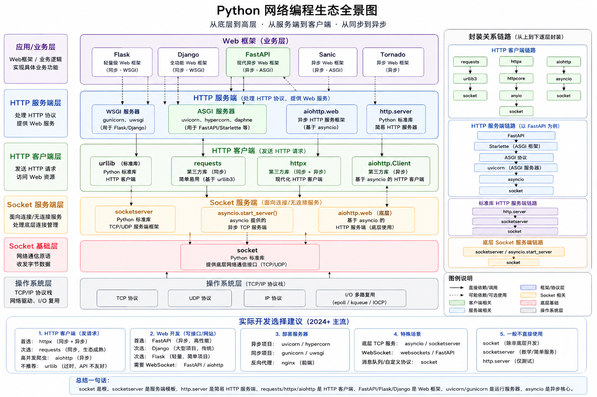

# python -- 网络

# 目录

15. [Python 网络编程生态](#15-python-网络编程生态)

---

# 15. Python 网络编程生态



## 15.1 先建立层级关系

Python 网络编程不是一堆平级库，而是不同抽象层的工具。

```bash
业务框架层:  FastAPI / Flask / Django
     ↓
应用服务器接口层:  ASGI / WSGI
     ↓
服务端运行层:  Uvicorn / Gunicorn（常见组合）
     ↓
HTTP 协议实现层:  h11 / httptools 等（依具体实现）
     ↓
异步运行时、I/O 调度:  asyncio
     ↓
Socket API:  socket
     ↓
操作系统网络协议栈:  TCP / UDP / IP
     ↓
网卡与网络
```

客户端工具是另一条分支：

```bash
业务代码
  ↓
requests / httpx / aiohttp
  ↓
HTTP 协议处理
  ↓
Socket / TLS / asyncio（按实现与使用方式）
  ↓
操作系统网络栈
```

## 15.2 常见模块与库

| 名称           | 类型         | 主要作用                      | 常见用途                         |
| -------------- | ------------ | ----------------------------- | -------------------------------- |
| `socket`       | 标准库       | 底层 Socket API               | TCP/UDP 通信、理解网络基础       |
| `socketserver` | 标准库       | 简化同步网络服务器编写        | 教学、小型服务                   |
| `http.server`  | 标准库       | 简单 HTTP 服务端              | 本地测试，不建议直接作为生产服务 |
| `urllib`       | 标准库       | URL 处理、HTTP 客户端相关能力 | 简单请求、标准库方案             |
| `requests`     | 第三方库     | 同步 HTTP 客户端              | 普通同步接口调用                 |
| `httpx`        | 第三方库     | 同步/异步 HTTP 客户端         | 现代 Python 服务间调用           |
| `aiohttp`      | 第三方库     | 异步 HTTP 客户端与服务端      | 异步网络应用                     |
| `websockets`   | 第三方库     | WebSocket 通信                | WebSocket 服务与客户端           |
| `asyncio`      | 标准库       | 异步事件循环与协程调度        | 高并发 I/O 程序                  |
| `FastAPI`      | 第三方框架   | ASGI Web API 框架             | API 业务开发                     |
| `Uvicorn`      | 第三方服务器 | ASGI 服务器                   | 运行 FastAPI 等 ASGI 应用        |

注意：库之间不是简单的“上一层调用下一层”的固定树状关系。不同实现可能采用不同协议解析库、TLS 实现、事件循环和底层 I/O 机制。

## 15.3 socket：底层网络接口

socket、socketserver、urllib、http.server: 这些更多是：教学、底层框架开发、特殊协议

适合学习 TCP/UDP、实现简单协议、理解连接和数据收发。

不适合直接承担复杂 HTTP 业务，除非明确需要自己实现协议细节。

## 15.4 asyncio：异步编程基础设施

`asyncio` 提供：

- 协程与 `async` / `await`。
- 事件循环。
- Task 与 Future。
- 异步 Socket I/O。
- 同步原语。
- 异步网络服务的调度能力。

异步不等于多线程，也不等于 CPU 并行。

异步 I/O 的关键是：任务等待 I/O 时可以让出执行权，事件循环调度其他就绪任务。

## 15.5 requests、httpx、aiohttp

### requests

- 同步 HTTP 客户端。
- 使用简单，适合同步程序。
- 在 `async def` 中直接调用可能阻塞事件循环。

### httpx

- 同时提供 同步和异步 客户端。
- 支持连接池、超时、HTTP/1.1 和 HTTP/2（需按依赖与配置确认）。
- 适合 FastAPI 服务调用外部 API。

示例：

```python
import httpx

async def get_user():
    async with httpx.AsyncClient(timeout=10.0) as client:
        response = await client.get("https://example.com/api/user")
        response.raise_for_status()
        return response.json()
```

### aiohttp

- 提供异步 HTTP 客户端。
- 也可以用于构建异步 HTTP 服务端。
- 在已有 asyncio 技术栈中使用较多。

## 15.6 ASGI、Uvicorn 与 FastAPI

它们不是同一层：

- FastAPI：Web 应用框架，定义路由、依赖、校验和业务接口。
- ASGI：异步 Python Web 服务器与应用之间的接口规范。
- Uvicorn：ASGI 服务器，负责接收网络请求并调用 ASGI 应用。
- asyncio：常用异步运行时。
- Socket：操作系统网络通信接口。

关系：

```text
浏览器
  ↓ HTTP
操作系统 Socket
  ↓
Uvicorn
  ↓ ASGI scope / receive / send
FastAPI
  ↓
路由、依赖、业务逻辑
  ↓
响应通过 ASGI 返回
  ↓
Uvicorn 编码 HTTP 响应并发送
```

FastAPI 并不直接负责 TCP 三次握手；连接管理和底层网络 I/O 主要由 操作系统与 ASGI 服务器承担。

## 15.7 Python 后端开发的推荐掌握顺序

1. URL、DNS、IP、端口、子网、网关。
2. TCP/IP 分层、TCP 与 UDP。
3. TCP 三次握手、四次挥手、连接复用。
4. HTTP 请求/响应、状态码、缓存、HTTPS。
5. Socket 基础：`bind`、`listen`、`accept`、`connect`、`send`、`recv`。
6. HTTP 客户端：先掌握 `httpx`，再理解 `requests`、`aiohttp` 的适用场景。
7. asyncio：协程、Task、事件循环、取消、超时、并发控制。
8. ASGI 与 Uvicorn：理解请求如何进入 FastAPI。
9. 代理、TLS、超时、连接池、限流、日志与抓包。
10. 生产部署：Nginx、进程管理、容器网络、健康检查和可观测性。

---
