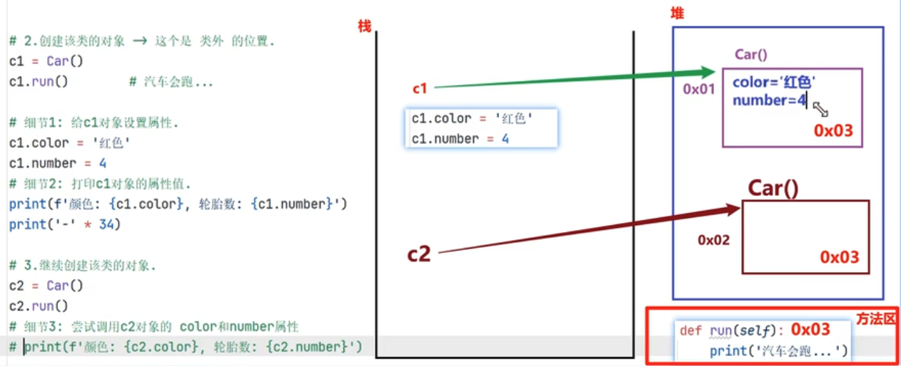

# python 进阶

- 面向过程 与 面向对象
  1. 面向过程：强调过程，第一步、第二步、第三步。。。。
  2. 面向对象：强调以“对象为基础”完成各种操作，对象是具有属性和方法的（例：洗衣服，交给别人/机器，让它做）。
     - 它是基于面向过程的

- 封装、继承、多态
  1. 封装：【好处：简化编程】；隐藏对象的属性和实现细节，仅对外公开接口；
  2. 继承：【好处：代码复用】；子类继承父类的属性和方法；使得子类对象（实例）具有父类的特征和行为；
  3. 多态：【好处：解耦合，可扩展】同一个事物在不同时刻做出的反应不一样；例：（同一个人）在教室是学生，在商场是顾客，在家是。。。
     - 同一个函数接收参数不一样，表现出来的结果也不一样；

- 类与对象
  1. 类：是抽象模板（图纸）
  2. 对象：是类的具体实例（按图纸造出来的东西）；有 属性（名词）、方法（动词）

  


## 进程 与 线程

- 多任务: 是指在“同一时间”内执行“多个任务”(给我们的感觉)；
- 并发: 在一段时间内，“交替”执行任务；
- 并行: 在一段时间内，真正的“同时一起”执行多个任务（需要多核 CPU）；

1. Python (CPython)：进程优先策略
   - 由于 GIL（全局解释器锁）的存在，真正的并行只能通过多进程实现
   - 每个 Python 进程是独立的操作系统进程，有自己独立的内存空间和 Python 解释器
   - 进程间通信需要显式处理（队列、管道、共享内存等）

2. Java：线程优先策略
   - 没有 GIL 的限制，可以直接使用多线程实现真正的并发
   - 线程共享内存空间，通信简单直接
   - 也支持多进程，但线程是首选的并发模型

- 进程：是分配资源的基本单位，一旦创建一个进程就会分配一定的资源;
- 线程：是 cpu 调度的基本单位，每个进程至少都有一个线程，而这个线程就是我们通常说的主线程

### 进程

```python
   # 新建进程
   import multiprocessing
   p1 = multiprocessing.Process(target=函数名, args=元组, kwargs=字典)
   p1.daemon = True # 设置守护进程,思路1
   p1.start()
   p1.terminate() # 结束进程,思路2

   # 获取当前进程ID
   pid = os.getpid() # 方法一
   pid = multiprocessing.current_process().pid # 方法二
   # 获取父线程ID
   ppid = os.getppid()
```

进程的特点:

1. 进程之间数据是相互隔离的.
   - 因为子进程相当于是父进程的"副本"，会将父进程的"main 外资源"拷贝一份，即:各是各的

2. 默认情况下，主进程会等待子进程执行结束再结束
   - 如果要设置主进程结束，予进程同步结束，方式如下:
     1. 思路 1:设置子进程为 守护进程；
     2. 思路 2:强制关闭子进程，可能导致子进程变成僵尸进程，交由 Python 解释器自动回收(底层有 init 初始化进程来管理维护)；

### 线程

```python
   import threading
   my_lock = threading.Lock()
   mu_lock2 = threading.Lock() # 2把锁可能造成锁不住；

   def func1():
      my_lock.acquire()
      print("线程1")
      time.sleep(1)
      my_lock.release()

   def func2():
      my_lock.acquire()
      print("线程2")
      time.sleep(1)
      my_lock.release()


   t1 =threading.Thread(target=func1,args=元组,kwargs=字典)
   t2 =threading.Thread(target=func2,daemon=True) #线程守护,写法1
   t2.daemon = True # 线程守护，写法2
   t1.start()
   t2.start()
```

1. 线程之间执行是无序的
2. 主线程会等待所有的子线程执行结束再结束（线程守护）
3. 线程之间共享全局变量
4. 线程之间共享全局变量数据出现错误问题（互斥锁解决）

- 死锁：一直等待对方释放锁的情景就是死锁；
  - 死锁的原因:使用互斥锁的时候需要注意死锁的问题，未在合适的地方注意释放锁；
  - 死锁的结果:会造成应用程序的停止响应，应用程序无法再继续往下执行了；

- 互斥锁：对共享数据进行锁定，保证同一时刻只有一个线程去操作
- 锁不住：使用 2 把及以上的锁；


## 数据结构 与 算法
