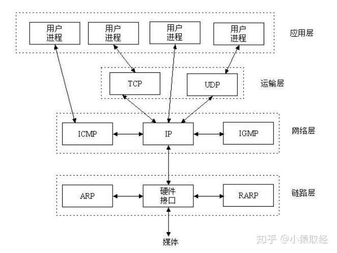
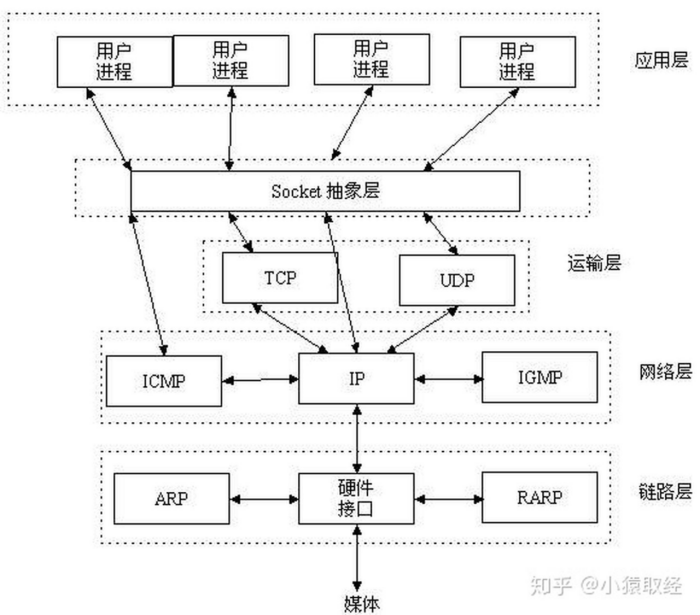
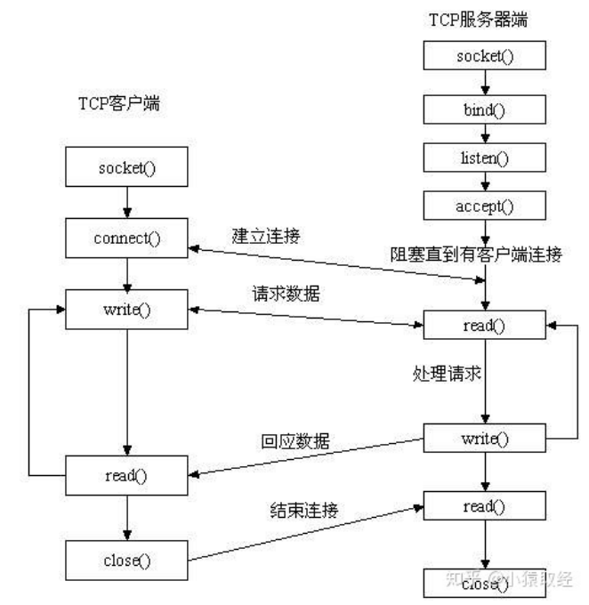
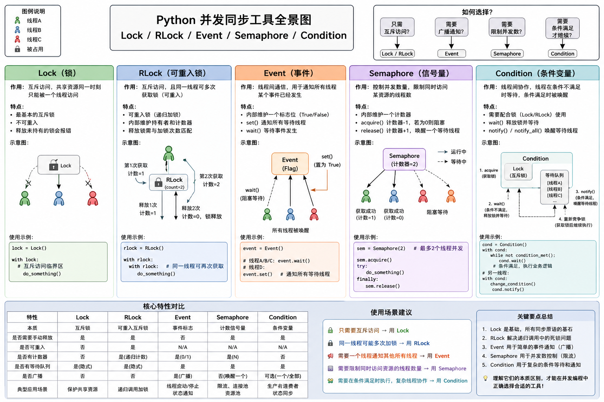

# python 高级 [原文地址](https://www.bilibili.com/video/BV1Sp4y1U7Jr)

🔥 先看 膜拜大神所得/计算机科学速成课/通用讲解.md


## 字符编码

- 一、 字符编码基础
  1. 数学基础: `2**7=128；2**8=256；2**9=512`
  2. ASCII 码表:
     - 涵盖范围 0-127，是世界上首个字符编码表。
     - 实际只需要 7 位（Bit）二进制即可表示完整，但计算机中通常分配 1 个字节（8位）来存储，多出的 1 位（最高位）主要用于后续扩展或奇偶校验。
     - “向下兼容性”: 后续所有主流的字符编码表（如 GBK、UTF-8 等）都完全兼容 ASCII 码（即全面支持英文和基础符号）。

- 二、输入字符到显示的完整流程（标准版）
  1. 键盘输入阶段: 你按键盘 其实是: “s h a n g” 这些字符属于 ASCII，所以键盘发送的是: ASCII 码（字母）；
  2. 输入法阶段（字符生成）: 输入法（如 Microsoft Pinyin）负责: “ASCII 拼音 → 中文字符”（例: shang → 上）；
     - 这里发生的是: 字符层面的转换；
     - ❗此时还没有存储，只是生成了一个字符。

  3. 字符在计算机中的统一表示（Unicode）: 计算机内部必须统一表示所有字符，于是使用: 👉 Unicode 字符集；
     - Unicode 的作用: “字符 → 编号（码点）”（例: 上 → U+4E0A）；
     - Unicode 只是一个 “抽象编号体系”，并不决定如何存储。

  4. 编码阶段（真正进入内存）: 为了把 Unicode 存入内存，必须使用编码方式，例: UTF-8、UTF-16、UTF-32
     - 上（U+4E0A）→ UTF-8 → E4 B8 8A（二进制）
     - 字符 → Unicode → UTF-8 → 写入内存
     - ❗内存本身没有编码；编码是程序解释这些 0 和 1 的方式。
     - ❗编码属于程序，不属于内存

  5. 程序处理阶段: 软件（如文本编辑器）在内存中处理数据: 复制、粘贴、搜索、计算；这些操作通常基于 Unicode 逻辑。
  6. 显示到屏幕: 内存 UTF-8 → 解码 → Unicode → 字形 → 显示；
     - 解码: 软件根据编码（如 UTF-8）把二进制转换为 Unicode。
     - 字体查找: 字体（如 Microsoft YaHei）负责: “Unicode → 字形（Glyph）”
     - 渲染: 操作系统将字形绘制到屏幕

  7. 保存到文件（硬盘）: 当你按“Ctrl + S”，软件会“Unicode → 指定编码 → 写入文件”（例: UTF-8、UTF-8、UTF-16）
     - ❗如果保存编码不同，可能产生乱码（存储时，必须使用指定的编码，否则，数据会乱码）。

  8. 文件读取: 当再次打开文件“文件 → 按指定编码读取 → Unicode → 内存”
     - ❗如果编码选择错误: 乱码

  ❗乱码的本质: 乱码只有一个原因: 👉 编码和解码不一致
  ❗字符集不支持: 例: 保存日文、韩文选择GBK格式，会出现 直接报错、占位符替换 等数据丢失情况；

- 👉 输入到显示的核心链路: 键盘 → ASCII → 输入法（字符） → Unicode → 编码（UTF-8） → 内存 → 解码 → Unicode → 字体 → 屏幕
- 文件流程:
  1. 保存: 内存中的 Unicode 字符 → 编码（UTF-8 / GBK 等） → 生成二进制字节 → 写入硬盘文件
  2. 读取: 从硬盘读取字节流 → 加载到内存 → 解码（UTF-8 / GBK 等） → 得到 Unicode 字符

- Python 解释器读取文件:
  1. 启动 Python 解释器【类似: 文本编辑器】；
     - 加载 Python 程序 → 内存 → 开始执行；
  2. Python 打开 .py 文件（字节模式）【类似: 加载文件】；
     - Python 首先做的事情是: 以“二进制模式”读取文件，👉 此时 Python 不知道文件是什么编码。它只拿到: 一串字节（bytes）例: E4 B8 8A；
  3. 检测编码声明（关键）:
     - Python 会检查文件前两行，寻找: ` # coding: xxx # -*- coding: xxx -*-`
     - 👉 这一步是在“字节层”完成的。
     - 👉 Python 还没有真正解析代码。
     - 原因: Python 必须先知道编码，才能正确解码。
     - 为什么只扫描前两行？因为历史原因（兼容 Python2）: 编码声明通常在第一或第二行。

  4. 确定编码:
  5. 解码源码为 Unicode: 字节 → 解码 → Unicode
  6. 词法分析（Lexical Analysis）: 例: print('上')会被分解为print、(、'上'、)
  7. 语法分析（Parsing）:生成 AST（抽象语法树）
  8. 编译为字节码: 例: 字节码为`LOAD_CONST CALL_FUNCTION`
  9. 执行: Python 虚拟机执行字节码

  👉 Python 解释器先以字节读取源码，检测编码声明后再解码为 Unicode，然后进行词法和语法分析，最终编译为字节码执行。

```python
# coding=utf-8  #既是注释，又是指令；是告诉解释器，这个文件使用utf-8编码 (不用默认编码)
print('上')
```


## 装饰器

装饰器: 定义一个函数，该函数是用来为其他函数添加额外的功能

在“不修改原函数及调用方式”的情况下，给它添加新功能；

- 开放封闭原则:
  1. 开放: 指对扩展功能是开放的
  2. 封闭: 指对修改源代码是封闭的

```python
import time
from functools import wraps # 将原函数的属性赋值给wrapper函数

def index(x,y,z):
  time.sleep(3)
  print(x,y,z)

def home(x):
  time.sleep(3)
  print(x)

def outter(func):
  # func:被装饰对象的内存地址
  @wraps(func) # 将原函数的属性赋值给wrapper函数
  def wrapper(*args, **kwargs):
    start = time.time()
    res = func(*args, **kwargs)
    stop = time.time()
    print(f'耗时: {stop-start}')
    return res

  # wrapper.__name__ = func.__name__
  # wrapper.__doc__ = func.__doc__
  # ...
  return wrapper

home = outter(home) # 偷梁换柱: 变量home: 指向wrapper函数的内存地址
res = home("hello")
print("返回值",res) # hello

# == 语法糖 ================================================
# 由于语法糖限制: outter函数只能有一个参数（只用来接受被装饰对象的内存地址）；
@outter  # index = outter(index)
def index(x,y,z):
  time.sleep(3)
  print(x,y,z)
  return "返回值-index"

res = index(1,2,3)
print("返回值",res)
# == 语法糖解析、装饰器函数属性 ===============================================
@print('hello')  # ==> None=print('hello')(index) ==> index=None(index)
def index(x,y,z):
  """ 函数文档 """
  pass

# index.__name__ = 原函数.__name__
# index.__doc__ = 原函数.__doc__
# ...

print(index.__name__)
print(index.__doc__)
print(help(index))
# ==有参数装饰器================================
def auth(type):
  def deco(func):
    @wraps(func)
    def wrapper(*args, **kwargs):
      if type == 'admin':
        print("管理员权限")
        return func(*args, **kwargs)
      else type == 'user':
        print("普通用户权限")
        return func(*args, **kwargs)
    return wrapper
  return deco

  @auth('admin') # deco=@auth('admin') ==> index=deco(index) ==》index=wrapper
  def index(x,y,z):
    print(x,y,z)
    return "返回值-index"

```

- 多个装饰器
  1. 查找阶段: 由近及远
  2. 执行阶段: 从远端开始，U型（或者洋葱模型）

```python
  # deco1
  def deco1(func1): # func1 =wrapper2的内存地址
    def wrapper1(*args, **kwargs):
      print("正在运行==》deco1.wrapper1 ")
      res1 = func1(*args, **kwargs)
      return res1
    return wrapper1

  # deco2
  def deco2(func2): #func2 =wrapper3的内存地址
    def wrapper2(*args, **kwargs):
      print("正在运行==》deco2.wrapper2 ")
      res2 = func2(*args, **kwargs)
      return res2
    return wrapper2

  # deco3
  def deco3(x):
    def outter3(func3): ##func3 =被装饰对象index函数的内存地址
      def wrapper3(*args, **kwargs):
        print("正在运行==》deco3.wrapper3 ")
        res3 = func3(*args, **kwargs)
        return res3
      return wrapper3
    return outter3

  # 加载顺序: 由近到远
  @deco1 #index=deco1(wrapper2的内存地址)  ==>index=wrapper1的内存地址
  @deco2 #index=deco2(wrapper3的内存地址)  ==>index=wrapper2的内存地址
  @deco3(111) # ==》@outter3 ==> index=outter3(index) ==>index=wrapper3的内存地址
  def index(x):
    print("正在运行==》test ")

  # 执行顺序: 从远端开始，U型（或者洋葱模型）
```


## 递归 (python 没有尾递归)

```python
  import sys;
  sys.getrecursionlimit() # ==> 1000 获取递归深度
  sys.setrecursionlimit(2000) # 设置递归深度
```

- 递归的2个阶段: 递推、回归

回溯: 指的是一种通过“试错”来寻找解的方法；

## 面向过程思想

过程是“流水线”，用“分步骤”来解决问题；

- 面相过程思想:
  - 优点: 复杂问题流程化，进而简单化
  - 缺点: 扩展性非常差

爬虫（Scrapy框架）: 1、目标站点发请求，拿数据；3、数据清洗；4、存数据库
数据分析:

- 匿名函数: fn=lambda 参数: 函数体
  `res = max(obj,key=lambda k:obj[k])`
  `res = map(lambda x:x**2,range(10));res.__iter__();`
  `res = filter(lambda x:x%2==0,range(10));res.__iter__();`
  `res = reduce(lambda x,y:x+y,range(10),0);res.__iter__();`


## 网络编程 -- 参考“Python 网络编程生态.md”

CS架构(Client-Server) 、BS架构(Browser-Server)

ip + MAC + port(端口,应用程序的id)

### 正确理解: 半连接池（SYN Queue）

1. 内存是有限的
2. 每个半连接 ≈ 占用一块内核内存
3. 队列大小有限 = 为了防止资源被耗尽 + 保证系统稳定性
   - 服务器的内存给应用程序划一块内存（A），在这块内存（A）中再划出一块做半连接池；

半连接队列大小是有限的，因为每个连接都会占用内核资源，如果不限制，在高并发或攻击场景下会导致内存和CPU被耗尽，从而拖垮整个系统，因此操作系统通过限制队列大小来保证稳定性。

- 队列大小其实是: “吞吐能力” 和 “抗攻击能力” 的平衡点

```code
📌 工作流程（超重要）

1️⃣ 客户端发 SYN
2️⃣ 服务端:
   - 创建一个“半连接对象”
   - 放入 SYN 队列【半连接池】
   - 返回 SYN+ACK

3️⃣ 如果客户端回 ACK:
   👉 从 SYN 队列移除
   👉 进入 Accept 队列【全连接队列】

4️⃣ 应用程序 accept() 取走连接【应用接管】
5️⃣ 。。。
6️⃣ 应用程序 close()【进入 TIME_WAIT】
7️⃣ 释放


📌 两个队列要分清！

队列                     状态                          作用
------------------------------------------------------------------
SYN 队列（半连接池）       SYN_RECV（半连接）             等 ACK
------------------------------------------------------------------
Accept 队列（全连接池）    ESTABLISHED（已连接）          等应用 accept
------------------------------------------------------------------
                        TIME_WAIT（等待连接彻底关闭）
📌 队列满了会怎样？

1. SYN 队列满:
  * 新 SYN 被丢弃
  * 或 启用 SYN Cookie

2. Accept 队列满:
  * TCP 已建立，但应用不 accept
  * 客户端会感觉:
    👉 连接成功但卡住

```

1. 洪水攻击（SYN Flood）:
   - 本质: 攻击者: 疯狂发 SYN, 但不回 ACK;
   - 结果: 半连接队列被占满, 正常用户无法连接(服务“看起来挂了”);
   - 防御手段:
     1. SYN Cookie（核心）: 不分配内存，直接用算法生成序列号
     2. 增大队列
     3. 限速 / 防火墙

2. 普通个人发起洪水攻击:
   - 数据包会在互联网中经过多跳路由转发（多个路由器），根据网络拓扑和路由协议（如 BGP）动态选择路径。
   - 由于不同路径的延迟、带宽和拥塞情况不同，数据包通常不会同时到达目标服务器，而是呈现出一定的离散性和波动性。

### socket




1. 🔥 B/S vs C/S
   - B/S = 浏览器帮你用 socket
   - C/S = 你自己写 socket

#### TCP、UDP共用

TCP 和 UDP 的共同点是都基于 socket API，数据都经过内核协议栈和 socket 缓冲区。

1. socket抽象层: 封装应用层以外的所有层；
   - 👉 socket = 操作系统提供的 API，用来操作 TCP/IP 协议栈
   - 🔥 socket 的本质: socket = 应用程序访问 TCP/IP 的入口
   - socket 是“应用程序 ↔ 操作系统网络协议栈”的接口

   ```code
      应用层（浏览器 / App）
           ↓
      socket API
           ↓
      TCP（可靠传输）
           ↓
      IP（路由）
           ↓
      网卡（发包）
   ```

2. 浏览器 帮你封装了 socket【浏览器是 socket 的高级封装 + 协议实现器（HTTP/HTTPS）】

   ```code
   访问: https://google.com 时，
   浏览器内部其实做了:
      * socket()
      * connect()
      * TLS握手
      * 发送HTTP请求
      * 接收响应
   ```

   ✔ 本质: HTTP over TCP（或 QUIC over UDP）

   👉 小补充（高级点）:
   - HTTP/1.1 / HTTP/2 → TCP
   - HTTP/3（QUIC）→ UDP

3. 很多客户端连接会撑爆服务端: 👉 这是高并发的核心问题；
   - 每个连接都占用:
     - 一个 socket（文件描述符）
     - 内核内存（缓冲区）
     - TCP 状态

4. 服务端怎么解决“撑爆问题”？
   1. ✅ IO 多路复用（核心）: 一个线程管理成千上万连接【也适合UDP】
   2. ✅ 连接池 / 限流
   3. ✅ 负载均衡: 把流量分散到多台服务器【也适合UDP】
   4. ✅ 长连接优化: 减少握手次数
   5. ✅ 内核调优: 1、 提高文件描述符上限；2、accept队列；3、半连接队列的最大长度【也适合UDP】

   👉 UDP 也会撑爆（但更轻）

5. ip:
   - 0,0,0,0: 监听所有网卡（是否能访问取决于网络环境）；
   - 127.x.x.x: “本地回环”，永远只在本机内部通信
   - 192.168.x.x: 局域网可访问

6. 发送路径

   ```code
       ① 应用程序
           ↓ send()
       ② 用户态 → 内核态（拷贝）
                   ↓
       ③ Socket 发送缓冲区（Socket在内核中）
           ↓
       ④ TCP/IP 协议栈（分包）
           ↓
       ⑤ DMA 直接写入内存（内核空间）
           ↓
       ⑥ 网卡
           ↓
       ⑦ 网络
   ```

7. 数据接收（从网络到程序）

   ```code
       ① 网卡（NIC）
           ↓
       ② DMA 直接写入内存（内核空间）
           ↓
       ③ 操作系统网络协议栈（TCP/IP）
           ↓
       ④ Socket 接收缓冲区（recv buffer）
           ↓
       ⑤ 应用程序调用 recv()
           ↓
       ⑥ 数据从“内核态”拷贝到“用户态”
   ```

#### TCP 专属

TCP 是面向连接、可靠的流式协议，需要三次握手、四次挥手，有连接状态和队列；

1. 🔥 连接问题:
   - 是否每次握手？ → 看是否复用连接;
   - 会不会撑爆？ → 会（所以才有高并发架构）

2. 一个连接生命周期: 建立 → 使用 → 空闲 → 超时关闭

3. TCP 粘包的本质原因: 是 TCP 是面向字节流的协议，没有消息边界，多个应用层消息在传输过程中可能被合并或拆分。
   - ✅ 解决方法是: 在应用层设计协议来定义消息边界，常见方式包括固定长度、分隔符、以及最常用的“长度字段 + 数据”模式。
   - UDP 是面向数据报的协议，每个数据报在内核中独立存储，recvfrom() 一次读取一个完整报文。

4. 程序结束后: socket会释放，但不是“立刻完全消失”

   🔹阶段1: 程序运行中

   ```code
       你创建 socket
         → 获得 fd（文件描述符）

      如果你不 close:
         → fd 一直占用
         → 数量不断增加
         → 达到系统上限（ulimit -n）
         → 报错: too many open files

      ✅ 运行过程中必须主动 close(不需要时):
         → fd 释放（应用层）
         → 内存释放（内核层）
         → TCP 连接关闭（协议层）
   ```

   🔹阶段2: 程序结束时

   ```code
      进程退出
         → OS（操作系统内核）自动关闭所有 socket（相当于调用 close）【只是“兜底”机制，❌此时会积累很多fd，大量 CLOSE_WAIT（典型 bug），连接堆积】
         → TCP 连接进入四次挥手流程
         → 主动关闭方进入 TIME_WAIT=2 × MSL（通常 1~4 分钟）【客服端、服务端都可能主动close】

      📌关键点:
         ✅ 文件描述符立即释放（退出时兜底）
         ⚠️ TCP 连接: 不会立刻消失【 内核仍然维护连接状态（如 TIME_WAIT）】
         ⚠️ 端口: 可能暂时无法复用: 【 特别是: 主动关闭的一方会进入 TIME_WAIT，占用 (ip, port)】

         不是所有 socket 都进入 TIME_WAIT
            主动关闭方 → TIME_WAIT
            被动关闭方 → CLOSE_WAIT → LAST_ACK → CLOSED
   ```

5. 网络\_socket套接字工作流程

   

   ```code
      【服务端】:   socket → bind → listen →（等待）

      【客户端】:               connect()
                                 ↓
                              三次握手
                                 ↓
      【服务端内核】:   SYN队列 → Accept队列
                                 ↓
      【服务端】:                accept()  从 Accept队列取连接
                                 ↓
                              得到 conn_fd（新socket）
                                 ↓
                              read / write
   ```

   1. socket → 创建“通信端点”
      - 创建一个 socket 结构体；
      - 分配一个 文件描述符 fd；
      - 此时: ❗ 还没有地址；❗ 还不能通信

   2. bind → 绑定“地址和端口”
      - 把 socket 和 IP + 端口 绑定
      - 告诉操作系统: 这个 socket 负责监听哪个地址

   3. listen → 进入“可接收连接状态”（建立队列）
      - 把 socket 变成“监听 socket”
      - 1、创建两个队列【SYN队列（半连接队列），Accept队列（全连接队列）】； 2、状态变化

   4. accept → 从“全连接队列” 取出一个“已完成连接”
      - 本质: 返回一个 新的 socket（conn_fd），这个 socket: 已经建立 TCP 连接，可以 read/write
      - ❗注意: 原来的 fd（listen socket）不变 → 继续负责接收新连接
      - 📌 如果没有连接: accept 会阻塞

```python
#  =======TCP============== 服务端 ========= 简版: 每次发送小于1024字节的数据；单线程（一次只能处理一个链，多个链接需要等待） =================
# 1.一直提供服务
# 2.并发地提供服务
import socket
import subprocess
import struct
# 1. 创建套接字
server = socket.socket(socket.AF_INET, socket.SOCK_STREAM) # 流式协议==》TCP协议  【不写默认TCP协议】
# 2-1. 允许端口复用（避免重启时报错）
server.setsockopt(socket.SOL_SOCKET, socket.SO_REUSEADDR, 1)
# 2. 绑定
server.bind(('127.0.0.1', 8080)) # 0-65535,1024以前的都被系统保留使用
# 3. 监听
server.listen(5) # 最多允许挂起5个客户端【已完成连接队列 + 半连接队列的上限（实现相关）】；
print("服务端启动...")

# 第一件事:循环地从“Accept 队列”中 拿 链接对象
while True:
    # 4. 等待客户端连接
    conn_fd, client_addr = server.accept()
    print('客户端ip与端口:', client_addr)
    try:
      #第二件事:拿到链接对象后，与其进行循环通信
      while True:
        # 5. 接收数据
        data = conn_fd.recv(1024) # 1024字节，最大接收的数据量为1024Bytes,收到的是bytes类型【从本地缓存中读取数据】
        if not data:
          print("客户端断开") # 👉 表示: 对方调用了 close()（正常断开）
          break
        print('recv:', data.decode('utf-8'))

        # 6. 发送数据
        obj = subprocess.Popen(data.decode('utf-8'),shell=True,stdout=subprocess.PIPE,stderr=subprocess.PIPE)
        stdout_data = obj.stdout.read()
        stderr_data = obj.stderr.read()
        total_size = len(stdout_data) + len(stderr_data)

        # 6-1、先发头信息(固定长度的bytes):对数据描述信息
        header = struct.pack('i',total_size)
        conn_fd.send(header) # 【先发给本地缓存】

        # 6-2、再发真实的数据
        conn_fd.send(stdout_data)
        conn_fd.send(stderr_data)


    except Exception as e:
          print("连接异常:", e)
    finally:
          # 7. 关闭连接(❗必须关闭)
          conn_fd.close()
          print("连接关闭")
# 关闭套接字（一般不考虑）
# server.close()
# ====================== 客户端 ===============================
import socket
# 1.初始化
client = socket.socket(socket.AF_INET, socket.SOCK_STREAM)
try:
  # 2.建立连接
  client.connect(('127.0.0.1', 8080))
  while True:
    # 3.发送数据
    msg = input("输入指令>>: ")
    if msg == 'exit':
          break
      client.send(msg.encode('utf-8'))

    # 4.接收数据
    # 4-1、先收固定长度的头:解析出数据的描述信息，包括数据的总大小total_size
    header = client.recv(4) # 打包‘i’模式，占4个字节
    total_size = struct.unpack('i', header)[0]
    # 4-2、根据解析出的描述信息，接收真实的数据
    recv_size=0
    while recv_size < total_size:
      data = client.recv(1024)
      recv_size += len(data)
      print('data:', data.decode('utf-8'))
finally:
  # 5.关闭连接（❗必须关闭）
  client.close()
```

#### UDP 专属

UDP 是无连接、面向数据报的协议，不保证可靠性，但开销小、延迟低，不存在粘包和连接状态。

```python
# =======UDP============== 服务端 =========
import socket
# 1.初始化
server = socket.socket(socket.AF_INET, socket.SOCK_DGRAM)
# 2-1. 端口复用
server.setsockopt(socket.SOL_SOCKET, socket.SO_REUSEADDR, 1)
# 2.绑定
server.bind(('127.0.0.1', 8080))
print("UDP 服务端启动...")
try:
    while True:
      # 3.接收数据
      data, client_addr = server.recvfrom(1024)
      print(f"客户端: {client_addr}")
      print('recv:', data.decode('utf-8'))
      # 4.发送数据
      server.sendto(data.upper(), client_addr)
except Exception as e:
  print("异常:", e)
finally:
  # 5.关闭套接字
  server.close()

# =======UDP============== 客户端 =========
import socket
# 1.初始化
client = socket.socket(socket.AF_INET, socket.SOCK_DGRAM)
try:
  while True:
    msg = input("输入消息: ")
    if msg == 'exit':
      break
    # 2.发送数据
    client.sendto(msg.encode('utf-8'), ('127.0.0.1', 8080))
    # 3.接收数据
    data, server_addr = client.recvfrom(1024) # 👉 相当于: 从内核 socket buffer 取一个完整数据报（datagram）
    print("recv:", data.decode('utf-8'))
finally:
  # 5.关闭连接（必须关闭）
  client.close()
```

#### TCP VS UDP 区别

1. send / recv vs sendto / recvfrom
   - TCP: send / recv（基于连接）
   - UDP: sendto / recvfrom（必须带地址）

2. 粘包问题
   - TCP: 会粘包（流式）
   - UDP: 不会粘包（报文边界天然存在）

3. TIME_WAIT
   - TCP: 有（主动关闭方）
   - UDP: 没有

4. accept()
   - TCP: 必须 accept
   - UDP: 没有 accept（直接收包）

5. 连接数量 vs 并发
   - TCP: 每个连接一个 socket（重）
   - UDP: 一个 socket 可服务所有客户端（轻）

   👉 这就是: 为什么 DNS / 游戏 / 直播用 UDP

- 🔥 一句话本质区别
  - TCP: 维护“连接状态”（stateful）
  - UDP: 无状态（stateless）

### socketserver模块 -- 服务器【实现并发】

Python 特有: GIL（重点🔥）

- 在 CPython:
  - 👉 同一时刻: 只能有 1 个线程执行 Python 字节码
  - 👉 结果:
    1. 多线程 ≠ 并行（CPU密集）
    2. 多线程适合 IO（网络、文件）

#### socketserver -- TCP

```code -- 生命周期
  client.connect()
     ↓
  server.accept()
     ↓
  创建线程
     ↓
  handle()
     ↓
  while recv/send
     ↓
  客户端关闭 → recv=0
     ↓
  break → close
```

```python
# ================ TCP 服务器 ===========================
import socketserver
class MyTCPHandler(socketserver.BaseRequestHandler):
  def handle(self):
    print("原来的conn_fd:", self.request)
    print("客户端:", self.client_address)
    try:
      while True:
          data = self.request.recv(1024)
          if not data:
            print("客户端断开")
            break
          print("收到:", data)
          self.request.send(data.upper())
    except Exception as e:
        print("异常:", e)
    finally:
      self.request.close() # 对方主动关闭、网络异常、业务逻辑结束、超时 等
      print("连接关闭:", self.client_address)

# 1. 初始化
server = socketserver.ThreadingTCPServer(('127.0.0.1', 8080), MyTCPHandler)
# 2. 启动
print("服务器启动...")
server.serve_forever()
# 等同于
# while True:
#     conn_fd, client_addr = server.accept()
#     创建新线程(handle(conn))
# ============= TCP 客户端 ===========================
import socket
client = socket.socket(socket.AF_INET, socket.SOCK_STREAM)
client.connect(('127.0.0.1', 8080))
try:
  while True:
    msg = input("输入消息: ")
    if msg == 'exit':
      break
    client.send(msg.encode('utf-8'))
    data = client.recv(1024)
    print("recv:", data.decode('utf-8'))
except Exception as e:
  print("异常:", e)
finally:
  client.close()
  print("连接已关闭")
```

#### socketserver -- UDP

👉 UDP 编程 = “一包一处理”，没有连接、没有循环、没有状态

```python
  # ================ UDP 服务器 ===========================
  import socketserver
  class MyUDPHandler(socketserver.BaseRequestHandler):
    def handle(self):
      data, sock = self.request
      client_addr = self.client_address
      print("客户端:", client_addr)
      print("收到:", data)

      try:
          sock.sendto(data.upper(), client_addr)
      except Exception as e:
        print("异常:", e)

# 1. 创建服务器
server = socketserver.ThreadingUDPServer(('127.0.0.1', 8080), MyUDPHandler)
# 2. 启动
print("服务器启动...")
server.serve_forever()
# 等同于
# while True:
#   conn_fd, client_addr = server.recvfrom(1024)
#   print("收到:", data)
#   server.sendto(data.upper(), client_addr)

# ============= UDP 客户端 ===========================
import socket
client = socket.socket(socket.AF_INET, socket.SOCK_DGRAM)
try:
  while True:
    msg = input("输入消息: ")
    if msg == 'exit':
      break

    client.sendto(msg.encode('utf-8'), ('127.0.0.1', 8080))
    data, server_addr = client.recvfrom(1024)
    print("recv:", data.decode('utf-8'))
    print("来自:", server_addr)
except Exception as e:
  print("异常:", e)
finally:
  client.close()
  print("客户端关闭")
```

## ------ 接下来课程安排 ------

- 并发编程(3~4d)
- 小项目(2~3d)
- 数据库(MySQL)5d
- 前端7d
- django框架(10d)
- bbs项目(3~5d)
- 代码发布(5d)
- CMDB(5d)

## 进程 -- 并发编程

- ✅ Linux（fork）:
  1. 使用 fork()【复制内存】
  2. 子进程 = 父进程的“克隆”
  3. 代码不会重新执行

  👉 就像复制内存快照

- ❌ Windows（spawn）【重新执行文件】
  1. 没有 fork，只能 重新启动一个 Python 解释器
  2. 然后: 👉 import 主程序文件，再执行一遍

- ❗关键问题来了: 如果没有把“创建进程的代码”放进 main 保护里（`if __name__ == "__main__":`里面）那么子进程在 import 时会: 👉 从头到尾再执行一遍代码，于是:
  - 主进程运行 → 创建子进程
  - 子进程启动 → 再执行这段代码 → 又创建子进程
  - 子子进程 → 再执行 → 无限套娃递归

- `__name__ == "__main__"` 到底干了啥？

  Python 规则:
  - 直接运行脚本 → `__name__ == "__main__"`
  - 被 import → `__name__ == "模块名"`
  - 在 Windows 子进程中: 子进程执行的是: `import 你的脚本`所以`__name__ != "__main__"`,
  - `if __name__ == "__main__"`: 不成立
    → 不会创建新进程
    → 避免递归

```python
from multiprocessing import Process
import time
# ======== 进程创建: 方式1 ========================
def task(name,n):
  print("子进程开始执行:", name)
  time.sleep(n)
  print("子进程结束:", name)

if __name__ == '__main__':
  # 1. 创建一个对象
  p = Process(target=task, args=('zhangsan', 3))
  # 2. 开启进程
  p.start() # 告诉操作系统帮忙创建一个进程（应用程序没办法直接与硬件打交道的，必须通过操作系统）
  print("主进程")

  start = time.time()
  p_list=[]
  for i in range(3):
    p = Process(target=task, args=(f'lisi{i}', i))
    p.start()
    p_list.append(p)
  for p in p_list:
    p.join() # ❗等待子进程结束，才继续进行主进程
  end = time.time()
  print("总耗时:", end-start) # 总耗时: 3.1s,不到4s
# ========= 进程创建:  方式2 =================
class MyProcess(Process):
  def run(self):
    print("子进程开始执行:", self.name)
    time.sleep(3)
    print("子进程结束:", self.name)

if __name__ == '__main__':
  p = MyProcess(name='MyProcess')
  p.start()
  print("主进程")
# ========= ❗进程间数据是隔离的 =================
money = 100
def task(name):
  global money
  money =666
  print("子进程:", money)
if __name__ == '__main__':
  p = Process(target=task, args=('lisi',))
  p.start()
  p.join()
  print("主进程:", money)
```

- 创建进程就是在内存中申请一块内存空间将需要运行的代码丢进去;
- 一个进程对应在内存中就是一块独立的内存空间;
- 多个进程对应在内存中就是多块独立的内存空间;
- 进程与进程之间数据默认情况下是无法直接交互，如果想交互可以借助于第三方工具、模块

### 进程对象及其方法（守护进程、停止当前进程、获取进程是否存活、等待子进程）

一台计算机上面运行着很多进程，那么计算机是如何区分并管理这些进程服务端的呢?

计算机会给每一个运行的进程分配一个PID号

- 📌daemon 不是“守护别人”，而是“被主进程绑定生死的进程”

```python
  from multiprocessing  import Process, current_process
  import os
  import time

  def task():
    print(f'子进程 -- 当前进程PID: {current_process().pid}' )
    print(f'子进程 -- 当前进程PID: {os.getpid()}')
    time.sleep(5)
    print(f'子进程 -- 父进程PID: {os.getppid()}')

  if __name__ == '__main__':
    p = Process(target=task)
    p.daemon = True # 守护进程 (❗daemon 必须在 start() 前设置，因为进程启动后属性不可修改；守护进程会在"主进程"退出时被强制终止；daemon 不是“守护别人”，而是“被主进程绑定生死的进程”)
    p.start()

    print(f'主进程 -- 当前进程PID: {current_process().pid}')
    print(f'主进程 -- 当前进程PID: {os.getpid()}')
    print(f'主进程 -- 父进程PID: {os.getppid()}')

    p.terminate() # 停止当前进程（告诉操作系统帮你去杀死当前进程 但是需要一定的时间）
    time.sleep(0.1)
    print(p.is_alive()) # 获取进程是否存活

   # p.join() # ❗等待子进程结束，才继续进行主进程
   # ==== ⚠️ 这样写: daemon 的意义就没了,因为: 又主动等它结束了  ==========================================
    p.daemon = True
    p.start()
    p.join()

```

### 僵尸进程与孤儿进程（了解）

- 僵尸进程: 孩子死了，父进程没“收尸”（必须处理）
  1. 解决: 父进程必须调用: `os.wait()` 或 `os.waitpid(pid, 0)`

- 孤儿进程: 父进程死了，孩子还活着（被“init进程”接管）

### 互斥锁

- 多个进程操作同一份数据的时候，会出现数据错乱的问题,针对上述问题；

  解决方式就是加锁处理: 将并发变成串行，牺牲效率但是保证了数据的安全

- 注意:
  1. 锁不要轻易的使用，容易造成死锁现象(我们写代码一般不会用到，都是内部封装好的)
  2. 锁只在处理数据的部分加来保证数据安全(只在争抢数据的环节加锁处理即可)

```python
from multiprocessing import Process, Lock, Queue
  def task(i, lock):
    lock.acquire() #抢锁
    print(f"{i} is working")
    lock.release() # 释放锁
if __name__ == "__main__":
  lock = Lock()
  for i in range(10):
    p = Process(target=task, args=(i, lock))
    p.start()
```

## 队列 与 管道

- 队列（Queue）: 高级封装，安全、好用（推荐）
  1. 👉 Queue = Pipe + 锁 + 缓冲 + 封装

     ```code
       Queue.put() --> pickle序列化 --> 写入 Pipe --> 另一端读取 --> 反序列化

       Queue
        ├── Pipe（管道）
        ├── Lock（锁）
        ├── Buffer（缓冲区）
        └── pickle（序列化）
     ```

- 管道（Pipe）: 底层通信工具，更轻量但更原始
  1. Pipe 本质就是: 👉 两个端点的连接（socket/管道）  
     `parent_conn  ⇄  child_conn`

- Queue 是基于 Pipe 的进程安全通信队列，而 Pipe 是更底层的双向通信通道。
- IPC（进程间通信）

| 对比           | Queue              | Pipe             |
| -------------- | ------------------ | ---------------- |
| 抽象层级       | 高级               | 低级             |
| 是否安全       | ✅ 安全            | ❌ 不安全        |
| 是否支持多进程 | ✅ 多生产者/消费者 | ❌ 只适合2个端点 |
| 是否有锁       | ✅ 有              | ❌ 没有          |
| 性能           | 较慢               | 更快             |
| 使用难度       | 简单               | 稍复杂           |

### 队列 Queue -- 会 阻塞

- 🔥 Python3 中的两种 Queue:
  1. 线程用的队列;
  2. 进程用的队列

  | 对比           | queue.Queue | multiprocessing.Queue |
  | -------------- | ----------- | --------------------- |
  | 用途           | 线程间通信  | 进程间通信            |
  | 是否跨进程     | ❌ 不可以   | ✅ 可以               |
  | 是否需要序列化 | ❌ 不需要   | ✅ 需要（pickle）     |
  | 性能           | 快          | 相对慢                |

```python
# ===== 进程队列=======================================
from multiprocessing import Queue
q = Queue(5) # 括号内可以放数字来限制队列的大小; 不传则，默认32767个
q.put(111) # 放数据: 当队列满了，继续放会阻塞，直到有位置让出来， ❗不会报错；
q.get() # 取数据: 当队列空了，继续取会阻塞；
q.get(timeout=3) # 取数据: 没有数据之后原地等待三秒,之后再报错 queue.Empty

# *********** 以下方法 ❗不精确，不是实时的 ************
q.empty() # 判断队列是否为空（❗不精确，不是实时的）
q.get_nowait() # 取数据: 不会阻塞，如果队列中没有数据，直接报错queue.Empty（❗不精确，不是实时的）
# ===== 线程队列=======================================
from queue import Queue, LifoQueue, PriorityQueue

q2 = Queue()
q2.put(1)
q2.get()

q3 = LifoQueue(4)  # 后进先出


q4 = PriorityQueue(4)  # 优先级高的先执行
# put括号内放一个元祖;第一个放数字表示优先级; 需要注意的是: 数字越小优先级越高!!!
q4.put((11, "111"))
q4.put((22, "222"))
q4.put((0, "0"))
q4.put((-5, "-5"))
print(q4.get())  # (-5,'-5')
```

- 📌 特点:
  - ✅ 线程/进程安全
  - ✅ FIFO（先进先出）
  - ✅ 自动加锁
  - ✅ 自动处理并发
  - ❗ 底层用 pickle（有开销）

- 👉推荐场景:
  - 多个生产者 + 多个消费者
  - 任务调度
  - 并发安全要求高

#### 进程间通信IPC机制

```python
  def task(q):
     q.put('呼叫！呼叫！')
     prtint('hahahah')

  if __name__ == '__main__':
    q = Queue()
    p = Process(target=task, args=(q,))
    p.start()
    print(q.get()) # 呼叫！呼叫！
```

#### 生产者-消费者模型（Queue）

```python
from multiprocessing import Process, Queue

def producer(q):
    for i in range(5):
        q.put(i)

def consumer(q):
    while True:
        print(q.get())

if __name__ == "__main__":
    q = Queue()

    Process(target=producer, args=(q,)).start()
    Process(target=consumer, args=(q,)).start()

```

#### JoinableQueue

JoinableQueue: 是'带任务完成确认机制'的队列，通过 task_done() 和 join() 实现任务同步。

```python

from multiprocessing import Process, JoinableQueue
import time

def worker(q):
    while True:
        task = q.get()
        if task is None:
            break

        print(f"处理任务: {task}")
        time.sleep(1)

        q.task_done()  # 🔥 完成任务（消费者调用）

if __name__ == "__main__":
    q = JoinableQueue() # 👉  内部维护一个: “未完成任务计数器”

    # 启动消费者
    for _ in range(2):
        p = Process(target=worker, args=(q,))
        p.daemon = True
        p.start()

    # 生产任务
    for i in range(5):
        q.put(i) # 放任务

    q.join()  # 🔥 等待所有任务完成（生产者调用）
    print("所有任务完成")
```

流程:

```code
  put()        → +1
  task_done()  → -1
  join()       → 等待计数器变为 0
```

### 管道 Pipe -- 多个进程同时send(): 数据错乱/崩溃

- 📌 特点:
  - ✅ 双向通信
  - ✅ 速度更快（比 Queue）
  - ❌ 不安全（多进程同时用会出问题）
  - ❌ 没有锁

- 👉 推荐场景:
  - 只有两个进程通信
  - 对性能要求极高
  - 你能控制并发（不会同时写）

```python
  from multiprocessing import Process, Pipe

  def worker(conn):
      conn.send("hello")
      conn.close()

  if __name__ == "__main__":
      parent_conn, child_conn = Pipe()

      p = Process(target=worker, args=(child_conn,))
      p.start()

      print(parent_conn.recv())
      p.join()
```

## 线程相关知识点

👉 守护线程不是“跟主线程死”，而是“随进程一起死”

```python
from threading import Thread, current_thread, active_count
import time, os


class MyThread(Thread):
    def __init__(self, name):
        super().__init__()
        self.name = name

    def run(self):
        print(f"MyThread--hello:{self.name}")
        time.sleep(1)
        print(f"MyThread--world:{self.name}")
        print(f"MyThread--线程名字:{current_thread().name}")
        print(f"MyThread--进程id:{os.getpid()}")
        print("*" * 40)


def task(name):
    print(f"task--hello:{name}")
    time.sleep(2)
    print(f"task--world:{name}")
    print(f"task--线程名字:{current_thread().name}")
    print(f"task--进程id:{os.getpid()}")
    print("*" * 40)


def task2(name):
    print(f"task2--hello:{name}")
    time.sleep(3)
    print(f"task2--world:{name}")


if __name__ == "__main__":
    t = MyThread("zhangsan")
    print("主线程1")
    t.start()
    t.join()  # 阻塞当前线程，等待子线程结束

    t2 = Thread(target=task, args=("lisi",))
    print("主线程2")
    t2.start()
    print("主线程2.1")
    print(f"主线程--名字:{current_thread().name}")
    # 2（MyThread已经结束了）
    print(f"主线程--活跃线程数:{active_count()}")  # 统计当前正在活跃的线程数

    print(f"主线程--进程id:{os.getpid()}")

    t3 = Thread(target=task2, args=("wangwu",))
    t3.daemon = True  # 守护线程（当进程退出时会被强制终止；程序会等待所有非守护线程结束后才退出）
    t3.start()
    print("主线程3")  # ❗守护线程不是“跟主线程死”，而是“随进程一起死”


# ======= 输出结果: ============
# 主线程1
# MyThread--hello:zhangsan
# MyThread--world:zhangsan
# MyThread--线程名字:zhangsan
# MyThread--进程id:90733
# ****************************************
# 主线程2
# task--hello:lisi
# 主线程2.1
# 主线程--名字:MainThread
# 主线程--活跃线程数:2
# 主线程--进程id:90733
# task2--hello:wangwu
# 主线程3
# task--world:lisi
# task--线程名字:Thread-2 (task)
# task--进程id:90733
# ****************************************
主线程结束
   ↓
如果还有非守护线程 → 继续运行
   ↓
当只剩守护线程
   ↓
进程退出 → 守护线程被干掉 ✅

```

### 多线程服务端

```python
import threading
import socket


def handle(conn, addr):
    while True:
        try:
            data = conn.recv(1024)
            if not data:
                break
            conn.send(data.upper())
        except ConnectionResetError as e:
            print(e)
            break
    conn.close()


def serve(ip, port):
    s = socket.socket()
    s.bind((ip, port))
    s.listen(5)
    while True:
        conn, addr = s.accept()
        t = threading.Thread(target=handle, args=(conn, addr))
        t.start()


if __name__ == "__main__":
    serve("127.0.0.1", 8080)
```

### 线程互斥锁 -- 加锁

### GIL全局解释器锁

👉 GIL（全局解释器锁）= 同一时刻只允许一个线程执行 Python 字节码

1. GIL（全局解释器锁）不是 Python 语言规范的一部分，而是 CPython 解释器的实现机制；
2. GIL 的作用是保证 CPython 内部对象模型（尤其是引用计数）的线程安全；
3. 在 GIL 存在下，同一进程内多个线程无法同时执行 Python 字节码（CPU 密集型任务无法并行）；
4. GIL 不能保证应用层数据安全，多线程访问共享数据仍需加锁（如 Lock）；
5. GIL 并不是解释型语言的通病，而是 CPython 的设计权衡，不同语言和实现有不同策略。

- 🚫 GIL 带来的直接影响
  1. 多线程 ≠ 并行（CPU 密集型）❌
  2. IO 密集型没问题 ✅

- 那为什么 Python 不去掉 GIL？:

  因为去掉 GIL 会让单线程性能下降，同时大幅增加实现复杂度（内存管理、锁粒度等），CPython 选择的是“牺牲多线程 CPU 并行能力，换取简单性和单线程性能”。

- GIL 切换机制

  ```code
  大致机制:

    * 执行一定字节码数量
    * 或遇到 IO
    * 或主动让出

  👉 类似:

    * 线程A: 拿到GIL → 执行一会 → 释放
    * 线程B: 抢到GIL → 执行 → 释放
  ```

- 怎么绕过 GIL？
  1. 多进程（最常用）
     - 每个进程都有自己的 GIL;
     - 真正并行 ✅

  2. C扩展（底层释放GIL），例: numpy、pytorch；
  3. asyncio（不是并行，是协程）

👉 GIL 本质是: 用“全局串行”换“实现简单 + 线程安全”

### GIL 与 互斥锁

```python
from threading import Thread, Lock
import time

lock = Lock()
money = 100


def task():
    global money
    # ----写法1 -------
    lock.acquire()

    tmp = money
    time.sleep(0.1)
    money = tmp - 1

    lock.release()
    # ----写法2 -------
    # with lock:
    #     tmp = money
    #     time.sleep(0.1)
    #     money = tmp - 1


if __name__ == "__main__":
    list = []
    for i in range(100):
        t = Thread(target=task)
        t.start()
        list.append(t)

    for t in list:
        t.join()
    print(money)

# 100个线程起起来之后要先去抢GIL
# 我进入IO,GIL自动释放,但是我手上还有一个自己的互斥锁;
# 其他线程虽然抢到了GIL但是抢不到互斥锁

```

### 死锁(Deadlock)与递归锁（RLock）

1. 死锁: 本质 多个线程（或进程）互相持有对方需要的锁，谁也不释放 → 永远卡住；
2. 递归锁: 本质 同一个线程，可以多次获取同一把锁，不会被自己卡死；（内部采用记数，每次加/减1）

| 对比点     | 死锁              | 递归锁         |
| ---------- | ----------------- | -------------- |
| 本质       | 多线程互相卡住    | 单线程重复加锁 |
| 是否正常   | ❌ bug            | ✅ 正常机制    |
| 是否能恢复 | ❌ 不能           | ✅ 可以        |
| 发生原因   | 锁顺序混乱        | 重复加锁       |
| 解决方式   | 统一顺序 / 减少锁 | 用 RLock       |

### 信号量（Semaphore）

Semaphore 是“有空位就进”，不是“等全部空出来再进”

- 锁 = 一次只允许 1 个人进（一把钥匙）
- 信号量 = 允许 N 个人同时进（N 张门票，限流）
- 信号量也可能导致死锁 👇
  1. 一个线程拿了不 release
  2. 或多个资源顺序混乱

- 信号量解决什么问题
  1. 限流（最常见），比如:
     - 数据库连接最多 10 个
     - 接口并发最多 5 个
     - 爬虫同时请求数限制

  2. 资源池控制，比如:
     - 连接池
     - 线程池内部控制
     - GPU 资源

- Semaphore 和 Lock / RLock 的区别

  | 类型      | 同时允许几个线程 | 是否可重入 | 场景            |
  | --------- | ---------------- | ---------- | --------------- |
  | Lock      | 1                | ❌         | 简单互斥        |
  | RLock     | 1                | ✅         | 递归/嵌套调用   |
  | Semaphore | N                | ❌         | 限流 / 资源控制 |

- 概念串:
  1. Lock → 互斥（1个线程）
  2. RLock(递归锁) → 可重入互斥（1个线程，可重复）
  3. Semaphore → 多个线程同时访问（N个）
  4. Deadlock(死锁) → 锁用错了，大家一起卡死

```python
import threading
import time

sem = threading.Semaphore(3) # 同一时间最多只有3个线程在执行，其他线程在排队（ ❌ release 多了会控制失效 ）
sem = threading.BoundedSemaphore(3) #（✅ 更安全，多 release 会直接报错）

def task(i):
  # 1.
   sem.acquire()
    print("进入")
    # 执行业务
    sem.release()
    # 2.
    # with sem:
    #     print(f"{i} 进入")
    #     time.sleep(2)
    #     print(f"{i} 离开")


for i in range(10):
    threading.Thread(target=task, args=(i,)).start()
# ======= 输出结果: ============
# 0 进入
# 1 进入
# 2 进入
# 0 离开
# 1 离开
# 2 离开
# 3 进入
# 4 进入
# 5 进入
# 3 离开
# 6 进入
# 4 离开
# 7 进入
# 5 离开
# 8 进入
# 8 离开
# 9 进入
# 6 离开
# 7 离开
# 9 离开
```

### 事件(Event)

- 内部只有两种状态:
  1. False: 没触发 -- 阻塞（默认）
  2. True : 已触发 -- 放行

- 线程 和 进程 都有Event❗

- 核心 API:

  ```python
      # from multiprocessing import Event
      from threading import Thread, Event
      e = Event() # 1.创建
      e.set() # 2.设置事件（变成 True）, 相当于: 发通知
      e.clear() # 3.清除事件（变回 False）, 重置状态
      e.wait() # 4.阻塞，直到 set() 被调用
      e.is_set() # 5.判断状态
  ```

| 对比               | Event        | Lock         |
| ------------------ | ------------ | ------------ |
| 本质               | 信号通知     | 互斥控制     |
| 是否互斥           | ❌ 不互斥    | ✅           |
| 多线程能否同时通过 | ✅ 可以      | ❌ 不行      |
| 典型用途           | 控制执行时机 | 保护共享资源 |

👉 Event = 用来做“（线程或进程）之间打信号”的工具

Event 控“什么时候执行”，Lock 控“谁能执行”

### 条件变量（Condition）

👉 “满足某个条件才执行” + 可精确唤醒

Condition = Lock + 等待队列 + 精准唤醒机制

Condition = 线程在“条件不满足时等待”，在“条件满足时被唤醒”的机制

它解决的是: 👉 “线程不是随便执行，而是要等某个条件成立再执行”

- 核心点:
  - 必须配合 锁（Lock）
  - wait() 会:
    1. 释放锁📌
    2. 进入等待队列（阻塞 -- 睡觉）
    3. 被 notify 唤醒
    4. 重新抢锁

- 后续

```code
拿锁 → 判断条件 → 不满足 → 放锁睡觉
        ↑
    被唤醒后再回来
```

❗ wait 只是让你醒，不保证条件成立，所以必须用 while 再确认一次；
（if 是“一次性”的判断， while 是“反复”的循环）

👉 核心区别一句话: Event 是“通知发生了”，Condition 是“条件成立了”
👉 一句话: Semaphore 是“限流”，Condition 是“逻辑控制”

```python
import threading
from collections import deque

cond = threading.Condition()
queue = deque() # 用链表，不用数组
# 👉 原因:
# list 是“动态数组”: 往头部插入 👉 后面所有元素都要往后挪
# deque 是“双端队列（链表块结构）”: 头尾操作都是 O(1)


# ==== 生产者 做了三件事:  ====
# 1. 每隔1秒生产一个
# 2. 放进队列
# 3. notify() 👉 通知“有人可以消费了”
#
#  ⚠️ 注意:
#   ❗ 没有任何“条件判断”
#   ❗ 没有 wait()
#   ❗ 👉 完全不会阻塞
def producer():
    for i in range(5):
        # ❗time.sleep() 是阻塞当前线程的；不是“挡住 for”，而是: 让当前线程停住（其他线程不卡），for 只能等它醒了再继续
        time.sleep(1)
        with cond:  # with cond: = 先加锁 → 执行 → 最后释放锁
            queue.append(i)
            print("生产:", i)
            cond.notify()  # 唤醒一个
            # cond.notify_all() → 全叫醒（多个消费者）
        # ==== with cond:  等价 下面👇 =====
        # cond.acquire() # 加锁
        # try:
        #    # 临界区代码
        #    # queue.append(i)
        #    # print("生产:", i)
        #    # cond.notify()  # 唤醒一个
        # finally:
        #     cond.release() # 解锁
    # 👇 通知结束
    with cond:
        queue.append(None)
        cond.notify()
        # cond.notify_all() → 全叫醒（多个消费者）


# ====== 消费者: 如果队列是空的，就等 ======
# ****** 第一次 ******
# while True
#   with cond
#     while not queue
#       wait()   ← 暂停在这里 😴


# ****** 👉 被唤醒后 *******
# 从 wait() 返回
#  ↓
# 再次执行 while not queue 判断（if 是“一次性”的判断， while 是“反复”的循环）
#  ↓
# 如果 queue 有数据
#  ↓
# 继续往下执行
def consumer():
    while True:
        with cond:  # with cond: = 先加锁 → 执行 → 最后释放锁
            # ❗必须用 while，不能用 if，因为“被唤醒 ≠ 条件一定成立”
            # ❗wait() 只是让你醒，不保证条件成立，所以必须用 while 再确认一次
            #  例: 🔥 情况1: 虚假唤醒；情况2: 多个消费者
            while not queue:
                cond.wait()  # ✅ 被唤醒 → 从 wait() 继续执行,返回到 while not queue
            item = queue.pop(0)

        if item is None:
            break

        print("消费:", item)  # ❗锁更小 → 并发更高（没必要在锁中）


t1 = threading.Thread(target=producer)
t2 = threading.Thread(target=consumer)

t1.start()
t2.start()
t1.join()# 阻塞当前线程，等待子线程结束
t2.join()# 阻塞当前线程，等待子线程结束
# ============== 流程 ===================================
# ******** 第一步: 消费者 ********
#   with cond:
#       while not queue:
#           cond.wait()
# -----------------------
#   拿锁 🔒
#   发现 queue 为空
#   → 调用 wait()
#   → 释放锁 🔓
#   → 睡觉 😴
# ******** 第二步: 生产者 ********
#   with cond:
#       queue.append(i)
#       cond.notify()
# -----------------------
#   成功拿到锁 🔒
#   → queue.append(1)
#   → cond.notify()
#   → 释放锁 🔓
# ******** 第三步: 消费者被唤醒（进入就绪态） ********
#   被唤醒
#   → 等待锁释放
#   → 抢到锁 🔒
#   → 从 wait() 返回
#   → 再执行 while 判断
#   → 条件满足 → 消费
#   → 释放锁 🔓
# ******** 🔁 再循环 ********

```

### Lock 🆚 RLock 🆚 Event 🆚 Condition 🆚 Semaphore

Event 管“开关”，Condition 管“条件 + 队列”，Semaphore 管“名额（配额）”

- Event 👉 大门开/关（开了大家都能进）
- Semaphore 👉 车位数量（最多 N 辆车能进）
- Condition 👉 “有空位才叫你进”（带排队 + 唤醒机制）

| 维度           | Event                | Condition        | Semaphore    |
| -------------- | -------------------- | ---------------- | ------------ |
| 本质           | 标志位（True/False） | 条件 + 等待队列  | 计数器       |
| 控制粒度       | 所有线程一起放行     | 精确唤醒某些线程 | 限制并发数量 |
| 是否需要锁     | ❌                   | ✅ 必须配合锁    | 内部已实现   |
| 是否有数量概念 | ❌                   | ❌               | ✅           |
| 典型用途       | 广播通知             | 复杂线程协作     | 限流         |

- Event 是基于标志位的广播通知机制，适合做线程间的开关控制；
- Semaphore 是基于计数器的同步工具，用于限制并发访问资源的数量；
- Condition 则是在锁的基础上实现的条件变量，支持线程在特定条件下等待和被唤醒，适用于复杂的线程协作场景。



### 线程队列（queue 模块）

参考 “队列 与 管道”

## 进程池与线程池

池是用来保证计算机硬件安全的情况下最大限度的利用计算机;  
它降低了程序的运行效率，但是保证了计算机硬件的安全，从而让你写的程序能够正常运行;

- ① Lock / Condition → 控制线程怎么配合
- ② Thread / Process → 怎么执行任务
- ③ Pool → 怎么管理执行资源

- 线程池: 适用于 IO 密集型任务，利用共享内存降低开销；
- 进程池: 适用于 CPU 密集型任务，通过多进程绕过 GIL 实现真正的并行计算。

```python
from concurrent.futures import ThreadPoolExecutor, ProcessPoolExecutor
import time, os

# concurrent（并发）:代表这个模块的用途，也就是用来处理"并发编程"的。
# futures（未来）:代表了它的核心设计理念——“未来对象”（Future Object）。

# =========================== 线程池 ==================================
# 括号内可以传数字 不传的话默认会开设当前计算机cpu个数五倍的线程
pool = ThreadPoolExecutor(5)  # 1. 池子里面固定只有五个线程
"""
池子造出来之后,里面会固定存在五个线程
这个五个线程不会出现重复创建和销毁的过程

池子的使用非常的简单
你只需要将需要做的任务往池子中提交即可 自动会有人来服务你
"""


def task(n):
    print("task:", n)
    time.sleep(2)
    return n * n


arr = []
for i in range(10):
    res = pool.submit(task, i)  # 2. 朝池子中提交任务异步提交
    # print(res)  # <Future at 0x102c934d0 state=pending>
    arr.append(res)
    # print(res.result())  # 3. 获取"异步提交"的结果，❗将“并发”任务改成“串行（同步）”任务了
    # res.add_done_callback(lambda x: print(x.result())) # 4. 回调函数
    # res.done()

pool.shutdown()  # 5. 关闭线程池,(等待线程池中所有的任务运行完毕)

for i in arr:
    print("result--:", i.result())  # 获取"异步提交"的结果;

print("main")
# ********** map **********
with ThreadPoolExecutor(max_workers=3) as pool:
    results = pool.map(task, range(5))

print(list(results))
# ========================== 进程池 ==================================
# 括号内可以传数字 不传的话默认会开设当前计算机cpu个数进程
pool = ProcessPoolExecutor(5)
"""
池子造出来之后,里面会固定存在五个进程
这个五个进程不会出现重复创建和销毁的过程

池子的使用非常的简单
你只需要将需要做的任务往池子中提交即可 自动会有人来服务你
"""


def task(n):
    print("task:", n, os.getpid())
    time.sleep(2)
    return n * n


def call_back(res):
    print("result--:", res.result())


if __name__ == "__main__":

    t_list = []
    for i in range(10):
        pool.submit(task, i).add_done_callback(call_back)
#         res = pool.submit(task, i)  # 朝池子中提交任务异步提交
#         t_list.append(res)

# pool.shutdown()
# for i in t_list:
#     print("result--:", i.result())
# ********** map **********
with ProcessPoolExecutor(max_workers=3) as pool:
    results = pool.map(task, range(5))

print(list(results))
print("main")
```

## 协程(Coroutine) -- asyncio模块（内置标准库）、gevent模块（第三方）

🔥 协程本质是: 协作式切换（cooperative），不是抢占式;

asyncio 的本质 = 事件循环 + epoll（IO多路复用） + 协程（状态机）

把 asyncio 想成: 一个调度中心（事件循环） + 一堆任务;

async/await 不是消灭回调，而是把“回调逻辑”隐藏进编译器和事件循环里，让你用顺序代码表达异步流程。

```python
import asyncio

async def task(name):  # 定义协程函数
    print(f"{name} 开始")
    await asyncio.sleep(2)  # 含义不是“阻塞”，而是❗“我现在要等，可以切去执行别的任务”
    print(f"{name} 结束")

async def main():
    t1 = asyncio.create_task(task("A"))  # 把协程放进“调度队列”，并发执行
    t2 = asyncio.create_task(task("B"))
    await asyncio.gather(t1, t2)

asyncio.run(main())  # 启动事件循环（event loop）

# 任务执行
#   ↓
# 遇到 await（IO/等待）
#   ↓
# 主动让出控制权
#   ↓
# 事件循环去执行别的任务
```

❗不是所有函数都能 await: `await time.sleep(2)` ❌  
必须是: `await asyncio.sleep(2)` ✅

👉 原因: 只有“异步函数”才能被调度

- 线程/进程 → 抢占式并发
- Condition → 线程协作
- asyncio/gevent → 协程并发

### 演进链路: 阻塞 → select → epoll → 事件循环 → asyncio

asyncio 的本质 = 事件循环 + epoll（IO多路复用/IO注册机制） + 协程（状态机）；

asyncio 基于事件循环，通过 epoll/select 监听 IO 事件，在协程遇到 await 时挂起任务，等内核通知后再恢复执行，本质上是通过状态机和回调机制实现的单线程高并发模型。

1. 1️⃣ 阻塞 IO（最原始）
   - 一个连接在等 → 整个线程卡住
   - 并发能力极差

2. 2️⃣ select（多路复用）
   - 一次性监听多个 socket
   - ❗ 每次都要全量扫描（O(n)）
   - ❗ 连接数大时性能差

   👉 本质: 轮询

3. 3️⃣ epoll（Linux独有）  
   👉 核心升级:
   - ✅ 事件驱动（不是轮询）
   - ✅ 只返回“有事件的 socket”
   - ✅ 注册一次，长期监听

   epoll 本质: 内核级事件通知器（IO多路复用）

   epoll 负责什么？
   - 告诉你: 哪些 socket 可读/可写
   - ❗不执行你的代码
   - ❗不负责调度

4. 事件循环（Event Loop）:
   - 解决的问题: “拿到事件之后，谁来调度执行？”
   - 本质: 一个任务调度器
   - 事件循环在干嘛？

     ```bash
       while True:
          1. 等 IO 事件（epoll/select）
          2. 拿到就绪 socket
          3. 执行对应任务（协程）
          4. 遇到 await → 挂起
     ```

5. 协程关键特性
   - async def: 可暂停函数
   - await: 主动让出执行权

6. 🔥 核心执行流程（必须掌握）

   ```bash
      1. 执行协程
      2. 遇到 await reader.read()

      3. asyncio:
         - 注册 socket 到 epoll
         - 告诉内核: 有数据再通知

      4. 当前协程挂起（让出 CPU）

      5. 事件循环执行其他协程

      6. 某一刻: socket 有数据

      7. epoll 通知事件循环

      8. 事件循环: 找到对应协程 → 恢复执行

      9. await 返回数据 → 继续执行
   ```

   一句话总结: await = “先挂起，等 IO 好了再回来继续”

7. async/await 的本质: 语法糖（回调 + 状态机）
   本质拆解:
   - 异步流程 = 回调链
   - async/await = 把回调写成顺序代码

   👉 等价思想:
   - await 前 → 发起 IO
   - await 后 → IO 完成后的回调

8. 协程本质: 可暂停 + 可恢复的函数（状态机）
   - 核心一句话: async/await 不是消灭回调，而是隐藏回调

9. 完整链路（终极版🔥）

   ```bash
     socket（网络 IO）
         ↓
     epoll（谁准备好了）
         ↓
     event loop（调度执行）
         ↓
     coroutine（执行任务）
         ↓
     await（挂起 & 恢复）
   ```

10. 把“角色分清楚”（非常关键）

    | 组件       | 作用         |
    | ---------- | ------------ |
    | epoll      | 通知谁有数据 |
    | event loop | 调度执行     |
    | asyncio    | 提供编程模型 |
    | coroutine  | 执行任务     |

11. 记忆口诀
    - epoll: 负责看
    - loop: 负责转
    - await: 负责让
    - 协程: 负责干

### 协程实现TCP服务端的并发效果(了解)

## IO模型

- IO 的两个阶段
  1. 阶段1: 等待数据准备好（wait data）;
     - 例: 等客户端发数据、等网卡收到数据（网卡 -> 内核 socket buffer）、等磁盘把数据读到“内核缓冲区（内存）”
     - ❗此时: 数据还在内核里
     - ❗程序最常卡在这里

  2. 阶段2: 把数据从内核拷贝到用户空间（copy data）;
     - 例: 内核buffer -> 用户进程buffer（例: Python进程内存）
     - 这个阶段通常比较快。

- 五种IO Model
  1. 阻塞IO(blocking IO): “等待数据”和“拷贝数据” 两个阶段 线程都被阻塞;
  2. 非阻塞IO(non-blocking IO): 疯狂轮询 内核缓冲区(kernel) 数据准备好了没有,如果数据未准备好，立即返回。
     - 若单独使用，通常需要不断轮询，会造成 CPU 浪费（busy polling）；因此通常会配合 IO 多路复用（select/poll/epoll）一起使用。

  3. 多路复用IO(multiplexing IO)/事件驱动IO(event driven IO): 内核负责: 帮你监视哪些连接有事件，而不是程序自己疯狂轮询。
     - select: 每次都全量扫描，有最大连接数限制;
     - poll: 每次都全量扫描，解决了最大连接数限制;
     - epoll：1. 红黑树：管理所有监听fd; 2. 就绪队列：只保存有事件的fd; 3. 有事件才通知用户程序
     - epoll 本质仍然是"同步IO"；因为: 最后数据复制，仍然需要用户程序自己 recv()，内核只是: 通知你“可以读了”；
     - asyncio = 事件循环 + IO多路复用 + 协程调度
     - 真正解决 IO 等待的是 epoll/kqueue/IOCP；协程解决的是："用户态"任务切换成本低(即: 线程切换成本)。

  4. 异步IO(asynchronous IO): 真·异步
     - 内核: 1、等待数据 + 2、接收数据 + 3、完成数据拷贝 + 4、完成后通知用户程序；
     - Linux：POSIX AIO（较弱）io_uring（现代高性能）；Windows：IOCP（成熟且强大）

  5. 信号驱动IO（signal driven IO）: 【不常用-了解】

- 五种 IO Model 本质区别: 这两个阶段谁在等？谁在通知？谁负责拷贝？”

- ”同步/异步“和”阻塞/非阻塞“: 是两个完全不同维度。

- 同步/异步: 描述的是“IO完成方式”。
- 同步IO：用户程序必须主动参与IO过程（如主动recv/read）,(内核通知用户程序“数据已就绪（readable）”，随后用户程序主动调用 recv/read 获取数据。);
- 异步IO：内核完成整个IO后主动通知用户程序,( 内核帮你完成 “网络数据接收 + 数据拷贝（recv + copy）“);

- 阻塞IO: 傻等
- 非阻塞IO: 疯狂问
- 阻塞/非阻塞: 调用期间线程会不会挂起；

- IO多路复用: 等通知
- 异步IO: 全自动
- 信号驱动IO: 发短信通知你

- 就绪（ready）vs 完成（completion）: 这是epoll 和 AIO 的本质区别
  1. IO 多路复用: 通知的是：ready（可读了）即：“现在你可以 recv 了”; 但：数据可能还没拷贝到用户空间, 所以：你还得：recv();
  2. 异步IO: 通知的是：completion（完成了）即：“数据已经放你buffer里了”,你不用再主动读。

- Reactor（反应堆） vs Proactor（完成端口）
  1. Reactor（反应堆）: 核心：“事件来了，你自己处理”; 流程：epoll_wait --> 事件就绪 -->用户程序 recv;
     - 本质：同步IO模型

  2. Proactor（完成端口）: 核心：“IO完成了，我通知你”;流程：提交异步IO --> 内核完成IO --> 通知用户程序
     - 本质：异步IO模型

- 用户态/内核态切换：用户程序调用系统调用（如 recv/read/write）时，CPU需要从用户态切换到内核态；频繁切换会带来较大性能开销。
- 零拷贝（Zero Copy） 目标：
  1. 减少数据复制次数
  2. 减少用户态/内核态切换

- DMA（Direct Memory Access - 直接内存访问）:
  1. 为什么网卡/磁盘速度能快？
     - 因为：数据不是CPU一字节一字节搬运, 而是：DMA控制器直接搬运;
     - 例：磁盘 → 内存,网卡 → 内存;
     - 很多时候：CPU只是“指挥”,不是亲自复制数据。

  2. 所以真正昂贵的是： kernel buffer ↔ user buffer 因为：这通常需要：
     - CPU参与
     - 内存copy
     - 上下文切换

- 📌数据流向：
  1. 磁盘文件发送到网络（send）:
     - 传统IO: 特点：1. 存在多次数据拷贝; 2. 以及多次用户态/内核态切换

       ```bash
         磁盘
          ↓
         kernel buffer（Page Cache）
          ↓ copy_to_user
         user buffer【属于：用户空间（user space）】
          ↓ copy_from_user
         socket buffer【属于：内核空间（kernel space）】
          ↓ DMA
         网卡
       ```

     - ❗零拷贝: 特点：1、绕过 user buffer; 2、减少 copy 和上下文切换

       ```hash
         磁盘
          ↓
         kernel buffer
          ↓
         socket buffer
          ↓ DMA
         网卡
       ```

  2. 网络数据接收（recv）:

     ```hash
          网卡
           ↓ DMA
          kernel socket buffer
           ↓ copy_to_user
          user buffer
     ```

     ❗注意：数据先进入内核 socket buffer；在 copy_to_user 之前，用户程序无法直接访问数据。

- 对比

  | 模型       | 等待阶段         | 拷贝阶段      | 通知类型       | 是否主动read/recv | 是否阻塞         | 本质       |
  | ---------- | ---------------- | ------------- | -------------- | ----------------- | ---------------- | ---------- |
  | 阻塞IO     | 阻塞等待         | 阻塞拷贝      | 无             | 是                | 是               | 同步阻塞   |
  | 非阻塞IO   | 轮询             | 阻塞拷贝      | 无             | 是                | 不阻塞等待       | 同步非阻塞 |
  | IO多路复用 | epoll/select等待 | 用户read/recv | ready通知      | 是                | 可阻塞在事件等待 | 同步非阻塞 |
  | 信号驱动IO | SIGIO通知        | 用户read/recv | ready通知      | 是                | 不阻塞等待       | 同步非阻塞 |
  | 异步IO     | 内核完成         | 内核完成      | completion通知 | 否                | 不阻塞           | 异步非阻塞 |

- Linux高性能编程五大核心优化方向
  1. 不阻塞线程
  2. 减少线程切换
  3. 减少数据拷贝
  4. 减少系统调用
  5. 减少用户态/内核态切换

- “高并发”真正解决的不是“处理数据快”，而是: “不要让线程傻等IO”；
  本质都在解决：不要让CPU把时间浪费在“等待IO”上
  因为: CPU其实很快
  真正慢的是:
  1. 网络
  2. 磁盘
  3. 数据库

- 高性能服务器本质上都在做：
  1. 把“等待”交给内核
  2. 把CPU时间留给真正的业务处理

- 现代高性能 IO 的核心目标：
  1. 不让线程阻塞等待IO
  2. 不做无意义的数据拷贝
  3. 不频繁切换用户态/内核态
  4. 不频繁创建和切换线程
  5. 让CPU只处理真正有价值的任务

  这其实就是：Linux高性能网络编程的主线。

| 技术     | 本质                         |
| -------- | ---------------------------- |
| Redis    | Reactor + epoll              |
| Nginx    | 多Reactor + epoll + sendfile |
| asyncio  | Reactor + 协程               |
| Go       | netpoll + GMP调度            |
| Netty    | Reactor                      |
| Kafka    | page cache + sendfile        |
| io_uring | 新一代异步IO                 |
| IOCP     | Proactor                     |
