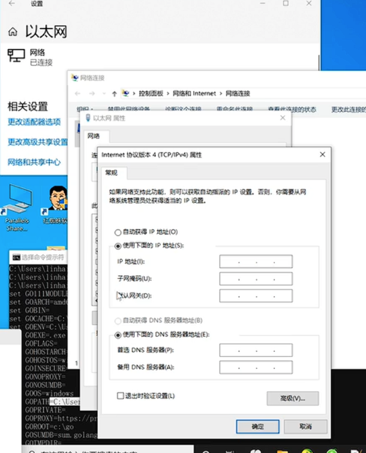
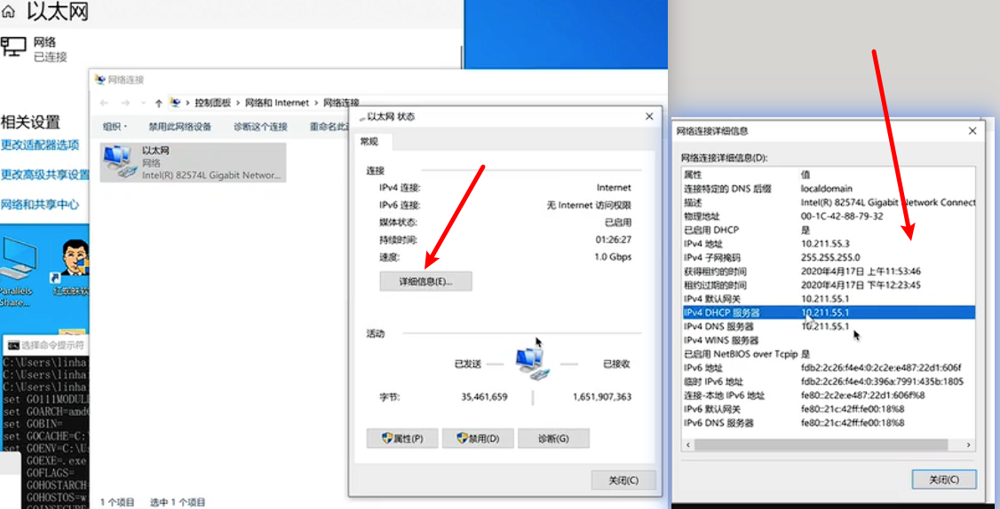

# TCP/IP


## 详情

### OSI 七层模型--开放式系统互联模型 ( 只是概念模型 -- 没有实际用 )

1. 应用层 ： 网络主机提供**方法和接口**，直接对应用户行为；例如 HTTP、FTP、SMTP；

2. 表示层（语法层） ：对数据 序列化，加密解密，压缩与解压；

3. 会话层：管理会话；例如 Open/Close/ReOpen/检查状态等；

4. 传输层：主机到主机的数据通信；
   - 建立连接保证数据封包发送、接受顺序一致；
   - 提供可靠性（发送者知道数据有没有完成送达）；
   - 提供流控制；
   - 提供多路复用

5. 网络层：提供数据在逻辑单元（IP 地址）之间的传递；
   - 路由：决定数据下一站在哪
   - 寻址：为数据封包增加头信息（地址等）

6. 数据链路层：提供数据在设备和设备间传输（网卡->路由器->路由器->防火墙->等等）；
   - 流控制：发送者和接收者之间同步数据的 收发速度和数据量；
   - 错误流程：可以检测错误（CRC），❌ 一般不负责重传（以太网不做）, 重传主要在 TCP（传输层）

7. 物理层：定义底层一个个位（bit）的数据怎么转化为物理信号；例如：二进制怎么转化电压高低，如何转化为其他物理介质上的信号；
   - 将数据传递行为转化为物理设备识别的信号；


### TCP/IP 协议模型（工程用）

```bash
应用层
  │
  │ HTTP / DNS / SSH
  ▼
传输层
  │
  │ TCP / UDP
  ▼
网络层
  │
  │ IP / ICMP
  ▼
数据链路层
  │
  │ Ethernet / MAC / ARP
  ▼
物理层
  │
  │ 网线 / 光纤 / 无线电波
  ▼
真正的物理网络
```

1. 应用层 ----> http/FTP/SMTP等
   - 功能: 应用间通信，定义数据格式
   - 数据形态: 原始数据（根据协议规定的数据格式，程序员自己填充的数据）

2. 传输层 ----> TCP/UDP 协议（主机到主机）
   - 提供端口号（例:80）；
   - UDP: 只管发送（无连接、不可靠、不保证顺序，但开销小、延迟低）；
   - TCP: 负责 分段（Segment）、排序（序列号）、重传（丢包补发）、流量控制、拥塞控制；
   - 数据结构:
     1. TCP Header: 为原始数据 增加头部信息；包括：源端口/目标端口，序列号/确认号，标志位（SYN/ACK/FIN）
     2. TCP Data: 应用层数据转换后的数据单元；
   - 数据单元: 报文段（Segment），此时数据被切割成适合传输的大小（Segment = TCP Header + 应用层数据）。

3. 网络层 ----> IP 协议（源IP地址‘从哪来’ --> 目标IP地址‘到哪去’）
   - 数据结构:
     1. IP Header: 为传输层的数据 再增加头部, 包括源IP地址和目标IP地址；
     2. IP 数据: 把传输层数据封装成 IP 包（Packet）；
   - 数据单元: 数据包（Packet）

   `网关`: 网关 = 默认出口（下一跳）；通常是路由器的一个接口IP;  
   👉 网关本质: 离开当前网络的“默认出口”

4. 链路层 ----> 多种底层网络协议，例: Ethernet（以太网）, wifi(设备-->设备), ⚠️ ARP协议(根据IP找MAC)；
   - ARP协议: 只在局域网内生效; 当只知道目标 IP，但不知道 MAC 时，通过 ARP 查询;
   - 作用: 同一局域网内: 设备 → 设备;
   - 数据结构:
     1. Frame Header: 为每个 IP 包添加头部【当前MAC地址、下一跳MAC地址】;
     2. Frame Data:
     3. Frame Footer: 为每个 IP 包添加尾部【差错检测（CRC）】;
   - 数据单元: 数据帧（Frame）;

   关联设备: 网卡（MAC 地址、以太网等）  
   每经过一个路由器: IP 不变, MAC 重写

5. 物理层 ----> 传输介质: 双绞线、同轴电缆、光纤
   - 功能: 将二进制数据（0/1）转换为电信号或光信号，进行物理传输
   - 数据单元: 比特（Bit）

## 查路由表 与 默认路由

- 默认路由

  1️⃣ 手动配置（管理员写死）
  2️⃣ DHCP 自动下发（最常见）
  3️⃣ 路由协议学习（企业/运营商）

```code
  你的电脑
    ↓（DHCP给默认网关）
  你家路由器
    ↓（ISP给默认路由）
  运营商网络
    ↓（BGP全球路由）
  互联网
    ↓
  目标服务器
```




