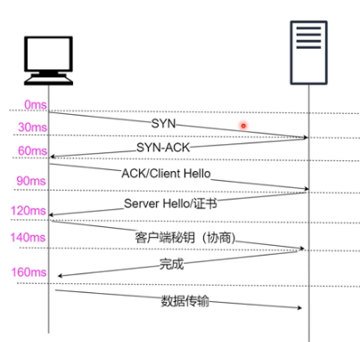

# HTTP1 / HTTP2 / HTTP3 / HTTPS / WebSocket / 状态码

**运作方式：**

- SSL：安全套接层
- TSL：传输层安全协议(更安全些)
- 需要客户端安装证书；

1. 企业生成--非对称加密的（公钥 A 、私钥 B）和对称加密的 （I、J、K）;  
   企业自己生成的私有证书(公钥 A)----发送--->公信力组织----组织的私钥 签名（加密）------>加过密的签名（C）---->返回给企业；

2. 客户端请求 3 次握手后（此时不用证书加密），服务端将签过名的证书（C）发给客户端；
3. 客户端用“公信力组织的公钥（D）”解密证书（C），核对证书（C）是不是组织发布的；
   - 不是：完结；
   - 是：将证书（C）中的公钥（A）拿出来，加密数据（协商用哪个对称加密证书- I、J、K ）发给服务器，服务器用私钥（B）解密；
4. 私钥(B)解密失败：完结；成功，通信
   

- 证书：有公信力的组织颁布；（只当裁判，不踢球）
- 对称加密：客户端与服务端用同样的密钥加密解密；（例如：一把锁，两把钥匙）
- 非对称加密：公钥/私钥（一个只负责加密，一个只负责解密；不能都是“加密”或都是“解密”）
  公钥：公开的，每个人能可以用（可以负责加密，也可以负责解密--只能选择一种）  
  私钥：服务端（公司，组织）私有的（可以负责加密，也可以负责解密--只能选择一种）

**注：**2 种加密方式 理论上都可以暴力破解；对称加密破解的概率大点；

1. 在 TCP 和 HTTP 之间插入一个安全层，所有经过安全层的数据都会被加密或者解密；
2. 作用：1、保证数据传输的安全；2、确认网站的真实性。
3. HTTP 协议端口是 80，HTTPS 协议端口是 443；
4. 对称加密：
   浏览器发送加密套件列表和一个随机数 client-random，服务器会从加密套件中选取一个加密套件，然后生成一个随机数 service-random，返回给浏览器。这样浏览器和服务器都有相同 client-random 和 service-random，再用相同的方法将两者混合生成一个密钥 master secret，双方就可以进行数据加密传输了；
   - 缺点：client-random 和 service-random 的过程都是明文，黑客可以拿到协商的加密套件和双方随机数，生成密钥，数据可以被破解；
5. 非对称加密：
   浏览器发送加密套件列表给服务器，服务器选择一个加密套件，返回加密套件和公钥，浏览器用公钥加密数据，服务器用私钥解密；
   - 缺点：加密效率太低；初次通信黑客可以获取公钥。
6. 对称加密结合非对称加密：初次非对称，以后对称；

**注：**2 种加密方式 理论上都可以暴力破解；对称加密破解的概率大点；

