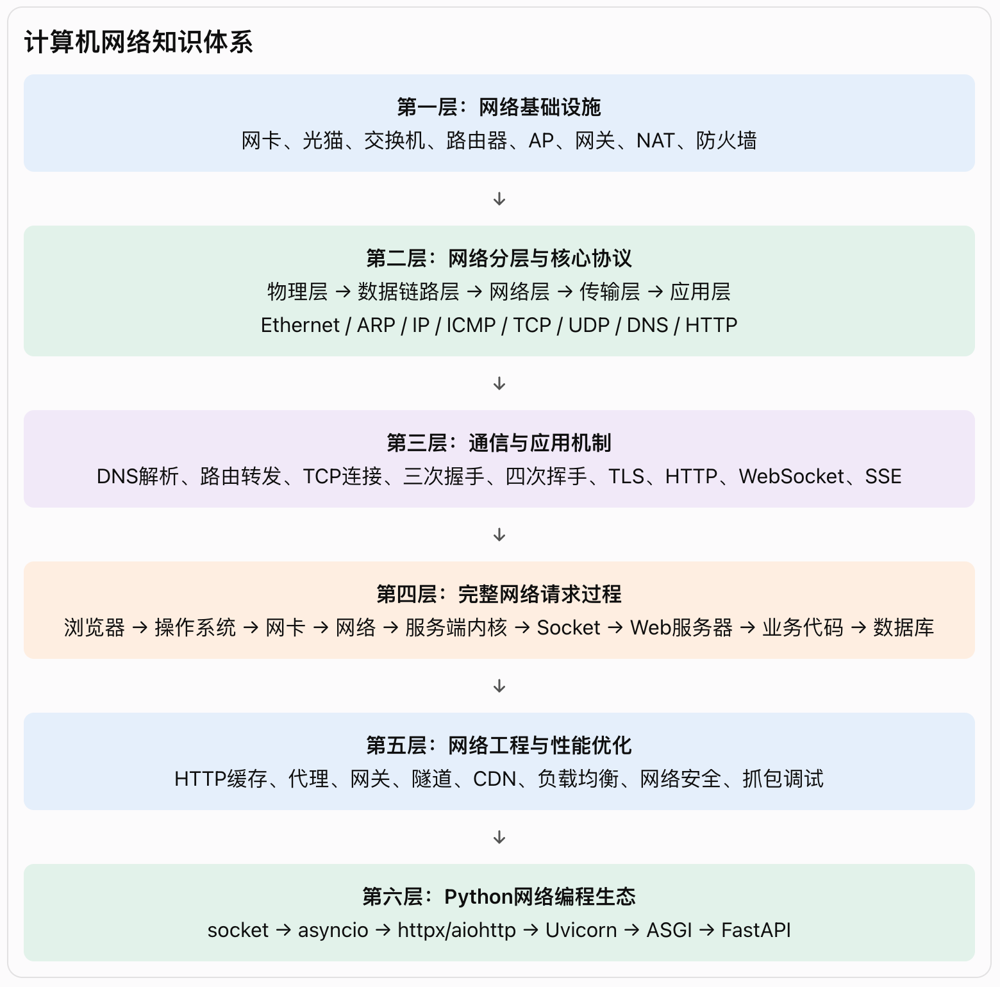
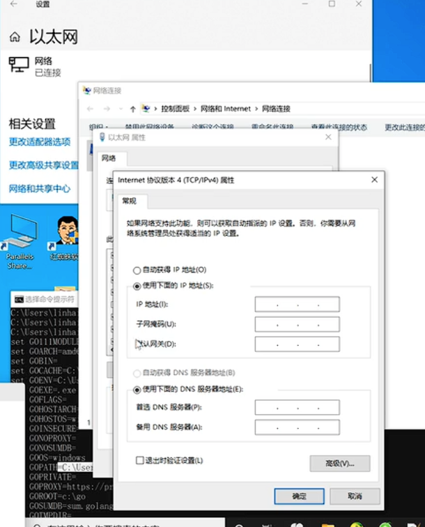
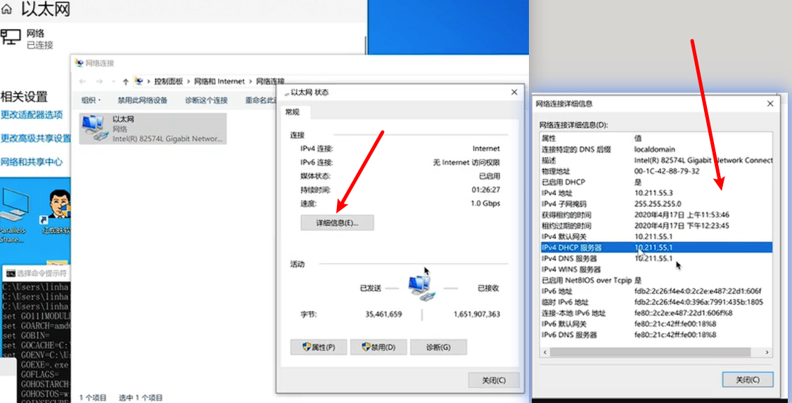
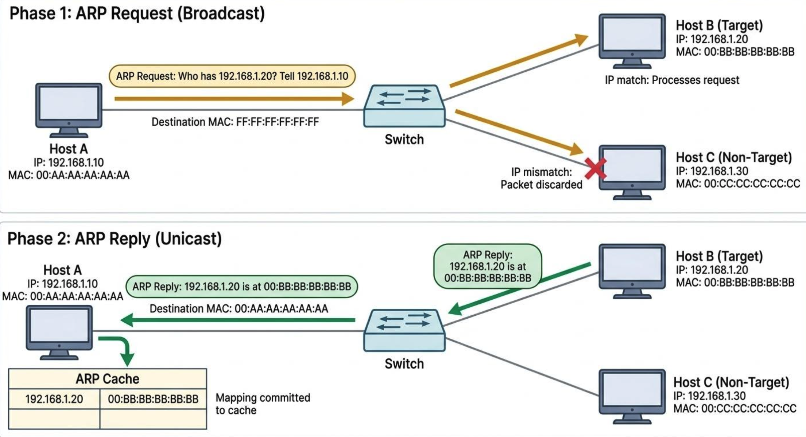
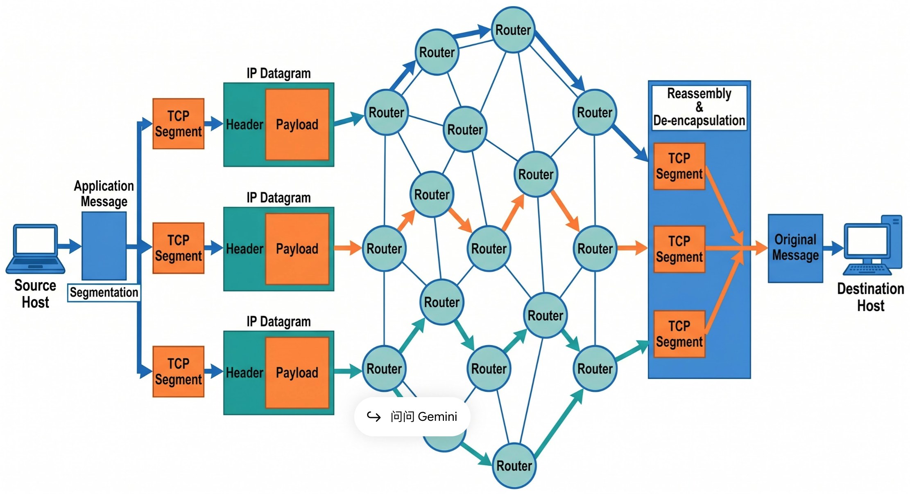
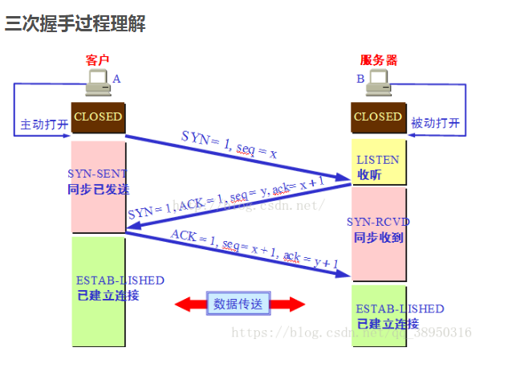
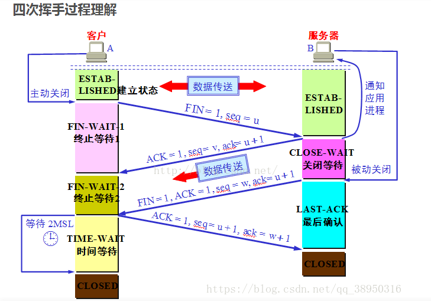

# 计算机网络-1-基础

> 说明：本文在保留原笔记核心内容的基础上，对不准确或过度简化的说法进行了修正，并补充必要的工程知识。



# 目录

1. [全局认知：网络到底解决什么问题](#1-全局认知网络到底解决什么问题)
2. [网络基础设施：设备与网络边界](#2-网络基础设施设备与网络边界)
3. [网络分层：协议如何协作](#3-网络分层协议如何协作)
4. [寻址与转发：DNS、IP、MAC、路由](#4-寻址与转发dnsipmac路由)
5. [传输层：TCP 与 UDP](#5-传输层tcp-与-udp)
6. [TCP 连接管理：三次握手与四次挥手](#6-tcp-连接管理三次握手与四次挥手)

---

# 1. 全局认知：网络到底解决什么问题

## 1.1 网络通信的本质

网络通信的本质可以归纳为 6 个连续的动作：

1. 找人（DNS）：域名解析为 IP。
2. 寻址（IP）：确定源 IP 和目标 IP（逻辑地址）。
3. 找路（路由/网关）：根据路由表确定下一跳。
4. 送达（MAC/ARP）：在局域网内找到下一跳设备的物理地址并交付。
5. 分清程序（端口）：传输层根据端口号将数据分发给对应的应用进程。
6. 可靠/实时传输（TCP/UDP）：根据应用需求决定是否重传、排序（TCP）或直接发送（UDP）。

🔥 网络本质(只干三件事)：找人、找路、送达

可以用一句话记忆：

> URL 描述要访问的资源，DNS 负责域名解析找到目标 IP，IP 负责逻辑寻址，路由负责选择下一跳，MAC 负责链路交付，TCP/UDP/QUIC 提供传输能力，TLS 保护传输，端口负责找到进程，应用协议负责解释数据。

注意：这是一种帮助理解的职责划分，不代表每次通信都一定发生 DNS 查询、ARP 广播、NAT 或完整 TCP 握手。

## 1.2 网络知识的六个层次

| 层次         | 研究对象                   | 典型内容                             |
| ------------ | -------------------------- | ------------------------------------ |
| 网络设备     | 数据经过什么设备           | 网卡、交换机、路由器、光猫           |
| 网络协议     | 设备如何遵循规则通信       | Ethernet、IP、TCP、UDP、HTTP         |
| 通信机制     | 连接如何建立、数据如何传递 | DNS、ARP、握手、路由、TLS            |
| 操作系统实现 | OS 如何接收和处理网络数据  | Socket、缓冲区、TCP/IP 协议栈、epoll |
| 应用服务     | 服务端如何处理请求         | Nginx、Uvicorn、FastAPI、数据库      |
| 工程实践     | 如何调试、安全和优化       | curl、Wireshark、缓存、代理、限流    |

## 1.3 三条视角不同、但相互衔接的链路

**A. 物理网络链路：数据经过什么**

```text
电脑/手机
   ↓
网卡 / Wi-Fi
   ↓
交换机 / 无线 AP
   ↓
路由器 / 网关
   ↓
运营商网络 【光猫、光纤】
   ↓
互联网
   ↓
目标服务器
```

你的电脑 --》 你家路由器 --》 运营商网络 --》 互联网 --》 目标服务器
**B. 软件处理链路：**

```text
应用数据（例如 HTTP 请求）
   ↓
TLS（HTTPS 场景）
   ↓
TCP Segment 或 UDP Datagram  --> 【TCP报文段 或 UDP 用户数据报; 传输层】
   ↓
IP Packet  --> 【IP分片-数据包; 网络层(网际层)】
   ↓
┌───── 硬件（网卡）─────────────────────────
| 数据链路层 · MAC 子层（成帧Frame、加 MAC、算 CRC）  -->【帧】
|  ↓
| 物理层 · PHY 芯片（编码、调制、发比特）  --> 【比特】
└─────────────────────────────────────────
   ↓

网线 / 光纤 / 无线电波
```

HTTP/3 的路径不同：HTTP/3 → QUIC → UDP → IP → 链路层。QUIC 在 UDP 之上实现可靠传输、拥塞控制、加密和多路复用等能力。

**C. 服务端处理链路：请求到达后由谁处理**

```text
服务器网卡
  ↓
操作系统网络协议栈
  ↓
TCP/UDP Socket
  ↓
监听端口 / 已建立连接
  ↓
反向代理或负载均衡器（若部署）
  ↓
ASGI/WSGI 服务器
  ↓
Web 框架路由与中间件
  ↓
业务逻辑
  ↓
缓存 / 数据库 / 下游服务
  ↓
构造响应并返回
```

---

# 2. 网络基础设施：设备与网络边界

```bash
          Internet
             │
       ┌─────┴─────┐
       │   服务器   │
       └─────▲─────┘
             │
           普通路由
             │
          普通路由
             │
          ISP骨干网
             │
          普通路由
             │
           CGNAT     ← 有些运营商这里做 NAT
             │
         运营商网络
             │
         家庭路由器    ← 这里通常做 NAT
             │
        192.168.1.100
             │
            电脑
# -----------------------------------------
                        Internet
                           ▲
                           │
                        互联网接入
                           │
           ┌───────────────┼────────────────┐
           │               │                │
          光纤             4G/5G            专线
           │               │
          光猫             基站
           │
           ▼
         路由器
           │
   ┌───────┴────────┐
  网线              AP
   │                │
   ▼                ▼
交换机             Wi-Fi
   ├── PC           ├── 手机
   ├── NAS          ├── 平板
   └── 摄像头        └── 笔记本
```

## 2.1 常见设备

| 设备/概念                     | 主要职责                          | 关键理解                                   |
| ----------------------------- | --------------------------------- | ------------------------------------------ |
| 网卡 NIC                      | 让设备接入网络                    | 有线网卡、无线网卡都是网络接口             |
| 交换机 Switch                 | 在局域网内转发以太网帧            | 主要依据 MAC 地址转发                      |
| AP (Access Point，无线接入点) | 提供 Wi-Fi 无线接入               | 通常桥接无线客户端与有线局域网             |
| 路由器 Router                 | 在不同 IP 网络之间转发数据包      | 查询路由表，选择下一跳和出口接口           |
| 网关 Gateway                  | 不同网络或系统之间的出入口/转换点 | 含义取决于具体上下文                       |
| 防火墙                        | 按安全策略控制流量                | 可基于 IP、端口、协议、连接状态等过滤      |
| 光猫 ONU/ONT                  | 将运营商接入网络转换为用户侧接口  | 不只是简单的光电转换，也可能集成路由等功能 |

AP 是 Wi-Fi 和有线局域网之间的“桥”;

### 网卡（NIC）🆚 网关（Gateway）

- 网卡是让你接入网络的“物理门票”，
  - 每个网卡都有：
    - IP地址（逻辑）
    - MAC地址（物理）:每块网卡都有自己独立的MAC地址。

- 网关是你离开本地网络去往外部世界的“大门”;
  同一个局域网里的机器，可以直接通信；不同网络之间通信，就需要经过网关。

没有网卡，你无法接入网络；没有网关，你只能困在局域网内，无法访问互联网。

IP地址是贯穿始终的“终极导航”，MAC地址是每一段路上的“接力棒”，而网关就是那个帮你接过接力棒、把你送出局域网的“中转站”。

### 交换机 🆚 路由器

- (二层)交换机: 通常工作在数据链路层，学习 MAC 地址与端口的对应关系，再转发以太网帧。【局域网】

  交换机（Switch）：把同一个局域网里的设备连接起来
  - 根据 ”MAC 地址“ 进行 局域网内的数据转发。
  - 不看 IP，只看 MAC。

- 路由器: 通常工作在网络层(网际层)，根据目标 IP 地址查询路由表，决定下一跳。【(路由)跨出局域网】
- 三层交换机: 可以同时具备二层交换和三层路由能力，因此不能简单认为某个设备只会看 MAC 或只会看 IP。

## 2.2 家用无线路由器是什么

家用无线路由器通常是多个功能的集成设备：

```text
家用无线路由器（俗称"胖 AP"）
  │
  ├── 路由功能 ─→ 对外表现为"默认网关"（内网出口）【查路由表，决定数据包下一跳】
  │
  ├── 交换机功能 ─→ LAN 口之间(查 MAC 表)转发帧
  │
  ├── 无线 AP 功能 ─→ 有线 ↔ WiFi 信号转换
  │
  ├── DHCP 服务 ─→ 自动分配内网 IP、子网掩码、网关、DNS
  │
  ├── NAT / PAT ─→ 多设备共享一个公网 IP(私有 IP ↔ 公网 IP 转换，端口复用)
  │
  ├── 防火墙 → 包过滤 + 状态检测
  │
  └── PPPoE 客户端 ─→ 宽带拨号（视接入方式而定）
```

设备名称叫“无线路由器”，不意味着它内部只有路由功能。

## 2.3 路由器 WAN 接入方式

运营商可能通过以下方式 给家庭路由器提供网络参数：

- **PPPoE**：通过账号、密码建立接入会话，常见于部分宽带接入。
- **DHCP**：自动分配 IP、子网掩码、默认网关、DNS 等参数。
- **静态 IP**：由运营商提供固定配置，用户或设备手动设置。

注意：家庭路由器 LAN 侧通常也运行 DHCP 服务，为家里的电脑、手机分配私网地址。这与 WAN 侧向运营商获取地址是两个方向。





## 2.4 IP、MAC、端口、DNS、网关

| 概念          | 作用                                         | 示例                    |
| ------------- | -------------------------------------------- | ----------------------- |
| IP 地址       | 标识网络层(网际层)的接口/通信端点 (决定去哪) | `192.168.1.100`         |
| MAC 地址      | 标识链路层接口 (决定下一跳怎么送)            | `00:11:22:33:44:55`     |
| 端口          | 区分同一主机上的传输层通信端点               | `443`                   |
| 子网掩码/前缀 | 划分网络前缀与主机部分                       | `255.255.255.0` / `/24` |
| 默认网关      | 本机访问非直连网络时通常交给的下一跳         | `192.168.1.1`           |
| DNS           | 将域名解析为 IP 等 DNS 记录                  | `example.com → IP`      |

- ❗纠正：
  1. IP 地址不是永远唯一对应“一台设备”。
  2. 一台设备可以有多个网卡(NIC)、多个 IP；一个公网 IP 也可以通过 NAT 被多个内网设备共享。
  3. MAC 地址也可能被虚拟化、随机化或软件修改。它只在当前局域网（同一网段）内有效，出了局域网就没用了。

## 2.5 私有 IP 与特殊地址

常见 IPv4 私有地址范围：

- `10.0.0.0/8`
- `172.16.0.0/12`
- `192.168.0.0/16`

常见特殊地址：

- `127.0.0.1`：IPv4 回环地址，访问本机。
- `0.0.0.0`：在服务端监听场景中常表示绑定所有 IPv4 本地接口；也可在其他上下文中表示未指定地址。
- `0.0.0.0/0`：IPv4 默认路由的前缀。
- `255.255.255.255`：受限广播地址。
- `169.254.0.0/16`：IPv4 链路本地地址范围。

`192.168.x.x` 是常见私有地址，但不是所有局域网都必须使用它。

## 2.6 NAT(Network Address Translation)：网络地址转换

NAT 在网络边界修改 IP 地址 + 端口。家庭网络常见的是 NAPT/PAT（端口地址转换）。

示例：

```text
内网设备：192.168.1.100:50000 【内网】
       |
       | 家庭路由器执行 NAT/PAT
       ▼
公网映射：203.0.113.10:62001 【公网IP:某个端口】
       |
       ▼
互联网服务器
```

路由与 NAT 是不同职责：

- 路由：决定数据下一跳。
- NAT：改写地址/端口并维护转换映射。

并不是每经过一个路由器就发生 NAT。运营商网络还可能存在 CGNAT（运营商级 NAT）。

---

# 3. 网络分层：协议如何协作

## 3.1 为什么要分层

网络通信非常复杂。分层将复杂问题拆分成职责相对清晰的部分：

- 上层不必关心底层信号如何传输。
- 下层不必理解上层业务含义。
- 每层通过约定的接口与相邻层协作。
- 协议可以在不改变整个体系的情况下演进。

## 3.2 OSI 七层模型与 TCP/IP 五层模型

| OSI 七层        | TCP/IP 五层    | 主要职责                     | 示例                                     |
| --------------- | -------------- | ---------------------------- | ---------------------------------------- |
| 应用层（7）     | 应用层         | 应用通信规则(应用协议)       | HTTP、DNS、SMTP、SSH                     |
| 表示层（6）     | 应用层         | 数据表示、编码、加密、压缩等 | JSON、字符编码、TLS（按功能理解）        |
| 会话层（5）     | 应用层         | 会话 建立、管理、恢复等      | 会话管理机制 (HTTP keep-alive / session) |
| 传输层（4）     | 传输层         | 进程间端到端传输             | TCP、UDP                                 |
| 网络层（3）     | 网络层(网际层) | IP 寻址与跨网络转发          | IPv4、IPv6、ICMP                         |
| 数据链路层（2） | 数据链路层     | 同一链路上的帧传输           | Ethernet、Wi-Fi、MAC                     |
| 物理层（1）     | 物理层         | 比特的物理传输               | 网线、光纤、无线电信号                   |

说明：

- OSI 是七层参考模型，它主要用于理解、设计和分析网络体系。
- TCP/IP 五层模型是常用教学表达。实际资料也常使用四层 TCP/IP 模型，把物理层和数据链路层合并为网络接口层。
- TLS、JSON 等不宜机械地认定为只属于 OSI 的某一层；模型是抽象工具，不是严格的软件目录。

```code
  设备层 → 标识层 → 寻址层 → 转发层 → 传输层 → 应用层
  对应现实：
  网卡  →  MAC  →   IP  →  路由 → TCP/UDP → HTTP/DNS
```

## 3.3 封装与解封装

发送端逐层封装，接收端逐层解封装：

```text
应用层       HTTP 数据
               ↓
传输层       TCP Header + 数据       → TCP Segment【报文段】
               ↓
网络层(网际层)       IP Header + Segment     → IP Packet 【包】
               ↓
数据链路层   Frame Header + Packet + Trailer → Frame 【帧】
               ↓
物理层       比特流 / 物理信号
```

- 分层思想（最重要）
  - 应用层：你要干嘛（HTTP）
  - 传输层：怎么传（TCP）
  - 网络层：往哪走（IP）
  - 链路层：怎么发（MAC）

常见数据单元名称：

| 层         | 数据单元               |
| ---------- | ---------------------- |
| 应用层     | Message / Data         |
| TCP        | Segment（报文段）      |
| UDP        | Datagram（用户数据报） |
| IP         | Packet（数据包）       |
| 数据链路层 | Frame（帧）            |
| 物理层     | Bit（比特）            |

注意：不同协议与教材的术语可能略有差异。以太网帧的头部和尾部并非都叫 MAC Header；FCS 通常用于差错检测。

## 3.4 五层模型的职责

应用层造数据 → 传输层加端口与可靠/报文字段成 Segment/Datagram → 网络层加源/目的 IP 成 Packet → 链路层查 ARP 填 MAC、加帧头帧尾成 Frame → 物理层变信号发出去；途中每过一跳路由器，拆帧看 IP、换 MAC 再发帧，直到目的主机层层剥壳交还应用进程。

### 1. 应用层 ---> HTTP/FTP/SMTP/DNS 等

- 功能：定义应用间如何表达请求、响应和业务数据。
- 数据形态：程序员构造的原始业务数据（如 JSON、HTML）。

### 2. 传输层 ---> TCP/UDP（源进程 到 目标进程）

- 核心功能：通过`端口号`区分同一主机上的不同应用进程。
- TCP: 面向连接、可靠、有序的字节流; 负责分段、序列号排序、丢包重传、确认应答、流量控制、拥塞控制。
  1. 结构：TCP Header（源/目的端口、序列号、确认号、SYN/ACK/FIN 标志位等）+ TCP Data。
  2. 数据单元：Segment（报文段）, 此时数据被切割成适合传输的大小。

- UDP: 无连接、不可靠、不保证顺序; 但头部开销小、延迟低，适合音视频/直播/DNS 等场景；
  1. 数据单元常称 Datagram（用户数据报）。

### 3. 网络层(网际层) ---> IP/ICMP/路由协议 (跨网络主机寻址与转发)

- 核心能力：通过`源/目的IP地址`进行逻辑寻址，并沿`路由表`决定跨网段转发路径。IP 本身提供“尽力而为”服务，不保证送达、顺序或不重复。
- 网关（Gateway）：离开"当前局域网"前往"外部网络"时的`默认下一跳出口`，通常是路由器的内网接口 IP。
- 结构：IP Header（源/目的 IP、TTL、协议号等）+ IP Data（传输层报文段/数据报）。
- 数据单元：Packet（数据包）
- ICMP: 网络“诊断工具”(ping 就是它)

### 4. 数据链路层 ---> 多种底层网络协议:Ethernet/Wi-Fi/ARP (局域网内传输)

- 核心能力：将"网络层数据包"封装成`帧`，利用`MAC地址`实现同一局域网/链路上的设备间传输，并通过尾部校验（如 FCS/CRC）做差错检测。
- ARP（地址解析协议）：工作在局域网内，已知下一跳/目标 IP 时，通过广播请求与单播响应获取对应的 `MAC 地址`。
  1. ARP（Address Resolution Protocol）: IP → MAC 转换

- 结构：Frame Header（目的 MAC、源 MAC、类型字段等）+ Frame Data（IP Packet）+ Frame Trailer/Footer (差错检测字段，如 FCS).
- 数据单元：Frame（帧）。
- 跨跳规律：每经过一台路由器解封装并重新封装帧，`IP 一般不变（除非 NAT），MAC 逐跳重写`。
- 关联设备: 网卡

### 5. 物理层 ---> 传输介质: 双绞线/光纤/同轴电缆/无线介质

- 核心能力：定义接口与传输介质的电气、光学、机械等物理规范，把数字比特流转换成电信号、光信号或无线电波传输。

- 数据单元：Bit（比特，0/1）。

---

# 4. 寻址与转发：DNS、IP、MAC、路由

网络三大核心机制（必须掌握）

1. 寻址（IP）： 决定：目标是谁（最终目的地）
   → 提供源IP、目标IP

2. 转发（路由）： 决定：下一跳是谁
   1. 查路由表（最长前缀匹配）
   2. 判断：
      - 同一网段 → 直接交付
      - 不同网段 → 交给网关（默认路由）

3. 交付（MAC）： 决定：把数据交给谁
   - 如果不知道MAC：使用ARP：IP → MAC
   - 封装二层帧：目标MAC = 下一跳设备的MAC

- 👉 精华总结：IP定终点，路由定路径，MAC做交付。
  IP → 路由 → ARP → MAC

- 👉 重要特性：
  - 每一跳都会重新封装 MAC（因为下一跳变了）
  - IP 一般不变（除非发生 NAT）

1. 路由表: 决定“下一跳去哪”
2. 默认路由: 不认识的都走这里
   - 0.0.0.0/0

3. NAT: 私网IP → 公网IP
   - 家庭上网必备

4. BGP: 互联网“导航系统”
   - ISP 各大网络交换路由信息

## 4.1 URL 的组成

示例：

```text
https://www.example.com:443/products/item?id=100#detail
└─┬─┘   └──────┬──────┘ └┬┘ └──────┬──────┘ └──┬──┘
 scheme       host       port      path       query  fragment
```

更完整地看：

```text
scheme://userinfo@host:port/path?query#fragment
```

- Scheme：协议方案，如 `http`、`https`。
- Host：主机名或 IP 地址。
- Port：端口；HTTP 默认端口 80，HTTPS 默认端口 443。
- Path：资源路径。
- Query：查询参数。
- Fragment：片段标识符，通常由客户端使用，不会作为 HTTP 请求目标的一部分发送给服务器。

URL 与 URI 不是完全同义：URL 是 URI 的一种，用于定位资源。

## 4.2 DNS：域名解析

DNS（Domain Name System）将域名解析为资源记录，最常见的是 A（IPv4）和 AAAA（IPv6）记录。

常见记录：

| 记录  | 含义                               |
| ----- | ---------------------------------- |
| A     | 域名对应 IPv4 地址                 |
| AAAA  | 域名对应 IPv6 地址                 |
| CNAME | 别名记录                           |
| MX    | 邮件交换服务器                     |
| NS    | 权威 DNS 服务器                    |
| TXT   | 文本信息，常用于验证和邮件安全策略 |

### DNS 解析大致过程

```text
应用/浏览器发起解析
       ↓
本机 DNS 缓存等
       ↓
配置的递归 DNS 解析器
       ↓
必要时查询根 DNS
       ↓
顶级域 DNS（如 .com）
       ↓
权威 DNS
       ↓
返回 DNS 记录
       ↓
缓存结果（受 TTL 等策略影响）
```

重要纠正：

- 根 DNS、顶级域 DNS、权威 DNS 的查询过程通常由递归解析器代为完成，不意味着浏览器每次都逐级直接访问它们。
- 实际还可能涉及浏览器缓存、操作系统缓存、Hosts 文件、企业 DNS、DoH/DoT 等。
- DNS 不只解析域名到 IP，也可以提供其他类型的记录。
- DNS 结果受 TTL、负载均衡、CDN、地理调度等影响，同一域名不一定永远解析到同一个 IP。

## 4.3 IP 地址与子网掩码

IPv4：

- 32 位，即 4 字节。
- 常用点分十进制表示，例如 `192.168.1.10`。
- 理论地址总数为 `2^32`，但并非全部可作为普通主机地址使用。

IPv6：

- 128 位。
- 通常使用 8 组十六进制数表示。
- 例如 `2001:db8:85a3::8a2e:370:7334`。
- `2001:db8::/32` 是文档示例保留地址段。

子网掩码前缀示例：

```text
IP：       192.168.1.10/24
网络前缀： 192.168.1.0/24
掩码：     255.255.255.0
```

| 名字               | 地址              | 转义                                 |
| :----------------- | :---------------- | :----------------------------------- |
| IP地址             | 172.16.10.1       | 10101100.00010000.00001010.000000001 |
| 子网掩码           | 255.255 255.255.0 | 11111111.11111111.11111111.000000000 |
| （合成的）网络地址 | 172.16.10.0       | 10101100.00010000.00001010.000000000 |

1. `/24` 表示前 24 位是网络前缀，剩余 8 位属于接口地址部分。

2. 不要把“前三段相同”当作通用判断规则；必须结合子网掩码或 CIDR 前缀进行判断。
   - 子网掩码（Subnet Mask）: 判断是不是“同一个局域网”

3. 对于 `192.168.1.0/24` 这样的普通 IPv4 子网，常见主机地址范围是 `.1` 到 `.254`，`.0` 是网络地址，`.255` 是广播地址。但 `/31` 点到点链路、`/32` 主机路由等有特殊规则。

- 广播域：广播域是一个逻辑上的网络范围。在这个范围内，任何一个设备发出的广播信息，都会被域内的所有其他设备接收到。
- 广播地址: “通知所有人”的地址; 👉 作用： - ARP广播（找别人MAC地址） - 局域网发现设备

- 通过路由器或虚拟局域网（VLAN）等技术将一个大的网络分割成多个更小的广播域，可以有效限制广播信息的传播范围，减少不必要的流量。

## 4.4 同网段通信与跨网段通信

假设：

```text
本机：192.168.1.10/24
目标 A：192.168.1.20/24
目标 B：8.8.8.8
默认网关：192.168.1.1
```

### 场景 A：局域网内（同网段）：IP 比对子网掩码 → 相同 → 查本地缓存 / ARP 广播寻找目标 MAC → 直接发给目标。

1. 判断是不是同一网段; 用子网掩码计算：
   ```text
      192.168.1.10 → 192.168.1
      192.168.1.20 → 192.168.1
      ✔ 相同 → 局域网内
   ```
2. 查MAC地址 (关键); 电脑需要知道对方的MAC地址, 👉 通过 ARP（地址解析协议）

   发送：`广播：谁是 192.168.1.20？` → 局域网所有设备都会收到（广播域） → 只有目标回应：`我是，我的MAC是 XX-XX`

3. 直接通信：

   之后：`IP包 → 封装成 → MAC帧` 发送给：`目标MAC地址` 👉 不经过网关 ❗

- 👉 局域网内通信 = ARP找MAC → 直接发

### 场景 B：访问外网（跨网段）：IP 比对子网掩码 → 不同 → 查路由表 → ARP 广播找网关 MAC → 数据帧发给网关 → 网关查路由表转发 → 出公网前进行 NAT（公网IP替换）。

- 👉 跨局域网通信 = 发给网关 → 网关帮你转发

#### 第一步：客户端判断网段、ARP 解析与逐层封装

##### 1. 判断“去往哪里” + ARP 查下一跳 MAC

1. 浏览器通过 DNS 拿到 example.com 对应 IP 93.184.216.34。

2. 客户端用本机 IP 192.168.1.10 和子网掩码 255.255.255.0 计算：目标 IP 93.184.216.34 不在当前局域网内。

3. 因此，数据链路层的目标不能填服务器 MAC，必须交给默认网关 192.168.1.1。

4. 客户端先查本地 ARP 缓存表：
   - 若已有 192.168.1.1 的 MAC 记录：直接填入帧头。
   - 若没有：广播发送 ARP Request（“谁是 192.168.1.1？请告诉 192.168.1.10（MAC AA-...-01）”）；网关收到后单播回复 ARP Reply（“192.168.1.1 在 BB-...-01”），客户端写入 ARP 缓存。



##### 2. 自顶向下逐层封装（发出前）

```text
┌-------------------------------------------------------------------┐
| 应用层 (HTTP)                                                      |
| GET / HTTP/1.1\r\nHost: example.com\r\n...                        |
└-------------------------------------------------------------------┘
        │ 加上 TCP Header（源端口如 52341，目的端口 80，Seq/Ack/标志位）
        ▼
┌------------------+------------------------------------------------┐
| TCP Header       | HTTP 数据                                       | ── TCP Segment
└------------------+------------------------------------------------┘
        │ 加上 IP Header（源IP 192.168.1.10，目的IP 93.184.216.34，TTL）
        ▼
┌---------------+------------------+--------------------------------┐
| IP Header     | TCP Header       | HTTP 数据                       | ── IP Packet
└---------------+------------------+--------------------------------┘
        │ 加上 Ethernet Header（目的MAC BB-...-01，源MAC AA-...-01）+ FCS 尾部
        ▼
┌------------+---------------+------------------+----------------+------┐
| Eth Header | IP Header     | TCP Header       | HTTP 数据       | FCS  | ── Frame
└------------+---------------+------------------+----------------+------┘
        │ 物理层编码为电/光/无线信号发送至网线或 Wi-Fi AP
        ▼
```

#### 第二步：网关与中间路由器的转发（拆帧 → 查路由 → 换帧）

"物理层"信号传到`网关`后，网关逐层向上处理，但不会解封装到应用层（普通三层路由器只看网络层及以下）：

```text
网关收到 Frame
  │
  ├─ 1. 物理层 → 数据链路层：校验 FCS；检查目的 MAC 是自己（BB-...-01），剥掉旧 Frame Header/Trailer。
  ├─ 2. 拿到 IP Packet：查看目的 IP = 93.184.216.34，将 TTL 减 1（若 TTL 归 0 则丢弃并返回 ICMP 超时）。
  ├─ 3. 查询路由表：匹配到去往外网的下一跳接口与下一跳路由器 IP。
  ├─ 4. 必要时通过 ARP 获取下一跳的 MAC 地址（若走 NAT，则改写源 IP/源端口并记录映射）。
  └─ 5. 重新封装新 Frame：
        • 新 Src MAC = 网关出接口 MAC（如 CC-...-01）
        • 新 Dst MAC = 下一跳设备 MAC
        • 重新计算新 FCS，经物理层发出
```

中间每经过一台路由器，都重复上述“拆帧看 IP、改 TTL、换 MAC 再封帧”的过程，直到 IP Packet 抵达 93.184.216.34 所在的网络并送达服务器网卡。



#### 第三步：服务器解封装与响应回传

##### 1. 服务端自底向上解封装

```text
物理层收到信号 → 还原为 Bit 流
  │
  ▼ 数据链路层
校验 FCS 无误，确认目的 MAC 为本机网卡，剥离 Frame Header & Trailer → 交出 IP Packet
  │
  ▼ 网络层
检查目的 IP 为本机（93.184.216.34），剥离 IP Header（按协议号识别为 TCP） → 交出 TCP Segment
  │
  ▼ 传输层
读取 TCP Header 中的目的端口 = 80，找到监听 80 端口的 Web 进程（如 Nginx/Apache）；
按序列号排序、确认数据完整，剥离 TCP Header → 交出 HTTP 请求报文
  │
  ▼ 应用层
Web 进程解析 `GET / HTTP/1.1`，生成 HTTP 响应（如 `200 OK` + HTML 页面内容）
```

##### 2. 响应原路返回客户端

服务器把 HTTP 响应按同样的应用层 → 传输层（源端口 80，目的端口 52341）→ 网络层（源 IP 93.184.216.34，目的 IP 192.168.1.10）→ 数据链路层 → 物理层封装发出；经过各跳路由器逐跳改写 MAC（及 NAT 反向转换），最终回到客户端网卡，层层解封装后由浏览器渲染出网页。

### 关键理解：

- IP 包的目标 IP 通常仍然是最终目标服务器的 IP。
- 当前以太网帧的目标 MAC 是当前链路的下一跳 MAC。
- 路由器转发时会移除原链路帧并重新封装下一条链路的帧。
- 普通路由转发时源/目标 IP 通常保持不变；发生 NAT 时地址或端口可能被改写。
- 每一跳的 MAC 地址会随链路变化。

### 局域网 vs 外网（本质）

🟢 局域网: ARP → 找MAC → 直接发
🔴 外网: 发给网关 → 路由 → NAT → 互联网

## 4.5 ARP 与 IPv6 邻居发现

- ARP：在 IPv4 网络中，根据同一链路上的 IPv4 地址解析对应链路层地址。
- IPv6 不使用 ARP，而使用 ICMPv6 Neighbor Discovery（邻居发现协议）。
- ARP 请求通常通过链路层广播发出；ARP 应答通常单播返回。
- ARP 只能解决本地链路上的地址解析，不负责跨互联网查找远端服务器的 MAC。

## 4.6 路由表、默认路由与 BGP全球路由

路由器根据路由表转发数据包，常见匹配原则是**最长前缀匹配**。

- 直连路由：网络直接连接在本机接口上。
- 静态路由：管理员手工配置。
- 动态路由：通过路由协议学习。
- 默认路由：没有更具体匹配时使用，例如 IPv4 `0.0.0.0/0`、IPv6 `::/0`。

BGP（Border Gateway Protocol）用于自治系统之间交换可达路由信息，是互联网路由体系的重要组成部分。它不是每个家庭路由器逐跳执行的“全球导航查询”。

---

# 5. 传输层：TCP 与 UDP

## 5.1 端口的作用

IP 主要定位主机/接口，端口用于区分主机上的传输层通信端点。

常见端口：

| 端口  | 常见用途                                 |
| ----- | ---------------------------------------- |
| 20/21 | FTP（传统数据/控制通道，具体模式有差异） |
| 22    | SSH                                      |
| 53    | DNS（UDP 常见，TCP 也会使用）            |
| 80    | HTTP                                     |
| 443   | HTTPS                                    |
| 3306  | MySQL 默认端口                           |
| 5432  | PostgreSQL 默认端口                      |
| 6379  | Redis 默认端口                           |

端口号是 16 位，范围 0–65535。端口与某个协议的对应关系是约定俗成的默认值，不代表该服务只能使用该端口。

## 5.2 TCP

TCP（Transmission Control Protocol）是面向连接、可靠、有序的字节流协议。

主要机制：

- 连接建立与关闭。
- 序列号与确认号。
- 超时重传、快速重传等可靠性机制。
- 接收窗口与流量控制。
- 拥塞控制。
- 校验和。

注意：

- TCP 提供的是字节流，不保留应用层消息边界。
- 一次 `send()` 不保证对方一次 `recv()` 就完整收到对应数据。
- TCP 的可靠性是传输层机制，不等于业务一定成功。例如服务器可能收到请求但业务处理失败。
- TCP 不能简单描述为“绝对不丢数据”；它通过检测、确认、重传等机制尽力提供可靠交付，连接最终也可能因超时或故障失败。

## 5.3 UDP

UDP（User Datagram Protocol）是无连接的数据报协议。

特点：

- 不需要像 TCP 那样建立连接。
- 保留数据报边界。
- 不保证送达、顺序或去重。
- 协议头开销较小。
- 应用可根据需要自行实现确认、重传、拥塞控制等机制。

常见场景：DNS 查询、实时音视频、在线游戏、部分实时传输协议。

不能简单说“UDP 一定更快”。实际延迟取决于网络、应用机制、数据大小、拥塞和实现方式。

## 5.4 TCP 与 UDP 对比

| 维度     | TCP                               | UDP                                |
| -------- | --------------------------------- | ---------------------------------- |
| 连接     | 面向连接                          | 无连接                             |
| 数据模型 | 字节流                            | 数据报                             |
| 可靠性   | 提供可靠有序传输                  | 不保证                             |
| 顺序     | 提供有序字节流                    | 不保证                             |
| 流量控制 | 有                                | 协议本身没有                       |
| 拥塞控制 | 有                                | 协议本身没有                       |
| 常见场景 | HTTP/1.1、HTTP/2、数据库连接、SSH | DNS、实时媒体、游戏、QUIC 底层传输 |

---

# 6. TCP 连接管理：三次握手与四次挥手

## 6.1 三次握手

目的：让通信双方确认彼此的发送与接收能力，并同步初始序列号等连接状态。


逐步理解：

1. 客户端发送一个 SYN 报文给服务器，表示请求建立连接，并给出自己的初始序列号(请求)。
2. 服务端收到SYN 报文后，返回 SYN+ACK报文给客户端，确认客户端的序列号，并提供自己的初始序列号(同意)。
3. 客户端收到 SYN+ACK 报文后，发送一个 ACK 报文给服务器，确认服务端的序列号(建立连接)。

三次握手不是简单地“客户端说想连接、服务端同意、客户端确认”而已；核心还在于双方确认双向通信能力和初始序列号。

## 6.2 SEQ 与 ACK

- SYN: 同步标志，表示请求建立连接。
- SEQ：当前 TCP 段中数据的起始序列号。
- ACK：确认号，表示接收方期望收到的下一个字节序列号。
- FIN：结束标志，表示发送方已经没有数据要发送。

例如：

```text
发送方发送 100 字节，起始序列号为 1000
接收方确认 ACK = 1100
```

## 6.3 四次挥手

TCP 是全双工协议，两个方向可以独立关闭，因此典型关闭过程需要双方分别表达关闭意图。



1. 主动关闭方 发送 一个 FIN 报文，表示自己不再发送数据。
2. 被动关闭方 收到 FIN 报文后，发送一个 ACK 报文，确认收到关闭请求(此时它可能仍有数据要发送)。
3. 被动关闭方 数据发送完毕后，发送 一个 FIN 报文。
4. 主动关闭方 收到 FIN 报文后，发送一个 ACK 报文。

## 6.4 TIME_WAIT

主动关闭方通常在发送最后一个 ACK 后进入 TIME_WAIT 状态。

主要目的：

- 确保最后一个 ACK 丢失时，仍有机会重发 ACK。
- 让旧连接中的延迟报文在网络中逐渐消失，降低旧报文干扰新连接的风险。

常见说法“TIME_WAIT 一定持续 2 分钟”不准确；时长与操作系统实现和配置有关。

## 6.5 半连接队列与全连接队列

服务端监听 TCP 端口时，内核会维护与连接建立过程相关的队列：

- SYN 队列：保存尚未完成握手的连接请求（常称半连接队列）。
- accept 队列：保存已经完成握手、等待应用 `accept()` 取走的连接（常称全连接队列）。

应用调用：

```python
conn, addr = server.accept()
```

本质上是从内核提供的已完成连接队列中取得一个连接套接字。

---
