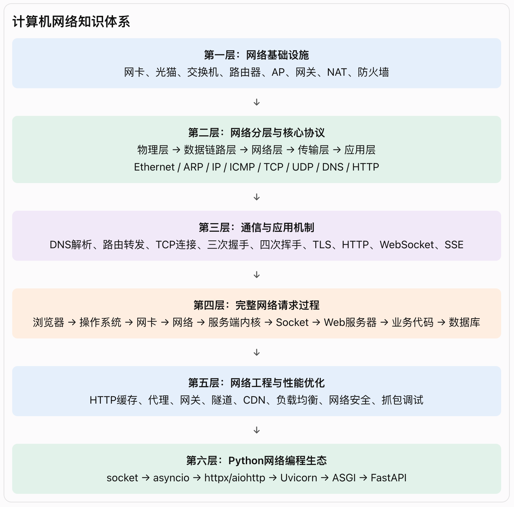
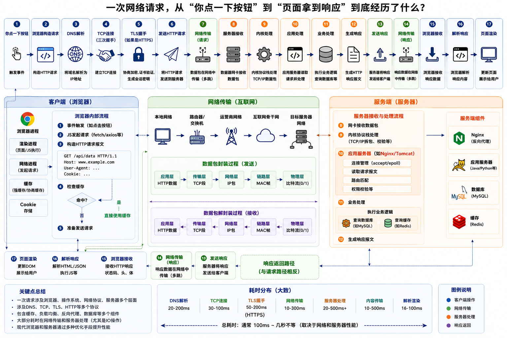

# 计算机网络-2-网络请求



## 目录

7. [应用层：HTTP、HTTPS、HTTP/2、HTTP/3](#7-应用层httphttpshttp2http3)
8. [实时通信：WebSocket 与 SSE](#8-实时通信websocket-与-sse)
9. [HTTP 缓存：第一次请求与第二次请求](#9-http-缓存第一次请求与第二次请求)
10. [一次完整网络请求：从浏览器到 Python 服务端](#10-一次完整网络请求从浏览器到-python-服务端)

---

# 7. 应用层：HTTP、HTTPS、HTTP/2、HTTP/3

## 7.1 HTTP 是什么

HTTP（Hypertext Transfer Protocol）是应用层请求/响应协议。

典型 HTTP/1.1 请求：

```http
GET /api/users/1 HTTP/1.1
Host: example.com
Accept: application/json
User-Agent: ExampleClient/1.0
```

典型响应：

```http
HTTP/1.1 200 OK
Content-Type: application/json
Cache-Control: no-store

{"id": 1, "name": "Tom"}
```

HTTP 定义方法、状态码、首部字段、消息语义等。底层使用什么传输方式，取决于 HTTP 版本。

## 7.2 HTTP 版本演进

| 版本     | 主要特点                           | 底层传输         |
| -------- | ---------------------------------- | ---------------- |
| HTTP/0.9 | 极简 GET，仅返回 HTML              | TCP              |
| HTTP/1.0 | 引入请求/响应头、状态码等          | TCP              |
| HTTP/1.1 | 默认持久连接、Host、分块传输编码等 | TCP              |
| HTTP/2   | 二进制分帧、多路复用、HPACK 头压缩 | TCP              |
| HTTP/3   | 基于 QUIC，减少 TCP 层队头阻塞     | QUIC（基于 UDP） |

### HTTP/1.1

- 支持持久连接（Keep-Alive），一个 TCP 连接可以承载多个请求/响应。
- 传统管线化（pipelining）支持有限，响应顺序等限制使其实际应用不广泛。
- 浏览器可能对同一源建立多个连接，但“每个域名固定 6 个连接”不是协议保证，具体取决于浏览器和场景。
- `Transfer-Encoding: chunked` 可用于分块传输动态生成的响应，不要求事先知道完整内容长度。
- HTTP/1.1 的文本消息格式不意味着响应体只能是文本，响应体可以是二进制数据。

### HTTP/2

- 使用二进制分帧。
- 通过 Stream ID 将帧归属到不同数据流。
- 多个流可以在同一个 TCP 连接上交错传输。
- 使用 HPACK 压缩 HTTP 头部。
- 可选服务器推送能力，但实际浏览器生态中已弱化/弃用，不能把它当成现代 Web 的主要推送方案。

关键纠正：

HTTP/2 解决了 HTTP/1.1 应用层请求排队造成的部分队头阻塞，但底层仍然是 TCP。一个 TCP 段丢失时，TCP 必须按序向上交付字节流，可能影响同一连接上的多个 HTTP/2 流。这是 TCP 层队头阻塞。

### HTTP/3

- HTTP/3 使用 QUIC。
- QUIC 基于 UDP，但在 QUIC 内部实现可靠传输、拥塞控制、加密和多路复用等机制。
- 不同 QUIC Stream 的数据传输可以相对独立，一个流丢包不必阻塞其他流的数据交付。
- QUIC 集成 TLS 1.3 握手机制，减少连接建立开销。
- QUIC 由 IETF 标准化，不应只称为“谷歌出的优化”。

## 7.3 HTTPS 与 TLS

HTTPS = HTTP over TLS。

TLS 为应用数据提供：

- **机密性**：防止旁观者直接读取传输内容。
- **完整性**：检测数据是否被篡改。
- **身份认证**：通常通过服务器证书验证服务器身份。

HTTPS 常用端口为 443，HTTP 常用端口为 80，但端口可以配置为其他值。

### TLS 证书验证

证书通常包含服务器身份信息和服务器公钥，并由证书颁发机构（CA）签名。

客户端通常会检查：

1. 证书链是否能追溯到受信任的根证书。
2. 证书域名是否与访问域名匹配。
3. 证书是否在有效期内。
4. 证书用途、算法和其他策略是否满足要求。
5. 是否存在吊销等需要检查的状态（具体取决于客户端策略）。

CA 的作用不是“把证书内容加密后交还企业”，而是通过数字签名证明证书内容由受信任的签发者签发且未被篡改。

### TLS 握手的现代理解

```text
客户端                                  服务端
  |                                       |
  | -------- ClientHello ---------------> |
  |   支持版本、密码套件、随机数、密钥交换参数等
  |                                       |
  | <------- ServerHello ---------------- |
  |   选择参数、密钥交换相关信息等
  | <------- Certificate ----------------|
  | <------- Finished 等 ----------------|
  |                                       |
  | 客户端验证证书、完成密钥协商与握手确认
  |                                       |
  | ===== 后续应用数据使用会话密钥保护 ===== |
```

现代 TLS 1.3 通常使用（椭圆曲线）Diffie-Hellman 密钥交换协商共享密钥材料，而不是普遍采用“客户端用服务器证书公钥加密一个对称密钥、服务器私钥解密”的旧式 RSA 密钥传输流程。

核心理解：

- 非对称密码学/密钥交换用于身份认证和协商共享密钥。
- 对称加密用于后续大量应用数据传输，效率更高。
- 证书签名验证与数据加密是不同的事情。
- TLS 1.3 使用经过认证的加密算法（AEAD）保护数据。

## 7.4 HTTP 状态码

| 类别 | 含义               | 常见状态码                   |
| ---- | ------------------ | ---------------------------- |
| 1xx  | 信息响应           | 100、101                     |
| 2xx  | 成功               | 200、201、202、204           |
| 3xx  | 重定向/缓存相关    | 301、302、303、304、307、308 |
| 4xx  | 客户端请求相关错误 | 400、401、403、404、405、429 |
| 5xx  | 服务端处理错误     | 500、502、503、504           |

常见状态码：

- `200 OK`：请求成功。
- `201 Created`：资源创建成功。
- `202 Accepted`：请求已接受处理，但处理未必完成。
- `204 No Content`：成功，但没有响应体。
- `301 Moved Permanently`：永久重定向。
- `302 Found`：临时重定向；客户端对方法的处理存在历史兼容行为。
- `303 See Other`：客户端应使用 GET（或 HEAD）访问另一个 URI。
- `304 Not Modified`：协商缓存验证通过，不需要重新传输资源主体。
- `307 Temporary Redirect`：临时重定向，要求保留原请求方法和请求体。
- `308 Permanent Redirect`：永久重定向，要求保留原请求方法和请求体。
- `400 Bad Request`：请求格式或内容不符合服务端要求。
- `401 Unauthorized`：缺少或无效的身份认证凭证，通常需要认证。
- `403 Forbidden`：服务端拒绝执行请求，通常不是简单地“再登录一次”就能解决。
- `404 Not Found`：资源不存在或服务端不愿透露其存在。
- `405 Method Not Allowed`：资源不支持该 HTTP 方法。
- `429 Too Many Requests`：请求过于频繁。
- `500 Internal Server Error`：服务端内部错误。
- `502 Bad Gateway`：网关/代理从上游收到无效响应。
- `503 Service Unavailable`：服务暂时不可用。
- `504 Gateway Timeout`：网关/代理等待上游响应超时。

补充：301、302 在历史上可能导致 POST 转 GET 的客户端行为；303 明确引导使用 GET；307、308 要求保留方法。

---

# 8. 实时通信：WebSocket 与 SSE

## 8.1 WebSocket

WebSocket 提供客户端与服务端之间的双向通信通道。

- 初始握手通常通过 HTTP Upgrade 机制发起。
- 握手成功后，协议升级为 WebSocket。
- 双方可以独立发送消息。
- 适合聊天、实时协作、在线状态、实时行情等。

浏览器示例：

```javascript
const ws = new WebSocket("wss://example.com/ws");

ws.onopen = () => {
  ws.send(JSON.stringify({ type: "hello" }));
};

ws.onmessage = (event) => {
  console.log("收到消息：", event.data);
};

ws.onerror = (event) => {
  console.error("WebSocket 错误", event);
};

ws.onclose = () => {
  console.log("连接关闭");
};
```

- `ws://`：明文 WebSocket。
- `wss://`：通过 TLS 保护的 WebSocket。

纠正：WebSocket 并不是“建立一次 Request/Response 后就只剩 TCP”。它在底层连接上使用 WebSocket 自身的帧协议；可以双向发送消息，并有 Ping/Pong、Close 等控制帧。

## 8.2 SSE（Server-Sent Events）

SSE 是基于 HTTP 的服务器到客户端单向事件流。

特点：

- 服务端持续向客户端推送文本事件。
- 浏览器使用 `EventSource` 接收。
- 默认支持断线重连机制。
- 支持事件 ID、事件类型和重试时间等字段。
- 客户端到服务端的业务数据通常仍通过普通 HTTP 请求发送。

浏览器示例：

```javascript
const source = new EventSource("/events");

source.onmessage = (event) => {
  console.log(event.data);
};

source.onerror = () => {
  console.log("连接异常，浏览器可能会尝试重连");
};

// 不再需要时
source.close();
```

SSE 响应通常使用：

```http
Content-Type: text/event-stream
Cache-Control: no-cache
```

事件格式示例：

```text
id: 100
event: progress
data: {"percent": 50}

```

## 8.3 HTTP、SSE、WebSocket 对比

| 维度     | 普通 HTTP          | SSE                         | WebSocket                |
| -------- | ------------------ | --------------------------- | ------------------------ |
| 通信方向 | 通常请求/响应      | 服务端 → 客户端             | 双向                     |
| 连接     | 可短连接或持久连接 | 长时间 HTTP 响应            | 长时间双向连接           |
| 数据形式 | 多种媒体类型       | 文本事件流                  | 帧，可承载文本/二进制    |
| 自动重连 | 应用自行处理       | EventSource 默认支持        | 通常应用自行实现         |
| 适用场景 | CRUD、接口调用     | 进度、通知、日志流、AI 输出 | 聊天、协作、双向实时交互 |

选择原则：

- 普通接口请求：HTTP。
- 主要是服务端持续推送：优先评估 SSE。
- 双向实时通信：评估 WebSocket。

---

# 9. HTTP 缓存：第一次请求与第二次请求

## 9.1 缓存按什么识别

浏览器缓存并非简单地 “按IP缓存”。HTTP 缓存主要依据请求URI和 缓存规则，并会考虑 `Vary` 等请求头维度。

示例：`https://example.com:443/js/app.js?v=1`

不同 URL 通常是不同缓存键；即使 URL 相同，也可能因请求方法、Vary、缓存指令、认证信息等因素产生不同缓存行为。

### 真正“决定要不要发请求”的是 浏览器， 准确说：浏览器网络模块（network stack）在检查缓存

1. 第一道关卡：强缓存（直接拦截，不发请求）
2. 第二道关卡：协商缓存（发请求，但可能不传数据）
3. 开发者视角的“缓存干预”，
   - 普通刷新（F5）：跳过强缓存，强制走协商缓存。
   - 强制刷新（Ctrl + F5 / Cmd + Shift + R）：直接无视所有缓存，强制向服务器请求最新资源。
   - 跨端开发中的特殊处理：在做移动端混合开发（比如用 WebView 嵌 H5）时，底层的缓存策略可能和标准浏览器不同。
     1. 比如在 Android 开发中，我们可以通过代码（如 WebSettings.LOAD_NO_CACHE）直接干预 WebView 的网络栈行为，强制它不走缓存。

- 浏览器内部大概结构

  ```bash
    JS代码
      ↓
    fetch/axios
      ↓
    浏览器 Web API
      ↓
    浏览器网络模块
      ↓
    缓存检查
      ↓
    决定是否联网
  ```

## 9.2 强缓存与协商缓存

### 强缓存

浏览器判断本地响应仍然新鲜时，可以直接使用缓存，不必向源服务器发起验证请求。

常见响应头：

```bash
  # 1. Cache-Control（现代主流）
  Cache-Control: max-age=3600：响应在指定秒数内可视为新鲜。
               : public：允许共享缓存存储。
               : private：只能由私有缓存存储，不允许共享缓存存储。
               : no-cache：可以存储，但复用前需要重新验证。
               : no-store：不应存储该响应。
               : must-revalidate：响应过期后必须成功重新验证，不能随意使用过期响应。

               #❗ 注意：`no-cache` 不等于“不缓存”，`no-store` 才是要求不存储。


   # 2. Expires（老方案）
   Expires: Wed, 21 Oct 2026 07:28:00 GMT # 是较早的绝对过期时间机制
```

### 协商缓存

本地响应 "过期或需要重新验证" 时，浏览器可以带 "验证器" 向服务器 询问 资源是否变化。

常见验证器(服务端第一次返回的)：

```http
1. ETag: "abc123"
2. Last-Modified: Wed, 01 May 2026 12:00:00 GMT
```

下一次请求可能携带：

```http
1. If-None-Match: "abc123"
2. If-Modified-Since: Wed, 01 May 2026 12:00:00 GMT
```

服务器判断：

- 资源未变化：返回 `304 Not Modified`，通常不带资源主体。
- 资源已变化：返回 `200 OK` 和新资源。

一般优先使用 ETag 验证；Last-Modified 的时间精度通常为秒，可能无法识别同一秒内的多次变化。

#### 为什么协商缓存还要发请求？

因为：浏览器不确定资源有没有更新，只能问服务器。

## 9.3 第一次与第二次请求流程

```text
第一次请求
   ↓
服务器返回 200 + 资源 + 缓存策略/验证器
   ↓
浏览器按规则保存响应

第二次请求
   ↓
检查是否存在可用缓存
   ↓
缓存是否新鲜、是否需要验证？
   ├── 可直接复用 → 使用本地缓存
   └── 需要验证 → 发送条件请求
                    ↓
              服务器检查资源
                 ├── 未变化 → 304
                 └── 已变化 → 200 + 新资源
```

## 9.4 Memory Cache、Disk Cache 与 Service Worker

- Memory Cache：浏览器进程使用的内存缓存，生命周期可能较短。
- Disk Cache：浏览器磁盘缓存，通常可以跨页面或浏览器重启保留，具体由浏览器策略决定。
- Service Worker：可以拦截受其作用域控制的请求，并通过 Cache API 等实现自定义缓存策略。

不能把三者理解为所有浏览器都严格遵循的固定优先级链。实际请求路径受浏览器实现、Service Worker、缓存模式、开发者工具设置和请求类型影响。

## 9.5 第二次请求是否还需要 DNS、TCP、TLS？

不一定：

- DNS 可能命中本地或递归解析器缓存【不需要重新 DNS 解析】。
- TCP 可能复用已有持久连接【不需要重新三次握手】。
- TLS 可能复用连接，或使用会话恢复机制【不需要完整 TLS 握手】。
- 强缓存可能使浏览器完全不发起网络请求。
- 如果使用 HTTP/3，则底层是 QUIC，不是 TCP。

因此，“第二次请求一定重新 DNS、三次握手、TLS 握手”是错误的。

---

# 10. 一次完整网络请求：从浏览器到 Python 服务端

👉 访问 google.com 时：

1. DNS → 获取IP
2. 判断是否同网段
3. ARP → 找网关MAC
4. 发给网关
5. 路由器查路由表
6. NAT转换公网IP
7. 经过互联网（BGP）
8. 到达服务器
9. TCP建立连接
10. HTTP请求数据



## 10.1 全景流程

以浏览器通过 HTTPS 请求 FastAPI 服务为例：

```text
用户点击按钮
   ↓
JavaScript 调用 fetch / axios
   ↓
浏览器网络模块检查 Service Worker 和 HTTP 缓存
   ↓
必要时解析域名 DNS
   ↓
选择目标 IP 与路由
   ↓
必要时建立传输连接
   ├── HTTP/1.1、HTTP/2：TCP
   └── HTTP/3：QUIC（基于 UDP）
   ↓
HTTPS 场景完成 TLS / QUIC 加密握手
   ↓
发送 HTTP 请求
   ↓
本机操作系统网络协议栈
   ↓
网卡发送数据
   ↓
交换机、路由器、运营商网络等转发
   ↓
服务端网卡接收数据
   ↓
服务端操作系统网络协议栈
   ↓
Socket 接收缓冲区
   ↓
Nginx / 负载均衡器（如果部署了）
   ↓
Uvicorn（ASGI 服务器）
   ↓
FastAPI 路由与依赖处理
   ↓
业务逻辑
   ↓
Redis / 数据库 / 其他服务
   ↓
生成 HTTP 响应
   ↓
沿网络链路返回客户端
   ↓
浏览器处理响应并更新页面
```

## 10.2 浏览器发起请求

```javascript
const response = await fetch("/api/users/1");
const data = await response.json();
```

大致涉及：

1. JavaScript 调用 Web API。
2. 浏览器处理 URL、请求头、Cookie、缓存、安全策略等。
3. 浏览器网络模块决定如何发送请求。
4. 浏览器可能复用连接，也可能新建连接。

## 10.3 DNS、连接与 TLS

依次解决：

- DNS：获取目标 IP。
- 路由与邻居发现：确定下一跳和链路层交付地址。
- TCP 或 QUIC：建立传输通道。
- TLS：保护 HTTPS 数据并验证服务端身份。

实际执行顺序会受协议版本、缓存、代理、连接复用等影响。

## 10.4 数据封装与发送

以 HTTP/1.1 + HTTPS + TCP 为例：

```text
HTTP 请求
   ↓ TLS 加密与记录封装
TLS 数据
   ↓ TCP 分段
TCP Segment
   ↓ IP 封装
IP Packet
   ↓ 以太网/Wi-Fi 封装
Frame
   ↓
物理介质传输
```

TLS 不是简单地在每个 TCP 包前面插入一个独立的“TLS 层头部”；TLS 记录会承载加密后的应用数据，底层 TCP 负责字节流传输。

## 10.5 服务端接收数据

以 Linux 服务端为例，粗略过程：

1. 网卡接收数据帧。
2. 网卡通过 DMA 等机制与内存交换数据，CPU 和内核参与后续处理。
3. 内核网络协议栈处理链路层、IP、TCP。
4. TCP 按序处理字节流，并将数据放入对应 Socket 接收缓冲区。
5. 应用通过 Socket API 读取数据。

纠正：DMA 并不是“完全不经过 CPU”；它减少 CPU 直接搬运数据的工作，但仍需要 CPU 配置、处理中断/轮询和执行协议栈等工作。

## 10.6 服务端应用处理

如果部署结构是：

```text
客户端
  ↓
Nginx
  ↓
Uvicorn
  ↓
FastAPI
  ↓
业务服务
  ↓
Redis / PostgreSQL
```

各层职责：

- Nginx：反向代理、TLS 终止（若配置）、静态资源、负载均衡等。
- Uvicorn：ASGI 服务器，负责接入连接、解析 HTTP 并调用 ASGI 应用。
- FastAPI：路由匹配、参数解析、依赖注入、请求校验、响应生成。
- 业务代码：实现实际业务规则。
- Redis/数据库：存储和读取数据。

不是所有项目都必须有 Nginx；Uvicorn 也可以直接对外提供服务，但生产部署通常还需要结合反向代理、进程管理、TLS、限流等进行设计。

## 10.7 浏览器处理响应

- JSON：JavaScript 读取并解析。
- HTML：浏览器解析 HTML，构建 DOM；解析 CSS，构建 CSSOM；形成渲染树并进行布局、绘制、合成等过程。
- 图片、字体、脚本等资源可能触发后续请求。

---
