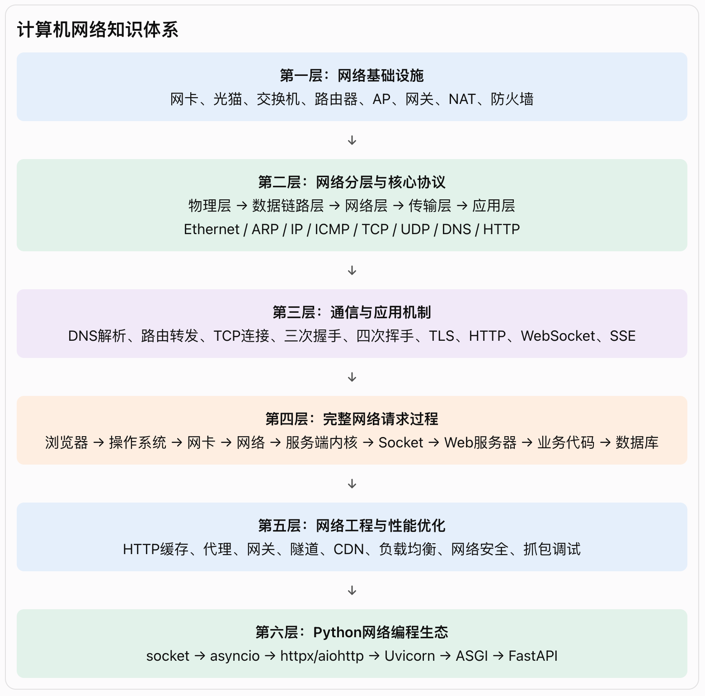

# 计算机网络-3-服务端



## 目录

11. [Socket、Linux 内核与 I/O 多路复用](#11-socketlinux-内核与io-多路复用)
12. [代理、网关、隧道、CDN 与负载均衡](#12-代理网关隧道cdn-与负载均衡)
13. [常见网络安全问题](#13-常见网络安全问题)
14. [网络抓包与调试工具](#14-网络抓包与调试工具)

15. [常见概念辨析与易错点](#16-常见概念辨析与易错点)
16. [学习路线与最终总结](#17-学习路线与最终总结)

---

# 11. Socket、Linux 内核与 I/O 多路复用

## 11.1 Socket 是什么

Socket 是操作系统提供的网络通信编程接口/通信端点抽象。

应用程序通常不直接操作网卡，也不自行实现 TCP 协议，而是通过 Socket API 与内核网络协议栈交互。

常见 Socket 类型：

- `SOCK_STREAM`：常用于 TCP 字节流。
- `SOCK_DGRAM`：常用于 UDP 数据报。

Python 示例：

```python
import socket

client = socket.socket(socket.AF_INET, socket.SOCK_STREAM)
client.connect(("example.com", 80))

client.sendall(
    b"GET / HTTP/1.1\r\n"
    b"Host: example.com\r\n"
    b"Connection: close\r\n\r\n"
)

data = b""
while True:
    chunk = client.recv(4096)
    if not chunk:
        break
    data += chunk

client.close()
print(data.decode("utf-8", errors="replace"))
```

实际开发通常使用成熟 HTTP 客户端，而不是手写 HTTP 协议解析。

## 11.2 Socket 与 TCP 的关系

```text
Python 应用
   ↓ socket API
操作系统内核
   ↓ TCP/IP 协议栈
网卡
   ↓
网络
```

- TCP 是通信协议。
- Socket 是程序使用网络能力的接口抽象。
- HTTP 是运行在传输通道之上的应用协议。

HTTP、WebSocket、Redis、MySQL 等网络服务通常会通过 Socket 进行通信，但它们不是同一种应用协议。

## 服务端 Socket 生命周期

典型 TCP 服务端：

```text
socket()
  ↓
bind()       绑定本地 IP 与端口
  ↓
listen()     开始监听
  ↓
accept()     取得已建立连接
  ↓
recv()/send() 读写字节流
  ↓
close()      关闭连接
```

bind(0.0.0.0, port) 通常表示监听所有 IPv4 本地接口；`127.0.0.1` 只接受本机回环接口访问。IPv6 监听行为还受地址族和系统配置影响。

## 阻塞、非阻塞、同步与异步

这几组概念不要混成一组：

- 阻塞/非阻塞：调用在条件未满足时是否等待。
- 同步/异步：调用方如何获知操作完成、结果如何交付。
- 并发/并行：任务是否在时间上交错推进，或真正同时执行。

非阻塞 I/O 不等于异步业务；异步框架也不意味着每段代码都在并行执行。

## 11.3 I/O 多路复用

服务端可能同时维护大量连接。如果每个连接都由一个线程阻塞等待，线程数量和调度开销可能很高。

I/O 多路复用让一个或少量线程监视多个 Socket 的 I/O 就绪状态。

常见机制：

| 机制   | 说明                                                                 |
| ------ | -------------------------------------------------------------------- |
| select | 经典接口，通常有描述符数量限制，检查集合的开销较明显                 |
| poll   | 使用 pollfd 数组，没有 select 的固定 FD_SETSIZE 位图限制，但仍需扫描 |
| epoll  | Linux 提供，适合大量连接的就绪事件通知                               |

注意：

- epoll 通知的是 I/O 就绪，不是替应用自动完成全部数据读取和业务处理。
- I/O 就绪不意味着一次读取就拿到完整 HTTP 请求。
- epoll 是 Linux 特有机制；macOS 常用 kqueue，Windows 常见 IOCP。
- asyncio 是 Python 的异步编程框架，其事件循环会使用平台适配的 I/O 机制，不应简单说所有平台的 asyncio 都依赖 epoll。

---

# 12. 代理(proxy)、网关(gateway)、隧道(tunnel)、CDN 、负载均衡 与 可靠性

## 12.1 正向代理与反向代理

### 正向代理

代理 代表 客户端访问外部服务。
`客户端 → 正向代理 → 目标服务器`

常见用途：

- 企业出口代理。
- 访问控制与审计。
- 缓存。
- 网络访问策略。

### 反向代理

代理 代表 服务端接收客户端请求，并转发到后端服务。
`客户端 → Nginx/反向代理 → 后端应用`

常见用途：

- TLS 终止。
- 负载均衡。
- 路由转发。
- 限流、访问控制。
- 静态资源服务。

## 12.2 Proxy、Gateway、Tunnel

| 概念           | 核心作用                                        | 理解重点                             |
| -------------- | ----------------------------------------------- | ------------------------------------ |
| Proxy          | 代替一方转发请求                                | 可以解析、修改、缓存、过滤           |
| Gateway(网关)  | 不同网络或系统间的入口/转换点                   | 含义广泛，不等同于某一种代理         |
| Tunnel（隧道） | 将“一种协议的数据” 封装在 “另一种协议里中” 传输 | 重点是封装和传输，不一定解析内部负载 |

- HTTP 代理转发时可能追加 `Via` 等字段，但具体行为取决于代理实现和协议要求。
- 现代 API Gateway、网络网关常常具备认证、限流、过滤、协议转换等能力【❗海关 + 翻译官】。
- 隧道: 通常不解析内部应用负载，但隧道端点仍然需要处理外层封装【❗偷渡】。

## 12.3 CDN

CDN（Content Delivery Network）通过分布在不同区域的边缘节点缓存和分发内容，减少访问源站的距离和负载。

```text
用户
 ↓
DNS / 调度
 ↓
附近 CDN 边缘节点
 ├── 缓存命中 → 直接返回
 └── 缓存未命中 → 回源获取
```

适合静态资源、下载文件、图片、视频等；动态内容也可结合缓存策略、边缘计算等方式处理。

## 12.4 负载均衡

负载均衡把请求分配给多个后端实例。

常见策略：

- 轮询。
- 加权轮询。
- 最少连接。
- 一致性哈希。
- 基于健康检查摘除异常实例。

负载均衡可以位于四层（TCP/UDP）或七层（HTTP 等应用层）。

## 12.5 超时、重试、幂等与熔断

生产服务需要对不同阶段设置超时：

- DNS 解析超时。
- TCP 连接超时。
- TLS 握手超时。
- 读取超时。
- 整体请求 deadline。
- 数据库连接与查询超时。

重试原则：

1. 只对可恢复错误重试。
2. 设置最大次数和总时间预算。
3. 使用指数退避和随机抖动，避免所有客户端同时重试。
4. 对非幂等操作谨慎重试。
5. 使用幂等键（Idempotency-Key）等机制保护创建订单、支付等操作。
6. 区分“请求没发出去”“服务端没收到”“服务端处理了但响应丢失”等情况。

### 12.5.1 重试与幂等示例

客户端 POST 创建订单，服务端已成功创建，但响应在网络中丢失。客户端无法仅凭超时判断服务端是否执行成功。若直接重试，可能重复创建。可以通过业务幂等键，让服务端识别同一业务操作。

### 12.5.2 限流、熔断与背压

- 限流：限制单位时间内请求量，保护服务容量。
- 熔断：下游持续失败时暂时停止调用，避免故障扩散。
- 背压：下游处理能力不足时，向上游传递压力或降低接收速度，避免无限堆积。
- 负载隔离：将不同类型任务或租户的资源隔离，避免互相拖垮。

### 12.5.3 连接与容量管理

容量评估不能只看“并发请求数”，还要看：

- 活跃 TCP/QUIC 连接数。
- 每个 Worker 的并发模型。
- 连接池大小。
- 请求平均耗时与尾延迟。
- CPU、内存、文件描述符、Socket 缓冲区。
- 数据库连接数和下游服务容量。
- 长连接（SSE/WebSocket）占用的资源。

### 12.5.4 代理头与客户端真实 IP

反向代理后，应用看到的 TCP 对端通常是代理，而不一定是原始客户端。常见转发头：

- Forwarded
- X-Forwarded-For
- X-Forwarded-Proto
- X-Real-IP
- Via

这些头只有在可信代理正确写入、应用正确配置可信代理范围时才能作为来源信息。不能无条件相信客户端自己提交的 X-Forwarded-For，否则可能被伪造。

Via 可用于标识消息经过的代理，帮助追踪代理链路。

---

# 13. 常见网络安全问题

| 风险          | 说明                                 | 常见防护方向                      |
| ------------- | ------------------------------------ | --------------------------------- |
| DNS 劫持/污染 | 解析结果被恶意篡改或误导             | HTTPS、可信 DNS、监控解析异常     |
| ARP 欺骗      | 局域网内伪造 IP-MAC 映射             | 交换机安全能力、网络隔离          |
| IP 欺骗       | 伪造源 IP                            | 入站/出站过滤、协议层校验         |
| 中间人攻击    | 攻击者插入通信链路                   | 正确验证 TLS 证书                 |
| DDoS          | 大量流量耗尽资源                     | CDN、清洗、限流、容量规划         |
| 端口扫描      | 探测主机开放服务                     | 最小暴露面、防火墙、监控          |
| SYN Flood     | 大量半连接消耗资源                   | SYN cookies、队列与边界防护       |
| 请求走私      | 代理与后端对 HTTP 消息边界理解不一致 | 统一解析、修复代理链配置          |
| SSRF          | 服务端被诱导访问非预期地址           | 出站访问控制、目标地址校验        |
| CSRF          | 借用用户浏览器自动携带的凭据发起操作 | CSRF Token、SameSite、Origin 校验 |
| XSS           | 恶意脚本在用户浏览器执行             | 输出编码、CSP、输入处理           |

TLS 不能防止所有攻击：它保护传输链路，但不能替代授权、输入校验、业务风控和服务端安全设计。

## 13.1 DoS / DDoS

- DoS：通过大量请求或资源消耗使服务不可用。
- DDoS：由多个来源协同发起分布式拒绝服务攻击。

防护思路：

- 流量清洗与 DDoS 防护服务。
- CDN、Anycast 等基础设施。
- 限流、连接数限制、超时。
- 资源隔离与弹性扩容。
- 对异常流量进行监控和告警。

单纯“封 IP”通常不足以解决分布式攻击。

## 13.2 ARP 欺骗

攻击者伪造 ARP 应答，诱导局域网设备把某个 IP 错误映射到攻击者 MAC，可能导致流量劫持或中间人攻击。

防护：交换机安全机制、动态 ARP 检测、静态绑定（适用场景有限）、网络隔离、加密通信。

## 13.3 XSS（跨站脚本攻击）

攻击者让恶意脚本在受害者浏览器的可信站点上下文中执行。

常见类型：

- 存储型 XSS。
- 反射型 XSS。
- DOM 型 XSS。

防护：

- 根据输出上下文进行正确编码。
- 避免不安全地拼接 HTML。
- 使用安全的模板机制。
- 配置 CSP。
- Cookie 合理使用 HttpOnly、Secure、SameSite。

## 13.4 SQL 注入

攻击者将恶意输入拼接进 SQL 语句，改变原本查询逻辑。

错误做法：

```python
sql = f"SELECT * FROM users WHERE name = '{name}'"
```

正确方向：使用参数化查询。

```python
cursor.execute(
    "SELECT * FROM users WHERE name = %s",
    (name,)
)
```

具体占位符写法取决于数据库驱动。

## 13.5 CSRF（跨站请求伪造）

攻击者诱导已登录用户的浏览器向目标网站发送非预期请求，浏览器可能自动附带 Cookie。

防护：

- CSRF Token。
- SameSite Cookie。
- Origin/Referer 校验。
- 对敏感操作使用合理的重新认证或二次确认。

## 13.6 HTTPS 中间人攻击

如果攻击者能控制网络链路，可能尝试拦截或篡改通信。

正确验证 TLS 证书可以有效抵御普通中间人攻击。用户忽略证书警告、安装不可信根证书、客户端错误关闭证书验证等会削弱保护。

抓包工具在安装并信任其根证书后，可能对 HTTPS 做受控解密代理；这不意味着 HTTPS 本身没有加密。

## 13.7 其他后端开发安全重点

- 不要关闭 TLS 证书验证。
- 使用安全的 Cookie 属性。
- 对输入做校验，但不要把校验当作 SQL 注入的唯一防线。
- 设置请求体大小、超时和并发限制。
- 不要在日志中泄露密码、Token、密钥和个人敏感信息。
- 对内部管理接口实施身份认证和权限控制。
- 及时更新依赖并管理密钥。

---

# 14. 网络抓包与调试工具

| 工具                     | 主要用途                 | 常用命令/场景                                         |
| ------------------------ | ------------------------ | ----------------------------------------------------- |
| `ping`                   | ICMP 可达性与 RTT        | `ping example.com`                                    |
| `traceroute` / `tracert` | 查看路由路径             | `traceroute example.com`                              |
| `dig` / `nslookup`       | DNS 查询                 | `dig example.com A`                                   |
| `curl`                   | 发起 HTTP 请求、查看响应 | `curl -v https://example.com`                         |
| `nc` / `netcat`          | TCP/UDP 连通性测试       | `nc -vz host 443`                                     |
| `ss` / `netstat`         | 查看 Socket、端口状态    | `ss -lntp`                                            |
| `tcpdump`                | 命令行抓包               | `tcpdump -i any port 443`                             |
| Wireshark                | 图形化分析协议           | 分析 DNS、TCP、TLS、HTTP 等                           |
| 浏览器 DevTools          | 查看请求、缓存、时序     | Network 面板                                          |
| `openssl s_client`       | TLS 握手和证书排查       | `openssl s_client -connect host:443 -servername host` |

HTTPS 内容通常被 TLS 加密，普通链路抓包未必能直接看到 HTTP 明文；可以分析握手、证书、时序、包大小和连接行为，或在受控调试环境使用合法的解密配置。

## 14.1 curl

`curl` 是命令行 HTTP/多协议客户端，不是浏览器，也不是代理服务器。

常用命令：

```bash
# 发起 GET 请求
curl https://example.com

# 只请求响应头（HEAD）
curl -I https://example.com

# 显示请求与响应过程
curl -v https://example.com

# 输出响应头和响应体
curl -i https://example.com

# 发送 JSON
curl -X POST https://example.com/api \
  -H "Content-Type: application/json" \
  -d '{"name":"Tom"}'

# 指定请求头
curl -H "Authorization: Bearer TOKEN" https://example.com/api
```

区别：

- `-I`：发送 HEAD 请求，服务器应返回与 GET 对应的响应头语义，但不返回响应体。
- `-i`：在输出中包含响应头和响应体。
- `-v`：显示连接、TLS、请求/响应等调试细节。

## 14.2 Wireshark

图形化网络协议分析工具。

用途：

- 查看 DNS 查询与响应。
- 分析 TCP 三次握手、四次挥手。
- 查看 TCP 重传、乱序、窗口等。
- 分析 HTTP 等明文协议。
- 观察 TLS 握手元数据。

HTTPS 应用数据通常是加密的；没有合法解密条件时，不能直接看到明文请求体。

## 14.3 Whistle / Fiddler / Charles

HTTP(S) 调试代理工具，常用于：

- 抓取请求和响应。
- 修改请求头、响应头。
- 重写 URL。
- Mock 响应。
- 请求重放。
- 分析移动端或浏览器接口。

HTTPS 抓包通常需要在测试设备上安装并信任代理工具的 CA 证书；仅安装代理程序不代表就能解密所有 HTTPS 流量。

Whistle 官方文档：<https://wproxy.org/whistle/>

## 14.4 常用排查顺序

```text
1. 域名是否解析正确？
   nslookup / dig

2. 目标 IP 是否可达？
   ping（仅作参考，可能被禁）
   traceroute / tracert

3. 目标端口是否能建立连接？
   nc / telnet / curl

4. TLS 是否正常？
   curl -v / openssl s_client

5. HTTP 请求是否正确？
   curl -v / Whistle / Fiddler

6. 服务端是否收到请求？
   Nginx 日志 / 应用日志

7. 应用是否处理成功？
   FastAPI 日志 / Trace ID

8. 数据库或下游服务是否异常？
   数据库日志 / Redis / 链路追踪
```

## 14.5 关于“每个包不超过 64KB”

这句话不准确。

- 以太网 MTU 常见为 1500 字节（不含以太网头部），但具体网络可能不同。
- IPv4 的总长度字段最大可表示 65535 字节，但实际传输通常受 MTU 限制。
- TCP 是字节流，会按 MSS 等因素分段；MSS 常见为 MTU 扣除 IP/TCP 头部后的数据长度。
- UDP 单个数据报长度也有协议上限，但实际可用大小受路径 MTU 限制。
- IP 分片、路径 MTU 发现、隧道封装等都会影响实际包大小。

不要把 64KB 当成所有网络包的固定大小上限。

---

## 从现象到层次定位

| 现象                     | 优先检查                                 |
| ------------------------ | ---------------------------------------- |
| 域名无法解析             | DNS、Hosts、递归解析器                   |
| IP 可达但端口不通        | 路由、防火墙、安全组、监听状态           |
| TCP 建连成功但 HTTP 报错 | HTTP 方法、路径、头、请求体、状态码      |
| TLS 握手失败             | 证书、域名、时间、SNI、协议版本、信任链  |
| 只有浏览器跨域失败       | CORS、预检、凭据配置                     |
| 第一次慢、第二次快       | DNS 缓存、连接复用、HTTP 缓存、应用缓存  |
| 偶发 502/504             | 代理上游、应用可用性、超时、连接池       |
| 服务高并发时卡顿         | Worker、I/O 模型、CPU、连接池、下游容量  |
| WebSocket 经代理断开     | Upgrade 转发、空闲超时、心跳、代理配置   |
| SSE 不持续输出           | 缓冲、压缩、代理超时、响应头、应用 flush |

## 性能分析的分层指标

- DNS：解析耗时、失败率。
- 连接：TCP connect、TLS handshake、连接复用率。
- HTTP：TTFB、总耗时、状态码、响应大小。
- 服务端：请求排队时间、应用处理时间、错误率。
- 数据层：连接池等待、查询耗时、慢查询。
- 网络：丢包、重传、RTT、吞吐量。
- 资源：CPU、内存、文件描述符、连接数。

# 16. 常见概念辨析与易错点

- 网络基础与分层

  | 容易混淆的概念     | 正确理解                                                                                  |
  | :----------------- | :---------------------------------------------------------------------------------------- |
  | **IP 与 MAC**      | IP 是网络层（网际层）逻辑地址，用于跨网络寻址；MAC 是链路层物理地址，用于局域网内交付     |
  | **IP 与端口**      | IP 定位网络中的主机/网络接口；端口区分该主机上的具体传输层通信端点（进程）                |
  | **URL 与 DNS**     | URL 是资源的完整定位信息；DNS 负责将域名解析为 IP 地址记录                                |
  | **DNS 与 DHCP**    | DNS 解析名称（域名转IP）；DHCP 自动分配网络配置（IP、网关、子网掩码等）                   |
  | **路由与 NAT**     | 路由负责选择数据包的下一跳路径；NAT 负责改写数据包的源/目的 IP 地址和端口                 |
  | **交换机与路由器** | 交换机常做二层转发（依据 MAC 地址）；路由器做三层转发（依据 IP 地址），现代设备常集成两者 |
  | **网关与路由器**   | 默认网关是网络出口/下一跳的“角色”；路由器是实现该角色的常见物理或虚拟设备                 |
  | **64KB 与 MTU**    | IP 协议头中总长度字段的上限是 64KB，但不等于链路实际 MTU（常见以太网 MTU 为 1500 字节）   |

- 传输与连接

| 容易混淆的概念           | 正确理解                                                                             |
| :----------------------- | :----------------------------------------------------------------------------------- |
| **TCP 与 HTTP**          | TCP 是传输层协议，负责端到端通信；HTTP 是应用层协议，负责数据语义与格式              |
| **Socket 与 TCP**        | Socket 是操作系统提供的编程接口/端点抽象；TCP 是具体的网络传输协议                   |
| **TCP 字节流与应用消息** | TCP 提供的是无消息边界的可靠字节流，应用层需自行处理粘包/拆包                        |
| **TCP 连接与 HTTP 请求** | 一个 TCP 连接可承载多个 HTTP 请求（Keep-Alive）；HTTP/2、HTTP/3 还支持单连接多路复用 |
| **TCP 可靠与业务成功**   | TCP 仅确保传输层的字节流可靠到达，不保证应用层业务逻辑执行成功                       |
| **流量控制与拥塞控制**   | 流量控制（滑动窗口）保护接收端不被压垮；拥塞控制保护中间网络路径不被压垮             |

- 安全与加密

| 容易混淆的概念         | 正确理解                                                                                           |
| :--------------------- | :------------------------------------------------------------------------------------------------- |
| **TLS 与 HTTPS**       | TLS 是传输层安全协议；HTTPS 是应用层概念，即 HTTP over TLS                                         |
| **HTTPS 与非对称加密** | TLS 握手阶段使用非对称加密协商密钥，后续数据传输通常使用对称加密（AEAD）以保证性能                 |
| **证书与加密**         | 数字证书主要用于身份认证和公钥绑定（防中间人），它本身不是用来直接加密通信数据的文件               |
| **JWT 与加密**         | JWT 的签名（Signature）用于防篡改，Payload 默认仅做 Base64Url 编码，可被任何人解码读取，不等于加密 |

- HTTP 与应用层

| 容易混淆的概念                      | 正确理解                                                                                       |
| :---------------------------------- | :--------------------------------------------------------------------------------------------- |
| **HTTP/2 与 HTTP/3**                | HTTP/2 通常基于 TCP，存在连接级队头阻塞；HTTP/3 基于 QUIC/UDP，在传输层解决了队头阻塞          |
| **HTTP/2 多路复用与彻底无队头阻塞** | HTTP/2 虽在应用层多路复用，但底层 TCP 丢包重传仍会导致整个连接阻塞（队头阻塞）                 |
| **HTTP/3 与 UDP**                   | QUIC 协议基于 UDP 传输，但在用户空间自行实现了可靠传输、拥塞控制等类似 TCP 的能力              |
| **Cookie 与 Session**               | Cookie 是存储在客户端的键值对机制，随请求发送；Session 是存储在服务端的会话状态机制            |
| **304 与 200**                      | 200 返回完整的成功响应主体；304 表示协商缓存验证通过，客户端可复用本地缓存主体                 |
| **304 与强缓存**                    | 304 是协商缓存的验证结果；强缓存命中（如 max-age 未过期）直接读本地，不发网络请求              |
| **`no-cache` 与 `no-store`**        | `no-cache` 允许存储但每次复用前必须向服务端验证；`no-store` 严格禁止存储任何缓存               |
| **HTTP 缓存与连接复用**             | 缓存命中可能完全不发网络请求；连接复用（Keep-Alive）省去了 TCP 握手，但仍会发送 HTTP 请求      |
| **SSE 与 WebSocket**                | SSE（Server-Sent Events）是服务端到客户端的单向文本事件流；WebSocket 支持全双工双向通信        |
| **CORS 与 CSRF**                    | CORS 是浏览器端的跨源资源共享访问控制机制；CSRF 是攻击者利用浏览器自动携带凭据发起的非预期请求 |
| **502 与 504**                      | 502 Bad Gateway 表示上游服务器响应无效；504 Gateway Timeout 表示等待上游服务器响应超时         |

- Python Web 架构

  | 容易混淆的概念         | 正确理解                                                                                      |
  | :--------------------- | :-------------------------------------------------------------------------------------------- |
  | **WSGI 与 ASGI**       | 均为 Python Web 应用接口规范；WSGI 是同步规范，ASGI 支持异步、长连接及 WebSocket 场景         |
  | **ASGI 与 Uvicorn**    | ASGI 是接口规范（契约）；Uvicorn 是遵循该规范的高性能 ASGI 服务器实现                         |
  | **Uvicorn 与 FastAPI** | Uvicorn 负责网络通信与协议解析，接入并运行应用；FastAPI 负责路由、依赖注入与业务逻辑          |
  | **网关与 API Gateway** | Gateway 是广义的网络出入口概念；API Gateway 是应用层/API 流量入口的一种具体实现，强调统一治理 |

- 并发与异步

| 容易混淆的概念             | 正确理解                                                                                                   |
| :------------------------- | :--------------------------------------------------------------------------------------------------------- |
| **asyncio 与多线程**       | asyncio 是基于协程与事件循环的单线程并发模型；多线程依赖操作系统调度，存在上下文切换开销                   |
| **epoll 与 asyncio**       | epoll 是 Linux 内核提供的 I/O 多路复用底层机制；asyncio 是 Python 跨平台的异步编程框架（底层可封装 epoll） |
| **阻塞/非阻塞与同步/异步** | 是不同维度：阻塞/非阻塞描述调用线程是否挂起等待；同步/异步描述任务完成后的通知机制                         |

- 微服务与流量治理

| 容易混淆的概念             | 正确理解                                                                                      |
| :------------------------- | :-------------------------------------------------------------------------------------------- |
| **反向代理与 API Gateway** | 两者有重叠；反向代理侧重请求转发与负载均衡，API Gateway 更强调鉴权、限流、监控等 API 统一治理 |
| **限流与熔断**             | 限流控制进入系统的请求量，保护自身不被压垮；熔断在下游持续失败时快速失败，保护调用方不被拖死  |

---

# 17. 学习路线与最终总结

## 17.1 推荐学习顺序

### 第一阶段：建立网络基础

1. 网络设备：网卡、交换机、路由器、AP、网关。
2. 分层模型：OSI、TCP/IP 五层模型、封装与解封装。
3. 地址体系：MAC、IP、子网、端口。
4. DNS、ARP、DHCP、ICMP、路由和 NAT。

### 第二阶段：理解连接和传输

1. TCP 与 UDP 的区别。
2. TCP 三次握手、四次挥手、TIME_WAIT。
3. SEQ、ACK、重传、滑动窗口。
4. 流量控制、拥塞控制。
5. Socket、监听端口、SYN 队列和 accept 队列。

### 第三阶段：掌握应用协议

1. URL、HTTP 请求/响应、方法、状态码。
2. HTTP/1.1、HTTP/2、HTTP/3。
3. TLS、证书、SNI、ALPN、HTTPS。
4. Cookie、Session、JWT、CORS。
5. WebSocket、SSE、RPC/gRPC。

### 第四阶段：理解浏览器与服务端

1. 浏览器请求流程、缓存和连接复用。
2. Socket 与操作系统网络栈。
3. 阻塞/非阻塞、同步/异步、I/O 多路复用。
4. WSGI、ASGI、Uvicorn、FastAPI。
5. 数据库和 Redis 的网络访问、连接池。

### 第五阶段：生产环境能力

1. Nginx、反向代理、网关、CDN、负载均衡。
2. 超时、重试、幂等、限流、熔断、背压。
3. TLS 与代理头的生产配置。
4. 日志、指标、链路追踪和抓包排障。

## 17.2 最终知识地图

```text
计算机网络
│
├── 1. 网络基础设施
│   ├── 网卡、光猫、交换机、路由器、AP
│   ├── IP、MAC、端口、子网掩码
│   ├── 网关、NAT、防火墙
│   └── 局域网、广域网、互联网
│
├── 2. 网络协议体系
│   ├── 物理层
│   ├── 数据链路层：Ethernet、Wi-Fi、ARP
│   ├── 网络层(网际层)：IPv4、IPv6、ICMP、路由
│   ├── 传输层：TCP、UDP
│   └── 应用层：DNS、HTTP、SSH
│
├── 3. 核心通信机制
│   ├── URL 与 DNS 解析
│   ├── IP 寻址与路由转发
│   ├── ARP / IPv6 邻居发现
│   ├── TCP 三次握手与四次挥手
│   ├── TCP 可靠传输、流量控制、拥塞控制
│   └── TLS 握手与加密通信
│
├── 4. Web 应用协议
│   ├── HTTP/1.1、HTTP/2、HTTP/3
│   ├── HTTPS
│   ├── HTTP 状态码
│   ├── HTTP 缓存
│   ├── WebSocket
│   └── SSE
│
├── 5. 操作系统网络实现
│   ├── Socket
│   ├── TCP/IP 协议栈
│   ├── 接收/发送缓冲区
│   ├── 半连接队列、全连接队列
│   └── select、poll、epoll
│
├── 6. 网络工程
│   ├── 正向代理、反向代理
│   ├── 网关、隧道
│   ├── CDN、负载均衡
│   ├── 网络安全
│   └── 抓包、诊断、性能优化
│
└── 7. Python 网络编程
    ├── socket / socketserver
    ├── asyncio
    ├── requests / httpx / aiohttp
    ├── WebSocket
    ├── ASGI / Uvicorn
    └── FastAPI
```

## 17.3 最重要的十句话

1. DNS 解决域名解析，IP 解决网络层(网际层)寻址。
2. 路由表决定下一跳，MAC 地址负责当前链路上的交付。
3. 端口帮助操作系统把网络数据交给对应的传输层通信端点。
4. 网络协议分层，数据发送时逐层封装，接收时逐层解封装。
5. IP 尽力而为，TCP 提供可靠有序的字节流。
6. TCP 三次握手建立连接，四次挥手完成双向关闭。
7. HTTPS 是 HTTP 通过 TLS 进行安全通信。
8. HTTP/2 基于 TCP，HTTP/3 基于 QUIC（UDP）。
9. Socket 是应用程序使用操作系统网络能力的重要接口。
10. FastAPI 负责应用业务，Uvicorn 负责 ASGI 服务接入，底层网络通信由操作系统及其网络栈支撑。

---

- **学习时始终保持这条主线：**

```text
网络设备如何连接
      ↓
网络协议如何协作
      ↓
数据如何寻址和传输
      ↓
TCP / TLS / HTTP 如何通信
      ↓
操作系统如何接收和处理数据
      ↓
Socket 如何把网络能力提供给应用
      ↓
Uvicorn 如何调用 FastAPI
      ↓
Python 如何实现完整的后端网络服务
```

这才是从计算机网络基础走向 Python 后端网络编程的完整知识链路。

- 最终应建立的心智模型

```text
客户端想访问资源
  ↓
URL 确定目标与资源
  ↓
DNS 找到目标 IP
  ↓
路由与链路层把数据送到目标网络
  ↓
TCP / UDP / QUIC 提供传输能力
  ↓
TLS 保护通信（HTTPS 场景）
  ↓
HTTP / RPC / WebSocket 等定义应用通信
  ↓
服务端 Socket 接收数据
  ↓
代理 / Web Server / ASGI Server 接入请求
  ↓
Web 框架解析、校验、路由
  ↓
业务逻辑访问数据库、缓存或下游服务
  ↓
生成响应并沿链路返回
  ↓
客户端处理响应、缓存并更新界面
```
