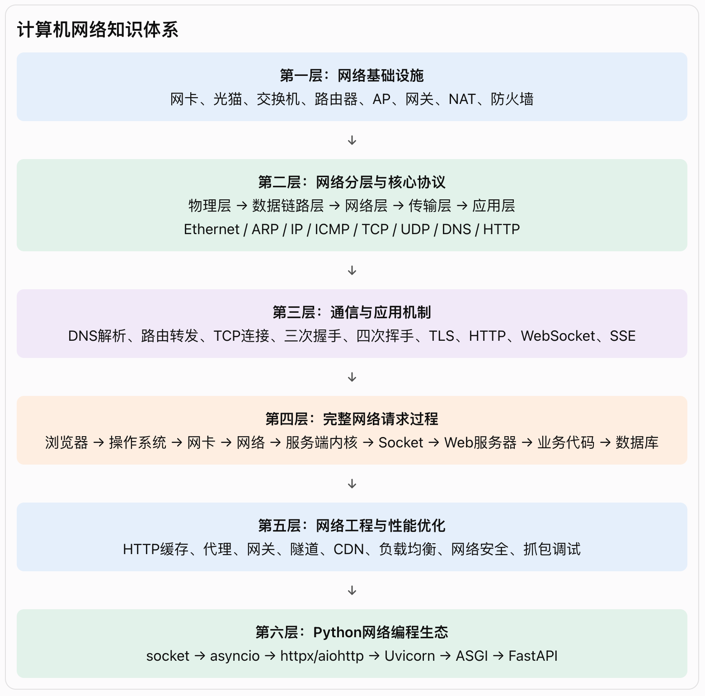

# 计算机网络-3-服务端 -- Python



# 目录

11. [Socket、Linux 内核与 I/O 多路复用](#11-socketlinux-内核与io-多路复用)
12. [代理、网关、隧道、CDN 与负载均衡](#12-代理网关隧道cdn-与负载均衡)
13. [常见网络安全问题](#13-常见网络安全问题)
14. [网络抓包与调试工具](#14-网络抓包与调试工具)
15. [Python 网络编程生态](#15-python-网络编程生态)
16. [常见概念辨析与易错点](#16-常见概念辨析与易错点)
17. [学习路线与最终总结](#17-学习路线与最终总结)

---

# 11. Socket、Linux 内核与 I/O 多路复用

## 11.1 Socket 是什么

Socket 是操作系统提供的网络通信编程接口/通信端点抽象。

应用程序通常不直接操作网卡，也不自行实现 TCP 协议，而是通过 Socket API 与内核网络协议栈交互。

常见 Socket 类型：

- `SOCK_STREAM`：常用于 TCP 字节流。
- `SOCK_DGRAM`：常用于 UDP 数据报。

Python 示例：

```python
import socket

client = socket.socket(socket.AF_INET, socket.SOCK_STREAM)
client.connect(("example.com", 80))

client.sendall(
    b"GET / HTTP/1.1\r\n"
    b"Host: example.com\r\n"
    b"Connection: close\r\n\r\n"
)

data = b""
while True:
    chunk = client.recv(4096)
    if not chunk:
        break
    data += chunk

client.close()
print(data.decode("utf-8", errors="replace"))
```

实际开发通常使用成熟 HTTP 客户端，而不是手写 HTTP 协议解析。

## 11.2 Socket 与 TCP 的关系

```text
Python 应用
   ↓ socket API
操作系统内核
   ↓ TCP/IP 协议栈
网卡
   ↓
网络
```

- TCP 是通信协议。
- Socket 是程序使用网络能力的接口抽象。
- HTTP 是运行在传输通道之上的应用协议。

HTTP、WebSocket、Redis、MySQL 等网络服务通常会通过 Socket 进行通信，但它们不是同一种应用协议。

## 11.3 I/O 多路复用

服务端可能同时维护大量连接。如果每个连接都由一个线程阻塞等待，线程数量和调度开销可能很高。

I/O 多路复用让一个或少量线程监视多个 Socket 的 I/O 就绪状态。

常见机制：

| 机制   | 说明                                                                 |
| ------ | -------------------------------------------------------------------- |
| select | 经典接口，通常有描述符数量限制，检查集合的开销较明显                 |
| poll   | 使用 pollfd 数组，没有 select 的固定 FD_SETSIZE 位图限制，但仍需扫描 |
| epoll  | Linux 提供，适合大量连接的就绪事件通知                               |

注意：

- epoll 通知的是 I/O 就绪，不是替应用自动完成全部数据读取和业务处理。
- I/O 就绪不意味着一次读取就拿到完整 HTTP 请求。
- epoll 是 Linux 特有机制；macOS 常用 kqueue，Windows 常见 IOCP。
- asyncio 是 Python 的异步编程框架，其事件循环会使用平台适配的 I/O 机制，不应简单说所有平台的 asyncio 都依赖 epoll。

---

# 12. 代理(proxy)、网关(gateway)、隧道(tunnel)、CDN 与负载均衡

## 12.1 正向代理与反向代理

### 正向代理

代理 代表 客户端访问外部服务。

```text
客户端 → 正向代理 → 目标服务器
```

常见用途：

- 企业出口代理。
- 访问控制与审计。
- 缓存。
- 网络访问策略。

### 反向代理

代理 代表 服务端接收客户端请求，并转发到后端服务。

```text
客户端 → Nginx/反向代理 → 后端应用
```

常见用途：

- TLS 终止。
- 负载均衡。
- 路由转发。
- 限流、访问控制。
- 静态资源服务。

## 12.2 Proxy、Gateway、Tunnel

| 概念    | 核心作用                                        | 理解重点                             |
| ------- | ----------------------------------------------- | ------------------------------------ |
| Proxy   | 代替一方转发请求                                | 可以解析、修改、缓存、过滤           |
| Gateway | 不同网络或系统间的入口/转换点                   | 含义广泛，不等同于某一种代理         |
| Tunnel  | 将“一种协议的数据” 封装在 “另一种协议里中” 传输 | 重点是封装和传输，不一定解析内部负载 |

- HTTP 代理转发时可能追加 `Via` 等字段，但具体行为取决于代理实现和协议要求。
- 现代 API Gateway、网络网关常常具备认证、限流、过滤、协议转换等能力【❗海关 + 翻译官】。
- 隧道: 通常不解析内部应用负载，但隧道端点仍然需要处理外层封装【❗偷渡】。

## 12.3 CDN

CDN（Content Delivery Network）通过分布在不同区域的边缘节点缓存和分发内容，减少访问源站的距离和负载。

```text
用户
 ↓
DNS / 调度
 ↓
附近 CDN 边缘节点
 ├── 缓存命中 → 直接返回
 └── 缓存未命中 → 回源获取
```

适合静态资源、下载文件、图片、视频等；动态内容也可结合缓存策略、边缘计算等方式处理。

## 12.4 负载均衡

负载均衡把请求分配给多个后端实例。

常见策略：

- 轮询。
- 加权轮询。
- 最少连接。
- 一致性哈希。
- 基于健康检查摘除异常实例。

负载均衡可以位于四层（TCP/UDP）或七层（HTTP 等应用层）。

---

# 13. 常见网络安全问题

## 13.1 DoS / DDoS

- DoS：通过大量请求或资源消耗使服务不可用。
- DDoS：由多个来源协同发起分布式拒绝服务攻击。

防护思路：

- 流量清洗与 DDoS 防护服务。
- CDN、Anycast 等基础设施。
- 限流、连接数限制、超时。
- 资源隔离与弹性扩容。
- 对异常流量进行监控和告警。

单纯“封 IP”通常不足以解决分布式攻击。

## 13.2 ARP 欺骗

攻击者伪造 ARP 应答，诱导局域网设备把某个 IP 错误映射到攻击者 MAC，可能导致流量劫持或中间人攻击。

防护：交换机安全机制、动态 ARP 检测、静态绑定（适用场景有限）、网络隔离、加密通信。

## 13.3 XSS（跨站脚本攻击）

攻击者让恶意脚本在受害者浏览器的可信站点上下文中执行。

常见类型：

- 存储型 XSS。
- 反射型 XSS。
- DOM 型 XSS。

防护：

- 根据输出上下文进行正确编码。
- 避免不安全地拼接 HTML。
- 使用安全的模板机制。
- 配置 CSP。
- Cookie 合理使用 HttpOnly、Secure、SameSite。

## 13.4 SQL 注入

攻击者将恶意输入拼接进 SQL 语句，改变原本查询逻辑。

错误做法：

```python
sql = f"SELECT * FROM users WHERE name = '{name}'"
```

正确方向：使用参数化查询。

```python
cursor.execute(
    "SELECT * FROM users WHERE name = %s",
    (name,)
)
```

具体占位符写法取决于数据库驱动。

## 13.5 CSRF（跨站请求伪造）

攻击者诱导已登录用户的浏览器向目标网站发送非预期请求，浏览器可能自动附带 Cookie。

防护：

- CSRF Token。
- SameSite Cookie。
- Origin/Referer 校验。
- 对敏感操作使用合理的重新认证或二次确认。

## 13.6 HTTPS 中间人攻击

如果攻击者能控制网络链路，可能尝试拦截或篡改通信。

正确验证 TLS 证书可以有效抵御普通中间人攻击。用户忽略证书警告、安装不可信根证书、客户端错误关闭证书验证等会削弱保护。

抓包工具在安装并信任其根证书后，可能对 HTTPS 做受控解密代理；这不意味着 HTTPS 本身没有加密。

## 13.7 其他后端开发安全重点

- 不要关闭 TLS 证书验证。
- 使用安全的 Cookie 属性。
- 对输入做校验，但不要把校验当作 SQL 注入的唯一防线。
- 设置请求体大小、超时和并发限制。
- 不要在日志中泄露密码、Token、密钥和个人敏感信息。
- 对内部管理接口实施身份认证和权限控制。
- 及时更新依赖并管理密钥。

---

# 14. 网络抓包与调试工具

## 14.1 curl

`curl` 是命令行 HTTP/多协议客户端，不是浏览器，也不是代理服务器。

常用命令：

```bash
# 发起 GET 请求
curl https://example.com

# 只请求响应头（HEAD）
curl -I https://example.com

# 显示请求与响应过程
curl -v https://example.com

# 输出响应头和响应体
curl -i https://example.com

# 发送 JSON
curl -X POST https://example.com/api \
  -H "Content-Type: application/json" \
  -d '{"name":"Tom"}'

# 指定请求头
curl -H "Authorization: Bearer TOKEN" https://example.com/api
```

区别：

- `-I`：发送 HEAD 请求，服务器应返回与 GET 对应的响应头语义，但不返回响应体。
- `-i`：在输出中包含响应头和响应体。
- `-v`：显示连接、TLS、请求/响应等调试细节。

## 14.2 Wireshark

图形化网络协议分析工具。

用途：

- 查看 DNS 查询与响应。
- 分析 TCP 三次握手、四次挥手。
- 查看 TCP 重传、乱序、窗口等。
- 分析 HTTP 等明文协议。
- 观察 TLS 握手元数据。

HTTPS 应用数据通常是加密的；没有合法解密条件时，不能直接看到明文请求体。

## 14.3 Whistle / Fiddler / Charles

HTTP(S) 调试代理工具，常用于：

- 抓取请求和响应。
- 修改请求头、响应头。
- 重写 URL。
- Mock 响应。
- 请求重放。
- 分析移动端或浏览器接口。

HTTPS 抓包通常需要在测试设备上安装并信任代理工具的 CA 证书；仅安装代理程序不代表就能解密所有 HTTPS 流量。

Whistle 官方文档：<https://wproxy.org/whistle/>

## 14.4 常用排查顺序

```text
1. 域名是否解析正确？
   nslookup / dig

2. 目标 IP 是否可达？
   ping（仅作参考，可能被禁）
   traceroute / tracert

3. 目标端口是否能建立连接？
   nc / telnet / curl

4. TLS 是否正常？
   curl -v / openssl s_client

5. HTTP 请求是否正确？
   curl -v / Whistle / Fiddler

6. 服务端是否收到请求？
   Nginx 日志 / 应用日志

7. 应用是否处理成功？
   FastAPI 日志 / Trace ID

8. 数据库或下游服务是否异常？
   数据库日志 / Redis / 链路追踪
```

## 14.5 关于“每个包不超过 64KB”

这句话不准确。

- 以太网 MTU 常见为 1500 字节（不含以太网头部），但具体网络可能不同。
- IPv4 的总长度字段最大可表示 65535 字节，但实际传输通常受 MTU 限制。
- TCP 是字节流，会按 MSS 等因素分段；MSS 常见为 MTU 扣除 IP/TCP 头部后的数据长度。
- UDP 单个数据报长度也有协议上限，但实际可用大小受路径 MTU 限制。
- IP 分片、路径 MTU 发现、隧道封装等都会影响实际包大小。

不要把 64KB 当成所有网络包的固定大小上限。

---

# 15. Python 网络编程生态


## 15.1 先建立层级关系

Python 网络编程不是一堆平级库，而是不同抽象层的工具。

```bash
业务框架层:  FastAPI / Flask / Django
     ↓
应用服务器接口层:  ASGI / WSGI
     ↓
服务端运行层:  Uvicorn / Gunicorn（常见组合）
     ↓
HTTP 协议实现层:  h11 / httptools 等（依具体实现）
     ↓
异步运行时、I/O 调度:  asyncio
     ↓
Socket API:  socket
     ↓
操作系统网络协议栈:  TCP / UDP / IP
     ↓
网卡与网络
```

客户端工具是另一条分支：

```bash
业务代码
  ↓
requests / httpx / aiohttp
  ↓
HTTP 协议处理
  ↓
Socket / TLS / asyncio（按实现与使用方式）
  ↓
操作系统网络栈
```

## 15.2 常见模块与库

| 名称           | 类型         | 主要作用                      | 常见用途                         |
| -------------- | ------------ | ----------------------------- | -------------------------------- |
| `socket`       | 标准库       | 底层 Socket API               | TCP/UDP 通信、理解网络基础       |
| `socketserver` | 标准库       | 简化同步网络服务器编写        | 教学、小型服务                   |
| `http.server`  | 标准库       | 简单 HTTP 服务端              | 本地测试，不建议直接作为生产服务 |
| `urllib`       | 标准库       | URL 处理、HTTP 客户端相关能力 | 简单请求、标准库方案             |
| `requests`     | 第三方库     | 同步 HTTP 客户端              | 普通同步接口调用                 |
| `httpx`        | 第三方库     | 同步/异步 HTTP 客户端         | 现代 Python 服务间调用           |
| `aiohttp`      | 第三方库     | 异步 HTTP 客户端与服务端      | 异步网络应用                     |
| `websockets`   | 第三方库     | WebSocket 通信                | WebSocket 服务与客户端           |
| `asyncio`      | 标准库       | 异步事件循环与协程调度        | 高并发 I/O 程序                  |
| `FastAPI`      | 第三方框架   | ASGI Web API 框架             | API 业务开发                     |
| `Uvicorn`      | 第三方服务器 | ASGI 服务器                   | 运行 FastAPI 等 ASGI 应用        |

注意：库之间不是简单的“上一层调用下一层”的固定树状关系。不同实现可能采用不同协议解析库、TLS 实现、事件循环和底层 I/O 机制。

## 15.3 socket：底层网络接口

socket、socketserver、urllib、http.server: 这些更多是：教学、底层框架开发、特殊协议

适合学习 TCP/UDP、实现简单协议、理解连接和数据收发。

不适合直接承担复杂 HTTP 业务，除非明确需要自己实现协议细节。

## 15.4 asyncio：异步编程基础设施

`asyncio` 提供：

- 协程与 `async` / `await`。
- 事件循环。
- Task 与 Future。
- 异步 Socket I/O。
- 同步原语。
- 异步网络服务的调度能力。

异步不等于多线程，也不等于 CPU 并行。

异步 I/O 的关键是：任务等待 I/O 时可以让出执行权，事件循环调度其他就绪任务。

## 15.5 requests、httpx、aiohttp

### requests

- 同步 HTTP 客户端。
- 使用简单，适合同步程序。
- 在 `async def` 中直接调用可能阻塞事件循环。

### httpx

- 同时提供 同步和异步 客户端。
- 支持连接池、超时、HTTP/1.1 和 HTTP/2（需按依赖与配置确认）。
- 适合 FastAPI 服务调用外部 API。

示例：

```python
import httpx

async def get_user():
    async with httpx.AsyncClient(timeout=10.0) as client:
        response = await client.get("https://example.com/api/user")
        response.raise_for_status()
        return response.json()
```

### aiohttp

- 提供异步 HTTP 客户端。
- 也可以用于构建异步 HTTP 服务端。
- 在已有 asyncio 技术栈中使用较多。

## 15.6 ASGI、Uvicorn 与 FastAPI

它们不是同一层：

- FastAPI：Web 应用框架，定义路由、依赖、校验和业务接口。
- ASGI：异步 Python Web 服务器与应用之间的接口规范。
- Uvicorn：ASGI 服务器，负责接收网络请求并调用 ASGI 应用。
- asyncio：常用异步运行时。
- Socket：操作系统网络通信接口。

关系：

```text
浏览器
  ↓ HTTP
操作系统 Socket
  ↓
Uvicorn
  ↓ ASGI scope / receive / send
FastAPI
  ↓
路由、依赖、业务逻辑
  ↓
响应通过 ASGI 返回
  ↓
Uvicorn 编码 HTTP 响应并发送
```

FastAPI 并不直接负责 TCP 三次握手；连接管理和底层网络 I/O 主要由 操作系统与 ASGI 服务器承担。

## 15.7 Python 后端开发的推荐掌握顺序

1. URL、DNS、IP、端口、子网、网关。
2. TCP/IP 分层、TCP 与 UDP。
3. TCP 三次握手、四次挥手、连接复用。
4. HTTP 请求/响应、状态码、缓存、HTTPS。
5. Socket 基础：`bind`、`listen`、`accept`、`connect`、`send`、`recv`。
6. HTTP 客户端：先掌握 `httpx`，再理解 `requests`、`aiohttp` 的适用场景。
7. asyncio：协程、Task、事件循环、取消、超时、并发控制。
8. ASGI 与 Uvicorn：理解请求如何进入 FastAPI。
9. 代理、TLS、超时、连接池、限流、日志与抓包。
10. 生产部署：Nginx、进程管理、容器网络、健康检查和可观测性。

---

# 16. 常见概念辨析与易错点

| 容易混淆的概念                  | 正确理解                                                             |
| ------------------------------- | -------------------------------------------------------------------- |
| URL 与 DNS                      | URL 是资源定位信息；DNS 负责解析域名记录                             |
| IP 与 MAC                       | IP 是网络层(网际层)逻辑地址；MAC 是链路层地址                        |
| IP 与端口                       | IP 定位网络接口；端口区分传输层通信端点                              |
| 路由与 NAT                      | 路由选择下一跳；NAT 改写地址/端口                                    |
| 网关与路由器                    | 默认网关是下一跳角色；路由器是常见实现设备                           |
| 交换机与路由器                  | 交换机常做二层转发；路由器做三层转发，设备也可能集成两者             |
| TCP 与 HTTP                     | TCP 是传输层协议；HTTP 是应用层协议                                  |
| Socket 与 TCP                   | Socket 是编程接口/端点抽象；TCP 是协议                               |
| TCP 可靠与业务成功              | TCP 确保传输层可靠字节流，不保证业务执行成功                         |
| HTTP/2 多路复用与彻底无队头阻塞 | HTTP/2 仍受 TCP 丢包导致的连接级队头阻塞影响                         |
| HTTP/3 与 UDP                   | QUIC 基于 UDP，但在 QUIC 内实现可靠传输等能力                        |
| HTTPS 与非对称加密              | TLS 不是简单地全程使用非对称加密；通常协商密钥后用对称 AEAD 保护数据 |
| 证书与加密                      | 证书主要用于身份认证和公钥绑定，不是把所有通信数据加密的“证书文件”   |
| 304 与强缓存                    | 304 是协商缓存验证结果，不是强缓存命中                               |
| `no-cache` 与 `no-store`        | `no-cache` 可存储但复用前需验证；`no-store` 不应存储                 |
| SSE 与 WebSocket                | SSE 是服务端到客户端单向事件流；WebSocket 是双向通信                 |
| asyncio 与多线程                | asyncio 是协程与事件循环模型，不等同于线程并行                       |
| epoll 与 asyncio                | epoll 是 Linux I/O 多路复用机制；asyncio 是跨平台异步编程框架        |
| 网关与 API Gateway              | Gateway 是广义概念；API Gateway 是应用层/API 流量入口的一种实现      |
| 64KB 与 MTU                     | IP 协议长度上限不等于链路实际 MTU；常见以太网 MTU 为 1500 字节       |

---

# 17. 学习路线与最终总结

## 17.1 推荐学习顺序

### 阶段一：网络全局观

掌握：

- 网络设备。
- IP、MAC、端口、DNS。
- 子网掩码、默认网关。
- 交换机、路由器、NAT。

目标：能解释电脑访问同网段设备与访问公网服务器的区别。

### 阶段二：协议基础

掌握：

- OSI 与 TCP/IP 分层。
- 封装与解封装。
- TCP 与 UDP。
- 三次握手、四次挥手。
- 路由、ARP、ICMP。

目标：能看懂一次 TCP 连接建立和数据传输。

### 阶段三：Web 通信

掌握：

- URL 与 DNS。
- HTTP 请求/响应。
- HTTP/1.1、HTTP/2、HTTP/3。
- HTTPS 与 TLS。
- 状态码。
- 强缓存、协商缓存。
- WebSocket、SSE。

目标：能解释浏览器一次 HTTP 请求的完整过程。

### 阶段四：服务端运行机制

掌握：

- Socket。
- Linux TCP/IP 协议栈。
- accept 队列。
- select、poll、epoll。
- Nginx、Uvicorn、ASGI。
- 连接池、超时和并发。

目标：能解释请求如何从网卡进入 Python 应用。

### 阶段五：Python 网络编程

掌握：

- socket。
- asyncio。
- requests / httpx / aiohttp。
- FastAPI / Uvicorn。
- WebSocket / SSE。
- 网络异常、重试、超时、连接池。

目标：能独立开发和排查 Python 网络服务。

## 17.2 最终知识地图

```text
计算机网络
│
├── 1. 网络基础设施
│   ├── 网卡、光猫、交换机、路由器、AP
│   ├── IP、MAC、端口、子网掩码
│   ├── 网关、NAT、防火墙
│   └── 局域网、广域网、互联网
│
├── 2. 网络协议体系
│   ├── 物理层
│   ├── 数据链路层：Ethernet、Wi-Fi、ARP
│   ├── 网络层(网际层)：IPv4、IPv6、ICMP、路由
│   ├── 传输层：TCP、UDP
│   └── 应用层：DNS、HTTP、SSH
│
├── 3. 核心通信机制
│   ├── URL 与 DNS 解析
│   ├── IP 寻址与路由转发
│   ├── ARP / IPv6 邻居发现
│   ├── TCP 三次握手与四次挥手
│   ├── TCP 可靠传输、流量控制、拥塞控制
│   └── TLS 握手与加密通信
│
├── 4. Web 应用协议
│   ├── HTTP/1.1、HTTP/2、HTTP/3
│   ├── HTTPS
│   ├── HTTP 状态码
│   ├── HTTP 缓存
│   ├── WebSocket
│   └── SSE
│
├── 5. 操作系统网络实现
│   ├── Socket
│   ├── TCP/IP 协议栈
│   ├── 接收/发送缓冲区
│   ├── 半连接队列、全连接队列
│   └── select、poll、epoll
│
├── 6. 网络工程
│   ├── 正向代理、反向代理
│   ├── 网关、隧道
│   ├── CDN、负载均衡
│   ├── 网络安全
│   └── 抓包、诊断、性能优化
│
└── 7. Python 网络编程
    ├── socket / socketserver
    ├── asyncio
    ├── requests / httpx / aiohttp
    ├── WebSocket
    ├── ASGI / Uvicorn
    └── FastAPI
```

## 17.3 最重要的十句话

1. DNS 解决域名解析，IP 解决网络层(网际层)寻址。
2. 路由表决定下一跳，MAC 地址负责当前链路上的交付。
3. 端口帮助操作系统把网络数据交给对应的传输层通信端点。
4. 网络协议分层，数据发送时逐层封装，接收时逐层解封装。
5. IP 尽力而为，TCP 提供可靠有序的字节流。
6. TCP 三次握手建立连接，四次挥手完成双向关闭。
7. HTTPS 是 HTTP 通过 TLS 进行安全通信。
8. HTTP/2 基于 TCP，HTTP/3 基于 QUIC（UDP）。
9. Socket 是应用程序使用操作系统网络能力的重要接口。
10. FastAPI 负责应用业务，Uvicorn 负责 ASGI 服务接入，底层网络通信由操作系统及其网络栈支撑。

---

**学习时始终保持这条主线：**

```text
网络设备如何连接
      ↓
网络协议如何协作
      ↓
数据如何寻址和传输
      ↓
TCP / TLS / HTTP 如何通信
      ↓
操作系统如何接收和处理数据
      ↓
Socket 如何把网络能力提供给应用
      ↓
Uvicorn 如何调用 FastAPI
      ↓
Python 如何实现完整的后端网络服务
```

这才是从计算机网络基础走向 Python 后端网络编程的完整知识链路。
