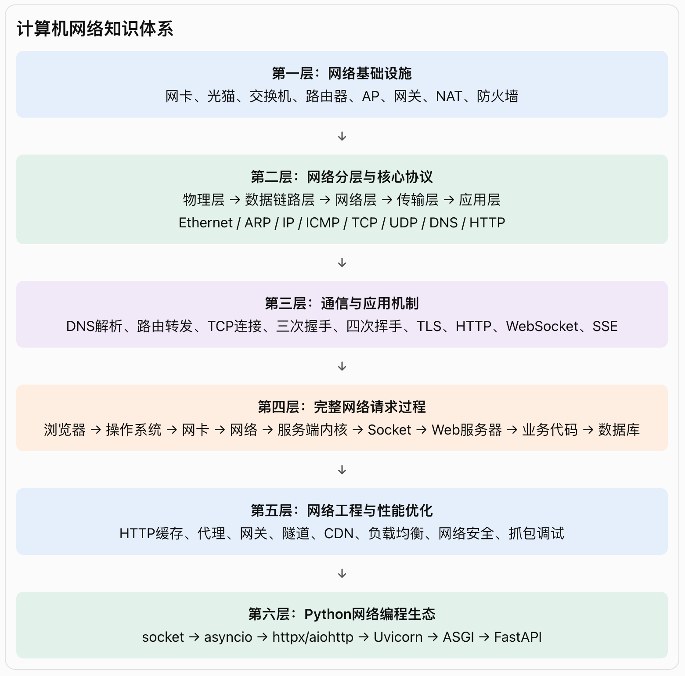
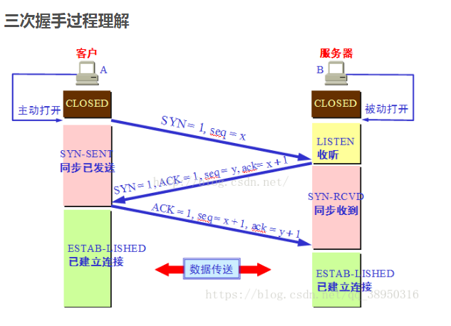
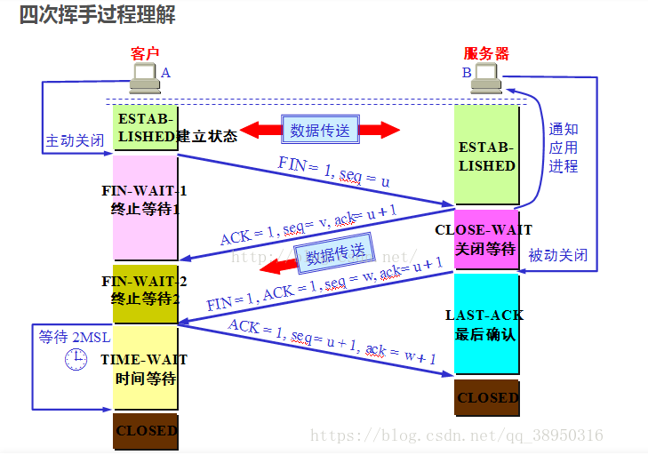

# 计算机网络与 Python 网络编程知识体系

> 说明：本文在保留原笔记核心内容的基础上，对不准确或过度简化的说法进行了修正，并补充必要的工程知识。

## 

# 目录

1. [全局认知：网络到底解决什么问题](#1-全局认知网络到底解决什么问题)
2. [网络基础设施：设备与网络边界](#2-网络基础设施设备与网络边界)
3. [网络分层：协议如何协作](#3-网络分层协议如何协作)
4. [寻址与转发：DNS、IP、MAC、路由](#4-寻址与转发dnsipmac路由)
5. [传输层：TCP 与 UDP](#5-传输层tcp-与-udp)
6. [TCP 连接管理：三次握手与四次挥手](#6-tcp-连接管理三次握手与四次挥手)
7. [应用层：HTTP、HTTPS、HTTP/2、HTTP/3](#7-应用层httphttpshttp2http3)
8. [实时通信：WebSocket 与 SSE](#8-实时通信websocket-与-sse)
9. [HTTP 缓存：第一次请求与第二次请求](#9-http-缓存第一次请求与第二次请求)
10. [一次完整网络请求：从浏览器到 Python 服务端](#10-一次完整网络请求从浏览器到-python-服务端)
11. [Socket、Linux 内核与 I/O 多路复用](#11-socketlinux-内核与io-多路复用)
12. [代理、网关、隧道、CDN 与负载均衡](#12-代理网关隧道cdn-与负载均衡)
13. [常见网络安全问题](#13-常见网络安全问题)
14. [网络抓包与调试工具](#14-网络抓包与调试工具)
15. [Python 网络编程生态](#15-python-网络编程生态)
16. [常见概念辨析与易错点](#16-常见概念辨析与易错点)
17. [学习路线与最终总结](#17-学习路线与最终总结)

---

# 1. 全局认知：网络到底解决什么问题

## 1.1 网络通信的本质

网络通信可以拆成几个连续的问题：

1. **找到目标**：目标设备在哪里？DNS、IP 地址解决不同层面的定位问题。
2. **找到路径**：数据应该经过哪些网络设备？路由和转发负责选择下一跳。
3. **交给正确设备**：当前链路上应该把帧交给哪个网卡？MAC 地址参与本地链路交付。
4. **交给正确程序**：目标主机收到数据后，应该交给哪个应用进程？端口号参与传输层复用与分用。
5. **按应用约定理解数据**：双方如何解释请求和响应？HTTP、DNS 等应用协议定义规则。
6. **处理传输问题**：是否需要可靠、有序、流量控制和拥塞控制？TCP、UDP 等提供不同能力。

可以用一句话记忆：

> DNS 负责域名解析，IP 负责逻辑寻址，路由负责选择下一跳，MAC 负责链路交付，端口负责找到进程，应用协议负责解释数据。

注意：这是一种帮助理解的职责划分，不代表每次通信都一定发生 DNS 查询、ARP 广播、NAT 或完整 TCP 握手。

## 1.2 网络知识的六个层次

| 层次         | 研究对象                   | 典型内容                             |
| ------------ | -------------------------- | ------------------------------------ |
| 网络设备     | 数据经过什么设备           | 网卡、交换机、路由器、光猫           |
| 网络协议     | 设备如何遵循规则通信       | Ethernet、IP、TCP、UDP、HTTP         |
| 通信机制     | 连接如何建立、数据如何传递 | DNS、ARP、握手、路由、TLS            |
| 操作系统实现 | OS 如何接收和处理网络数据  | Socket、缓冲区、TCP/IP 协议栈、epoll |
| 应用服务     | 服务端如何处理请求         | Nginx、Uvicorn、FastAPI、数据库      |
| 工程实践     | 如何调试、安全和优化       | curl、Wireshark、缓存、代理、限流    |

## 1.3 两条必须分清的链路

**网络设备链路：**

```text
电脑/手机
   ↓
网卡
   ↓
交换机 / 无线 AP
   ↓
路由器 / 网关
   ↓
运营商网络
   ↓
互联网
   ↓
目标服务器
```

**软件处理链路：**

```text
应用程序
   ↓
HTTP / DNS 等应用协议
   ↓
TCP / UDP
   ↓
IP
   ↓
数据链路层
   ↓
网卡与物理介质
```

两条链路相互配合，但不能混为一谈。

---

# 2. 网络基础设施：设备与网络边界

## 2.1 常见设备

| 设备/概念     | 主要职责                          | 关键理解                                   |
| ------------- | --------------------------------- | ------------------------------------------ |
| 网卡 NIC      | 让设备接入网络                    | 有线网卡、无线网卡都是网络接口             |
| 光猫 ONU/ONT  | 将运营商接入网络转换为用户侧接口  | 不只是简单的光电转换，也可能集成路由等功能 |
| 交换机 Switch | 在局域网内转发以太网帧            | 主要依据 MAC 地址转发                      |
| 路由器 Router | 在不同 IP 网络之间转发数据包      | 查询路由表，选择下一跳和出口接口           |
| AP            | 提供 Wi-Fi 无线接入               | 通常桥接无线客户端与有线局域网             |
| 防火墙        | 按安全策略控制流量                | 可基于 IP、端口、协议、连接状态等过滤      |
| 网关 Gateway  | 不同网络或系统之间的出入口/转换点 | 含义取决于具体上下文                       |

### 交换机与路由器

- 交换机通常工作在数据链路层，学习 MAC 地址与端口的对应关系，再转发以太网帧。
- 路由器通常工作在网络层，根据目标 IP 地址查询路由表，决定下一跳。
- 三层交换机可以同时具备二层交换和三层路由能力，因此不能简单认为某个设备只会看 MAC 或只会看 IP。

## 2.2 家用无线路由器是什么

家用无线路由器通常是多个功能的集成设备：

```text
家用无线路由器
  ├── 路由功能
  ├── 交换机功能（LAN 端口）
  ├── 无线 AP 功能
  ├── DHCP 服务
  ├── NAT / PAT
  ├── 防火墙
  └── PPPoE 客户端（视网络接入方式）
```

设备名称叫“无线路由器”，不意味着它内部只有路由功能。

## 2.3 WAN 接入方式

运营商可能通过以下方式 给家庭路由器提供网络参数：

- **PPPoE**：通过账号、密码建立接入会话，常见于部分宽带接入。
- **DHCP**：自动分配 IP、子网掩码、默认网关、DNS 等参数。
- **静态 IP**：由运营商提供固定配置，用户或设备手动设置。

注意：家庭路由器 LAN 侧通常也运行 DHCP 服务，为家里的电脑、手机分配私网地址。这与 WAN 侧向运营商获取地址是两个方向。

## 2.4 IP、MAC、端口、DNS、网关

| 概念          | 作用                                 | 示例                    |
| ------------- | ------------------------------------ | ----------------------- |
| IP 地址       | 标识网络层的接口/通信端点            | `192.168.1.100`         |
| MAC 地址      | 标识链路层接口                       | `00:11:22:33:44:55`     |
| 端口          | 区分同一主机上的传输层通信端点       | `443`                   |
| 子网掩码/前缀 | 划分网络前缀与主机部分               | `255.255.255.0` / `/24` |
| 默认网关      | 本机访问非直连网络时通常交给的下一跳 | `192.168.1.1`           |
| DNS           | 将域名解析为 IP 等 DNS 记录          | `example.com → IP`      |

纠正：IP 地址不是永远唯一对应“一台设备”。一台设备可以有多个网卡、多个 IP；一个公网 IP 也可以通过 NAT 被多个内网设备共享。MAC 地址也可能被虚拟化、随机化或软件修改。

## 2.5 私有 IP 与特殊地址

常见 IPv4 私有地址范围：

- `10.0.0.0/8`
- `172.16.0.0/12`
- `192.168.0.0/16`

常见特殊地址：

- `127.0.0.1`：IPv4 回环地址，访问本机。
- `0.0.0.0`：在服务端监听场景中常表示绑定所有 IPv4 本地接口；也可在其他上下文中表示未指定地址。
- `0.0.0.0/0`：IPv4 默认路由的前缀。
- `255.255.255.255`：受限广播地址。
- `169.254.0.0/16`：IPv4 链路本地地址范围。

`192.168.x.x` 是常见私有地址，但不是所有局域网都必须使用它。

## 2.6 NAT：网络地址转换

NAT 在网络边界修改 IP 地址，有时还会修改端口。家庭网络常见的是 NAPT/PAT（端口地址转换）。

示例：

```text
内网设备：
192.168.1.100:50000
       |
       | 家庭路由器执行 NAT/PAT
       v
公网映射：
203.0.113.10:62001
       |
       v
互联网服务器
```

路由与 NAT 是不同职责：

- 路由：决定数据下一跳。
- NAT：改写地址/端口并维护转换映射。

并不是每经过一个路由器就发生 NAT。运营商网络还可能存在 CGNAT（运营商级 NAT）。

---

# 3. 网络分层：协议如何协作

## 3.1 为什么要分层

网络通信非常复杂。分层将复杂问题拆分成职责相对清晰的部分：

- 上层不必关心底层信号如何传输。
- 下层不必理解上层业务含义。
- 每层通过约定的接口与相邻层协作。
- 协议可以在不改变整个体系的情况下演进。

## 3.2 OSI 七层模型与 TCP/IP 五层模型

| OSI 七层        | TCP/IP 五层 | 主要职责                     | 示例                              |
| --------------- | ----------- | ---------------------------- | --------------------------------- |
| 应用层（7）     | 应用层      | 应用通信规则                 | HTTP、DNS、SMTP、SSH              |
| 表示层（6）     | 应用层      | 数据表示、编码、加密、压缩等 | JSON、字符编码、TLS（按功能理解） |
| 会话层（5）     | 应用层      | 会话建立、管理、恢复等       | 会话管理机制                      |
| 传输层（4）     | 传输层      | 进程间端到端传输             | TCP、UDP                          |
| 网络层（3）     | 网络层      | IP 寻址与跨网络转发          | IPv4、IPv6、ICMP                  |
| 数据链路层（2） | 数据链路层  | 同一链路上的帧传输           | Ethernet、Wi-Fi、MAC              |
| 物理层（1）     | 物理层      | 比特的物理传输               | 网线、光纤、无线电信号            |

说明：

- OSI 是七层参考模型，不应说它“完全没有实际应用”；它主要用于理解、设计和分析网络体系。
- TCP/IP 五层模型是常用教学表达。实际资料也常使用四层 TCP/IP 模型，把物理层和数据链路层合并为网络接口层。
- TLS、JSON 等不宜机械地认定为只属于 OSI 的某一层；模型是抽象工具，不是严格的软件目录。

## 3.3 封装与解封装

发送端逐层封装，接收端逐层解封装：

```text
发送端
应用层       HTTP 数据
               ↓
传输层       TCP Header + 数据       → TCP Segment
               ↓
网络层       IP Header + Segment     → IP Packet
               ↓
数据链路层   Frame Header + Packet + Trailer → Frame
               ↓
物理层       比特流 / 物理信号

接收端按相反方向处理
```

常见数据单元名称：

| 层         | 数据单元               |
| ---------- | ---------------------- |
| 应用层     | Message / Data         |
| TCP        | Segment（报文段）      |
| UDP        | Datagram（用户数据报） |
| IP         | Packet（数据包）       |
| 数据链路层 | Frame（帧）            |
| 物理层     | Bit（比特）            |

注意：不同协议与教材的术语可能略有差异。以太网帧的头部和尾部并非都叫 MAC Header；FCS 通常用于差错检测。

## 3.4 五层模型的职责

### 物理层

把比特转换成适合介质传输的信号，定义接口、电气/光学特性、速率等。

### 数据链路层

负责同一链路上的帧传输，包括帧封装、MAC 地址、差错检测等。以太网通常检测错误，但一般不由以太网本身负责端到端可靠重传。

### 网络层

IP 提供逻辑寻址和尽力而为的数据包转发。IP 本身不保证可靠送达、顺序或不重复。

### 传输层

TCP 提供可靠、有序的字节流；UDP 提供数据报服务，不保证送达和顺序。

### 应用层

定义应用之间如何表达请求、响应和业务数据，例如 HTTP、DNS、SMTP。

---

# 4. 寻址与转发：DNS、IP、MAC、路由

## 4.1 URL 的组成

示例：

```text
https://www.example.com:443/products/item?id=100#detail
└─┬─┘   └──────┬──────┘ └┬┘ └──────┬──────┘ └──┬──┘
 scheme       host       port      path       query  fragment
```

更完整地看：

```text
scheme://userinfo@host:port/path?query#fragment
```

- Scheme：协议方案，如 `http`、`https`。
- Host：主机名或 IP 地址。
- Port：端口；HTTP 默认端口 80，HTTPS 默认端口 443。
- Path：资源路径。
- Query：查询参数。
- Fragment：片段标识符，通常由客户端使用，不会作为 HTTP 请求目标的一部分发送给服务器。

URL 与 URI 不是完全同义：URL 是 URI 的一种，用于定位资源。

## 4.2 DNS：域名解析

DNS（Domain Name System）将域名解析为资源记录，最常见的是 A（IPv4）和 AAAA（IPv6）记录。

常见记录：

| 记录  | 含义                               |
| ----- | ---------------------------------- |
| A     | 域名对应 IPv4 地址                 |
| AAAA  | 域名对应 IPv6 地址                 |
| CNAME | 别名记录                           |
| MX    | 邮件交换服务器                     |
| NS    | 权威 DNS 服务器                    |
| TXT   | 文本信息，常用于验证和邮件安全策略 |

### DNS 解析大致过程

```text
应用/浏览器发起解析
       ↓
本机 DNS 缓存等
       ↓
配置的递归 DNS 解析器
       ↓
必要时查询根 DNS
       ↓
顶级域 DNS（如 .com）
       ↓
权威 DNS
       ↓
返回 DNS 记录
       ↓
缓存结果（受 TTL 等策略影响）
```

重要纠正：

- 根 DNS、顶级域 DNS、权威 DNS 的查询过程通常由递归解析器代为完成，不意味着浏览器每次都逐级直接访问它们。
- 实际还可能涉及浏览器缓存、操作系统缓存、Hosts 文件、企业 DNS、DoH/DoT 等。
- DNS 不只解析域名到 IP，也可以提供其他类型的记录。
- DNS 结果受 TTL、负载均衡、CDN、地理调度等影响，同一域名不一定永远解析到同一个 IP。

## 4.3 IP 地址与子网

IPv4：

- 32 位，即 4 字节。
- 常用点分十进制表示，例如 `192.168.1.10`。
- 理论地址总数为 `2^32`，但并非全部可作为普通主机地址使用。

IPv6：

- 128 位。
- 通常使用 8 组十六进制数表示。
- 例如 `2001:db8:85a3::8a2e:370:7334`。
- `2001:db8::/32` 是文档示例保留地址段。

子网前缀示例：

```text
IP：       192.168.1.10/24
网络前缀： 192.168.1.0/24
掩码：     255.255.255.0
```

`/24` 表示前 24 位是网络前缀，剩余 8 位属于接口地址部分。

不要把“前三段相同”当作通用判断规则；必须结合子网掩码或 CIDR 前缀进行判断。

对于 `192.168.1.0/24` 这样的普通 IPv4 子网，常见主机地址范围是 `.1` 到 `.254`，`.0` 是网络地址，`.255` 是广播地址。但 `/31` 点到点链路、`/32` 主机路由等有特殊规则。

## 4.4 同网段通信与跨网段通信

假设：

```text
本机：192.168.1.10/24
目标 A：192.168.1.20/24
目标 B：8.8.8.8
默认网关：192.168.1.1
```

### 场景 A：访问同网段设备

```text
本机判断目标属于直连网段
       ↓
查询邻居缓存
       ↓
若没有目标 MAC，则通过 ARP 查询
       ↓
构造以太网帧：
目标 MAC = 对方 MAC
IP 目标地址 = 192.168.1.20
       ↓
在本地链路发送
```

### 场景 B：访问其他网络

```text
本机判断目标不属于直连网段
       ↓
查询路由表
       ↓
匹配默认路由或更具体的路由
       ↓
查询下一跳网关的 MAC
       ↓
构造以太网帧：
目标 MAC = 网关 MAC
IP 目标地址 = 远端服务器 IP
       ↓
交给网关转发
```

关键理解：

- IP 包的目标 IP 通常仍然是最终目标服务器的 IP。
- 当前以太网帧的目标 MAC 是当前链路的下一跳 MAC。
- 路由器转发时会移除原链路帧并重新封装下一条链路的帧。
- 普通路由转发时源/目标 IP 通常保持不变；发生 NAT 时地址或端口可能被改写。
- 每一跳的 MAC 地址会随链路变化。

## 4.5 ARP 与 IPv6 邻居发现

- ARP：在 IPv4 网络中，根据同一链路上的 IPv4 地址解析对应链路层地址。
- IPv6 不使用 ARP，而使用 ICMPv6 Neighbor Discovery（邻居发现协议）。
- ARP 请求通常通过链路层广播发出；ARP 应答通常单播返回。
- ARP 只能解决本地链路上的地址解析，不负责跨互联网查找远端服务器的 MAC。

## 4.6 路由表、默认路由与 BGP

路由器根据路由表转发数据包，常见匹配原则是**最长前缀匹配**。

- 直连路由：网络直接连接在本机接口上。
- 静态路由：管理员手工配置。
- 动态路由：通过路由协议学习。
- 默认路由：没有更具体匹配时使用，例如 IPv4 `0.0.0.0/0`、IPv6 `::/0`。

BGP（Border Gateway Protocol）用于自治系统之间交换可达路由信息，是互联网路由体系的重要组成部分。它不是每个家庭路由器逐跳执行的“全球导航查询”。

---

# 5. 传输层：TCP 与 UDP

## 5.1 端口的作用

IP 主要定位主机/接口，端口用于区分主机上的传输层通信端点。

常见端口：

| 端口  | 常见用途                                 |
| ----- | ---------------------------------------- |
| 20/21 | FTP（传统数据/控制通道，具体模式有差异） |
| 22    | SSH                                      |
| 53    | DNS（UDP 常见，TCP 也会使用）            |
| 80    | HTTP                                     |
| 443   | HTTPS                                    |
| 3306  | MySQL 默认端口                           |
| 5432  | PostgreSQL 默认端口                      |
| 6379  | Redis 默认端口                           |

端口号是 16 位，范围 0–65535。端口与某个协议的对应关系是约定俗成的默认值，不代表该服务只能使用该端口。

## 5.2 TCP

TCP（Transmission Control Protocol）是面向连接、可靠、有序的字节流协议。

主要机制：

- 连接建立与关闭。
- 序列号与确认号。
- 超时重传、快速重传等可靠性机制。
- 接收窗口与流量控制。
- 拥塞控制。
- 校验和。

注意：

- TCP 提供的是字节流，不保留应用层消息边界。
- 一次 `send()` 不保证对方一次 `recv()` 就完整收到对应数据。
- TCP 的可靠性是传输层机制，不等于业务一定成功。例如服务器可能收到请求但业务处理失败。
- TCP 不能简单描述为“绝对不丢数据”；它通过检测、确认、重传等机制尽力提供可靠交付，连接最终也可能因超时或故障失败。

## 5.3 UDP

UDP（User Datagram Protocol）是无连接的数据报协议。

特点：

- 不需要像 TCP 那样建立连接。
- 保留数据报边界。
- 不保证送达、顺序或去重。
- 协议头开销较小。
- 应用可根据需要自行实现确认、重传、拥塞控制等机制。

常见场景：DNS 查询、实时音视频、在线游戏、部分实时传输协议。

不能简单说“UDP 一定更快”。实际延迟取决于网络、应用机制、数据大小、拥塞和实现方式。

## 5.4 TCP 与 UDP 对比

| 维度     | TCP                               | UDP                                |
| -------- | --------------------------------- | ---------------------------------- |
| 连接     | 面向连接                          | 无连接                             |
| 数据模型 | 字节流                            | 数据报                             |
| 可靠性   | 提供可靠有序传输                  | 不保证                             |
| 顺序     | 提供有序字节流                    | 不保证                             |
| 流量控制 | 有                                | 协议本身没有                       |
| 拥塞控制 | 有                                | 协议本身没有                       |
| 常见场景 | HTTP/1.1、HTTP/2、数据库连接、SSH | DNS、实时媒体、游戏、QUIC 底层传输 |

---

# 6. TCP 连接管理：三次握手与四次挥手

## 6.1 三次握手

目的：让通信双方确认彼此的发送与接收能力，并同步初始序列号等连接状态。


逐步理解：

1. 客户端发送 SYN，表示请求建立连接，并给出自己的初始序列号。
2. 服务端收到后，返回 SYN+ACK，确认客户端的序列号，并提供自己的初始序列号。
3. 客户端发送 ACK，确认服务端的序列号。

三次握手不是简单地“客户端说想连接、服务端同意、客户端确认”而已；核心还在于双方确认双向通信能力和初始序列号。

## 6.2 SEQ 与 ACK

- SEQ：当前 TCP 段中数据的起始序列号。
- ACK：确认号，表示接收方期望收到的下一个字节序列号。

例如：

```text
发送方发送 100 字节，起始序列号为 1000
接收方确认 ACK = 1100
```

SYN 和 FIN 各自也会消耗一个序列号。

因此，不应把 SEQ 简化为“这个消息发送前总共发了多少字节”，也不应把 ACK 简化为“这个消息发送前总共收到了多少字节”。

## 6.3 四次挥手

TCP 是全双工协议，两个方向可以独立关闭，因此典型关闭过程需要双方分别表达关闭意图。



1. 主动关闭方发送 FIN，表示自己不再发送数据。
2. 被动关闭方返回 ACK，确认收到关闭请求；此时它可能仍有数据要发送。
3. 被动关闭方数据发送完毕后，发送 FIN。
4. 主动关闭方返回 ACK。

## 6.4 TIME_WAIT

主动关闭方通常在发送最后一个 ACK 后进入 TIME_WAIT 状态。

主要目的：

- 确保最后一个 ACK 丢失时，仍有机会重发 ACK。
- 让旧连接中的延迟报文在网络中逐渐消失，降低旧报文干扰新连接的风险。

常见说法“TIME_WAIT 一定持续 2 分钟”不准确；时长与操作系统实现和配置有关。

## 6.5 半连接队列与全连接队列

服务端监听 TCP 端口时，内核会维护与连接建立过程相关的队列：

- SYN 队列：保存尚未完成握手的连接请求（常称半连接队列）。
- accept 队列：保存已经完成握手、等待应用 `accept()` 取走的连接（常称全连接队列）。

应用调用：

```python
conn, addr = server.accept()
```

本质上是从内核提供的已完成连接队列中取得一个连接套接字。

---

# 7. 应用层：HTTP、HTTPS、HTTP/2、HTTP/3

## 7.1 HTTP 是什么

HTTP（Hypertext Transfer Protocol）是应用层请求/响应协议。

典型 HTTP/1.1 请求：

```http
GET /api/users/1 HTTP/1.1
Host: example.com
Accept: application/json
User-Agent: ExampleClient/1.0
```

典型响应：

```http
HTTP/1.1 200 OK
Content-Type: application/json
Cache-Control: no-store

{"id": 1, "name": "Tom"}
```

HTTP 定义方法、状态码、首部字段、消息语义等。底层使用什么传输方式，取决于 HTTP 版本。

## 7.2 HTTP 版本演进

| 版本     | 主要特点                           | 底层传输         |
| -------- | ---------------------------------- | ---------------- |
| HTTP/0.9 | 极简 GET，仅返回 HTML              | TCP              |
| HTTP/1.0 | 引入请求/响应头、状态码等          | TCP              |
| HTTP/1.1 | 默认持久连接、Host、分块传输编码等 | TCP              |
| HTTP/2   | 二进制分帧、多路复用、HPACK 头压缩 | TCP              |
| HTTP/3   | 基于 QUIC，减少 TCP 层队头阻塞     | QUIC（基于 UDP） |

### HTTP/1.1

- 支持持久连接（Keep-Alive），一个 TCP 连接可以承载多个请求/响应。
- 传统管线化（pipelining）支持有限，响应顺序等限制使其实际应用不广泛。
- 浏览器可能对同一源建立多个连接，但“每个域名固定 6 个连接”不是协议保证，具体取决于浏览器和场景。
- `Transfer-Encoding: chunked` 可用于分块传输动态生成的响应，不要求事先知道完整内容长度。
- HTTP/1.1 的文本消息格式不意味着响应体只能是文本，响应体可以是二进制数据。

### HTTP/2

- 使用二进制分帧。
- 通过 Stream ID 将帧归属到不同数据流。
- 多个流可以在同一个 TCP 连接上交错传输。
- 使用 HPACK 压缩 HTTP 头部。
- 可选服务器推送能力，但实际浏览器生态中已弱化/弃用，不能把它当成现代 Web 的主要推送方案。

关键纠正：

HTTP/2 解决了 HTTP/1.1 应用层请求排队造成的部分队头阻塞，但底层仍然是 TCP。一个 TCP 段丢失时，TCP 必须按序向上交付字节流，可能影响同一连接上的多个 HTTP/2 流。这是 TCP 层队头阻塞。

### HTTP/3

- HTTP/3 使用 QUIC。
- QUIC 基于 UDP，但在 QUIC 内部实现可靠传输、拥塞控制、加密和多路复用等机制。
- 不同 QUIC Stream 的数据传输可以相对独立，一个流丢包不必阻塞其他流的数据交付。
- QUIC 集成 TLS 1.3 握手机制，减少连接建立开销。
- QUIC 由 IETF 标准化，不应只称为“谷歌出的优化”。

## 7.3 HTTPS 与 TLS

HTTPS = HTTP over TLS。

TLS 为应用数据提供：

- **机密性**：防止旁观者直接读取传输内容。
- **完整性**：检测数据是否被篡改。
- **身份认证**：通常通过服务器证书验证服务器身份。

HTTPS 常用端口为 443，HTTP 常用端口为 80，但端口可以配置为其他值。

### TLS 证书验证

证书通常包含服务器身份信息和服务器公钥，并由证书颁发机构（CA）签名。

客户端通常会检查：

1. 证书链是否能追溯到受信任的根证书。
2. 证书域名是否与访问域名匹配。
3. 证书是否在有效期内。
4. 证书用途、算法和其他策略是否满足要求。
5. 是否存在吊销等需要检查的状态（具体取决于客户端策略）。

CA 的作用不是“把证书内容加密后交还企业”，而是通过数字签名证明证书内容由受信任的签发者签发且未被篡改。

### TLS 握手的现代理解

```text
客户端                                  服务端
  |                                       |
  | -------- ClientHello ---------------> |
  |   支持版本、密码套件、随机数、密钥交换参数等
  |                                       |
  | <------- ServerHello ---------------- |
  |   选择参数、密钥交换相关信息等
  | <------- Certificate ----------------|
  | <------- Finished 等 ----------------|
  |                                       |
  | 客户端验证证书、完成密钥协商与握手确认
  |                                       |
  | ===== 后续应用数据使用会话密钥保护 ===== |
```

现代 TLS 1.3 通常使用（椭圆曲线）Diffie-Hellman 密钥交换协商共享密钥材料，而不是普遍采用“客户端用服务器证书公钥加密一个对称密钥、服务器私钥解密”的旧式 RSA 密钥传输流程。

核心理解：

- 非对称密码学/密钥交换用于身份认证和协商共享密钥。
- 对称加密用于后续大量应用数据传输，效率更高。
- 证书签名验证与数据加密是不同的事情。
- TLS 1.3 使用经过认证的加密算法（AEAD）保护数据。

## 7.4 HTTP 状态码

| 类别 | 含义               | 常见状态码                   |
| ---- | ------------------ | ---------------------------- |
| 1xx  | 信息响应           | 100、101                     |
| 2xx  | 成功               | 200、201、202、204           |
| 3xx  | 重定向/缓存相关    | 301、302、303、304、307、308 |
| 4xx  | 客户端请求相关错误 | 400、401、403、404、405、429 |
| 5xx  | 服务端处理错误     | 500、502、503、504           |

常见状态码：

- `200 OK`：请求成功。
- `201 Created`：资源创建成功。
- `202 Accepted`：请求已接受处理，但处理未必完成。
- `204 No Content`：成功，但没有响应体。
- `301 Moved Permanently`：永久重定向。
- `302 Found`：临时重定向；客户端对方法的处理存在历史兼容行为。
- `303 See Other`：客户端应使用 GET（或 HEAD）访问另一个 URI。
- `304 Not Modified`：协商缓存验证通过，不需要重新传输资源主体。
- `307 Temporary Redirect`：临时重定向，要求保留原请求方法和请求体。
- `308 Permanent Redirect`：永久重定向，要求保留原请求方法和请求体。
- `400 Bad Request`：请求格式或内容不符合服务端要求。
- `401 Unauthorized`：缺少或无效的身份认证凭证，通常需要认证。
- `403 Forbidden`：服务端拒绝执行请求，通常不是简单地“再登录一次”就能解决。
- `404 Not Found`：资源不存在或服务端不愿透露其存在。
- `405 Method Not Allowed`：资源不支持该 HTTP 方法。
- `429 Too Many Requests`：请求过于频繁。
- `500 Internal Server Error`：服务端内部错误。
- `502 Bad Gateway`：网关/代理从上游收到无效响应。
- `503 Service Unavailable`：服务暂时不可用。
- `504 Gateway Timeout`：网关/代理等待上游响应超时。

补充：301、302 在历史上可能导致 POST 转 GET 的客户端行为；303 明确引导使用 GET；307、308 要求保留方法。

---

# 8. 实时通信：WebSocket 与 SSE

## 8.1 WebSocket

WebSocket 提供客户端与服务端之间的双向通信通道。

- 初始握手通常通过 HTTP Upgrade 机制发起。
- 握手成功后，协议升级为 WebSocket。
- 双方可以独立发送消息。
- 适合聊天、实时协作、在线状态、实时行情等。

浏览器示例：

```javascript
const ws = new WebSocket("wss://example.com/ws");

ws.onopen = () => {
  ws.send(JSON.stringify({ type: "hello" }));
};

ws.onmessage = (event) => {
  console.log("收到消息：", event.data);
};

ws.onerror = (event) => {
  console.error("WebSocket 错误", event);
};

ws.onclose = () => {
  console.log("连接关闭");
};
```

- `ws://`：明文 WebSocket。
- `wss://`：通过 TLS 保护的 WebSocket。

纠正：WebSocket 并不是“建立一次 Request/Response 后就只剩 TCP”。它在底层连接上使用 WebSocket 自身的帧协议；可以双向发送消息，并有 Ping/Pong、Close 等控制帧。

## 8.2 SSE（Server-Sent Events）

SSE 是基于 HTTP 的服务器到客户端单向事件流。

特点：

- 服务端持续向客户端推送文本事件。
- 浏览器使用 `EventSource` 接收。
- 默认支持断线重连机制。
- 支持事件 ID、事件类型和重试时间等字段。
- 客户端到服务端的业务数据通常仍通过普通 HTTP 请求发送。

浏览器示例：

```javascript
const source = new EventSource("/events");

source.onmessage = (event) => {
  console.log(event.data);
};

source.onerror = () => {
  console.log("连接异常，浏览器可能会尝试重连");
};

// 不再需要时
source.close();
```

SSE 响应通常使用：

```http
Content-Type: text/event-stream
Cache-Control: no-cache
```

事件格式示例：

```text
id: 100
event: progress
data: {"percent": 50}

```

## 8.3 HTTP、SSE、WebSocket 对比

| 维度     | 普通 HTTP          | SSE                         | WebSocket                |
| -------- | ------------------ | --------------------------- | ------------------------ |
| 通信方向 | 通常请求/响应      | 服务端 → 客户端             | 双向                     |
| 连接     | 可短连接或持久连接 | 长时间 HTTP 响应            | 长时间双向连接           |
| 数据形式 | 多种媒体类型       | 文本事件流                  | 帧，可承载文本/二进制    |
| 自动重连 | 应用自行处理       | EventSource 默认支持        | 通常应用自行实现         |
| 适用场景 | CRUD、接口调用     | 进度、通知、日志流、AI 输出 | 聊天、协作、双向实时交互 |

选择原则：

- 普通接口请求：HTTP。
- 主要是服务端持续推送：优先评估 SSE。
- 双向实时通信：评估 WebSocket。

---

# 9. HTTP 缓存：第一次请求与第二次请求

## 9.1 缓存按什么识别

浏览器缓存并非简单地“按 IP 缓存”。HTTP 缓存主要依据请求 URI 和缓存规则，并会考虑 `Vary` 等请求头维度。

示例：

```text
https://example.com:443/js/app.js?v=1
```

不同 URL 通常是不同缓存键；即使 URL 相同，也可能因请求方法、Vary、缓存指令、认证信息等因素产生不同缓存行为。

## 9.2 强缓存与协商缓存

### 强缓存

浏览器判断本地响应仍然新鲜时，可以直接使用缓存，不必向源服务器发起验证请求。

常见响应头：

```http
Cache-Control: max-age=3600
```

常见指令：

- `max-age=3600`：响应在指定秒数内可视为新鲜。
- `public`：允许共享缓存存储。
- `private`：只能由私有缓存存储，不允许共享缓存存储。
- `no-cache`：可以存储，但复用前需要重新验证。
- `no-store`：不应存储该响应。
- `must-revalidate`：响应过期后必须成功重新验证，不能随意使用过期响应。

`Expires` 是较早的绝对过期时间机制；现代应用通常优先使用 `Cache-Control`。

注意：`no-cache` 不等于“不缓存”，`no-store` 才是要求不存储。

### 协商缓存

本地响应过期或需要重新验证时，浏览器可以带验证器向服务器询问资源是否变化。

常见验证器：

```http
ETag: "abc123"
Last-Modified: Wed, 01 May 2026 12:00:00 GMT
```

下一次请求可能携带：

```http
If-None-Match: "abc123"
If-Modified-Since: Wed, 01 May 2026 12:00:00 GMT
```

服务器判断：

- 资源未变化：返回 `304 Not Modified`，通常不带资源主体。
- 资源已变化：返回 `200 OK` 和新资源。

一般优先使用 ETag 验证；Last-Modified 的时间精度通常为秒，可能无法识别同一秒内的多次变化。

## 9.3 第一次与第二次请求流程

```text
第一次请求
   ↓
服务器返回 200 + 资源 + 缓存策略/验证器
   ↓
浏览器按规则保存响应

第二次请求
   ↓
检查是否存在可用缓存
   ↓
缓存是否新鲜、是否需要验证？
   ├── 可直接复用 → 使用本地缓存
   └── 需要验证 → 发送条件请求
                    ↓
              服务器检查资源
                 ├── 未变化 → 304
                 └── 已变化 → 200 + 新资源
```

## 9.4 Memory Cache、Disk Cache 与 Service Worker

- Memory Cache：浏览器进程使用的内存缓存，生命周期可能较短。
- Disk Cache：浏览器磁盘缓存，通常可以跨页面或浏览器重启保留，具体由浏览器策略决定。
- Service Worker：可以拦截受其作用域控制的请求，并通过 Cache API 等实现自定义缓存策略。

不能把三者理解为所有浏览器都严格遵循的固定优先级链。实际请求路径受浏览器实现、Service Worker、缓存模式、开发者工具设置和请求类型影响。

## 9.5 第二次请求是否还需要 DNS、TCP、TLS？

不一定：

- DNS 可能命中本地或递归解析器缓存。
- TCP 可能复用已有持久连接。
- TLS 可能复用连接，或使用会话恢复机制。
- 强缓存可能使浏览器完全不发起网络请求。
- 如果使用 HTTP/3，则底层是 QUIC，不是 TCP。

因此，“第二次请求一定重新 DNS、三次握手、TLS 握手”是错误的。

---

# 10. 一次完整网络请求：从浏览器到 Python 服务端

## 10.1 全景流程

以浏览器通过 HTTPS 请求 FastAPI 服务为例：

```text
用户点击按钮
   ↓
JavaScript 调用 fetch / axios
   ↓
浏览器网络模块检查 Service Worker 和 HTTP 缓存
   ↓
必要时解析域名 DNS
   ↓
选择目标 IP 与路由
   ↓
必要时建立传输连接
   ├── HTTP/1.1、HTTP/2：TCP
   └── HTTP/3：QUIC（基于 UDP）
   ↓
HTTPS 场景完成 TLS / QUIC 加密握手
   ↓
发送 HTTP 请求
   ↓
本机操作系统网络协议栈
   ↓
网卡发送数据
   ↓
交换机、路由器、运营商网络等转发
   ↓
服务端网卡接收数据
   ↓
服务端操作系统网络协议栈
   ↓
Socket 接收缓冲区
   ↓
Nginx / 负载均衡器（如果部署了）
   ↓
Uvicorn（ASGI 服务器）
   ↓
FastAPI 路由与依赖处理
   ↓
业务逻辑
   ↓
Redis / 数据库 / 其他服务
   ↓
生成 HTTP 响应
   ↓
沿网络链路返回客户端
   ↓
浏览器处理响应并更新页面
```

## 10.2 浏览器发起请求

```javascript
const response = await fetch("/api/users/1");
const data = await response.json();
```

大致涉及：

1. JavaScript 调用 Web API。
2. 浏览器处理 URL、请求头、Cookie、缓存、安全策略等。
3. 浏览器网络模块决定如何发送请求。
4. 浏览器可能复用连接，也可能新建连接。

## 10.3 DNS、连接与 TLS

依次解决：

- DNS：获取目标 IP。
- 路由与邻居发现：确定下一跳和链路层交付地址。
- TCP 或 QUIC：建立传输通道。
- TLS：保护 HTTPS 数据并验证服务端身份。

实际执行顺序会受协议版本、缓存、代理、连接复用等影响。

## 10.4 数据封装与发送

以 HTTP/1.1 + HTTPS + TCP 为例：

```text
HTTP 请求
   ↓ TLS 加密与记录封装
TLS 数据
   ↓ TCP 分段
TCP Segment
   ↓ IP 封装
IP Packet
   ↓ 以太网/Wi-Fi 封装
Frame
   ↓
物理介质传输
```

TLS 不是简单地在每个 TCP 包前面插入一个独立的“TLS 层头部”；TLS 记录会承载加密后的应用数据，底层 TCP 负责字节流传输。

## 10.5 服务端接收数据

以 Linux 服务端为例，粗略过程：

1. 网卡接收数据帧。
2. 网卡通过 DMA 等机制与内存交换数据，CPU 和内核参与后续处理。
3. 内核网络协议栈处理链路层、IP、TCP。
4. TCP 按序处理字节流，并将数据放入对应 Socket 接收缓冲区。
5. 应用通过 Socket API 读取数据。

纠正：DMA 并不是“完全不经过 CPU”；它减少 CPU 直接搬运数据的工作，但仍需要 CPU 配置、处理中断/轮询和执行协议栈等工作。

## 10.6 服务端应用处理

如果部署结构是：

```text
客户端
  ↓
Nginx
  ↓
Uvicorn
  ↓
FastAPI
  ↓
业务服务
  ↓
Redis / PostgreSQL
```

各层职责：

- Nginx：反向代理、TLS 终止（若配置）、静态资源、负载均衡等。
- Uvicorn：ASGI 服务器，负责接入连接、解析 HTTP 并调用 ASGI 应用。
- FastAPI：路由匹配、参数解析、依赖注入、请求校验、响应生成。
- 业务代码：实现实际业务规则。
- Redis/数据库：存储和读取数据。

不是所有项目都必须有 Nginx；Uvicorn 也可以直接对外提供服务，但生产部署通常还需要结合反向代理、进程管理、TLS、限流等进行设计。

## 10.7 浏览器处理响应

- JSON：JavaScript 读取并解析。
- HTML：浏览器解析 HTML，构建 DOM；解析 CSS，构建 CSSOM；形成渲染树并进行布局、绘制、合成等过程。
- 图片、字体、脚本等资源可能触发后续请求。

---

# 11. Socket、Linux 内核与 I/O 多路复用

## 11.1 Socket 是什么

Socket 是操作系统提供的网络通信编程接口/通信端点抽象。

应用程序通常不直接操作网卡，也不自行实现 TCP 协议，而是通过 Socket API 与内核网络协议栈交互。

常见 Socket 类型：

- `SOCK_STREAM`：常用于 TCP 字节流。
- `SOCK_DGRAM`：常用于 UDP 数据报。

Python 示例：

```python
import socket

client = socket.socket(socket.AF_INET, socket.SOCK_STREAM)
client.connect(("example.com", 80))

client.sendall(
    b"GET / HTTP/1.1\r\n"
    b"Host: example.com\r\n"
    b"Connection: close\r\n\r\n"
)

data = b""
while True:
    chunk = client.recv(4096)
    if not chunk:
        break
    data += chunk

client.close()
print(data.decode("utf-8", errors="replace"))
```

实际开发通常使用成熟 HTTP 客户端，而不是手写 HTTP 协议解析。

## 11.2 Socket 与 TCP 的关系

```text
Python 应用
   ↓ socket API
操作系统内核
   ↓ TCP/IP 协议栈
网卡
   ↓
网络
```

- TCP 是通信协议。
- Socket 是程序使用网络能力的接口抽象。
- HTTP 是运行在传输通道之上的应用协议。

HTTP、WebSocket、Redis、MySQL 等网络服务通常会通过 Socket 进行通信，但它们不是同一种应用协议。

## 11.3 I/O 多路复用

服务端可能同时维护大量连接。如果每个连接都由一个线程阻塞等待，线程数量和调度开销可能很高。

I/O 多路复用让一个或少量线程监视多个 Socket 的 I/O 就绪状态。

常见机制：

| 机制   | 说明                                                                 |
| ------ | -------------------------------------------------------------------- |
| select | 经典接口，通常有描述符数量限制，检查集合的开销较明显                 |
| poll   | 使用 pollfd 数组，没有 select 的固定 FD_SETSIZE 位图限制，但仍需扫描 |
| epoll  | Linux 提供，适合大量连接的就绪事件通知                               |

注意：

- epoll 通知的是 I/O 就绪，不是替应用自动完成全部数据读取和业务处理。
- I/O 就绪不意味着一次读取就拿到完整 HTTP 请求。
- epoll 是 Linux 特有机制；macOS 常用 kqueue，Windows 常见 IOCP。
- asyncio 是 Python 的异步编程框架，其事件循环会使用平台适配的 I/O 机制，不应简单说所有平台的 asyncio 都依赖 epoll。

---

# 12. 代理(proxy)、网关(gateway)、隧道(tunnel)、CDN 与负载均衡

## 12.1 正向代理与反向代理

### 正向代理

代理 代表 客户端访问外部服务。

```text
客户端 → 正向代理 → 目标服务器
```

常见用途：

- 企业出口代理。
- 访问控制与审计。
- 缓存。
- 网络访问策略。

### 反向代理

代理 代表 服务端接收客户端请求，并转发到后端服务。

```text
客户端 → Nginx/反向代理 → 后端应用
```

常见用途：

- TLS 终止。
- 负载均衡。
- 路由转发。
- 限流、访问控制。
- 静态资源服务。

## 12.2 Proxy、Gateway、Tunnel

| 概念    | 核心作用                               | 理解重点                             |
| ------- | -------------------------------------- | ------------------------------------ |
| Proxy   | 代替一方转发请求                       | 可以解析、修改、缓存、过滤           |
| Gateway | 不同网络或系统间的入口/转换点          | 含义广泛，不等同于某一种代理         |
| Tunnel  | 将“一种协议的数据” 封装在 “另一种协议里中” 传输 | 重点是封装和传输，不一定解析内部负载 |

- HTTP 代理转发时可能追加 `Via` 等字段，但具体行为取决于代理实现和协议要求。
- 现代 API Gateway、网络网关常常具备认证、限流、过滤、协议转换等能力【❗海关 + 翻译官】。
- 隧道: 通常不解析内部应用负载，但隧道端点仍然需要处理外层封装【❗偷渡】。

## 12.3 CDN

CDN（Content Delivery Network）通过分布在不同区域的边缘节点缓存和分发内容，减少访问源站的距离和负载。

```text
用户
 ↓
DNS / 调度
 ↓
附近 CDN 边缘节点
 ├── 缓存命中 → 直接返回
 └── 缓存未命中 → 回源获取
```

适合静态资源、下载文件、图片、视频等；动态内容也可结合缓存策略、边缘计算等方式处理。

## 12.4 负载均衡

负载均衡把请求分配给多个后端实例。

常见策略：

- 轮询。
- 加权轮询。
- 最少连接。
- 一致性哈希。
- 基于健康检查摘除异常实例。

负载均衡可以位于四层（TCP/UDP）或七层（HTTP 等应用层）。

---

# 13. 常见网络安全问题

## 13.1 DoS / DDoS

- DoS：通过大量请求或资源消耗使服务不可用。
- DDoS：由多个来源协同发起分布式拒绝服务攻击。

防护思路：

- 流量清洗与 DDoS 防护服务。
- CDN、Anycast 等基础设施。
- 限流、连接数限制、超时。
- 资源隔离与弹性扩容。
- 对异常流量进行监控和告警。

单纯“封 IP”通常不足以解决分布式攻击。

## 13.2 ARP 欺骗

攻击者伪造 ARP 应答，诱导局域网设备把某个 IP 错误映射到攻击者 MAC，可能导致流量劫持或中间人攻击。

防护：交换机安全机制、动态 ARP 检测、静态绑定（适用场景有限）、网络隔离、加密通信。

## 13.3 XSS（跨站脚本攻击）

攻击者让恶意脚本在受害者浏览器的可信站点上下文中执行。

常见类型：

- 存储型 XSS。
- 反射型 XSS。
- DOM 型 XSS。

防护：

- 根据输出上下文进行正确编码。
- 避免不安全地拼接 HTML。
- 使用安全的模板机制。
- 配置 CSP。
- Cookie 合理使用 HttpOnly、Secure、SameSite。

## 13.4 SQL 注入

攻击者将恶意输入拼接进 SQL 语句，改变原本查询逻辑。

错误做法：

```python
sql = f"SELECT * FROM users WHERE name = '{name}'"
```

正确方向：使用参数化查询。

```python
cursor.execute(
    "SELECT * FROM users WHERE name = %s",
    (name,)
)
```

具体占位符写法取决于数据库驱动。

## 13.5 CSRF（跨站请求伪造）

攻击者诱导已登录用户的浏览器向目标网站发送非预期请求，浏览器可能自动附带 Cookie。

防护：

- CSRF Token。
- SameSite Cookie。
- Origin/Referer 校验。
- 对敏感操作使用合理的重新认证或二次确认。

## 13.6 HTTPS 中间人攻击

如果攻击者能控制网络链路，可能尝试拦截或篡改通信。

正确验证 TLS 证书可以有效抵御普通中间人攻击。用户忽略证书警告、安装不可信根证书、客户端错误关闭证书验证等会削弱保护。

抓包工具在安装并信任其根证书后，可能对 HTTPS 做受控解密代理；这不意味着 HTTPS 本身没有加密。

## 13.7 其他后端开发安全重点

- 不要关闭 TLS 证书验证。
- 使用安全的 Cookie 属性。
- 对输入做校验，但不要把校验当作 SQL 注入的唯一防线。
- 设置请求体大小、超时和并发限制。
- 不要在日志中泄露密码、Token、密钥和个人敏感信息。
- 对内部管理接口实施身份认证和权限控制。
- 及时更新依赖并管理密钥。

---

# 14. 网络抓包与调试工具

## 14.1 curl

`curl` 是命令行 HTTP/多协议客户端，不是浏览器，也不是代理服务器。

常用命令：

```bash
# 发起 GET 请求
curl https://example.com

# 只请求响应头（HEAD）
curl -I https://example.com

# 显示请求与响应过程
curl -v https://example.com

# 输出响应头和响应体
curl -i https://example.com

# 发送 JSON
curl -X POST https://example.com/api \
  -H "Content-Type: application/json" \
  -d '{"name":"Tom"}'

# 指定请求头
curl -H "Authorization: Bearer TOKEN" https://example.com/api
```

区别：

- `-I`：发送 HEAD 请求，服务器应返回与 GET 对应的响应头语义，但不返回响应体。
- `-i`：在输出中包含响应头和响应体。
- `-v`：显示连接、TLS、请求/响应等调试细节。

## 14.2 Wireshark

图形化网络协议分析工具。

用途：

- 查看 DNS 查询与响应。
- 分析 TCP 三次握手、四次挥手。
- 查看 TCP 重传、乱序、窗口等。
- 分析 HTTP 等明文协议。
- 观察 TLS 握手元数据。

HTTPS 应用数据通常是加密的；没有合法解密条件时，不能直接看到明文请求体。

## 14.3 Whistle / Fiddler / Charles

HTTP(S) 调试代理工具，常用于：

- 抓取请求和响应。
- 修改请求头、响应头。
- 重写 URL。
- Mock 响应。
- 请求重放。
- 分析移动端或浏览器接口。

HTTPS 抓包通常需要在测试设备上安装并信任代理工具的 CA 证书；仅安装代理程序不代表就能解密所有 HTTPS 流量。

Whistle 官方文档：<https://wproxy.org/whistle/>

## 14.4 常用排查顺序

```text
1. 域名是否解析正确？
   nslookup / dig

2. 目标 IP 是否可达？
   ping（仅作参考，可能被禁）
   traceroute / tracert

3. 目标端口是否能建立连接？
   nc / telnet / curl

4. TLS 是否正常？
   curl -v / openssl s_client

5. HTTP 请求是否正确？
   curl -v / Whistle / Fiddler

6. 服务端是否收到请求？
   Nginx 日志 / 应用日志

7. 应用是否处理成功？
   FastAPI 日志 / Trace ID

8. 数据库或下游服务是否异常？
   数据库日志 / Redis / 链路追踪
```

## 14.5 关于“每个包不超过 64KB”

这句话不准确。

- 以太网 MTU 常见为 1500 字节（不含以太网头部），但具体网络可能不同。
- IPv4 的总长度字段最大可表示 65535 字节，但实际传输通常受 MTU 限制。
- TCP 是字节流，会按 MSS 等因素分段；MSS 常见为 MTU 扣除 IP/TCP 头部后的数据长度。
- UDP 单个数据报长度也有协议上限，但实际可用大小受路径 MTU 限制。
- IP 分片、路径 MTU 发现、隧道封装等都会影响实际包大小。

不要把 64KB 当成所有网络包的固定大小上限。

---

# 15. Python 网络编程生态

## 15.1 先建立层级关系

Python 网络编程不是一堆平级库，而是不同抽象层的工具。

```text
业务框架层
  FastAPI / Flask / Django
        ↓
应用服务器接口层
  ASGI / WSGI
        ↓
服务端运行层
  Uvicorn / Gunicorn（常见组合）
        ↓
HTTP 协议实现层
  h11 / httptools 等（依具体实现）
        ↓
异步运行时 / I/O 调度
  asyncio
        ↓
Socket API
  socket
        ↓
操作系统网络协议栈
  TCP / UDP / IP
        ↓
网卡与网络
```

客户端工具是另一条分支：

```text
业务代码
  ↓
requests / httpx / aiohttp
  ↓
HTTP 协议处理
  ↓
Socket / TLS / asyncio（按实现与使用方式）
  ↓
操作系统网络栈
```

## 15.2 常见模块与库

| 名称           | 类型         | 主要作用                      | 常见用途                         |
| -------------- | ------------ | ----------------------------- | -------------------------------- |
| `socket`       | 标准库       | 底层 Socket API               | TCP/UDP 通信、理解网络基础       |
| `socketserver` | 标准库       | 简化同步网络服务器编写        | 教学、小型服务                   |
| `http.server`  | 标准库       | 简单 HTTP 服务端              | 本地测试，不建议直接作为生产服务 |
| `urllib`       | 标准库       | URL 处理、HTTP 客户端相关能力 | 简单请求、标准库方案             |
| `requests`     | 第三方库     | 同步 HTTP 客户端              | 普通同步接口调用                 |
| `httpx`        | 第三方库     | 同步/异步 HTTP 客户端         | 现代 Python 服务间调用           |
| `aiohttp`      | 第三方库     | 异步 HTTP 客户端与服务端      | 异步网络应用                     |
| `websockets`   | 第三方库     | WebSocket 通信                | WebSocket 服务与客户端           |
| `asyncio`      | 标准库       | 异步事件循环与协程调度        | 高并发 I/O 程序                  |
| `FastAPI`      | 第三方框架   | ASGI Web API 框架             | API 业务开发                     |
| `Uvicorn`      | 第三方服务器 | ASGI 服务器                   | 运行 FastAPI 等 ASGI 应用        |

注意：库之间不是简单的“上一层调用下一层”的固定树状关系。不同实现可能采用不同协议解析库、TLS 实现、事件循环和底层 I/O 机制。

## 15.3 socket：底层网络接口

适合学习 TCP/UDP、实现简单协议、理解连接和数据收发。

不适合直接承担复杂 HTTP 业务，除非明确需要自己实现协议细节。

## 15.4 asyncio：异步编程基础设施

`asyncio` 提供：

- 协程与 `async` / `await`。
- 事件循环。
- Task 与 Future。
- 异步 Socket I/O。
- 同步原语。
- 异步网络服务的调度能力。

异步不等于多线程，也不等于 CPU 并行。

异步 I/O 的关键是：任务等待 I/O 时可以让出执行权，事件循环调度其他就绪任务。

## 15.5 requests、httpx、aiohttp

### requests

- 同步 HTTP 客户端。
- 使用简单，适合同步程序。
- 在 `async def` 中直接调用可能阻塞事件循环。

### httpx

- 同时提供同步和异步客户端。
- 支持连接池、超时、HTTP/1.1 和 HTTP/2（需按依赖与配置确认）。
- 适合 FastAPI 服务调用外部 API。

示例：

```python
import httpx

async def get_user():
    async with httpx.AsyncClient(timeout=10.0) as client:
        response = await client.get("https://example.com/api/user")
        response.raise_for_status()
        return response.json()
```

### aiohttp

- 提供异步 HTTP 客户端。
- 也可以用于构建异步 HTTP 服务端。
- 在已有 asyncio 技术栈中使用较多。

## 15.6 ASGI、Uvicorn 与 FastAPI

它们不是同一层：

- FastAPI：Web 应用框架，定义路由、依赖、校验和业务接口。
- ASGI：异步 Python Web 服务器与应用之间的接口规范。
- Uvicorn：ASGI 服务器，负责接收网络请求并调用 ASGI 应用。
- asyncio：常用异步运行时。
- Socket：操作系统网络通信接口。

关系：

```text
浏览器
  ↓ HTTP
操作系统 Socket
  ↓
Uvicorn
  ↓ ASGI scope / receive / send
FastAPI
  ↓
路由、依赖、业务逻辑
  ↓
响应通过 ASGI 返回
  ↓
Uvicorn 编码 HTTP 响应并发送
```

FastAPI 并不直接负责 TCP 三次握手；连接管理和底层网络 I/O 主要由操作系统与 ASGI 服务器承担。

## 15.7 Python 后端开发的推荐掌握顺序

1. URL、DNS、IP、端口、子网、网关。
2. TCP/IP 分层、TCP 与 UDP。
3. TCP 三次握手、四次挥手、连接复用。
4. HTTP 请求/响应、状态码、缓存、HTTPS。
5. Socket 基础：`bind`、`listen`、`accept`、`connect`、`send`、`recv`。
6. HTTP 客户端：先掌握 `httpx`，再理解 `requests`、`aiohttp` 的适用场景。
7. asyncio：协程、Task、事件循环、取消、超时、并发控制。
8. ASGI 与 Uvicorn：理解请求如何进入 FastAPI。
9. 代理、TLS、超时、连接池、限流、日志与抓包。
10. 生产部署：Nginx、进程管理、容器网络、健康检查和可观测性。

---

# 16. 常见概念辨析与易错点

| 容易混淆的概念                  | 正确理解                                                             |
| ------------------------------- | -------------------------------------------------------------------- |
| URL 与 DNS                      | URL 是资源定位信息；DNS 负责解析域名记录                             |
| IP 与 MAC                       | IP 是网络层逻辑地址；MAC 是链路层地址                                |
| IP 与端口                       | IP 定位网络接口；端口区分传输层通信端点                              |
| 路由与 NAT                      | 路由选择下一跳；NAT 改写地址/端口                                    |
| 网关与路由器                    | 默认网关是下一跳角色；路由器是常见实现设备                           |
| 交换机与路由器                  | 交换机常做二层转发；路由器做三层转发，设备也可能集成两者             |
| TCP 与 HTTP                     | TCP 是传输层协议；HTTP 是应用层协议                                  |
| Socket 与 TCP                   | Socket 是编程接口/端点抽象；TCP 是协议                               |
| TCP 可靠与业务成功              | TCP 确保传输层可靠字节流，不保证业务执行成功                         |
| HTTP/2 多路复用与彻底无队头阻塞 | HTTP/2 仍受 TCP 丢包导致的连接级队头阻塞影响                         |
| HTTP/3 与 UDP                   | QUIC 基于 UDP，但在 QUIC 内实现可靠传输等能力                        |
| HTTPS 与非对称加密              | TLS 不是简单地全程使用非对称加密；通常协商密钥后用对称 AEAD 保护数据 |
| 证书与加密                      | 证书主要用于身份认证和公钥绑定，不是把所有通信数据加密的“证书文件”   |
| 304 与强缓存                    | 304 是协商缓存验证结果，不是强缓存命中                               |
| `no-cache` 与 `no-store`        | `no-cache` 可存储但复用前需验证；`no-store` 不应存储                 |
| SSE 与 WebSocket                | SSE 是服务端到客户端单向事件流；WebSocket 是双向通信                 |
| asyncio 与多线程                | asyncio 是协程与事件循环模型，不等同于线程并行                       |
| epoll 与 asyncio                | epoll 是 Linux I/O 多路复用机制；asyncio 是跨平台异步编程框架        |
| 网关与 API Gateway              | Gateway 是广义概念；API Gateway 是应用层/API 流量入口的一种实现      |
| 64KB 与 MTU                     | IP 协议长度上限不等于链路实际 MTU；常见以太网 MTU 为 1500 字节       |

---

# 17. 学习路线与最终总结

## 17.1 推荐学习顺序

### 阶段一：网络全局观

掌握：

- 网络设备。
- IP、MAC、端口、DNS。
- 子网掩码、默认网关。
- 交换机、路由器、NAT。

目标：能解释电脑访问同网段设备与访问公网服务器的区别。

### 阶段二：协议基础

掌握：

- OSI 与 TCP/IP 分层。
- 封装与解封装。
- TCP 与 UDP。
- 三次握手、四次挥手。
- 路由、ARP、ICMP。

目标：能看懂一次 TCP 连接建立和数据传输。

### 阶段三：Web 通信

掌握：

- URL 与 DNS。
- HTTP 请求/响应。
- HTTP/1.1、HTTP/2、HTTP/3。
- HTTPS 与 TLS。
- 状态码。
- 强缓存、协商缓存。
- WebSocket、SSE。

目标：能解释浏览器一次 HTTP 请求的完整过程。

### 阶段四：服务端运行机制

掌握：

- Socket。
- Linux TCP/IP 协议栈。
- accept 队列。
- select、poll、epoll。
- Nginx、Uvicorn、ASGI。
- 连接池、超时和并发。

目标：能解释请求如何从网卡进入 Python 应用。

### 阶段五：Python 网络编程

掌握：

- socket。
- asyncio。
- requests / httpx / aiohttp。
- FastAPI / Uvicorn。
- WebSocket / SSE。
- 网络异常、重试、超时、连接池。

目标：能独立开发和排查 Python 网络服务。

## 17.2 最终知识地图

```text
计算机网络
│
├── 1. 网络基础设施
│   ├── 网卡、光猫、交换机、路由器、AP
│   ├── IP、MAC、端口、子网掩码
│   ├── 网关、NAT、防火墙
│   └── 局域网、广域网、互联网
│
├── 2. 网络协议体系
│   ├── 物理层
│   ├── 数据链路层：Ethernet、Wi-Fi、ARP
│   ├── 网络层：IPv4、IPv6、ICMP、路由
│   ├── 传输层：TCP、UDP
│   └── 应用层：DNS、HTTP、SSH
│
├── 3. 核心通信机制
│   ├── URL 与 DNS 解析
│   ├── IP 寻址与路由转发
│   ├── ARP / IPv6 邻居发现
│   ├── TCP 三次握手与四次挥手
│   ├── TCP 可靠传输、流量控制、拥塞控制
│   └── TLS 握手与加密通信
│
├── 4. Web 应用协议
│   ├── HTTP/1.1、HTTP/2、HTTP/3
│   ├── HTTPS
│   ├── HTTP 状态码
│   ├── HTTP 缓存
│   ├── WebSocket
│   └── SSE
│
├── 5. 操作系统网络实现
│   ├── Socket
│   ├── TCP/IP 协议栈
│   ├── 接收/发送缓冲区
│   ├── 半连接队列、全连接队列
│   └── select、poll、epoll
│
├── 6. 网络工程
│   ├── 正向代理、反向代理
│   ├── 网关、隧道
│   ├── CDN、负载均衡
│   ├── 网络安全
│   └── 抓包、诊断、性能优化
│
└── 7. Python 网络编程
    ├── socket / socketserver
    ├── asyncio
    ├── requests / httpx / aiohttp
    ├── WebSocket
    ├── ASGI / Uvicorn
    └── FastAPI
```

## 17.3 最重要的十句话

1. DNS 解决域名解析，IP 解决网络层寻址。
2. 路由表决定下一跳，MAC 地址负责当前链路上的交付。
3. 端口帮助操作系统把网络数据交给对应的传输层通信端点。
4. 网络协议分层，数据发送时逐层封装，接收时逐层解封装。
5. IP 尽力而为，TCP 提供可靠有序的字节流。
6. TCP 三次握手建立连接，四次挥手完成双向关闭。
7. HTTPS 是 HTTP 通过 TLS 进行安全通信。
8. HTTP/2 基于 TCP，HTTP/3 基于 QUIC（UDP）。
9. Socket 是应用程序使用操作系统网络能力的重要接口。
10. FastAPI 负责应用业务，Uvicorn 负责 ASGI 服务接入，底层网络通信由操作系统及其网络栈支撑。

---

**学习时始终保持这条主线：**

```text
网络设备如何连接
      ↓
网络协议如何协作
      ↓
数据如何寻址和传输
      ↓
TCP / TLS / HTTP 如何通信
      ↓
操作系统如何接收和处理数据
      ↓
Socket 如何把网络能力提供给应用
      ↓
Uvicorn 如何调用 FastAPI
      ↓
Python 如何实现完整的后端网络服务
```

这才是从计算机网络基础走向 Python 后端网络编程的完整知识链路。
